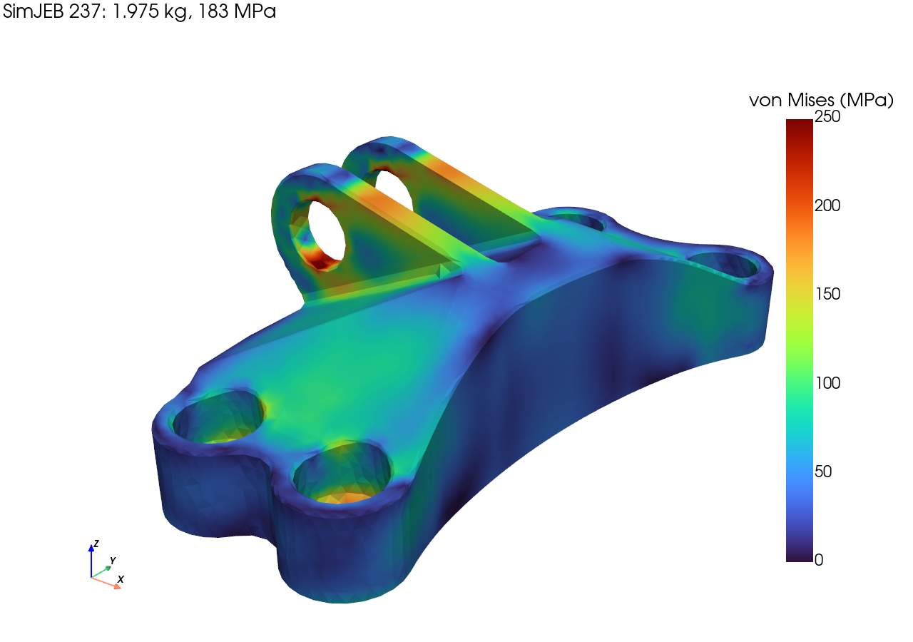
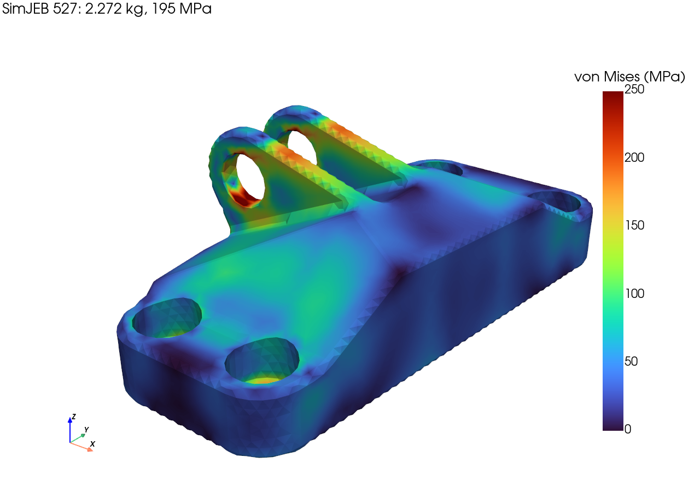
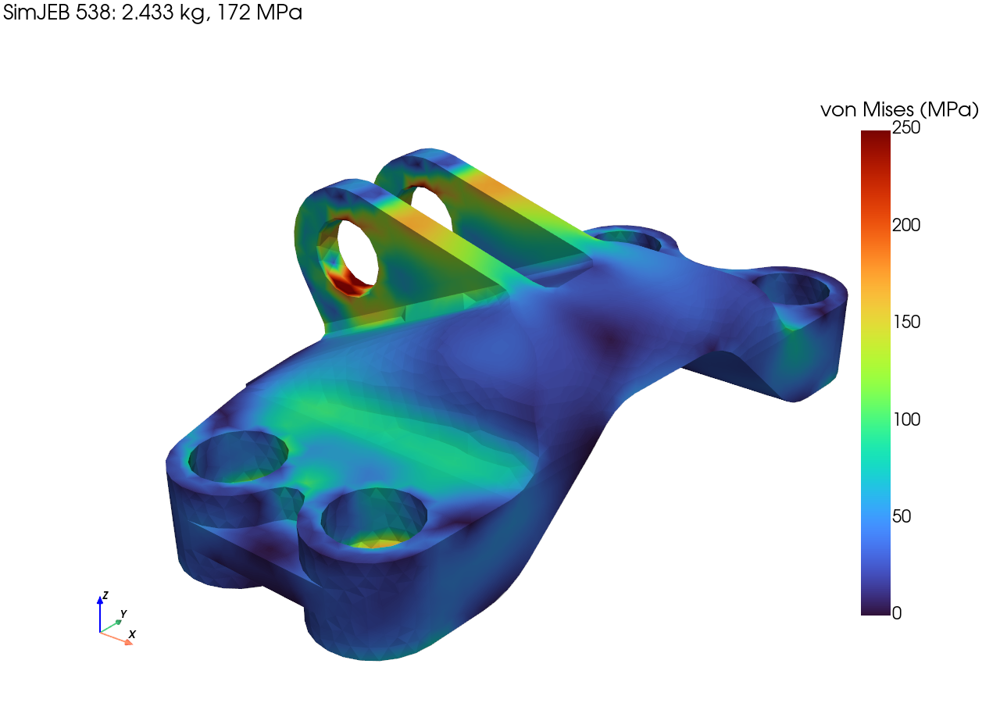

# Reglas de diseno del soporte (DESIGN_RULES)

Actualizado: 26/11/2026 13:12. Generado por `scripts/reglas.py` a partir de:

1. **Estudio de las soluciones publicadas** (SimJEB: los 381 disenos del GE Jet Engine Bracket Challenge, Whalen et al. 2021, doi:10.7910/DVN/XFUWJG) calculados con **nuestra** carga (42258 N en -X por el bulon, pernos empotrados) y **nuestro** limite (215 MPa, coef. de seguridad >= 1; desplazamiento <= 0.25 mm). Resultados: `estudio/estudio_simjeb.json`.
2. **Nuestros calculos anteriores** (familias vaciado y refuerzo, 294 disenos con 37 800 N; el modelo es lineal y se escalan x1.118). Datos: `estudio/calculos_anteriores.csv`.
3. **Lo que pasa al aplicarlas** en el optimizador (cada aplicacion: tension y masa antes/despues). Una regla que los datos de un cambio DIRECTO contradicen se DESACTIVA (las comparaciones con SimJEB, entre disenos distintos, pueden respaldarla o ser no concluyentes, pero no la desactivan); una que falla 8 veces sin ninguna mejora en el optimizador se SUSPENDE.

## Estudio de las soluciones publicadas

381 disenos calculados: **16 cumplen**, 281 no cumplen, 50 no tienen los agujeros del enunciado (bulon macizo o agujeros de otro tamano), 34 fallaron (malla). Los que superaban 1,5 veces el limite en la pasada rapida (malla gruesa) se descartaron sin calculo fino.

Los mas ligeros que cumplen (son la referencia de lo que se puede conseguir; NO se copian: la pieza final sale del original modificado paso a paso):

| SimJEB | masa | tension | desplaz. | tipo | material ocioso | pico en |
|---|---|---|---|---|---|---|
| 237 (Bol) | 1.975 kg | 183 MPa | 0.140 mm | block | 24 % | orejetas del bulon |
| 474 (Kiran Kumar A) | 2.236 kg | 197 MPa | 0.126 mm | block | 30 % | orejetas del bulon |
| 475 (Kiran Kumar A) | 2.241 kg | 212 MPa | 0.130 mm | block | 33 % | cuerpo, lado trasero (x >= 15 mm) |
| 527 (NIKHIL KHOBRAGADE) | 2.272 kg | 195 MPa | 0.128 mm | block | 34 % | orejetas del bulon |
| 476 (Kiran Kumar A) | 2.412 kg | 197 MPa | 0.122 mm | block | 37 % | orejetas del bulon |
| 538 (A0I0A) | 2.433 kg | 172 MPa | 0.134 mm | block | 34 % | orejetas del bulon |
| 537 (A0I0A) | 2.434 kg | 175 MPa | 0.133 mm | block | 34 % | orejetas del bulon |
| 86 (riyosketch) | 2.464 kg | 170 MPa | 0.132 mm | block | 32 % | orejetas del bulon |
| 211 (Michael Waugh) | 2.542 kg | 198 MPa | 0.155 mm | block | 35 % | alrededor de los pernos traseros |
| 180 (Tomek F.) | 2.570 kg | 195 MPa | 0.148 mm | block | 30 % | orejetas del bulon |
| 403 (Rafael) | 2.593 kg | 175 MPa | 0.119 mm | block | 42 % | orejetas del bulon |
| 233 (Farandy Angesti Liong) | 2.801 kg | 174 MPa | 0.138 mm | block | 43 % | alrededor de los pernos traseros |

     

## Restricciones que se cumplen siempre

- Coeficiente de seguridad >= 1 (215 MPa) y desplazamiento <= 0.25 mm, con la malla normal corregida a malla fina (calibracion medida en cada verificacion).
- Los 4 agujeros de los pernos y los 2 del bulon, intactos (se comprueba en cada pieza).
- **Simetria** respecto al plano medio de las orejetas: cada operacion se aplica tambien en su simetrico y un material solo es ocioso si tambien lo es en el lado simetrico (los agujeros de los pernos del enunciado no son simetricos: la pieza lo es salvo donde ellos lo impiden).
- Impresion 3D: sin voladizos de menos de 45 grados ni cavidades cerradas.

## Reglas

### R1. Aligeramiento pasante donde toda la columna de material esta ociosa  (ACTIVA)

- **Si:** toda la columna vertical (radio del agujero + 3 mm de margen) trabaja por debajo del umbral de material ocioso.
- **Hago:** agujero vertical pasante; paredes verticales (imprimible sin soportes); nunca en las zonas protegidas.
- **Porque:** ese material no esta en el camino de la carga (bulon -> orejetas -> cuerpo -> pernos). Un agujero en una zona a tension s multiplica la tension en su borde por Kt ~ 3 (placa con agujero circular, Kirsch): si todo alrededor esta por debajo del umbral u, el borde queda por debajo de ~3u del limite y el pico no cambia.
- **Espero:** baja la masa; la tension maxima casi no cambia.
- **Evidencia (respaldada por los datos):** en los 16 disenos publicados VALIDOS, la mitad mas ligera tiene un 25 % de material ocioso (por debajo del 15 % de su pico) frente al 51 % del original; en ese grupo, a mas material ocioso mas masa (Spearman +0.55). Agujeros pasantes: en ese grupo, a mas agujeros pasantes (genus de la malla) menos masa (Spearman -0.11, p = 0.69).
- **Aplicada en el optimizador:** 416 veces (27 descartadas en la evaluacion rapida, 188 aceptadas, 17 rechazadas); tension +1.9 % (mediana), masa -16 g (mediana).
  - calibracion de la evaluacion rapida (malla gruesa): cambio de tension previsto -0.0 % frente a +1.9 % real (mediana de 205)
  - iteracion 57: aceptada: aligeramiento pasante vertical D20 mm en (43, -68) (y su sim (tension +2.1 %, masa -60 g)
  - iteracion 59: aceptada: aligeramiento pasante vertical D16 mm en (37, -62) (y su sim (tension +1.8 %, masa -59 g)
  - iteracion 65: rechazada: aligeramiento pasante vertical D10 mm en (1, -41) (y su sime (tension +1.4 %, masa -34 g)
  - iteracion 66: aceptada: aligeramiento pasante vertical D10 mm en (4, -110) (y su sim (tension -3.1 %, masa -35 g)

Referencia: los 16 disenos publicados VALIDOS.

| | material ocioso (< 15 % de su propio pico) | masa |
|---|---|---|
| pieza original (SimJEB n.o 0) | 51 % | 2.423 kg |
| mediana del grupo de referencia (16) | 31 % | 2.503 kg |
| mediana de su mitad mas ligera (8) | 25 % | 2.342 kg |

Donde esta el material (cm3) - original frente a la mitad mas ligera del grupo de referencia:

| zona | original | referencia ligera (mediana) | exceso del original |
|---|---|---|---|
| alrededor de los pernos delanteros | 25 | 37 | -12 |
| alrededor de los pernos traseros | 24 | 37 | -12 |
| orejetas del bulon | 20 | 21 | -1 |
| placa base (z < 10 mm) | 67 | 45 | +21 |
| cuerpo, lado de las orejetas (x < 15 mm) | 70 | 56 | +14 |
| cuerpo, lado trasero (x >= 15 mm) | 103 | 96 | +6 |

### R2. Rebaje desde arriba de la capa ociosa  (ACTIVA)

- **Si:** todo el material por encima de una cota zc, en un rectangulo (con 4 mm de margen), esta por debajo del umbral.
- **Hago:** rebaje desde arriba hasta zc (suelo horizontal: imprimible) con esquinas redondeadas de radio = 20 % de su lado menor (3-8 mm); deja >= 5 mm de suelo y nunca una pared de menos de 5 mm al borde.
- **Porque:** material que no transmite carga: su tension es baja porque ni el momento de vuelco ni el cortante pasan por ahi. Quitarlo desde arriba no deja voladizos y no corta el camino de carga.
- **Espero:** baja la masa; la tension maxima casi no cambia.
- **Evidencia (respaldada por los datos):** en los 16 disenos publicados VALIDOS, la mitad mas ligera tiene un 25 % de material ocioso (por debajo del 15 % de su pico) frente al 51 % del original; en ese grupo, a mas material ocioso mas masa (Spearman +0.55).
- **Aplicada en el optimizador:** 38 veces (19 descartadas en la evaluacion rapida, 5 aceptadas, 6 rechazadas); tension +1.6 % (mediana), masa -47 g (mediana).
  - calibracion de la evaluacion rapida (malla gruesa): cambio de tension previsto +0.4 % frente a +1.6 % real (mediana de 11)
  - iteracion 50: rechazada: rebaje desde arriba hasta z = 5 mm en x -1..11, y -124..-112 (tension +7.1 %, masa -59 g)
  - iteracion 62: rechazada: rebaje desde arriba hasta z = 9 mm en x -9..11, y -44..-24 m (tension +63.0 %, masa -133 g)
  - iteracion 63: rechazada: rebaje desde arriba hasta z = 5 mm en x -1..15, y -120..-104 (tension +44.4 %, masa -107 g)
  - iteracion 64: rechazada: rebaje desde arriba hasta z = 5 mm en x -5..7, y -44..-24 mm (tension +64.0 %, masa -97 g)

Referencia: los 16 disenos publicados VALIDOS.

| | material ocioso (< 15 % de su propio pico) | masa |
|---|---|---|
| pieza original (SimJEB n.o 0) | 51 % | 2.423 kg |
| mediana del grupo de referencia (16) | 31 % | 2.503 kg |
| mediana de su mitad mas ligera (8) | 25 % | 2.342 kg |

Donde esta el material (cm3) - original frente a la mitad mas ligera del grupo de referencia:

| zona | original | referencia ligera (mediana) | exceso del original |
|---|---|---|---|
| alrededor de los pernos delanteros | 25 | 37 | -12 |
| alrededor de los pernos traseros | 24 | 37 | -12 |
| orejetas del bulon | 20 | 21 | -1 |
| placa base (z < 10 mm) | 67 | 45 | +21 |
| cuerpo, lado de las orejetas (x < 15 mm) | 70 | 56 | +14 |
| cuerpo, lado trasero (x >= 15 mm) | 103 | 96 | +6 |

### R3. Hueco interior en el nucleo ocioso (conservando las pieles)  (ACTIVA)

- **Si:** un bloque interior, a >= 4 mm de cualquier superficie, trabaja por debajo del umbral.
- **Hago:** hueco con techo a 45 grados y agujero de evacuacion D5 (impresion 3D).
- **Porque:** a flexion y torsion la tension crece con la distancia a la fibra neutra (s = M y / I, t = T r / J): el nucleo apenas trabaja y la rigidez la dan las pieles. Por eso las vigas son en I o en cajon.
- **Espero:** baja la masa; la tension sube poco (las pieles siguen).
- **Evidencia (respaldada por los datos):** en los 16 disenos publicados VALIDOS, la mitad mas ligera tiene un 25 % de material ocioso (por debajo del 15 % de su pico) frente al 51 % del original; en ese grupo, a mas material ocioso mas masa (Spearman +0.55). Huecos interiores cerrados en ese grupo: 1 de 16 (en el concurso no se podian dejar cavidades cerradas; aqui se dejan con evacuacion).
- **Aplicada en el optimizador:** 182 veces (1 descartadas en la evaluacion rapida, 2 aceptadas, 1 rechazadas); tension +1.5 % (mediana), masa -7 g (mediana).
  - calibracion de la evaluacion rapida (malla gruesa): cambio de tension previsto +0.0 % frente a +1.5 % real (mediana de 3)
  - iteracion 15: aceptada: hueco interior 12 x 16 x 8 mm (techo a 45 grados + evacuacio (tension +1.5 %, masa -5 g)
  - iteracion 14: rechazada: hueco interior 12 x 20 x 8 mm (techo a 45 grados + evacuacio (tension +1.5 %, masa -11 g)
  - iteracion 43: aceptada: hueco interior 12 x 16 x 8 mm (techo a 45 grados + evacuacio (tension +0.3 %, masa -7 g)

Referencia: los 16 disenos publicados VALIDOS.

| | material ocioso (< 15 % de su propio pico) | masa |
|---|---|---|
| pieza original (SimJEB n.o 0) | 51 % | 2.423 kg |
| mediana del grupo de referencia (16) | 31 % | 2.503 kg |
| mediana de su mitad mas ligera (8) | 25 % | 2.342 kg |

Donde esta el material (cm3) - original frente a la mitad mas ligera del grupo de referencia:

| zona | original | referencia ligera (mediana) | exceso del original |
|---|---|---|---|
| alrededor de los pernos delanteros | 25 | 37 | -12 |
| alrededor de los pernos traseros | 24 | 37 | -12 |
| orejetas del bulon | 20 | 21 | -1 |
| placa base (z < 10 mm) | 67 | 45 | +21 |
| cuerpo, lado de las orejetas (x < 15 mm) | 70 | 56 | +14 |
| cuerpo, lado trasero (x >= 15 mm) | 103 | 96 | +6 |

### R4. Collar de refuerzo en el perno donde esta el pico (y en su simetrico)  (ACTIVA)

- **Si:** el pico de tension esta junto al alojamiento de la cabeza de un perno.
- **Hago:** anillo de material alrededor del alojamiento (y del perno simetrico respecto al plano medio de las orejetas).
- **Porque:** la carga horizontal aplicada a 44,7 mm de altura crea un momento de vuelco (F x h ~ 1,9 kN m con 42 258 N) que la pieza lleva a los pernos; alrededor del alojamiento la seccion es pequena. Mas seccion -> menos tension (s ~ M / W). El soporte es simetrico respecto al plano medio de las orejetas (y ~ -75 mm): el perno simetrico trabaja igual.
- **Espero:** baja la tension maxima; sube un poco la masa.
- **Evidencia (respaldada por los datos):** prueba directa en ANSYS sobre el original (bitacora 22/11): collares de 6 mm -> pico de 238 a 203 MPa (-15 %) con +159 g (escalado lineal a 42258 N); en 228 disenos de la familia refuerzo, mas collar delantero -> menos tension (Spearman -0.25, p = 0.00014); material junto a los pernos delanteros: original 25 cm3, mediana del grupo de referencia 37 cm3; en 104 de 297 disenos publicados calculados el pico esta junto a un perno.
- **Aplicada en el optimizador:** 20 veces (0 descartadas en la evaluacion rapida, 1 aceptadas, 6 rechazadas); tension -3.1 % (mediana), masa +72 g (mediana).
  - calibracion de la evaluacion rapida (malla gruesa): cambio de tension previsto -0.1 % frente a -2.5 % real (mediana de 3)
  - iteracion 60: rechazada: collar de 4 mm en los pernos 4 y 2 (tension -3.1 %, masa +42 g)
  - iteracion 61: rechazada: collar de 6 mm en los pernos 4 y 2 (tension -4.3 %, masa +77 g)
  - iteracion 75: rechazada: collar de 4 mm en los pernos 4 y 2 (tension -2.3 %, masa +42 g)
  - iteracion 76: rechazada: collar de 6 mm en los pernos 4 y 2 (tension -2.5 %, masa +77 g)

### R5. Alojamiento de la cabeza mas ancho con acuerdo de fondo mayor  (DESACTIVADA: LOS DATOS LA CONTRADICEN)

- **Si:** el pico esta en el acuerdo del fondo del alojamiento de un perno (entalla).
- **Hago:** alojamiento de radio mayor con acuerdo de fondo R - 8 mm.
- **Porque:** hipotesis de partida: el factor de concentracion Kt baja al crecer el radio del acuerdo (Peterson). PERO agrandar el alojamiento tambien quita seccion justo donde esta el pico.
- **Espero:** segun la teoria del acuerdo, baja la tension; segun la seccion, la sube: deciden los datos.
- **Evidencia (CONTRADICHA por los datos):** en 294 disenos anteriores, alojamiento mas ancho -> MAS tension (Spearman +0.76, p = 8.7e-56; mediana 360 MPa con R > 11 mm frente a 206 MPa con el del original): pesa mas la seccion que se pierde que el acuerdo que se gana. Regla DESACTIVADA por los datos..

### R6. Redondear las aristas entrantes junto al pico  (ACTIVA)

- **Si:** el pico es una concentracion local (pico >= 1,8 veces la tension media a 12 mm) fuera de los alojamientos.
- **Hago:** acuerdo (redondeo) de las aristas a menos de 6 mm del pico (nunca las de los 6 agujeros fijos).
- **Porque:** una arista viva entrante es una entalla: Kt crece al bajar el radio (Peterson). Un acuerdo reparte la tension en mas material.
- **Espero:** baja la tension maxima con muy poca masa.
- **Evidencia (basada en la teoria / en sus resultados):** no se puede medir en las mallas publicadas (radios de acuerdo); regla basada en la teoria (Peterson) y en los resultados del propio optimizador.
- **Aplicada en el optimizador:** 3 veces (3 descartadas en la evaluacion rapida, 0 aceptadas, 0 rechazadas).

### R7. Engrosar el anillo de las orejetas  (ACTIVA)

- **Si:** el pico esta en las orejetas del bulon.
- **Hago:** anillo de material alrededor del bulon en las dos orejetas (mismo espesor).
- **Porque:** el bulon empuja la orejeta en la direccion de la carga; el ligamento delante del agujero trabaja a cortadura y aplastamiento (s ~ F / (2 t e)). Mas ligamento e -> menos tension.
- **Espero:** baja la tension en la orejeta; sube un poco la masa.
- **Evidencia (respaldada por los datos):** ligamento delante del bulon: original 7.5 mm, mediana de los 16 disenos publicados VALIDOS: 7.6 mm, y 7.5 mm en los 25 disenos cuyo pico esta en la orejeta.
- **Aplicada en el optimizador:** 8 veces (2 descartadas en la evaluacion rapida, 1 aceptadas, 2 rechazadas); tension +3.9 % (mediana), masa +23 g (mediana).
  - iteracion 39: inversion: anillo de las orejetas hasta radio 20.1 mm (ligamento 10.5 m (tension -4.2 %, masa +15 g)
  - iteracion 58: rechazada: anillo de las orejetas hasta radio 23.1 mm (ligamento 13.5 m (tension +4.3 %, masa +23 g)
  - iteracion 73: rechazada: anillo de las orejetas hasta radio 23.1 mm (ligamento 13.5 m (tension +3.9 %, masa +23 g)

### R8. Reponer material donde un corte anterior ha creado el pico  (ACTIVA)

- **Si:** el pico esta a menos de 4 mm de un corte hecho antes.
- **Hago:** se reduce ese corte (x0,6 de su tamano; si queda muy pequeno, se deshace).
- **Porque:** si el pico aparece en el borde de un corte, ese material SI estaba en el camino de carga: se devuelve solo ese material en vez de reforzar en otro sitio.
- **Espero:** baja la tension maxima; sube un poco la masa.
- **Evidencia (basada en la teoria / en sus resultados):** regla de procedimiento: se juzga por sus resultados en el optimizador.
- **Aplicada en el optimizador:** 2 veces (0 descartadas en la evaluacion rapida, 1 aceptadas, 0 rechazadas); tension -3.8 % (mediana), masa +40 g (mediana).
  - iteracion 55: inversion: reducir la operacion 4 (aligeramiento pasante vertical D16 m (tension -3.7 %, masa +40 g)

### R9. Cortar menos donde ya se rechazo un corte  (ACTIVA)

- **Si:** un corte se rechazo (tension por encima del limite o pieza peor).
- **Hago:** en esa zona solo se proponen cortes de como maximo 0,6 veces el tamano rechazado.
- **Porque:** el rechazo dice que ahi hay material que trabaja; un corte menor puede ser aceptable (busqueda por biseccion del tamano).
- **Espero:** evita repetir errores y aprovecha lo que si se pueda quitar.
- **Evidencia (basada en la teoria / en sus resultados):** regla de procedimiento: se juzga por sus resultados en el optimizador.

### R10. Subir el umbral de material ocioso cuando ya no queda donde quitar  (ACTIVA)

- **Si:** no hay ninguna zona por debajo del umbral actual donde quepa un corte.
- **Hago:** se pasa al siguiente umbral (15 %, 25 %, 35 %, 45 % del limite).
- **Porque:** se empieza por lo mas seguro (con Kt ~ 3, el borde de un corte en material al 15 % queda al ~45 %) y solo despues se aprovecha material que trabaja algo mas.
- **Espero:** permite seguir aligerando con un riesgo controlado.
- **Evidencia (basada en la teoria / en sus resultados):** regla de procedimiento: se juzga por sus resultados en el optimizador.

### R12. Acampanar la raiz de los collares  (ACTIVA)

- **Si:** la pieza esta en el limite de tension y tiene collares cilindricos (la union collar-cuerpo es una esquina viva).
- **Hago:** la parte baja de cada collar pasa a tronco de cono con la pared a 30 grados (hasta z = 16 mm); en los dos collares de la pareja simetrica.
- **Porque:** la union de un cilindro con el cuerpo es una entalla (esquina entrante a ~90 grados); con la pared inclinada la union es un angulo abierto (menor concentracion) y la base de los pernos se rigidiza, lo que reduce la flexion que llega a las orejetas. Compra margen de tension con poca masa, que luego se gasta aligerando.
- **Espero:** baja la tension maxima del orden de un 5 % con ~+2 % de masa (inversion).
- **Evidencia (respaldada por los datos):** prueba directa en ANSYS (24/11) sobre la pieza simetrica de 2,257 kg: collares acampanados a 30 grados hasta z = 16 mm -> pico de 202,1 a 190,7 MPa (-5,6 %) con +52 g (+2,3 %).
- **Aplicada en el optimizador:** 2 veces (0 descartadas en la evaluacion rapida, 2 aceptadas, 0 rechazadas); tension -5.6 % (mediana), masa +52 g (mediana).
  - iteracion 31: inversion: acampanar la raiz de los collares (30 grados hasta z = 16 mm (tension -5.6 %, masa +52 g)
  - iteracion 37: inversion: acampanar la raiz de los collares (30 grados hasta z = 16 mm (tension -5.6 %, masa +52 g)

### R16. Eliminar laminas finas que no trabajan  (ACTIVA)

- **Si:** una pared de la pieza mide menos de 2,5 mm (medido en el CAD con rayos hacia dentro) y trabaja por debajo del umbral.
- **Hago:** se quita con un vaciado que la abarca (techo a 45 grados si queda material encima; abierto por abajo si esta en la cara de apoyo).
- **Porque:** una lamina tan fina casi no aporta seccion (a flexion la rigidez de una pared va como el espesor al cubo), se imprime mal (paredes de menos de ~1 mm y filos en fusion de lecho de polvo) y la malla de 4 mm no la resuelve (elementos degenerados). Suelen quedar donde se cruzan dos cortes.
- **Espero:** baja algo la masa; la tension no cambia (la lamina no lleva carga) y la malla mejora.
- **Evidencia (basada en la teoria / en sus resultados):** medido en la pieza de la iteracion 56: 12 laminas de 0,8 a 2,3 mm (algunas con filo de 0,1-0,2 mm), casi todas en la cara de apoyo donde un bolsillo a 45 grados corta un aligeramiento, trabajando de media a 13-51 MPa.
- **Aplicada en el optimizador:** 5 veces (2 descartadas en la evaluacion rapida, 0 aceptadas, 0 rechazadas).

### R17. Unir dos aligeramientos separados por una pared fina que no trabaja  (SUSPENDIDA: 8 INTENTOS SIN NINGUNA MEJORA)

- **Si:** dos aligeramientos verticales quedan separados por una pared de menos de 5 mm que trabaja por debajo del umbral.
- **Hago:** ranura: la envolvente de los dos agujeros (vertical y pasante: imprimible).
- **Porque:** la pared entre dos agujeros cercanos no esta en el camino de la carga si trabaja poco; quitarla convierte dos huecos en una ranura con el borde mas suave (sin la pared fina entre ellos).
- **Espero:** baja la masa; la tension casi no cambia.
- **Evidencia (basada en la teoria / en sus resultados):** medido en la pieza de la iteracion 56: paredes de 4-5 mm entre aligeramientos con un maximo del 18-33 % del limite.
- **Aplicada en el optimizador:** 8 veces (0 descartadas en la evaluacion rapida, 0 aceptadas, 0 rechazadas).

### R18. Agrandar una forma pura cuyo borde no trabaja  (ACTIVA)

- **Si:** el material que se quitaria al agrandar un corte existente (agujero, ranura, bolsillo) trabaja por debajo del 75 % del limite.
- **Hago:** la MISMA forma, mas grande (radio +1,5 mm o 3 mm mas larga por cada extremo): la pieza sigue hecha de formas puras.
- **Porque:** es el crecimiento de contorno de la optimizacion evolutiva (ESO): se quita el material de baja tension en la frontera de un hueco que ya funciona, sin anadir huecos nuevos superpuestos (facil de fabricar: menos operaciones y formas simples).
- **Espero:** baja la masa; la tension sube poco si el borde de verdad no trabaja.
- **Evidencia (basada en la teoria / en sus resultados):** crecimiento de contorno de la optimizacion evolutiva de estructuras (ESO, Xie y Steven): se quita material de baja tension en la frontera de los huecos.
- **Aplicada en el optimizador:** 14 veces (0 descartadas en la evaluacion rapida, 4 aceptadas, 0 rechazadas); tension +1.1 % (mediana), masa -15 g (mediana).
  - calibracion de la evaluacion rapida (malla gruesa): cambio de tension previsto +0.0 % frente a +1.1 % real (mediana de 4)
  - iteracion 72: aceptada: agrandar: aligeramiento pasante vertical D13 mm en (4, -110) (tension +1.5 %, masa -26 g)
  - iteracion 74: aceptada: agrandar: bolsillo en ranura desde la cara de apoyo, 30 mm d (tension +0.7 %, masa -3 g)
  - iteracion 77: aceptada: agrandar: rebaje desde arriba hasta z = 9 mm en x 40..64, y  (tension -2.2 %, masa -3 g)
  - iteracion 78: aceptada: agrandar: ranura que une los aligeramientos de (42, -79) y ( (tension +2.4 %, masa -29 g)

### R13. Ventana pasante donde toda la columna (de la base a arriba) esta ociosa  (SUSPENDIDA: 8 INTENTOS SIN NINGUNA MEJORA)

- **Si:** todo el material de una zona rectangular, desde la cara de apoyo hasta arriba (con 4 mm de margen), trabaja por debajo del umbral de material ocioso.
- **Hago:** ventana pasante vertical con esquinas redondeadas (radio = 20 % del lado menor); paredes verticales: imprimible.
- **Porque:** la placa base apenas trabaja lejos de los pernos (en el original, el 85 % de su material esta por debajo del 15 % del limite): la carga baja por el cuerpo a los pernos y la placa entre ellos no esta en ese camino. Una ventana la quita entera, cosa que un rebaje (que deja suelo) o un agujero redondo no pueden hacer.
- **Espero:** baja la masa; la tension maxima casi no cambia (lejos de los picos).
- **Evidencia (respaldada por los datos):** placa base (z < 10 mm): original 67 cm3 con un 77 % de material ocioso; mediana de la mitad mas ligera de los 16 disenos publicados VALIDOS: 45 cm3.
- **Aplicada en el optimizador:** 8 veces (7 descartadas en la evaluacion rapida, 0 aceptadas, 1 rechazadas); tension +1.6 % (mediana), masa -49 g (mediana).
  - calibracion de la evaluacion rapida (malla gruesa): cambio de tension previsto +0.0 % frente a +1.6 % real (mediana de 1)
  - iteracion 27: rechazada: ventana pasante en x 6..38, y -80..-68 mm (esquinas R3) (y s (tension +1.6 %, masa -49 g)

### R14. Aliviar la cara de apoyo: bolsillos desde abajo donde la placa base no trabaja  (ACTIVA)

- **Si:** todo el material por debajo de una altura zt (desde la cara de apoyo, con 4 mm de margen) trabaja por debajo del umbral.
- **Hago:** bolsillo (ranura) abierto por abajo con techo a cuatro aguas a 45 grados (imprimible sin soportes); nunca junto a los pernos (alli la cabeza y la arandela necesitan apoyo).
- **Porque:** el soporte solo se sujeta por los pernos: la cara inferior lejos de ellos no apoya en nada en el modelo ni transmite carga. La placa base bajo el cuerpo esta ociosa aunque el cuerpo de encima trabaje, asi que se vacia desde abajo sin tocar el cuerpo (cara de apoyo aliviada, habitual en soportes atornillados); las ranuras dejan nervios entre ellas.
- **Espero:** baja la masa; la tension maxima casi no cambia.
- **Evidencia (respaldada por los datos):** placa base (z < 10 mm): original 67 cm3 con un 77 % de material ocioso; mediana de la mitad mas ligera de los 16 disenos publicados VALIDOS: 45 cm3.
- **Aplicada en el optimizador:** 26 veces (5 descartadas en la evaluacion rapida, 8 aceptadas, 5 rechazadas); tension +0.9 % (mediana), masa -20 g (mediana).
  - calibracion de la evaluacion rapida (malla gruesa): cambio de tension previsto +0.1 % frente a +0.9 % real (mediana de 13)
  - iteracion 48: rechazada: bolsillo desde la cara de apoyo 28 x 32 mm, hasta z = 12 mm  (tension +3.1 %, masa -22 g)
  - iteracion 49: rechazada: bolsillo desde la cara de apoyo 28 x 32 mm, hasta z = 12 mm  (tension +2.8 %, masa -26 g)
  - iteracion 52: aceptada: bolsillo desde la cara de apoyo 56 x 16 mm, hasta z = 6 mm ( (tension +1.0 %, masa -20 g)
  - iteracion 68: aceptada: bolsillo desde la cara de apoyo 28 x 64 mm, hasta z = 12 mm  (tension -0.9 %, masa -8 g)

### R11. Sustituir un bloque que trabaja poco por un nervio en la trayectoria de la carga (FORMA NUEVA)  (SUSPENDIDA: 9 INTENTOS SIN NINGUNA MEJORA)

- **Si:** un bloque trabaja por debajo del 45-60 % del limite (no es ocioso: lleva algo de carga) o un rebaje se rechazo porque ese material si trabajaba.
- **Hago:** se quita el bloque y se crean NERVIOS (paredes verticales, imprimibles, con acuerdo de 3 mm en la raiz): uno por cada familia de la carga (traccion y compresion) en su direccion principal, dimensionado para llevarla al 50 % del limite.
- **Porque:** Michell (1904): la estructura de volumen minimo que lleva una carga sigue las trayectorias de las tensiones principales, y su volumen es la integral de |s| dV dividida por la tension de trabajo. En un bloque macizo casi todo el material trabaja muy por debajo del limite; un nervio en la direccion de la carga lleva lo mismo (traccion/compresion, que aprovecha toda la seccion) con mucho menos material.
- **Espero:** baja la masa (bloque menos nervio); la tension sube algo, pero el nervio trabaja por debajo del limite.
- **Evidencia (basada en la teoria / en sus resultados):** NO CONCLUYENTE: entre los disenos publicados calculados con malla completa, los de nervios / arcos / vigas (9) tienen de mediana un 35 % de material ocioso y 1.048 kg, frente al 32 % y 2.119 kg de los tipo bloque (38). Teoria: Michell (1904), estructuras de volumen minimo.
- **Aplicada en el optimizador:** 9 veces (9 descartadas en la evaluacion rapida, 0 aceptadas, 0 rechazadas).

---
Las reglas R9 y R10 son de procedimiento (como aplicar las demas). La lista completa de iteraciones, con el antes y el despues de cada cambio, esta en `runs/opt_<carga>N/ITERACIONES.md`.
