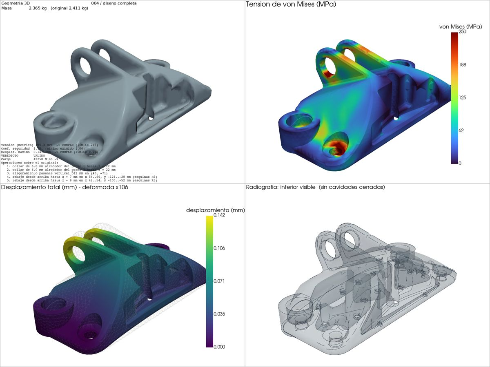

# Optimizacion del soporte guiada por reglas - panel en directo

> **Ultima actualizacion:** 23/11/2026 20:23 &nbsp;|&nbsp; **Estado:** EN MARCHA &nbsp;|&nbsp; carga **42258 N** &nbsp;|&nbsp; limite **215 MPa** (coef. de seguridad >= 1.00, obligatorio) y 0.25 mm &nbsp;|&nbsp; acero S235

La pieza parte del **0.stp del enunciado** y se modifica paso a paso: en cada iteracion una **regla de diseno** (sacada del estudio de las soluciones publicadas y de nuestros calculos, ver [DESIGN_RULES.md](DESIGN_RULES.md)) propone anadir material donde esta el pico, quitarlo donde no trabaja o **crear formas nuevas** (nervios en la direccion principal de tension, dimensionados con la carga que llevan), siempre **con su porque**; se prueba en ANSYS y se acepta o se revierte. Objetivo: **minima masa** con la tension y el desplazamiento como limites obligatorios. Cada cambio esta en [ITERACIONES.md](runs/opt_42258N/ITERACIONES.md).

| iteraciones | aceptadas | inversiones | rechazadas | sin cambio | descartadas en la evaluacion rapida |
|---|---|---|---|---|---|
| 4 | 4 | 0 | 0 | 0 | 7 |

## Mejor diseno

**2.3652 kg** (-2.4 % frente al original, 2.423 kg) &nbsp;|&nbsp; tension **195.3 MPa** &nbsp;|&nbsp; coef. seguridad **1.10** &nbsp;|&nbsp; desplazamiento **0.142 mm** &nbsp;|&nbsp; iteracion 4 &nbsp;|&nbsp; **malla fina: 212.9 MPa**

Operaciones sobre el original:

1. collar de 6.0 mm alrededor del perno 1 hasta z = 22 mm
2. collar de 6.0 mm alrededor del perno 3 hasta z = 22 mm
3. aligeramiento pasante vertical D12 mm en (40, -71)
4. rebaje desde arriba hasta z = 7 mm en x 54..66, y -124..-28 mm (esquinas R3)
5. rebaje desde arriba hasta z = 9 mm en x 42..54, y -100..-52 mm (esquinas R3)

Ultimo hito verificado (2.365 kg, iteracion 4): [Proyecto Workbench (.wbpz)](runs/opt_42258N/historial/05_it004_2.365kg/workbench/soporte_it004.wbpz) &nbsp;|&nbsp; [Geometria STEP](runs/opt_42258N/historial/05_it004_2.365kg/geometria.step)

## Camino de la pieza

Grafico interactivo: [evolucion_interactiva.html](runs/opt_42258N/evolucion_interactiva.html) &nbsp;|&nbsp; [Galeria de todas las piezas](runs/opt_42258N/GALERIA.md) &nbsp;|&nbsp; [Hitos con proyecto Workbench](runs/opt_42258N/HISTORIAL.md)

## Ultimas iteraciones

| iteracion | decision | regla | modificacion | resultado | motivo |
|---|---|---|---|---|---|
| 4 | ACEPTADA | R2 | rebaje desde arriba hasta z = 9 mm en x 42..54, y -100..-52 mm (esquin | 2.365 kg, 195 MPa | cumple y mejora al mejor (puntuacion 2.4126 -> 2.3652; masa 2.4126 -> 2.3652 kg) |
| 3 | ACEPTADA | R2 | rebaje desde arriba hasta z = 7 mm en x 54..66, y -124..-28 mm (esquin | 2.413 kg, 208 MPa | cumple y mejora al mejor (puntuacion 2.4704 -> 2.4126; masa 2.4704 -> 2.4126 kg) |
| 2 | ACEPTADA | R1 | aligeramiento pasante vertical D12 mm en (40, -71) | 2.470 kg, 196 MPa | cumple y mejora al mejor (puntuacion 2.5044 -> 2.4704; masa 2.5044 -> 2.4704 kg) |
| 1 | ACEPTADA | R4 | collar de 6 mm en los pernos 1 y 3 | 2.504 kg, 202 MPa | primera pieza que CUMPLE |
| 0 | INICIO | - | pieza del enunciado (0.stp) | 2.423 kg, 238 MPa | NO cumple (238 MPa > 215): primero hay que reforzar donde esta el pico |

---

**Como funciona:** estudio de las 381 soluciones publicadas (SimJEB) con nuestra carga -> reglas de diseno con datos -> el 0.stp se modifica paso a paso (cada cambio justificado por una regla) -> evaluacion rapida (malla gruesa) para descartar pronto -> evaluacion completa en ANSYS MAPDL (SOLID187, pernos empotrados, carga por RBE3) -> se acepta o se revierte. Hitos verificados con malla fina y con proyecto de Workbench (`.wbpz`: Workbench > File > Restore Archive).

Enfoque anterior (familias de piezas, 37 800 N, hasta el 23/11/2026): resultados solo en el PC (`runs/archivo/`); los datos que usan las reglas estan en `estudio/calculos_anteriores.csv`.
