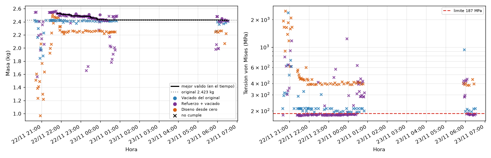

# Optimizacion del soporte - panel en directo

> **Ultima actualizacion:** 23/11/2026 06:33 &nbsp;|&nbsp; **Estado:** EN MARCHA &nbsp;|&nbsp; carga 37800 N &nbsp;|&nbsp; limites: 187 MPa (coef. seguridad >= 1.15 sobre sy = 215 MPa) y 0.25 mm &nbsp;|&nbsp; acero S235

| Familia | disenos calculados | cumplen | mejor masa | estado |
|---|---|---|---|---|
| Vaciado del original | 62 | 0 | - | en marcha |
| Refuerzo + vaciado | 126 | 25 | 2.422 kg (CS 1.17) | en marcha |
| Diseno desde cero | 61 | 0 | - | en marcha |

**Calculos ahorrados:** 0 descartados por el modelo sin ANSYS, 61 descartados en la pasada rapida, 27 piezas repetidas reutilizadas. **Fiabilidad del modelo de tension:** Vaciado del original: error tipico 5 % | Refuerzo + vaciado: error tipico 1 % | Diseno desde cero: error tipico 2 %

## Mejor diseno actual

**2.4224 kg** (-0.04 % de masa frente al original, 2.423 kg con el mismo modelo) &nbsp;|&nbsp; tension **183.1 MPa** &nbsp;|&nbsp; desplazamiento **0.128 mm** &nbsp;|&nbsp; coef. seguridad **1.17** &nbsp;|&nbsp; puntuacion **2.4148** &nbsp;|&nbsp; Refuerzo + vaciado, diseno 119 &nbsp;|&nbsp; calculado 2026-11-23 06:13 &nbsp;|&nbsp; **verificado con malla fina: 183.3 MPa**

[Proyecto Workbench (.wbpz)](runs/opt_37800N/historial/14_refuerzo_119_2.422kg/workbench/soporte_refuerzo_119.wbpz) &nbsp;|&nbsp; [Modelo APDL](runs/opt_37800N/historial/14_refuerzo_119_2.422kg/modelo_apdl.zip) &nbsp;|&nbsp; [Geometria STEP](runs/opt_37800N/historial/14_refuerzo_119_2.422kg/geometria.step)

## Evolucion en el tiempo

Grafico interactivo (hora y datos de cada punto al pasar el raton): [evolucion_interactiva.html](runs/opt_37800N/evolucion_interactiva.html) - descargar y abrir con el navegador (en el PC: doble clic en `runs/opt_37800N/evolucion_interactiva.html`).

**[Galeria: TODOS los disenos (validos y no validos) en orden cronologico](runs/opt_37800N/GALERIA.md)** - 249 fichas.

## Arbol genealogico de la busqueda

Detalle de cada rama: [ARBOL.md](runs/opt_37800N/ARBOL.md)

## Historial de mejoras (todas; la mas reciente arriba)

| n | hora | masa | mejora | tension | desplaz. | familia / diseno | proyecto | ficha |
|---|---|---|---|---|---|---|---|---|
| 15 | 23/11 06:14 | 2.4224 kg | -0.25 % (punt.) | 183.1 MPa | 0.128 mm | Refuerzo + vaciado 119 | [Workbench](runs/opt_37800N/historial/14_refuerzo_119_2.422kg/workbench/soporte_refuerzo_119.wbpz) |  |
| 14 | 23/11 00:18 | 2.4278 kg | -0.26 % (punt.) | 183.5 MPa | 0.128 mm | Refuerzo + vaciado 085 | [Workbench](runs/opt_37800N/historial/13_refuerzo_085_2.428kg/workbench/soporte_refuerzo_085.wbpz) |  |
| 13 | 22/11 23:51 | 2.4356 kg | -0.28 % (punt.) | 182.7 MPa | 0.128 mm | Refuerzo + vaciado 071 | [Workbench](runs/opt_37800N/historial/12_refuerzo_071_2.436kg/workbench/soporte_refuerzo_071.wbpz) |  |
| 12 | 22/11 23:48 | 2.4427 kg | -0.42 % (punt.) | 182.6 MPa | 0.127 mm | Refuerzo + vaciado 070 | [Workbench](runs/opt_37800N/historial/11_refuerzo_070_2.443kg/workbench/soporte_refuerzo_070.wbpz) |  |
| 11 | 22/11 23:37 | 2.4587 kg | -0.10 % (punt.) | 179.8 MPa | 0.127 mm | Refuerzo + vaciado 066 | [Workbench](runs/opt_37800N/historial/10_refuerzo_066_2.459kg/workbench/soporte_refuerzo_066.wbpz) |  |
| 10 | 22/11 23:34 | 2.4605 kg | -0.13 % (punt.) | 180.2 MPa | 0.127 mm | Refuerzo + vaciado 065 | [Workbench](runs/opt_37800N/historial/09_refuerzo_065_2.460kg/workbench/soporte_refuerzo_065.wbpz) |  |
| 9 | 22/11 23:29 | 2.4635 kg | -0.98 % (punt.) | 180.3 MPa | 0.127 mm | Refuerzo + vaciado 063 | [Workbench](runs/opt_37800N/historial/08_refuerzo_063_2.463kg/workbench/soporte_refuerzo_063.wbpz) |  |
| 8 | 22/11 23:10 | 2.4879 kg | -0.03 % (punt.) | 180.3 MPa | 0.126 mm | Refuerzo + vaciado 054 | [Workbench](runs/opt_37800N/historial/07_refuerzo_054_2.488kg/workbench/soporte_refuerzo_054.wbpz) |  |
| 7 | 22/11 22:56 | 2.4885 kg | -0.17 % (punt.) | 180.4 MPa | 0.126 mm | Refuerzo + vaciado 049 | [Workbench](runs/opt_37800N/historial/06_refuerzo_049_2.488kg/workbench/soporte_refuerzo_049.wbpz) |  |
| 6 | 22/11 22:40 | 2.4937 kg | -0.20 % (punt.) | 179.8 MPa | 0.126 mm | Refuerzo + vaciado 043 | [Workbench](runs/opt_37800N/historial/05_refuerzo_043_2.494kg/workbench/soporte_refuerzo_043.wbpz) |  |
| 5 | 22/11 22:30 | 2.4929 kg | -0.27 % (punt.) | 182.6 MPa | 0.126 mm | Refuerzo + vaciado 039 | registrado |  |
| 4 | 22/11 22:23 | 2.5048 kg | -0.36 % (punt.) | 180.0 MPa | 0.125 mm | Refuerzo + vaciado 037 | registrado |  |
| 3 | 22/11 22:07 | 2.5104 kg | -0.00 % (punt.) | 181.7 MPa | 0.125 mm | Refuerzo + vaciado 029 | - |  |
| 2 | 22/11 21:58 | 2.5153 kg | -0.51 % (punt.) | 179.4 MPa | 0.125 mm | Refuerzo + vaciado 027 | registrado |  |
| 1 | 22/11 21:47 | 2.5278 kg | - | 179.6 MPa | 0.124 mm | Refuerzo + vaciado 023 | registrado |  |

## Ultimos disenos calculados

| familia | # | masa | tension | resultado | motivo | ficha |
|---|---|---|---|---|---|---|
| Refuerzo + vaciado | 126 | 2.411 | 184.6 | cerca_del_limite | [rama R1.1.1.1] varios pasos sin mejora: paso mas corto (0.03); cambia | [ver](runs/opt_37800N/galeria/20261123_063322_refuerzo_126_CASI_2.411kg.jpg) |
| Vaciado del original | 062 | 2.409 | 211.5 | descartado | [rama V1.2] [aun sin disenos validos] pequeno cambio alrededor del mej | [ver](runs/opt_37800N/galeria/20261123_063127_vaciado_062_NO_VALIDO_2.409kg.jpg) |
| Refuerzo + vaciado | 125 | 2.411 | 184.5 | cerca_del_limite | [rama R1.1.1.1] pequeno cambio alrededor del mejor de la rama (paso 0. | [ver](runs/opt_37800N/galeria/20261123_063025_refuerzo_125_CASI_2.411kg.jpg) |
| Refuerzo + vaciado | 124 | 2.426 | 180.1 | cerca_del_limite | [rama R1.1.1.1] pequeno cambio alrededor del mejor de la rama (paso 0. | [ver](runs/opt_37800N/galeria/20261123_062826_refuerzo_124_CASI_2.426kg.jpg) |
| Diseno desde cero | 061 | 2.222 | 394.2 | descartado | [rama C1.2] [aun sin disenos validos] varios pasos sin mejora: paso ma | [ver](runs/opt_37800N/galeria/20261123_062626_cero_061_NO_VALIDO_2.222kg.jpg) |
| Refuerzo + vaciado | 123 | 0.000 | - | fallido | [rama R1.1.1.1] varios pasos sin mejora: paso mas corto (0.05); cambia | [ver](runs/opt_37800N/galeria/20261123_062538_refuerzo_123_FALLO_0.000kg.jpg) |
| Vaciado del original | 061 | 2.388 | 210.6 | descartado | [rama V1.2] [aun sin disenos validos] pequeno cambio alrededor del mej | [ver](runs/opt_37800N/galeria/20261123_062523_vaciado_061_NO_VALIDO_2.388kg.jpg) |
| Refuerzo + vaciado | 122 | 2.424 | 182.6 | valido | [rama R1.1.1.1] varios pasos sin mejora: paso mas corto (0.05); cambia | [ver](runs/opt_37800N/galeria/20261123_062426_refuerzo_122_VALIDO_2.424kg.jpg) |
| Refuerzo + vaciado | 121 | 2.428 | 180.7 | valido | [rama R1.1.1.1] pequeno cambio alrededor del mejor de la rama (paso 0. | [ver](runs/opt_37800N/galeria/20261123_062324_refuerzo_121_VALIDO_2.428kg.jpg) |
| Diseno desde cero | 060 | 2.069 | 442.3 | descartado | [rama C1.2] [aun sin disenos validos] pequeno cambio alrededor del mej | [ver](runs/opt_37800N/galeria/20261123_062223_cero_060_NO_VALIDO_2.069kg.jpg) |

---

**Como funciona:** el programa prueba dos familias de piezas (vaciado del original y diseno desde cero). Tras un reparto inicial, aprende con modelos sustitutos (procesos gaussianos) y propone pequenos cambios alrededor del mejor diseno: si mejora, sigue por esa linea y alarga el paso; si no, lo acorta. Cada diseno se calcula en ANSYS MAPDL (SOLID187, pernos empotrados, carga por RBE3). Cada nuevo mejor genera un proyecto de Workbench listo para abrir.

**Abrir un proyecto:** descargar el `.wbpz` > Workbench > File > Restore Archive. Todo el detalle esta en `bitacora.md`; cada diseno en `runs/`.
