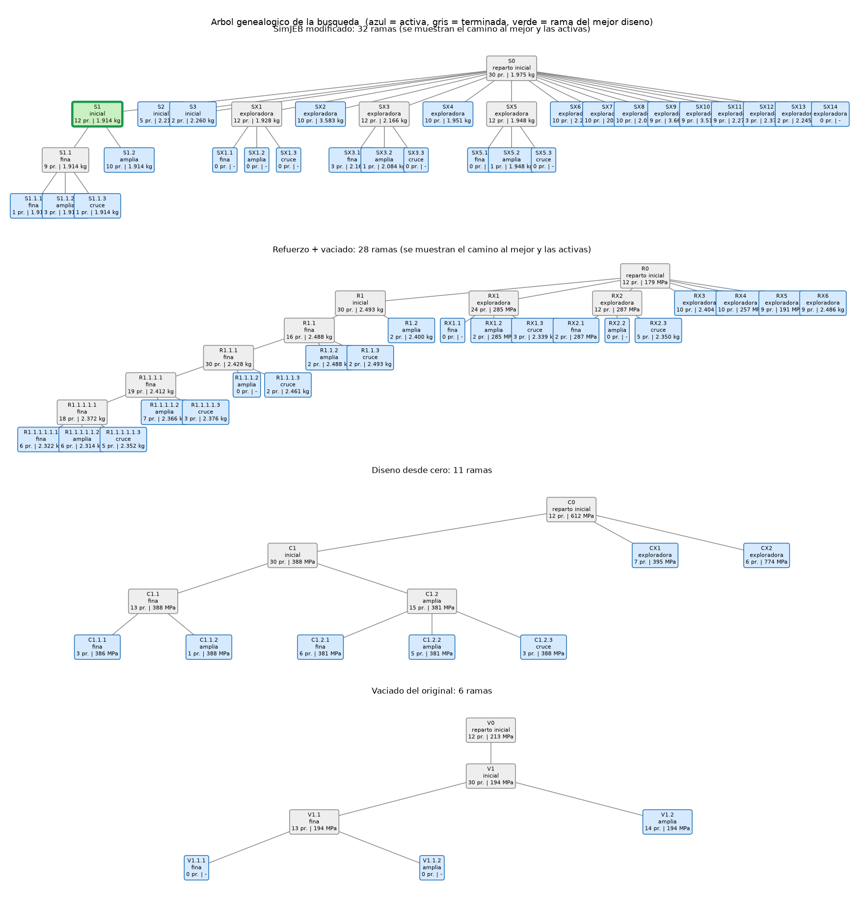
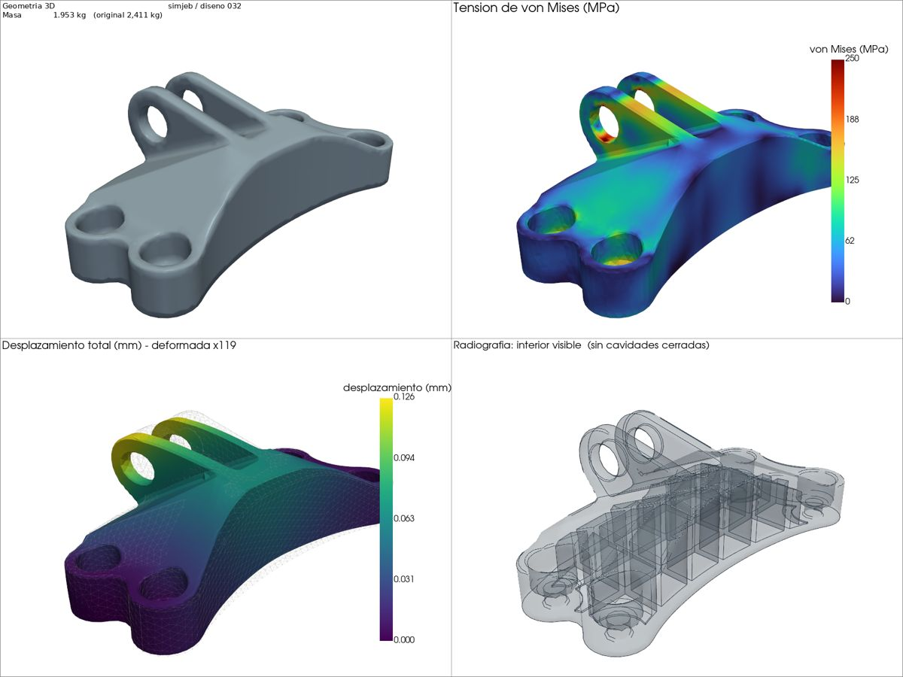
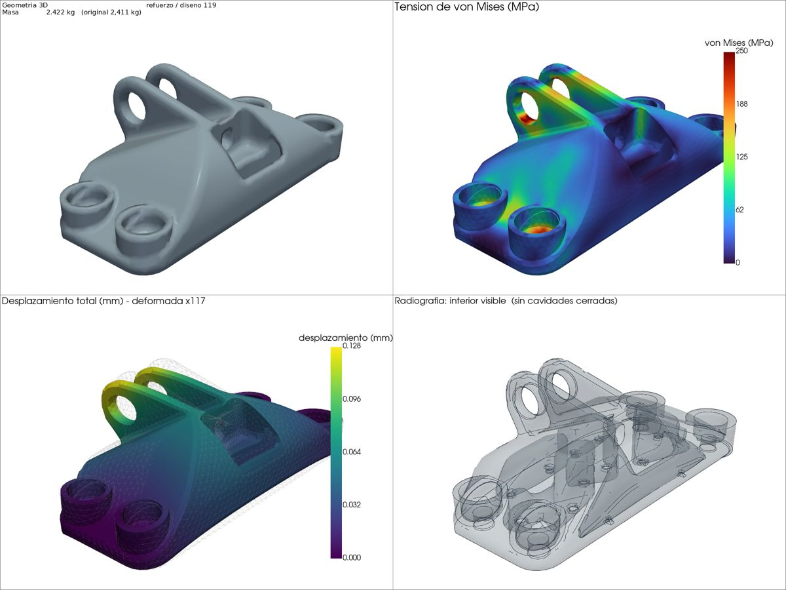
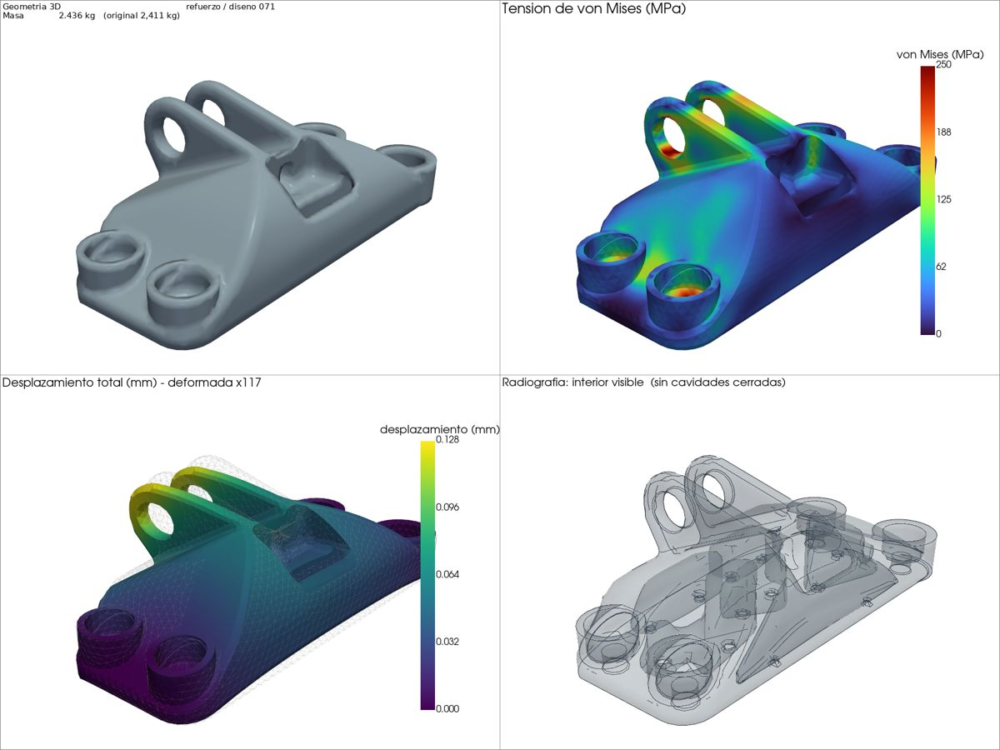
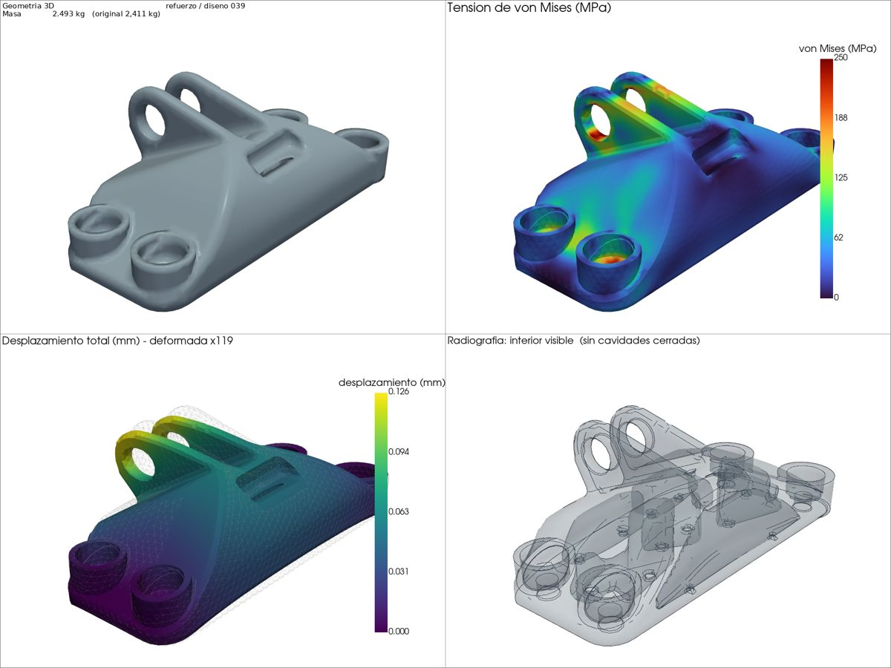

# Optimizacion del soporte - panel en directo

> **Ultima actualizacion:** 23/11/2026 14:02 &nbsp;|&nbsp; **Estado:** EN MARCHA &nbsp;|&nbsp; carga 37800 N &nbsp;|&nbsp; limites: 187 MPa (coef. seguridad >= 1.15 sobre sy = 215 MPa) y 0.25 mm &nbsp;|&nbsp; acero S235

| Familia | disenos calculados | cumplen | mejor masa | estado |
|---|---|---|---|---|
| SimJEB modificado | 196 | 44 | 1.914 kg (CS 1.30) | en marcha |
| Refuerzo + vaciado | 246 | 77 | 2.314 kg (CS 1.15) | en marcha |
| Diseno desde cero | 101 | 0 | - | en marcha |
| Vaciado del original | 69 | 0 | - | terminada: retirada: 62 disenos sin ninguno valido; sus operaciones ya estan dentro de la familia refuerzo |

**Calculos ahorrados:** 0 descartados por el modelo sin ANSYS, 100 descartados en la pasada rapida, 55 piezas repetidas reutilizadas. **Fiabilidad del modelo de tension:** SimJEB modificado: error tipico 7 % | Refuerzo + vaciado: error tipico 12 % | Diseno desde cero: error tipico 5 % | Vaciado del original: error tipico 4 %

## Mejor diseno actual

**1.9136 kg** (-21.04 % de masa frente al original, 2.423 kg con el mismo modelo) &nbsp;|&nbsp; tension **165.3 MPa** &nbsp;|&nbsp; desplazamiento **0.130 mm** &nbsp;|&nbsp; coef. seguridad **1.30** &nbsp;|&nbsp; puntuacion **1.8786** &nbsp;|&nbsp; SimJEB modificado, diseno 037 &nbsp;|&nbsp; calculado 2026-11-23 08:20 &nbsp;|&nbsp; **verificado con malla fina: 169.2 MPa**

[Proyecto Workbench (.wbpz)](runs/opt_37800N/historial/23_simjeb_037_1.914kg/workbench/soporte_simjeb_037.wbpz) &nbsp;|&nbsp; [Modelo APDL](runs/opt_37800N/historial/23_simjeb_037_1.914kg/modelo_apdl.zip) &nbsp;|&nbsp; [Geometria STEP](runs/opt_37800N/historial/23_simjeb_037_1.914kg/geometria.step)

## Evolucion en el tiempo

Grafico interactivo (hora y datos de cada punto al pasar el raton): [evolucion_interactiva.html](runs/opt_37800N/evolucion_interactiva.html) - descargar y abrir con el navegador (en el PC: doble clic en `runs/opt_37800N/evolucion_interactiva.html`).

**[Galeria: TODOS los disenos (validos y no validos) en orden cronologico](runs/opt_37800N/GALERIA.md)** - 612 fichas.

## Arbol genealogico de la busqueda

Detalle de cada rama: [ARBOL.md](runs/opt_37800N/ARBOL.md)

## Historial de mejoras (todas; la mas reciente arriba)

| n | hora | masa | mejora | tension | desplaz. | familia / diseno | proyecto | ficha |
|---|---|---|---|---|---|---|---|---|
| 24 | 23/11 08:21 | 1.9136 kg | -0.61 % (punt.) | 165.3 MPa | 0.130 mm | SimJEB modificado 037 | [Workbench](runs/opt_37800N/historial/23_simjeb_037_1.914kg/workbench/soporte_simjeb_037.wbpz) |  |
| 23 | 23/11 08:14 | 1.9213 kg | -1.56 % (punt.) | 167.7 MPa | 0.127 mm | SimJEB modificado 033 | [Workbench](runs/opt_37800N/historial/22_simjeb_033_1.921kg/workbench/soporte_simjeb_033.wbpz) |  |
| 22 | 23/11 08:09 | 1.9527 kg | -8.28 % (punt.) | 167.2 MPa | 0.126 mm | SimJEB modificado 032 | [Workbench](runs/opt_37800N/historial/21_simjeb_032_1.953kg/workbench/soporte_simjeb_032.wbpz) |  |
| 21 | 23/11 08:06 | 2.1321 kg | -11.16 % (punt.) | 165.5 MPa | 0.121 mm | SimJEB modificado 031 | [Workbench](runs/opt_37800N/historial/20_simjeb_031_2.132kg/workbench/soporte_simjeb_031.wbpz) |  |
| 20 | 23/11 07:56 | 2.3657 kg | -0.52 % (punt.) | 182.2 MPa | 0.128 mm | Refuerzo + vaciado 162 | [Workbench](runs/opt_37800N/historial/19_refuerzo_162_2.366kg/workbench/soporte_refuerzo_162.wbpz) |  |
| 19 | 23/11 07:08 | 2.3720 kg | -0.26 % (punt.) | 185.4 MPa | 0.130 mm | Refuerzo + vaciado 142 | [Workbench](runs/opt_37800N/historial/18_refuerzo_142_2.372kg/workbench/soporte_refuerzo_142.wbpz) |  |
| 18 | 23/11 07:02 | 2.3777 kg | -0.55 % (punt.) | 185.6 MPa | 0.129 mm | Refuerzo + vaciado 140 | [Workbench](runs/opt_37800N/historial/17_refuerzo_140_2.378kg/workbench/soporte_refuerzo_140.wbpz) |  |
| 17 | 23/11 06:48 | 2.3920 kg | -0.78 % (punt.) | 185.0 MPa | 0.129 mm | Refuerzo + vaciado 132 | [Workbench](runs/opt_37800N/historial/16_refuerzo_132_2.392kg/workbench/soporte_refuerzo_132.wbpz) |  |
| 16 | 23/11 06:35 | 2.4121 kg | -0.33 % (punt.) | 184.3 MPa | 0.128 mm | Refuerzo + vaciado 127 | [Workbench](runs/opt_37800N/historial/15_refuerzo_127_2.412kg/workbench/soporte_refuerzo_127.wbpz) |  |
| 15 | 23/11 06:14 | 2.4224 kg | -0.25 % (punt.) | 183.1 MPa | 0.128 mm | Refuerzo + vaciado 119 | [Workbench](runs/opt_37800N/historial/14_refuerzo_119_2.422kg/workbench/soporte_refuerzo_119.wbpz) |  |
| 14 | 23/11 00:18 | 2.4278 kg | -0.26 % (punt.) | 183.5 MPa | 0.128 mm | Refuerzo + vaciado 085 | registrado |  |
| 13 | 22/11 23:51 | 2.4356 kg | -0.28 % (punt.) | 182.7 MPa | 0.128 mm | Refuerzo + vaciado 071 | registrado |  |
| 12 | 22/11 23:48 | 2.4427 kg | -0.42 % (punt.) | 182.6 MPa | 0.127 mm | Refuerzo + vaciado 070 | registrado |  |
| 11 | 22/11 23:37 | 2.4587 kg | -0.10 % (punt.) | 179.8 MPa | 0.127 mm | Refuerzo + vaciado 066 | registrado |  |
| 10 | 22/11 23:34 | 2.4605 kg | -0.13 % (punt.) | 180.2 MPa | 0.127 mm | Refuerzo + vaciado 065 | registrado |  |
| 9 | 22/11 23:29 | 2.4635 kg | -0.98 % (punt.) | 180.3 MPa | 0.127 mm | Refuerzo + vaciado 063 | registrado |  |
| 8 | 22/11 23:10 | 2.4879 kg | -0.03 % (punt.) | 180.3 MPa | 0.126 mm | Refuerzo + vaciado 054 | registrado |  |
| 7 | 22/11 22:56 | 2.4885 kg | -0.17 % (punt.) | 180.4 MPa | 0.126 mm | Refuerzo + vaciado 049 | registrado |  |
| 6 | 22/11 22:40 | 2.4937 kg | -0.20 % (punt.) | 179.8 MPa | 0.126 mm | Refuerzo + vaciado 043 | registrado |  |
| 5 | 22/11 22:30 | 2.4929 kg | -0.27 % (punt.) | 182.6 MPa | 0.126 mm | Refuerzo + vaciado 039 | registrado |  |
| 4 | 22/11 22:23 | 2.5048 kg | -0.36 % (punt.) | 180.0 MPa | 0.125 mm | Refuerzo + vaciado 037 | registrado |  |
| 3 | 22/11 22:07 | 2.5104 kg | -0.00 % (punt.) | 181.7 MPa | 0.125 mm | Refuerzo + vaciado 029 | - |  |
| 2 | 22/11 21:58 | 2.5153 kg | -0.51 % (punt.) | 179.4 MPa | 0.125 mm | Refuerzo + vaciado 027 | registrado |  |
| 1 | 22/11 21:47 | 2.5278 kg | - | 179.6 MPa | 0.124 mm | Refuerzo + vaciado 023 | registrado |  |

## Ultimos disenos calculados

| familia | # | masa | tension | resultado | motivo | ficha |
|---|---|---|---|---|---|---|
| Refuerzo + vaciado | 246 | 2.714 | 184.8 | valido | [rama RX6] el ultimo paso mejoro: sigue en esa linea (paso 0.60); camb | [ver](runs/opt_37800N/galeria/20261123_140206_refuerzo_246_VALIDO_2.714kg.jpg) |
| SimJEB modificado | 196 | 1.717 | 339.9 | descartado | [rama SX12] pequeno cambio alrededor del mejor de la rama (paso 0.30); | [ver](runs/opt_37800N/galeria/20261123_140056_simjeb_196_NO_VALIDO_1.717kg.jpg) |
| SimJEB modificado | 195 | 1.865 | 490.9 | descartado | [rama SX13] pequeno cambio alrededor del mejor de la rama (paso 0.30); | [ver](runs/opt_37800N/galeria/20261123_135948_simjeb_195_NO_VALIDO_1.865kg.jpg) |
| Refuerzo + vaciado | 245 | 2.478 | 191.2 | cerca_del_limite | [rama RX5] [aun sin disenos validos] pequeno cambio alrededor del mejo | [ver](runs/opt_37800N/galeria/20261123_135903_refuerzo_245_CASI_2.478kg.jpg) |
| SimJEB modificado | 194 | 1.734 | 214.8 | descartado | [rama SX12] pequeno cambio alrededor del mejor de la rama (paso 0.30); | [ver](runs/opt_37800N/galeria/20261123_135755_simjeb_194_NO_VALIDO_1.734kg.jpg) |
| SimJEB modificado | 193 | 2.245 | 174.1 | valido | [rama SX13] exploradora: punto al azar en una zona nunca probada (a 1. | [ver](runs/opt_37800N/galeria/20261123_135708_simjeb_193_VALIDO_2.245kg.jpg) |
| Diseno desde cero | 101 | 2.242 | 386.2 | descartado | [rama C1.1.1] [aun sin disenos validos] pequeno cambio alrededor del m | [ver](runs/opt_37800N/galeria/20261123_135622_cero_101_NO_VALIDO_2.242kg.jpg) |
| Refuerzo + vaciado | 244 | 2.486 | 184.5 | valido | [rama RX6] [aun sin disenos validos] varios pasos sin mejora: paso mas | [ver](runs/opt_37800N/galeria/20261123_135537_refuerzo_244_VALIDO_2.486kg.jpg) |
| SimJEB modificado | 192 | 1.737 | 254.9 | descartado | [rama SX5.2] rama nueva (amplia, paso 0.35) desde el diseno 102; cambi | [ver](runs/opt_37800N/galeria/20261123_135424_simjeb_192_NO_VALIDO_1.737kg.jpg) |
| SimJEB modificado | 191 | 1.967 | 164.1 | valido | [rama S1.1.2] pequeno cambio alrededor del mejor de la rama (paso 0.35 | [ver](runs/opt_37800N/galeria/20261123_135319_simjeb_191_VALIDO_1.967kg.jpg) |

---

**Como funciona:** el programa prueba varias familias de piezas (disenos del concurso GE/SimJEB modificados, refuerzo + vaciado del original y diseno desde cero). Tras un reparto inicial, aprende con modelos sustitutos (procesos gaussianos) y propone cambios alrededor del mejor diseno: si mejora, sigue por esa linea y alarga el paso; si no, lo acorta; ramas exploradoras y anti-estancamiento saltan a zonas nuevas. Cada diseno se calcula en ANSYS MAPDL (SOLID187, pernos empotrados, carga por RBE3). Cada nuevo mejor genera un proyecto de Workbench listo para abrir.

**Abrir un proyecto:** descargar el `.wbpz` > Workbench > File > Restore Archive. Todo el detalle esta en `bitacora.md`; cada diseno en `runs/`.
