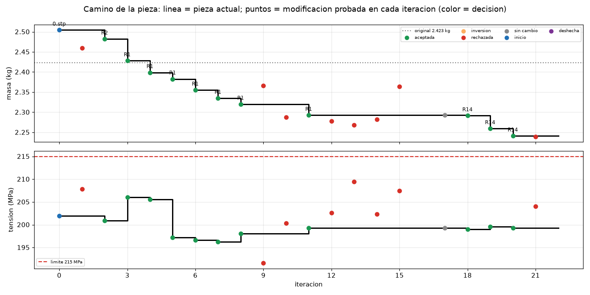

# Optimizacion del soporte guiada por reglas - panel en directo

> **Ultima actualizacion:** 24/11/2026 12:11 &nbsp;|&nbsp; **Estado:** EN MARCHA &nbsp;|&nbsp; carga **42258 N** &nbsp;|&nbsp; limite **215 MPa** (coef. de seguridad >= 1.00, obligatorio) y 0.25 mm &nbsp;|&nbsp; acero S235

La pieza parte del **0.stp del enunciado** y se modifica paso a paso: en cada iteracion una **regla de diseno** (sacada del estudio de las soluciones publicadas y de nuestros calculos, ver [DESIGN_RULES.md](DESIGN_RULES.md)) propone anadir material donde esta el pico, quitarlo donde no trabaja o **crear formas nuevas** (nervios en la direccion principal de tension, dimensionados con la carga que llevan), siempre **con su porque**; se prueba en ANSYS y se acepta o se revierte. Objetivo: **minima masa** con la tension y el desplazamiento como limites obligatorios. Cada cambio esta en [ITERACIONES.md](runs/opt_42258N/ITERACIONES.md).

| iteraciones | aceptadas | inversiones | rechazadas | sin cambio | descartadas en la evaluacion rapida |
|---|---|---|---|---|---|
| 22 | 11 | 0 | 8 | 2 | 27 |

## Mejor diseno

**2.2410 kg** (-7.5 % frente al original, 2.423 kg) &nbsp;|&nbsp; tension **199.3 MPa** &nbsp;|&nbsp; coef. seguridad **1.08** &nbsp;|&nbsp; desplazamiento **0.146 mm** &nbsp;|&nbsp; iteracion 20

Operaciones sobre el original:

1. collar de 6.0 mm alrededor del perno 1 hasta z = 22 mm
2. collar de 6.0 mm alrededor del perno 3 hasta z = 22 mm
3. rebaje desde arriba hasta z = 9 mm en x 42..62, y -80..-68 mm (esquinas R3) (y su simetrico)
4. aligeramiento pasante vertical D16 mm en (49, -56) (y su simetrico)
5. aligeramiento pasante vertical D12 mm en (4, -74) (y su simetrico)
6. aligeramiento pasante vertical D16 mm en (64, -32) (y su simetrico)
7. aligeramiento pasante vertical D16 mm en (-26, -29) (y su simetrico)
8. aligeramiento pasante vertical D10 mm en (28, -74) (y su simetrico)
9. aligeramiento pasante vertical D10 mm en (19, -74) (y su simetrico)
10. aligeramiento pasante vertical D8 mm en (43, -44) (y su simetrico)
11. bolsillo desde la cara de apoyo 8 x 16 mm, hasta z = 12 mm (techo a 45 grados) en (14, -44) (y su simetrico)
12. bolsillo desde la cara de apoyo 28 x 24 mm, hasta z = 10 mm (techo a 45 grados) en (16, -100) (y su simetrico)
13. bolsillo desde la cara de apoyo 36 x 20 mm, hasta z = 7 mm (techo a 45 grados) en (20, -110) (y su simetrico)

Ultimo hito verificado (2.259 kg, iteracion 19): [Proyecto Workbench (.wbpz)](runs/opt_42258N/historial/07_it019_2.259kg/workbench/soporte_it019.wbpz) &nbsp;|&nbsp; [Geometria STEP](runs/opt_42258N/historial/07_it019_2.259kg/geometria.step)

## Camino de la pieza

Grafico interactivo: [evolucion_interactiva.html](runs/opt_42258N/evolucion_interactiva.html) &nbsp;|&nbsp; [Galeria de todas las piezas](runs/opt_42258N/GALERIA.md) &nbsp;|&nbsp; [Hitos con proyecto Workbench](runs/opt_42258N/HISTORIAL.md)

## Ultimas iteraciones

| iteracion | decision | regla | modificacion | resultado | motivo |
|---|---|---|---|---|---|
| 22 | SIN CAMBIO | - | - | - | todas las modificaciones propuestas se descartaron en la evaluacion rapida |
| 21 | RECHAZADA | R14 | bolsillo desde la cara de apoyo 24 x 24 mm, hasta z = 10 mm (techo a 4 | 2.239 kg, 204 MPa | no cumple: 204.0 MPa con la malla normal, que corregidos a malla fina (x1.069) son 218.2 M |
| 20 | ACEPTADA | R14 | bolsillo desde la cara de apoyo 36 x 20 mm, hasta z = 7 mm (techo a 45 | 2.241 kg, 199 MPa | cumple y mejora al mejor (puntuacion 2.2593 -> 2.2410; masa 2.2593 -> 2.2410 kg) |
| 19 | ACEPTADA | R14 | bolsillo desde la cara de apoyo 28 x 24 mm, hasta z = 10 mm (techo a 4 | 2.259 kg, 200 MPa | cumple y mejora al mejor (puntuacion 2.2914 -> 2.2593; masa 2.2914 -> 2.2593 kg) |
| 18 | ACEPTADA | R14 | bolsillo desde la cara de apoyo 8 x 16 mm, hasta z = 12 mm (techo a 45 | 2.291 kg, 199 MPa | cumple y mejora al mejor (puntuacion 2.2925 -> 2.2914; masa 2.2925 -> 2.2914 kg) |
| 17 | REEVALUADA | - | pieza actual reconstruida | 2.293 kg, 199 MPa | cumple: se sigue optimizando con las reglas nuevas |
| 16 | SIN CAMBIO | - | - | - | ninguna regla encuentra ya una modificacion posible (no queda material ocioso donde quepa  |
| 15 | RECHAZADA | R4 | collar de 9 mm en los pernos 3 y 1 | 2.364 kg, 207 MPa | no cumple: 207.4 MPa con la malla normal, que corregidos a malla fina (x1.077) son 223.4 M |
| 14 | RECHAZADA | R3 | hueco interior 12 x 20 x 8 mm (techo a 45 grados + evacuacion D5) en ( | 2.282 kg, 202 MPa | no cumple: 202.3 MPa con la malla normal, que corregidos a malla fina (x1.077) son 217.9 M |
| 13 | RECHAZADA | R1 | aligeramiento pasante vertical D8 mm en (40, -59) (y su simetrico) | 2.268 kg, 209 MPa | no cumple: 209.4 MPa con la malla normal, que corregidos a malla fina (x1.077) son 225.5 M |
| 12 | RECHAZADA | R1 | aligeramiento pasante vertical D12 mm en (-5, -74) (y su simetrico) | 2.278 kg, 203 MPa | no cumple: 202.6 MPa con la malla normal, que corregidos a malla fina (x1.077) son 218.1 M |
| 11 | ACEPTADA | R1 | aligeramiento pasante vertical D8 mm en (43, -44) (y su simetrico) | 2.293 kg, 199 MPa | cumple y mejora al mejor (puntuacion 2.3201 -> 2.2925; masa 2.3201 -> 2.2925 kg) |

---

**Como funciona:** estudio de las 381 soluciones publicadas (SimJEB) con nuestra carga -> reglas de diseno con datos -> el 0.stp se modifica paso a paso (cada cambio justificado por una regla) -> evaluacion rapida (malla gruesa) para descartar pronto -> evaluacion completa en ANSYS MAPDL (SOLID187, pernos empotrados, carga por RBE3) -> se acepta o se revierte. Hitos verificados con malla fina y con proyecto de Workbench (`.wbpz`: Workbench > File > Restore Archive).

Enfoque anterior (familias de piezas, 37 800 N, hasta el 23/11/2026): resultados solo en el PC (`runs/archivo/`); los datos que usan las reglas estan en `estudio/calculos_anteriores.csv`.
