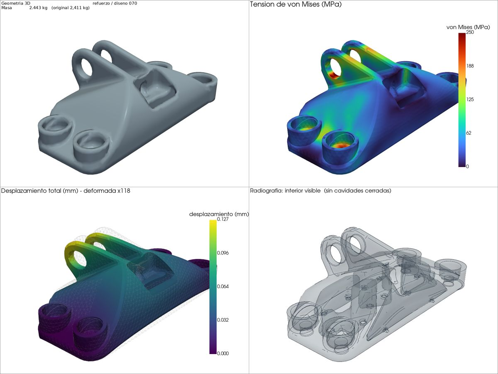
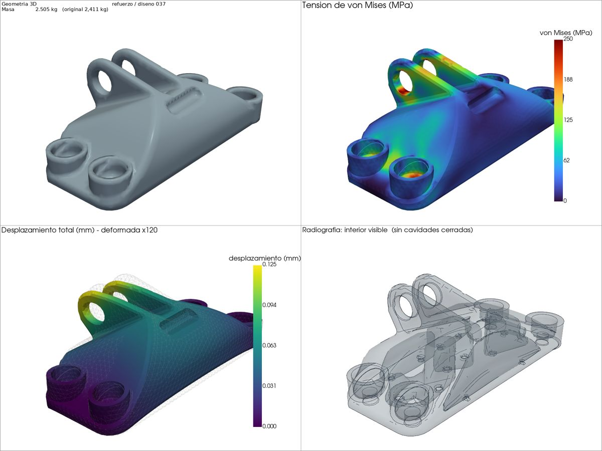

# Optimizacion del soporte - panel en directo

> **Ultima actualizacion:** 23/11/2026 07:46 &nbsp;|&nbsp; **Estado:** EN MARCHA &nbsp;|&nbsp; carga 37800 N &nbsp;|&nbsp; limites: 187 MPa (coef. seguridad >= 1.15 sobre sy = 215 MPa) y 0.25 mm &nbsp;|&nbsp; acero S235

| Familia | disenos calculados | cumplen | mejor masa | estado |
|---|---|---|---|---|
| SimJEB modificado | 21 | 1 | 3.644 kg (CS 1.41) | en marcha |
| Refuerzo + vaciado | 158 | 45 | 2.372 kg (CS 1.16) | en marcha |
| Diseno desde cero | 72 | 0 | - | en marcha |
| Vaciado del original | 69 | 0 | - | terminada: retirada: 62 disenos sin ninguno valido; sus operaciones ya estan dentro de la familia refuerzo |

**Calculos ahorrados:** 0 descartados por el modelo sin ANSYS, 72 descartados en la pasada rapida, 36 piezas repetidas reutilizadas. **Fiabilidad del modelo de tension:** SimJEB modificado: aun aprendiendo | Refuerzo + vaciado: error tipico 1 % | Diseno desde cero: error tipico 2 % | Vaciado del original: error tipico 4 %

## Mejor diseno actual

**2.3720 kg** (-2.12 % de masa frente al original, 2.423 kg con el mismo modelo) &nbsp;|&nbsp; tension **185.4 MPa** &nbsp;|&nbsp; desplazamiento **0.130 mm** &nbsp;|&nbsp; coef. seguridad **1.16** &nbsp;|&nbsp; puntuacion **2.3690** &nbsp;|&nbsp; Refuerzo + vaciado, diseno 142 &nbsp;|&nbsp; calculado 2026-11-23 07:07 &nbsp;|&nbsp; **verificado con malla fina: 185.8 MPa**

[Proyecto Workbench (.wbpz)](runs/opt_37800N/historial/18_refuerzo_142_2.372kg/workbench/soporte_refuerzo_142.wbpz) &nbsp;|&nbsp; [Modelo APDL](runs/opt_37800N/historial/18_refuerzo_142_2.372kg/modelo_apdl.zip) &nbsp;|&nbsp; [Geometria STEP](runs/opt_37800N/historial/18_refuerzo_142_2.372kg/geometria.step)

## Evolucion en el tiempo

Grafico interactivo (hora y datos de cada punto al pasar el raton): [evolucion_interactiva.html](runs/opt_37800N/evolucion_interactiva.html) - descargar y abrir con el navegador (en el PC: doble clic en `runs/opt_37800N/evolucion_interactiva.html`).

**[Galeria: TODOS los disenos (validos y no validos) en orden cronologico](runs/opt_37800N/GALERIA.md)** - 320 fichas.

## Arbol genealogico de la busqueda

Detalle de cada rama: [ARBOL.md](runs/opt_37800N/ARBOL.md)

## Historial de mejoras (todas; la mas reciente arriba)

| n | hora | masa | mejora | tension | desplaz. | familia / diseno | proyecto | ficha |
|---|---|---|---|---|---|---|---|---|
| 19 | 23/11 07:08 | 2.3720 kg | -0.26 % (punt.) | 185.4 MPa | 0.130 mm | Refuerzo + vaciado 142 | [Workbench](runs/opt_37800N/historial/18_refuerzo_142_2.372kg/workbench/soporte_refuerzo_142.wbpz) |  |
| 18 | 23/11 07:02 | 2.3777 kg | -0.55 % (punt.) | 185.6 MPa | 0.129 mm | Refuerzo + vaciado 140 | [Workbench](runs/opt_37800N/historial/17_refuerzo_140_2.378kg/workbench/soporte_refuerzo_140.wbpz) |  |
| 17 | 23/11 06:48 | 2.3920 kg | -0.78 % (punt.) | 185.0 MPa | 0.129 mm | Refuerzo + vaciado 132 | [Workbench](runs/opt_37800N/historial/16_refuerzo_132_2.392kg/workbench/soporte_refuerzo_132.wbpz) |  |
| 16 | 23/11 06:35 | 2.4121 kg | -0.33 % (punt.) | 184.3 MPa | 0.128 mm | Refuerzo + vaciado 127 | [Workbench](runs/opt_37800N/historial/15_refuerzo_127_2.412kg/workbench/soporte_refuerzo_127.wbpz) |  |
| 15 | 23/11 06:14 | 2.4224 kg | -0.25 % (punt.) | 183.1 MPa | 0.128 mm | Refuerzo + vaciado 119 | [Workbench](runs/opt_37800N/historial/14_refuerzo_119_2.422kg/workbench/soporte_refuerzo_119.wbpz) |  |
| 14 | 23/11 00:18 | 2.4278 kg | -0.26 % (punt.) | 183.5 MPa | 0.128 mm | Refuerzo + vaciado 085 | [Workbench](runs/opt_37800N/historial/13_refuerzo_085_2.428kg/workbench/soporte_refuerzo_085.wbpz) |  |
| 13 | 22/11 23:51 | 2.4356 kg | -0.28 % (punt.) | 182.7 MPa | 0.128 mm | Refuerzo + vaciado 071 | [Workbench](runs/opt_37800N/historial/12_refuerzo_071_2.436kg/workbench/soporte_refuerzo_071.wbpz) |  |
| 12 | 22/11 23:48 | 2.4427 kg | -0.42 % (punt.) | 182.6 MPa | 0.127 mm | Refuerzo + vaciado 070 | [Workbench](runs/opt_37800N/historial/11_refuerzo_070_2.443kg/workbench/soporte_refuerzo_070.wbpz) |  |
| 11 | 22/11 23:37 | 2.4587 kg | -0.10 % (punt.) | 179.8 MPa | 0.127 mm | Refuerzo + vaciado 066 | [Workbench](runs/opt_37800N/historial/10_refuerzo_066_2.459kg/workbench/soporte_refuerzo_066.wbpz) |  |
| 10 | 22/11 23:34 | 2.4605 kg | -0.13 % (punt.) | 180.2 MPa | 0.127 mm | Refuerzo + vaciado 065 | [Workbench](runs/opt_37800N/historial/09_refuerzo_065_2.460kg/workbench/soporte_refuerzo_065.wbpz) |  |
| 9 | 22/11 23:29 | 2.4635 kg | -0.98 % (punt.) | 180.3 MPa | 0.127 mm | Refuerzo + vaciado 063 | registrado |  |
| 8 | 22/11 23:10 | 2.4879 kg | -0.03 % (punt.) | 180.3 MPa | 0.126 mm | Refuerzo + vaciado 054 | registrado |  |
| 7 | 22/11 22:56 | 2.4885 kg | -0.17 % (punt.) | 180.4 MPa | 0.126 mm | Refuerzo + vaciado 049 | registrado |  |
| 6 | 22/11 22:40 | 2.4937 kg | -0.20 % (punt.) | 179.8 MPa | 0.126 mm | Refuerzo + vaciado 043 | registrado |  |
| 5 | 22/11 22:30 | 2.4929 kg | -0.27 % (punt.) | 182.6 MPa | 0.126 mm | Refuerzo + vaciado 039 | registrado |  |
| 4 | 22/11 22:23 | 2.5048 kg | -0.36 % (punt.) | 180.0 MPa | 0.125 mm | Refuerzo + vaciado 037 | registrado |  |
| 3 | 22/11 22:07 | 2.5104 kg | -0.00 % (punt.) | 181.7 MPa | 0.125 mm | Refuerzo + vaciado 029 | - |  |
| 2 | 22/11 21:58 | 2.5153 kg | -0.51 % (punt.) | 179.4 MPa | 0.125 mm | Refuerzo + vaciado 027 | registrado |  |
| 1 | 22/11 21:47 | 2.5278 kg | - | 179.6 MPa | 0.124 mm | Refuerzo + vaciado 023 | registrado |  |

## Ultimos disenos calculados

| familia | # | masa | tension | resultado | motivo | ficha |
|---|---|---|---|---|---|---|
| SimJEB modificado | 021 | 2.299 | 201.1 | cerca_del_limite | torneo de referencias SimJEB (21/30): SimJEB n.o 289 (flat, Marinus Re | [ver](runs/opt_37800N/galeria/20261123_074640_simjeb_021_CASI_2.299kg.jpg) |
| Refuerzo + vaciado | 158 | 2.512 | 179.4 | valido | [rama R1.1.1.1.3] el ultimo paso mejoro: sigue en esa linea (paso 0.20 | [ver](runs/opt_37800N/galeria/20261123_074602_refuerzo_158_VALIDO_2.512kg.jpg) |
| SimJEB modificado | 020 | 2.266 | 449.4 | descartado | torneo de referencias SimJEB (20/30): SimJEB n.o 384 (block, JuanCR) t | [ver](runs/opt_37800N/galeria/20261123_074500_simjeb_020_NO_VALIDO_2.266kg.jpg) |
| SimJEB modificado | 019 | 2.253 | 201.3 | cerca_del_limite | torneo de referencias SimJEB (19/30): SimJEB n.o 107 (block, julius) t | [ver](runs/opt_37800N/galeria/20261123_074421_simjeb_019_CASI_2.253kg.jpg) |
| Diseno desde cero | 072 | 2.255 | 416.2 | descartado | [rama C1.1.2] [aun sin disenos validos] rama nueva (amplia, paso 0.35) | [ver](runs/opt_37800N/galeria/20261123_074346_cero_072_NO_VALIDO_2.255kg.jpg) |
| Refuerzo + vaciado | 157 | 2.461 | 183.2 | valido | [rama R1.1.1.3] cruce: mezcla de los parametros de R1.1.1 (#085) y R1. | [ver](runs/opt_37800N/galeria/20261123_074305_refuerzo_157_VALIDO_2.461kg.jpg) |
| SimJEB modificado | 018 | 2.369 | 207.1 | descartado | torneo de referencias SimJEB (18/30): SimJEB n.o 165 (block, Andy Broo | [ver](runs/opt_37800N/galeria/20261123_074210_simjeb_018_NO_VALIDO_2.369kg.jpg) |
| SimJEB modificado | 017 | 2.237 | - | fallido | torneo de referencias SimJEB (17/30): SimJEB n.o 238 (block, dominic b | [ver](runs/opt_37800N/galeria/20261123_074134_simjeb_017_FALLO_2.237kg.jpg) |
| Refuerzo + vaciado | 156 | 2.400 | - | fallido | [rama R1.1.2] rama nueva (amplia, paso 0.35) desde el diseno 054; camb | [ver](runs/opt_37800N/galeria/20261123_074049_refuerzo_156_FALLO_2.400kg.jpg) |
| SimJEB modificado | 016 | 2.272 | 174.4 | valido | torneo de referencias SimJEB (16/30): SimJEB n.o 527 (block, NIKHIL KH | [ver](runs/opt_37800N/galeria/20261123_073957_simjeb_016_VALIDO_2.272kg.jpg) |

---

**Como funciona:** el programa prueba varias familias de piezas (disenos del concurso GE/SimJEB modificados, refuerzo + vaciado del original y diseno desde cero). Tras un reparto inicial, aprende con modelos sustitutos (procesos gaussianos) y propone cambios alrededor del mejor diseno: si mejora, sigue por esa linea y alarga el paso; si no, lo acorta; ramas exploradoras y anti-estancamiento saltan a zonas nuevas. Cada diseno se calcula en ANSYS MAPDL (SOLID187, pernos empotrados, carga por RBE3). Cada nuevo mejor genera un proyecto de Workbench listo para abrir.

**Abrir un proyecto:** descargar el `.wbpz` > Workbench > File > Restore Archive. Todo el detalle esta en `bitacora.md`; cada diseno en `runs/`.
