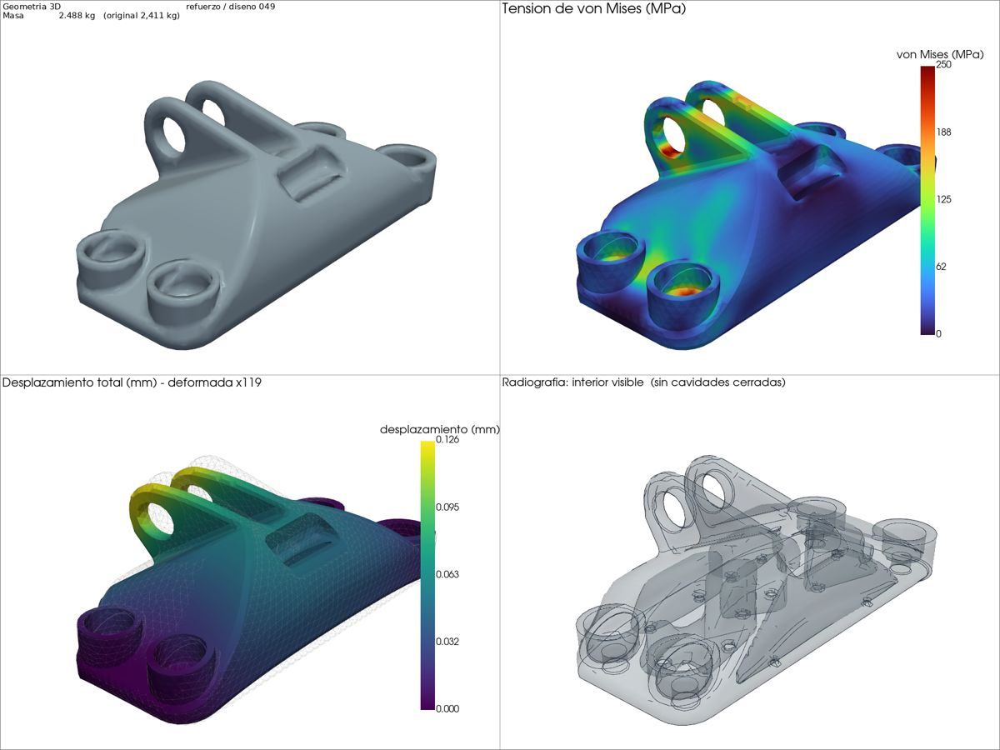

# Optimizacion del soporte - panel en directo

> **Ultima actualizacion:** 22/11/2026 23:00 &nbsp;|&nbsp; **Estado:** EN MARCHA &nbsp;|&nbsp; carga 37800 N &nbsp;|&nbsp; limites: 187 MPa (coef. seguridad >= 1.15 sobre sy = 215 MPa) y 0.25 mm &nbsp;|&nbsp; acero S235

| Familia | disenos calculados | cumplen | mejor masa | estado |
|---|---|---|---|---|
| Vaciado del original | 36 | 0 | - | en marcha |
| Refuerzo + vaciado | 49 | 10 | 2.488 kg (CS 1.19) | en marcha |
| Diseno desde cero | 36 | 0 | - | en marcha |

**Calculos ahorrados:** 0 descartados por el modelo sin ANSYS, 36 descartados en la pasada rapida, 16 piezas repetidas reutilizadas. **Fiabilidad del modelo de tension:** Vaciado del original: error tipico 6 % | Refuerzo + vaciado: error tipico 3 % | Diseno desde cero: error tipico 2 %

## Mejor diseno actual

**2.4885 kg** (+2.68 % de masa frente al original, 2.423 kg con el mismo modelo) &nbsp;|&nbsp; tension **180.4 MPa** &nbsp;|&nbsp; desplazamiento **0.126 mm** &nbsp;|&nbsp; coef. seguridad **1.19** &nbsp;|&nbsp; puntuacion **2.4751** &nbsp;|&nbsp; Refuerzo + vaciado, diseno 049 &nbsp;|&nbsp; calculado 2026-11-22 22:55 &nbsp;|&nbsp; **verificado con malla fina: 185.5 MPa**

[Proyecto Workbench (.wbpz)](runs/opt_37800N/historial/06_refuerzo_049_2.488kg/workbench/soporte_refuerzo_049.wbpz) &nbsp;|&nbsp; [Modelo APDL](runs/opt_37800N/historial/06_refuerzo_049_2.488kg/modelo_apdl.zip) &nbsp;|&nbsp; [Geometria STEP](runs/opt_37800N/historial/06_refuerzo_049_2.488kg/geometria.step)

## Evolucion en el tiempo

Grafico interactivo (hora y datos de cada punto al pasar el raton): [evolucion_interactiva.html](runs/opt_37800N/evolucion_interactiva.html) - descargar y abrir con el navegador (en el PC: doble clic en `runs/opt_37800N/evolucion_interactiva.html`).

**[Galeria: TODOS los disenos (validos y no validos) en orden cronologico](runs/opt_37800N/GALERIA.md)** - 121 fichas.

## Arbol genealogico de la busqueda

Detalle de cada rama: [ARBOL.md](runs/opt_37800N/ARBOL.md)

## Historial de mejoras (todas; la mas reciente arriba)

| n | hora | masa | mejora | tension | desplaz. | familia / diseno | proyecto | ficha |
|---|---|---|---|---|---|---|---|---|
| 7 | 22/11 22:56 | 2.4885 kg | -0.17 % (punt.) | 180.4 MPa | 0.126 mm | Refuerzo + vaciado 049 | [Workbench](runs/opt_37800N/historial/06_refuerzo_049_2.488kg/workbench/soporte_refuerzo_049.wbpz) |  |
| 6 | 22/11 22:40 | 2.4937 kg | -0.20 % (punt.) | 179.8 MPa | 0.126 mm | Refuerzo + vaciado 043 | [Workbench](runs/opt_37800N/historial/05_refuerzo_043_2.494kg/workbench/soporte_refuerzo_043.wbpz) |  |
| 5 | 22/11 22:30 | 2.4929 kg | -0.27 % (punt.) | 182.6 MPa | 0.126 mm | Refuerzo + vaciado 039 | [Workbench](runs/opt_37800N/historial/04_refuerzo_039_2.493kg/workbench/soporte_refuerzo_039.wbpz) |  |
| 4 | 22/11 22:23 | 2.5048 kg | -0.36 % (punt.) | 180.0 MPa | 0.125 mm | Refuerzo + vaciado 037 | [Workbench](runs/opt_37800N/historial/03_refuerzo_037_2.505kg/workbench/soporte_refuerzo_037.wbpz) |  |
| 3 | 22/11 22:07 | 2.5104 kg | -0.00 % (punt.) | 181.7 MPa | 0.125 mm | Refuerzo + vaciado 029 | - |  |
| 2 | 22/11 21:58 | 2.5153 kg | -0.51 % (punt.) | 179.4 MPa | 0.125 mm | Refuerzo + vaciado 027 | [Workbench](runs/opt_37800N/historial/02_refuerzo_027_2.515kg/workbench/soporte_refuerzo_027.wbpz) |  |
| 1 | 22/11 21:47 | 2.5278 kg | - | 179.6 MPa | 0.124 mm | Refuerzo + vaciado 023 | [Workbench](runs/opt_37800N/historial/01_refuerzo_023_2.528kg/workbench/soporte_refuerzo_023.wbpz) |  |

## Ultimos disenos calculados

| familia | # | masa | tension | resultado | motivo | ficha |
|---|---|---|---|---|---|---|
| Refuerzo + vaciado | 049 | 2.488 | 180.4 | valido | [rama R1.1] pequeno cambio alrededor del mejor de la rama (paso 0.05); | [ver](runs/opt_37800N/galeria/20261122_225746_refuerzo_049_VALIDO_2.488kg.jpg) |
| Diseno desde cero | 036 | 2.258 | 390.5 | descartado | [rama C1] [aun sin disenos validos] pequeno cambio alrededor del mejor | [ver](runs/opt_37800N/galeria/20261122_225540_cero_036_NO_VALIDO_2.258kg.jpg) |
| Refuerzo + vaciado | 048 | 2.480 | 179.2 | cerca_del_limite | [rama R1.1] pequeno cambio alrededor del mejor de la rama (paso 0.05); | [ver](runs/opt_37800N/galeria/20261122_225453_refuerzo_048_CASI_2.480kg.jpg) |
| Vaciado del original | 036 | 2.412 | 211.7 | descartado | [rama V1] [aun sin disenos validos] pequeno cambio alrededor del mejor | [ver](runs/opt_37800N/galeria/20261122_225250_vaciado_036_NO_VALIDO_2.412kg.jpg) |
| Refuerzo + vaciado | 047 | 2.488 | 182.9 | valido | [rama R1.1] varios pasos sin mejora: paso mas corto (0.10); cambia cav | [ver](runs/opt_37800N/galeria/20261122_225146_refuerzo_047_VALIDO_2.488kg.jpg) |
| Refuerzo + vaciado | 046 | 2.484 | 179.0 | cerca_del_limite | [rama R1.1] varios pasos sin mejora: paso mas corto (0.10); cambia cav | [ver](runs/opt_37800N/galeria/20261122_225034_refuerzo_046_CASI_2.484kg.jpg) |
| Diseno desde cero | 035 | 2.240 | 397.8 | descartado | [rama C1] [aun sin disenos validos] varios pasos sin mejora: paso mas  | [ver](runs/opt_37800N/galeria/20261122_224830_cero_035_NO_VALIDO_2.240kg.jpg) |
| Refuerzo + vaciado | 045 | 2.494 | 227.3 | descartado | [rama R1.1] pequeno cambio alrededor del mejor de la rama (paso 0.10); | [ver](runs/opt_37800N/galeria/20261122_224740_refuerzo_045_NO_VALIDO_2.494kg.jpg) |
| Vaciado del original | 035 | 2.376 | 206.2 | descartado | [rama V1] [aun sin disenos validos] varios pasos sin mejora: paso mas  | [ver](runs/opt_37800N/galeria/20261122_224628_vaciado_035_NO_VALIDO_2.376kg.jpg) |
| Refuerzo + vaciado | 044 | 2.521 | 180.0 | valido | [rama R1.1] pequeno cambio alrededor del mejor de la rama (paso 0.10); | [ver](runs/opt_37800N/galeria/20261122_224523_refuerzo_044_VALIDO_2.521kg.jpg) |

---

**Como funciona:** el programa prueba dos familias de piezas (vaciado del original y diseno desde cero). Tras un reparto inicial, aprende con modelos sustitutos (procesos gaussianos) y propone pequenos cambios alrededor del mejor diseno: si mejora, sigue por esa linea y alarga el paso; si no, lo acorta. Cada diseno se calcula en ANSYS MAPDL (SOLID187, pernos empotrados, carga por RBE3). Cada nuevo mejor genera un proyecto de Workbench listo para abrir.

**Abrir un proyecto:** descargar el `.wbpz` > Workbench > File > Restore Archive. Todo el detalle esta en `bitacora.md`; cada diseno en `runs/`.
