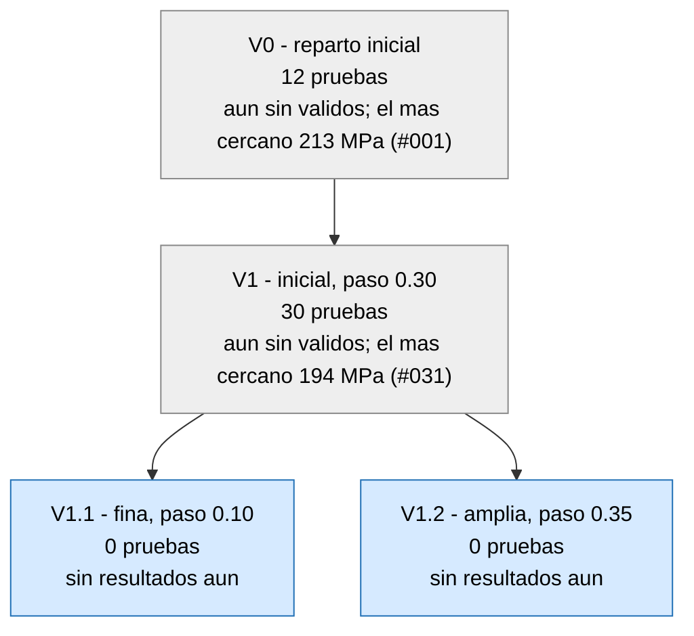
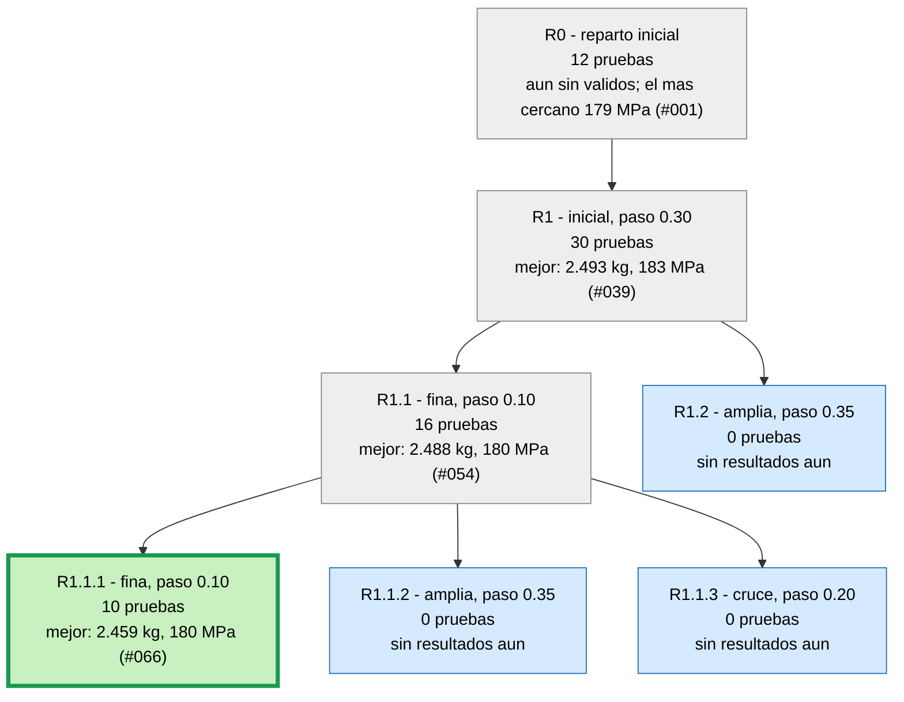

# Arbol genealogico de la busqueda

Cada caja es una **rama**: una linea de busqueda que parte de un diseno y prueba cambios a su alrededor.
Al terminar, su mejor diseno crea dos ramas hijas: **fina** (cambios pequenos) y **amplia** (cambios grandes).
Azul = activa | gris = terminada | verde grueso = contiene el MEJOR diseno de todos.

## Vaciado del original

## Refuerzo + vaciado

## Diseno desde cero

