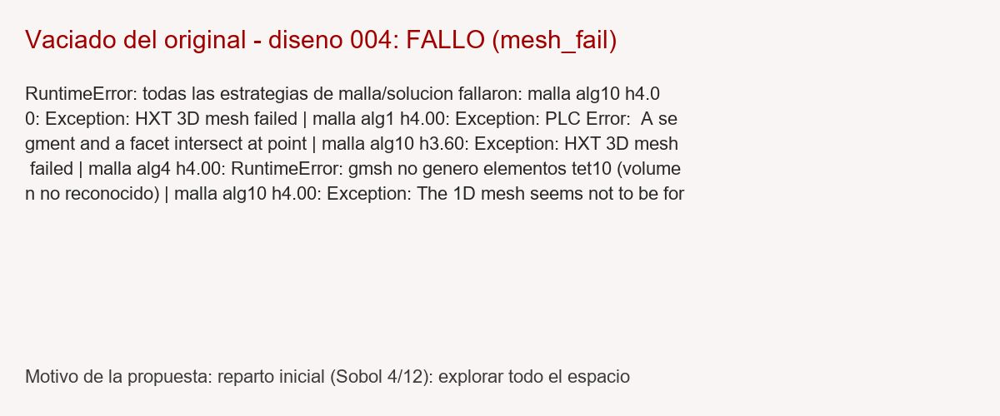
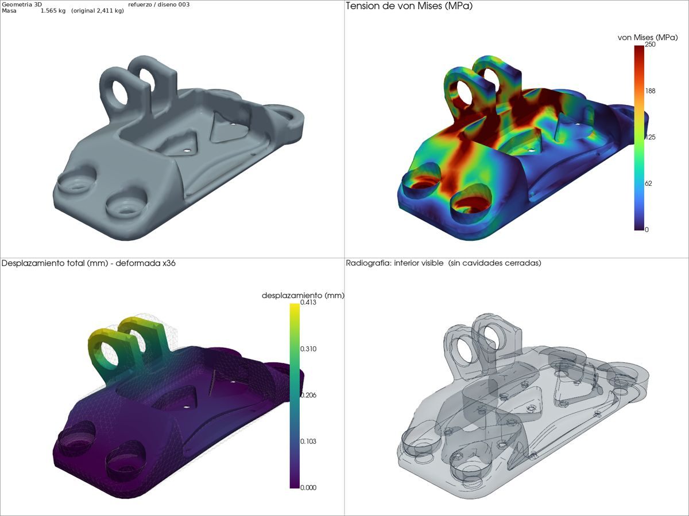
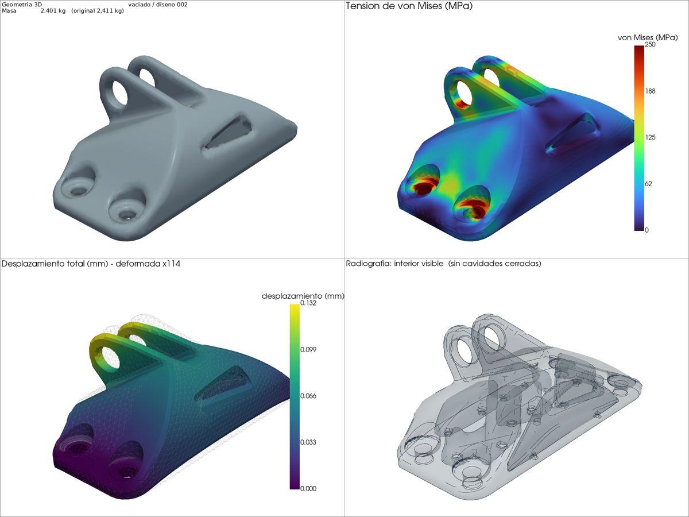

# Galeria: todos los disenos calculados, en orden cronologico (el mas reciente arriba)

Cada ficha: geometria 3D | tension de von Mises | deformada | radiografia del interior.
Veredicto: VALIDO (cumple tension y desplazamiento), CASI (hasta +10 %), no valido, FALLO.

| fecha | diseno | veredicto | masa | ficha (clic para ampliar) |
|---|---|---|---|---|
| 22/11 20:47 | Diseno desde cero 004 | no valido | 1.233 kg |  |
| 22/11 20:47 | Refuerzo + vaciado 004 | FALLO | 0.000 kg |  |
| 22/11 20:47 | Vaciado del original 004 | FALLO | 2.161 kg |  |
| 22/11 20:46 | Diseno desde cero 003 | no valido | 1.384 kg |  |
| 22/11 20:45 | Refuerzo + vaciado 003 | no valido | 1.565 kg |  |
| 22/11 20:44 | Vaciado del original 003 | no valido | 2.413 kg |  |
| 22/11 20:43 | Diseno desde cero 002 | no valido | 1.607 kg |  |
| 22/11 20:43 | Refuerzo + vaciado 002 | FALLO | 2.547 kg |  |
| 22/11 20:42 | Vaciado del original 002 | no valido | 2.401 kg |  |
| 22/11 20:41 | Diseno desde cero 001 | no valido | 1.510 kg |  |
| 22/11 20:40 | Refuerzo + vaciado 001 | CASI | 2.544 kg |  |
| 22/11 20:38 | Vaciado del original 001 | no valido | 2.423 kg |  |
