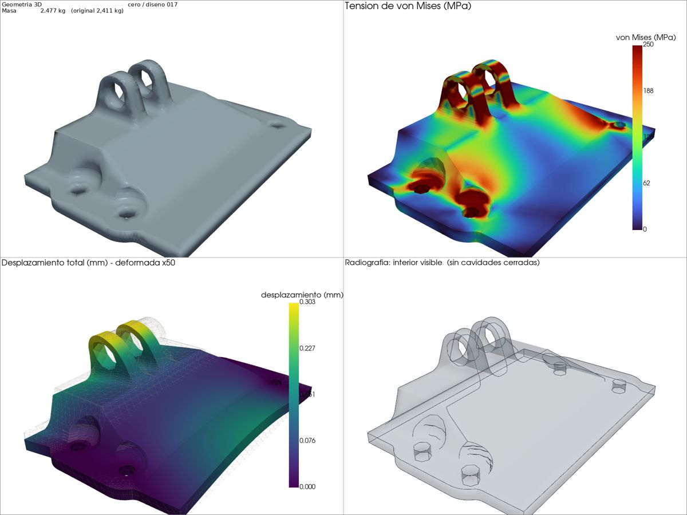
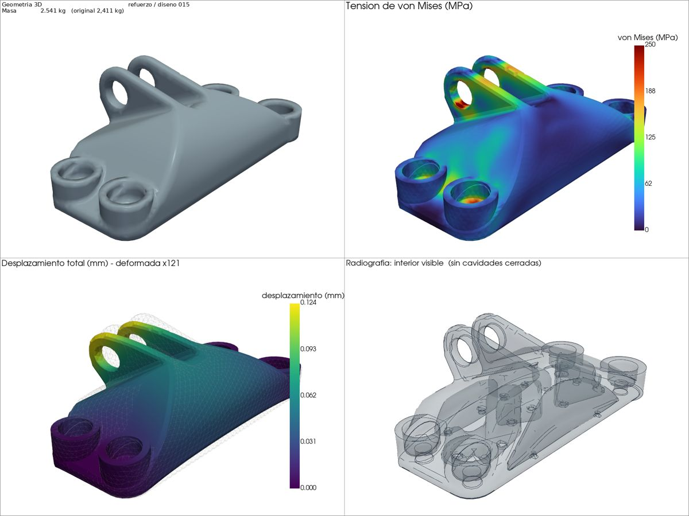
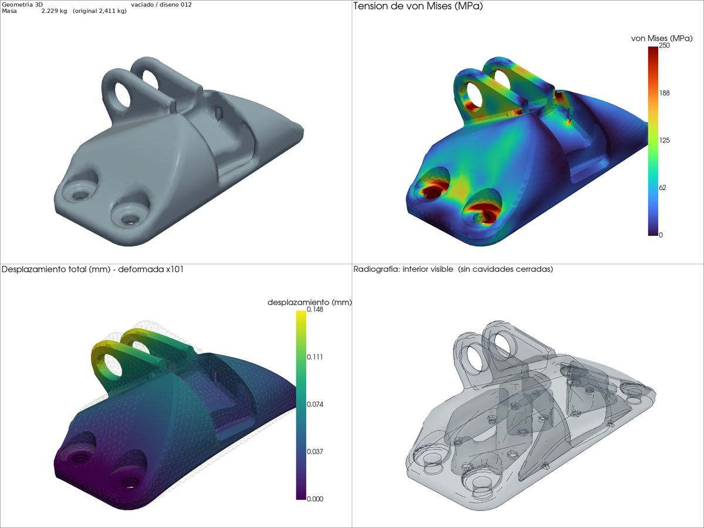
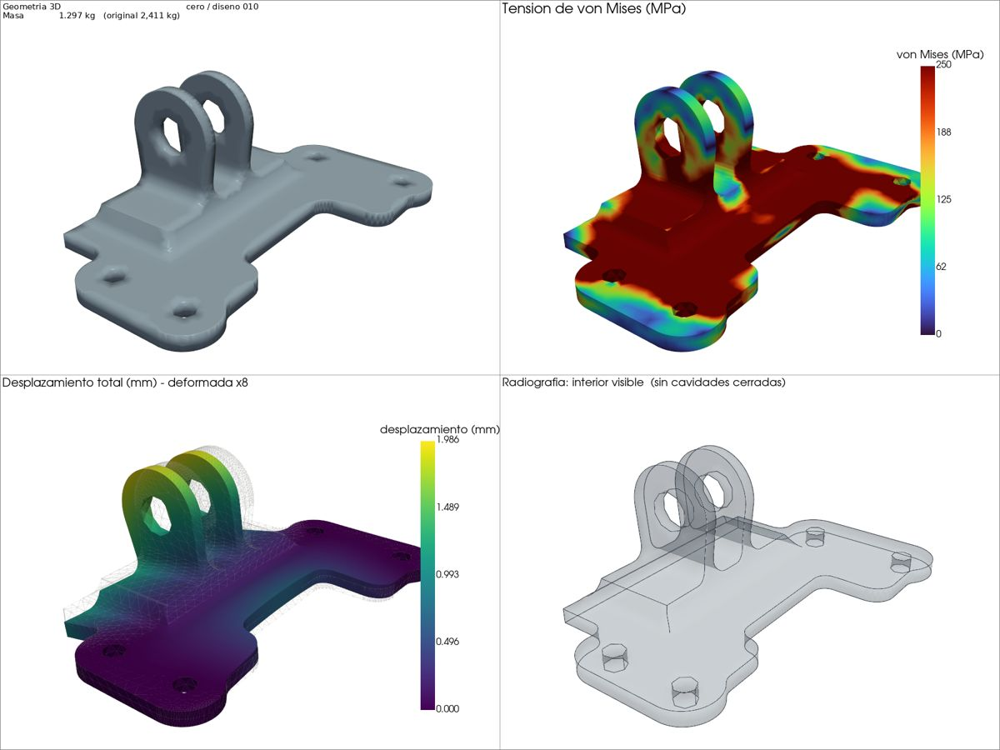
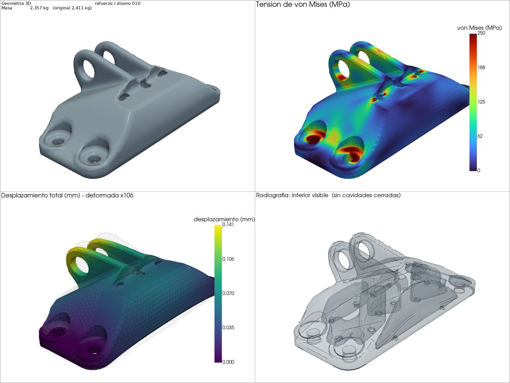
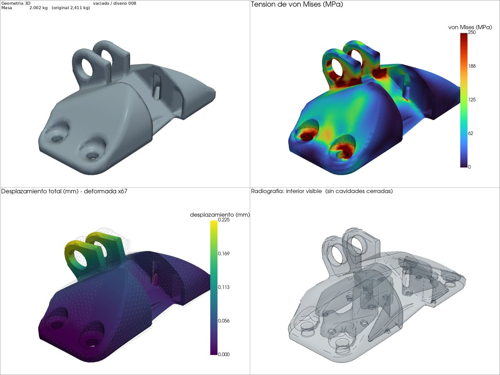
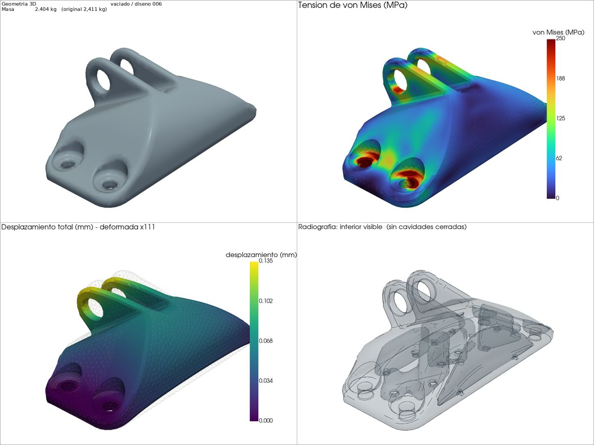
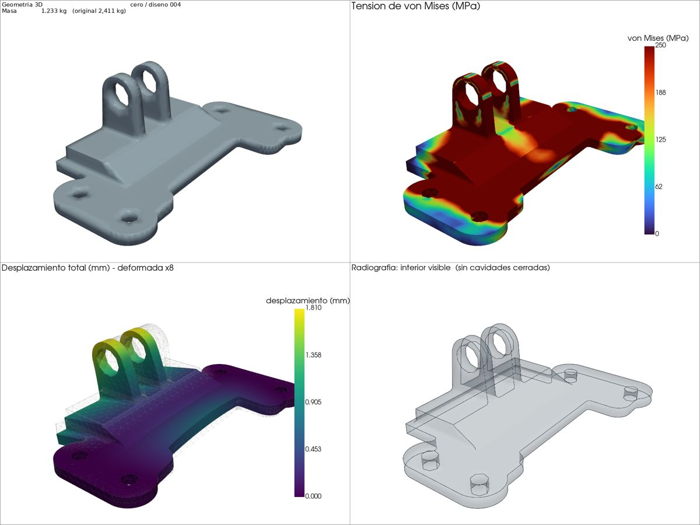
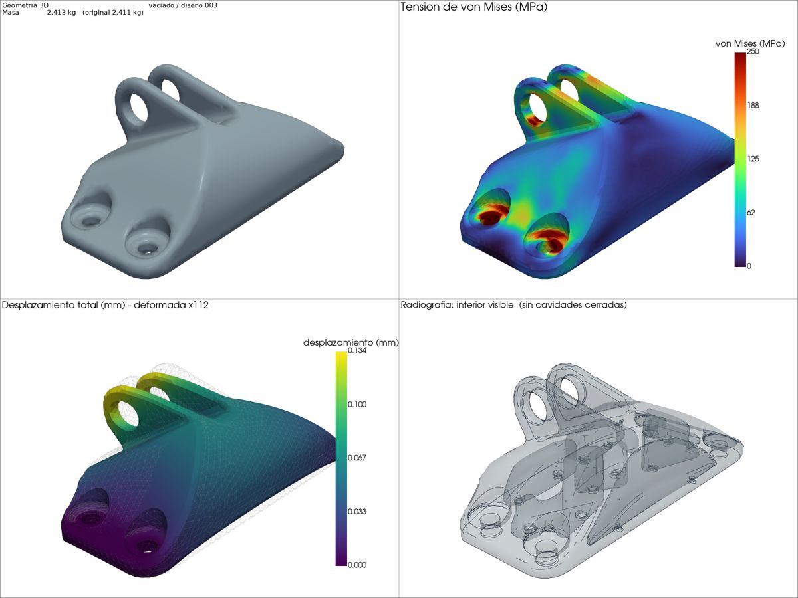
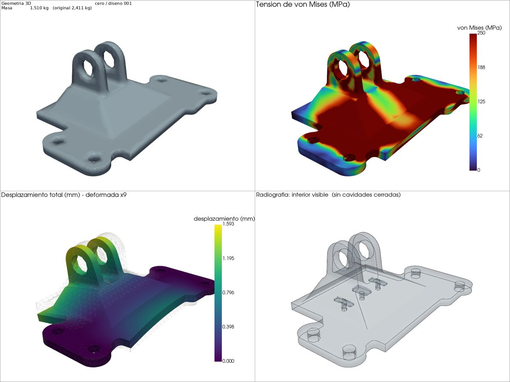

# Galeria: todos los disenos calculados, en orden cronologico (el mas reciente arriba)

Cada ficha: geometria 3D | tension de von Mises | deformada | radiografia del interior.
Veredicto: VALIDO (cumple tension y desplazamiento), CASI (hasta +10 %), no valido, FALLO.

| fecha | diseno | veredicto | masa | ficha (clic para ampliar) |
|---|---|---|---|---|
| 22/11 21:33 | Diseno desde cero 018 | no valido | 2.507 kg |  |
| 22/11 21:32 | Refuerzo + vaciado 018 | CASI | 2.546 kg |  |
| 22/11 21:32 | Vaciado del original 018 | no valido | 2.423 kg |  |
| 22/11 21:32 | Diseno desde cero 017 | no valido | 2.477 kg |  |
| 22/11 21:31 | Refuerzo + vaciado 017 | CASI | 2.546 kg |  |
| 22/11 21:30 | Vaciado del original 017 | no valido | 2.423 kg |  |
| 22/11 21:29 | Diseno desde cero 016 | no valido | 2.232 kg |  |
| 22/11 21:29 | Refuerzo + vaciado 016 | CASI | 2.544 kg |  |
| 22/11 21:29 | Vaciado del original 016 | no valido | 2.423 kg |  |
| 22/11 21:28 | Diseno desde cero 015 | no valido | 2.056 kg |  |
| 22/11 21:28 | Refuerzo + vaciado 015 | CASI | 2.541 kg |  |
| 22/11 21:26 | Vaciado del original 015 | no valido | 2.420 kg |  |
| 22/11 21:25 | Diseno desde cero 014 | no valido | 1.994 kg |  |
| 22/11 21:24 | Refuerzo + vaciado 014 | CASI | 2.544 kg |  |
| 22/11 21:24 | Vaciado del original 014 | no valido | 2.423 kg |  |
| 22/11 21:24 | Diseno desde cero 013 | no valido | 1.921 kg |  |
| 22/11 21:22 | Refuerzo + vaciado 013 | CASI | 2.544 kg |  |
| 22/11 21:13 | Vaciado del original 013 | no valido | 2.423 kg |  |
| 22/11 21:07 | Diseno desde cero 012 | no valido | 1.636 kg |  |
| 22/11 21:07 | Refuerzo + vaciado 012 | no valido | 2.059 kg |  |
| 22/11 21:05 | Vaciado del original 012 | no valido | 2.229 kg |  |
| 22/11 21:04 | Diseno desde cero 011 | no valido | 1.219 kg |  |
| 22/11 21:04 | Refuerzo + vaciado 011 | no valido | 2.404 kg |  |
| 22/11 21:03 | Vaciado del original 011 | no valido | 1.882 kg |  |
| 22/11 21:02 | Diseno desde cero 010 | no valido | 1.297 kg |  |
| 22/11 21:02 | Refuerzo + vaciado 010 | no valido | 2.357 kg |  |
| 22/11 21:00 | Vaciado del original 010 | FALLO | 0.000 kg |  |
| 22/11 21:00 | Diseno desde cero 009 | no valido | 1.765 kg |  |
| 22/11 20:59 | Refuerzo + vaciado 009 | no valido | 2.140 kg |  |
| 22/11 20:58 | Vaciado del original 009 | no valido | 1.968 kg |  |
| 22/11 20:57 | Diseno desde cero 008 | no valido | 2.063 kg |  |
| 22/11 20:57 | Refuerzo + vaciado 008 | no valido | 2.212 kg |  |
| 22/11 20:56 | Vaciado del original 008 | no valido | 2.002 kg |  |
| 22/11 20:55 | Diseno desde cero 007 | no valido | 0.972 kg |  |
| 22/11 20:55 | Refuerzo + vaciado 007 | no valido | 1.971 kg |  |
| 22/11 20:54 | Vaciado del original 007 | no valido | 1.845 kg |  |
| 22/11 20:53 | Diseno desde cero 006 | no valido | 1.490 kg |  |
| 22/11 20:52 | Refuerzo + vaciado 006 | no valido | 2.409 kg |  |
| 22/11 20:51 | Vaciado del original 006 | no valido | 2.404 kg |  |
| 22/11 20:50 | Diseno desde cero 005 | no valido | 1.415 kg |  |
| 22/11 20:49 | Refuerzo + vaciado 005 | no valido | 2.195 kg |  |
| 22/11 20:48 | Vaciado del original 005 | FALLO | 2.300 kg |  |
| 22/11 20:47 | Diseno desde cero 004 | no valido | 1.233 kg |  |
| 22/11 20:47 | Refuerzo + vaciado 004 | FALLO | 0.000 kg |  |
| 22/11 20:47 | Vaciado del original 004 | FALLO | 2.161 kg |  |
| 22/11 20:46 | Diseno desde cero 003 | no valido | 1.384 kg |  |
| 22/11 20:45 | Refuerzo + vaciado 003 | no valido | 1.565 kg |  |
| 22/11 20:44 | Vaciado del original 003 | no valido | 2.413 kg |  |
| 22/11 20:43 | Diseno desde cero 002 | no valido | 1.607 kg |  |
| 22/11 20:43 | Refuerzo + vaciado 002 | FALLO | 2.547 kg |  |
| 22/11 20:42 | Vaciado del original 002 | no valido | 2.401 kg |  |
| 22/11 20:41 | Diseno desde cero 001 | no valido | 1.510 kg |  |
| 22/11 20:40 | Refuerzo + vaciado 001 | CASI | 2.544 kg |  |
| 22/11 20:38 | Vaciado del original 001 | no valido | 2.423 kg |  |
