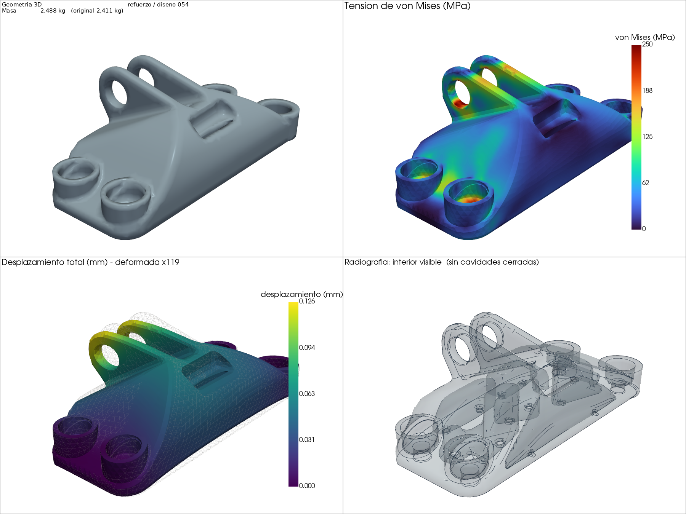
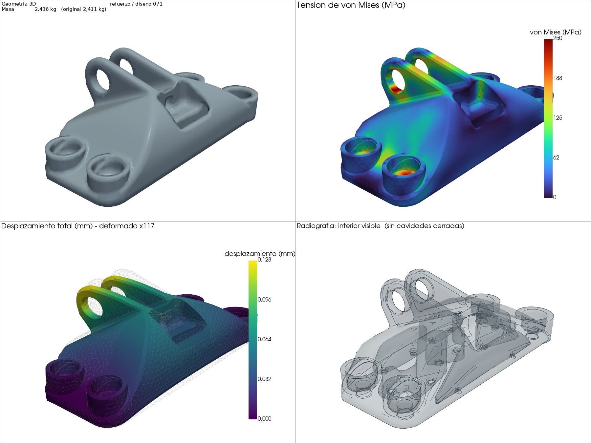
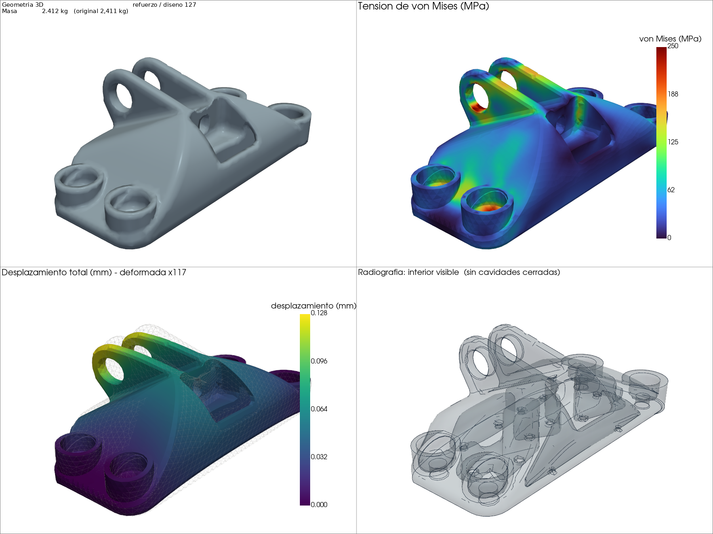

# Historial de la evolucion de la pieza

Cada fila es un diseno que mejoro a TODOS los anteriores.

Original: 2,411 kg (CAD) | limite 187 MPa | carga 37800 N

| n | diseno | masa (kg) | tension (MPa) | geometria | proyecto |
|---|---|---|---|---|---|
| 01 | 01_refuerzo_023_2.528kg | 2.528 | 179.6 |  | - |
| 02 | 02_refuerzo_027_2.515kg | 2.515 | 179.4 |  | - |
| 03 | 03_refuerzo_037_2.505kg | 2.505 | 180.0 |  | - |
| 04 | 04_refuerzo_039_2.493kg | 2.493 | 182.6 |  | - |
| 05 | 05_refuerzo_043_2.494kg | 2.494 | 179.8 |  | [Workbench](historial/05_refuerzo_043_2.494kg/workbench/soporte_refuerzo_043.wbpz) |
| 06 | 06_refuerzo_049_2.488kg | 2.488 | 180.4 |  | [Workbench](historial/06_refuerzo_049_2.488kg/workbench/soporte_refuerzo_049.wbpz) |
| 07 | 07_refuerzo_054_2.488kg | 2.488 | 180.3 |  | [Workbench](historial/07_refuerzo_054_2.488kg/workbench/soporte_refuerzo_054.wbpz) |
| 08 | 08_refuerzo_063_2.463kg | 2.463 | 180.3 |  | [Workbench](historial/08_refuerzo_063_2.463kg/workbench/soporte_refuerzo_063.wbpz) |
| 09 | 09_refuerzo_065_2.460kg | 2.460 | 180.2 |  | [Workbench](historial/09_refuerzo_065_2.460kg/workbench/soporte_refuerzo_065.wbpz) |
| 10 | 10_refuerzo_066_2.459kg | 2.459 | 179.8 |  | [Workbench](historial/10_refuerzo_066_2.459kg/workbench/soporte_refuerzo_066.wbpz) |
| 11 | 11_refuerzo_070_2.443kg | 2.443 | 182.6 |  | [Workbench](historial/11_refuerzo_070_2.443kg/workbench/soporte_refuerzo_070.wbpz) |
| 12 | 12_refuerzo_071_2.436kg | 2.436 | 182.7 |  | [Workbench](historial/12_refuerzo_071_2.436kg/workbench/soporte_refuerzo_071.wbpz) |
| 13 | 13_refuerzo_085_2.428kg | 2.428 | 183.5 |  | [Workbench](historial/13_refuerzo_085_2.428kg/workbench/soporte_refuerzo_085.wbpz) |
| 14 | 14_refuerzo_119_2.422kg | 2.422 | 183.1 |  | [Workbench](historial/14_refuerzo_119_2.422kg/workbench/soporte_refuerzo_119.wbpz) |
| 15 | 15_refuerzo_127_2.412kg | 2.412 | 184.3 |  | [Workbench](historial/15_refuerzo_127_2.412kg/workbench/soporte_refuerzo_127.wbpz) |
