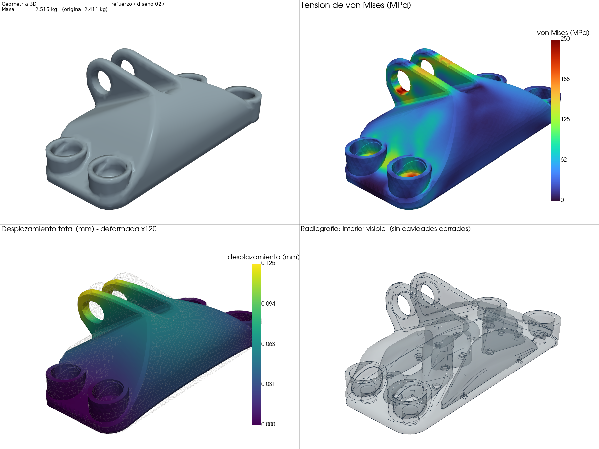

# Historial de la evolucion de la pieza

Cada fila es un diseno que mejoro a TODOS los anteriores.

Original: 2,411 kg (CAD) | limite 187 MPa | carga 37800 N

| n | diseno | masa (kg) | tension (MPa) | geometria | proyecto |
|---|---|---|---|---|---|
| 01 | 01_refuerzo_023_2.528kg | 2.528 | 179.6 |  | [Workbench](historial/01_refuerzo_023_2.528kg/workbench/soporte_refuerzo_023.wbpz) |
| 02 | 02_refuerzo_027_2.515kg | 2.515 | 179.4 |  | [Workbench](historial/02_refuerzo_027_2.515kg/workbench/soporte_refuerzo_027.wbpz) |
