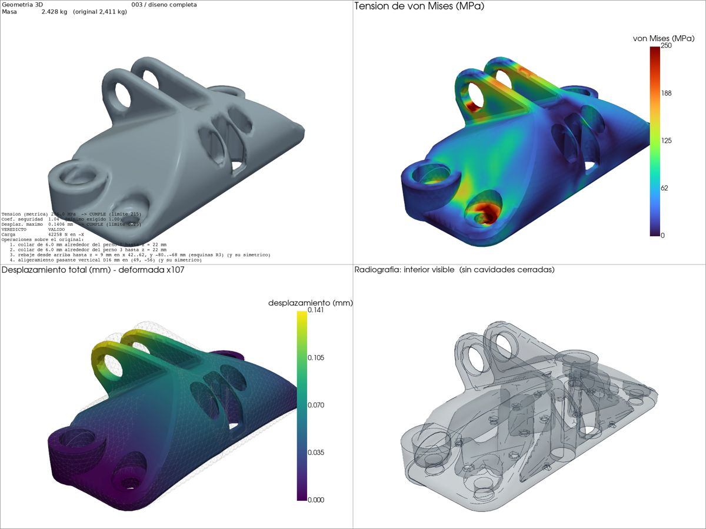

# Galeria: todas las piezas calculadas con la malla completa (la mas reciente arriba)

Cada ficha: geometria 3D | tension de von Mises | deformada | radiografia del interior, con la lista de operaciones aplicadas al original.

| fecha | iteracion | decision | masa | ficha (clic para ampliar) |
|---|---|---|---|---|
| 24/11 09:17 | iteracion 004 | ACEPTADA | 2.399 kg |  |
| 24/11 09:10 | iteracion 003 | ACEPTADA | 2.428 kg |  |
| 24/11 09:07 | iteracion 002 | ACEPTADA | 2.482 kg |  |
| 24/11 09:04 | iteracion 001 | RECHAZADA | 2.460 kg |  |
| 24/11 09:00 | iteracion 000 | INICIO | 2.504 kg |  |
