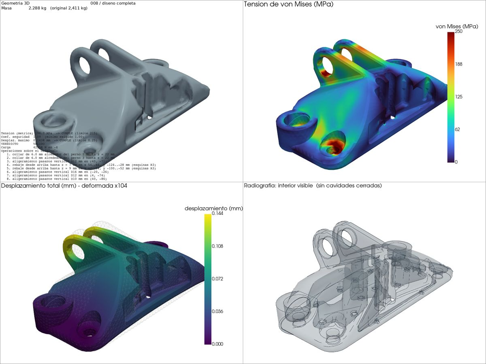

# Galeria: todas las piezas calculadas con la malla completa (la mas reciente arriba)

Cada ficha: geometria 3D | tension de von Mises | deformada | radiografia del interior, con la lista de operaciones aplicadas al original.

| fecha | iteracion | decision | masa | ficha (clic para ampliar) |
|---|---|---|---|---|
| 23/11 21:27 | iteracion 019 | ACEPTADA | 2.144 kg |  |
| 23/11 21:22 | iteracion 018 | ACEPTADA | 2.126 kg |  |
| 23/11 21:19 | iteracion 017 | ACEPTADA | 2.140 kg |  |
| 23/11 21:17 | iteracion 016 | RECHAZADA | 2.133 kg |  |
| 23/11 21:13 | iteracion 015 | ACEPTADA | 2.156 kg |  |
| 23/11 21:07 | iteracion 014 | ACEPTADA | 2.161 kg |  |
| 23/11 21:01 | iteracion 013 | ACEPTADA | 2.188 kg |  |
| 23/11 20:55 | iteracion 012 | ACEPTADA | 2.222 kg |  |
| 23/11 20:52 | iteracion 011 | RECHAZADA | 2.203 kg |  |
| 23/11 20:49 | iteracion 010 | ACEPTADA | 2.261 kg |  |
| 23/11 20:45 | iteracion 009 | ACEPTADA | 2.274 kg |  |
| 23/11 20:42 | iteracion 008 | ACEPTADA | 2.288 kg |  |
| 23/11 20:36 | iteracion 007 | ACEPTADA | 2.308 kg |  |
| 23/11 20:30 | iteracion 006 | ACEPTADA | 2.336 kg |  |
| 23/11 20:27 | iteracion 005 | RECHAZADA | 2.365 kg |  |
| 23/11 20:20 | iteracion 004 | ACEPTADA | 2.365 kg |  |
| 23/11 20:12 | iteracion 003 | ACEPTADA | 2.413 kg |  |
| 23/11 20:05 | iteracion 002 | ACEPTADA | 2.470 kg |  |
| 23/11 19:56 | iteracion 002 | ACEPTADA | 2.470 kg |  |
| 23/11 19:43 | iteracion 001 | ACEPTADA | 2.504 kg |  |
| 23/11 19:40 | iteracion 000 | INICIO | 2.423 kg |  |
