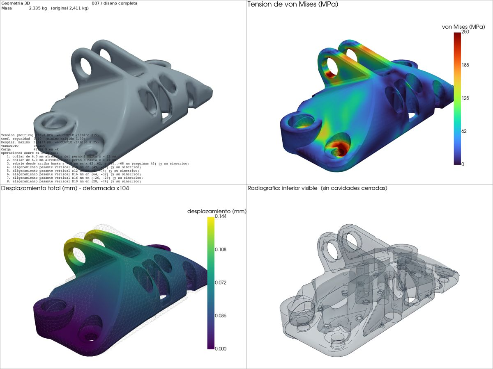
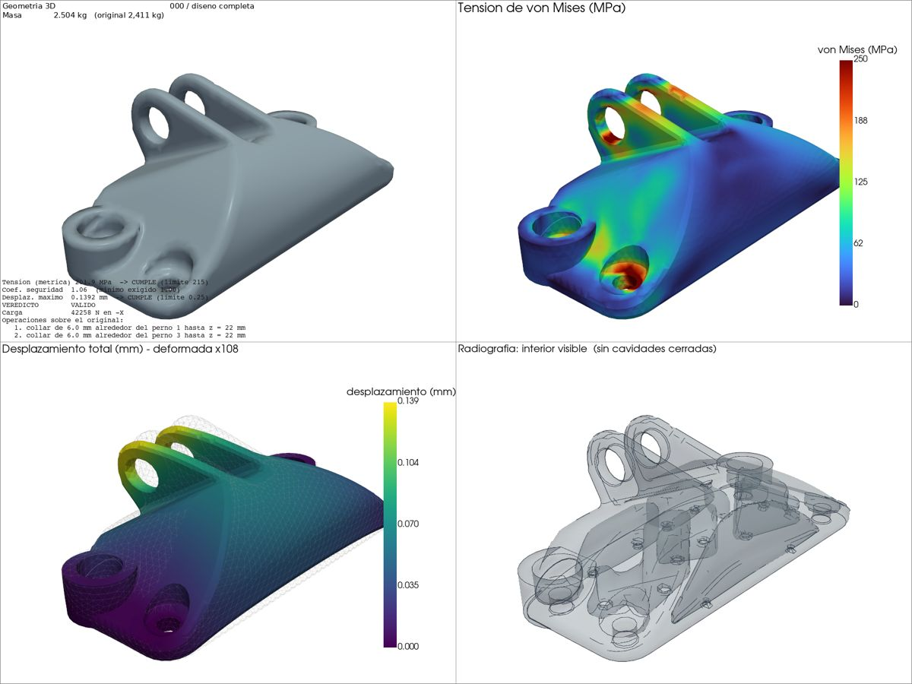

# Galeria: todas las piezas calculadas con la malla completa (la mas reciente arriba)

Cada ficha: geometria 3D | tension de von Mises | deformada | radiografia del interior, con la lista de operaciones aplicadas al original.

| fecha | iteracion | decision | masa | ficha (clic para ampliar) |
|---|---|---|---|---|
| 24/11 11:21 | iteracion 013 | RECHAZADA | 2.268 kg |  |
| 24/11 11:18 | iteracion 012 | RECHAZADA | 2.278 kg |  |
| 24/11 09:44 | iteracion 011 | ACEPTADA | 2.293 kg |  |
| 24/11 09:41 | iteracion 010 | RECHAZADA | 2.288 kg |  |
| 24/11 09:38 | iteracion 009 | RECHAZADA | 2.366 kg |  |
| 24/11 09:32 | iteracion 008 | ACEPTADA | 2.320 kg |  |
| 24/11 09:30 | iteracion 007 | ACEPTADA | 2.335 kg |  |
| 24/11 09:26 | iteracion 006 | ACEPTADA | 2.355 kg |  |
| 24/11 09:23 | iteracion 005 | ACEPTADA | 2.383 kg |  |
| 24/11 09:17 | iteracion 004 | ACEPTADA | 2.399 kg |  |
| 24/11 09:10 | iteracion 003 | ACEPTADA | 2.428 kg |  |
| 24/11 09:07 | iteracion 002 | ACEPTADA | 2.482 kg |  |
| 24/11 09:04 | iteracion 001 | RECHAZADA | 2.460 kg |  |
| 24/11 09:00 | iteracion 000 | INICIO | 2.504 kg |  |
