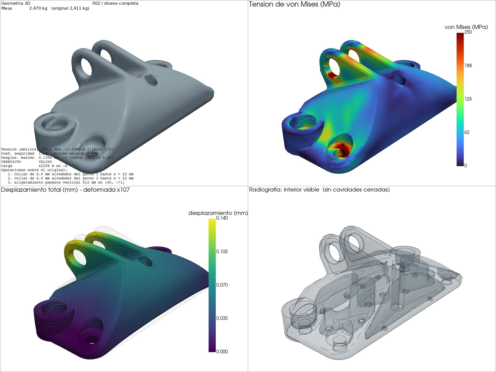
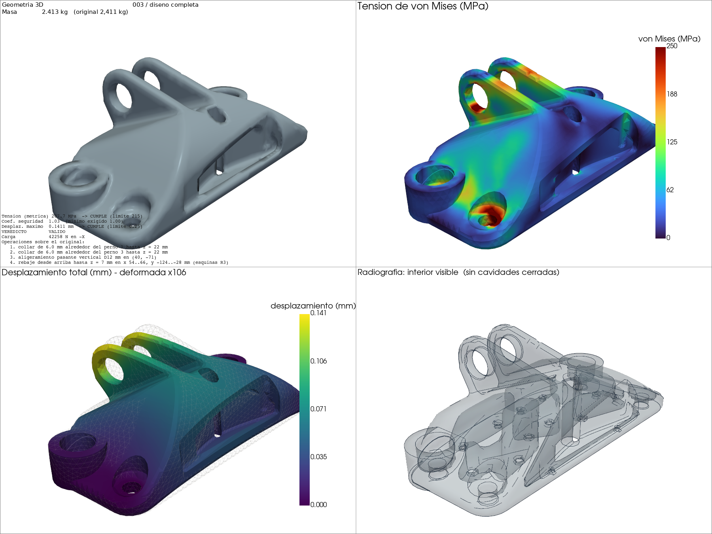
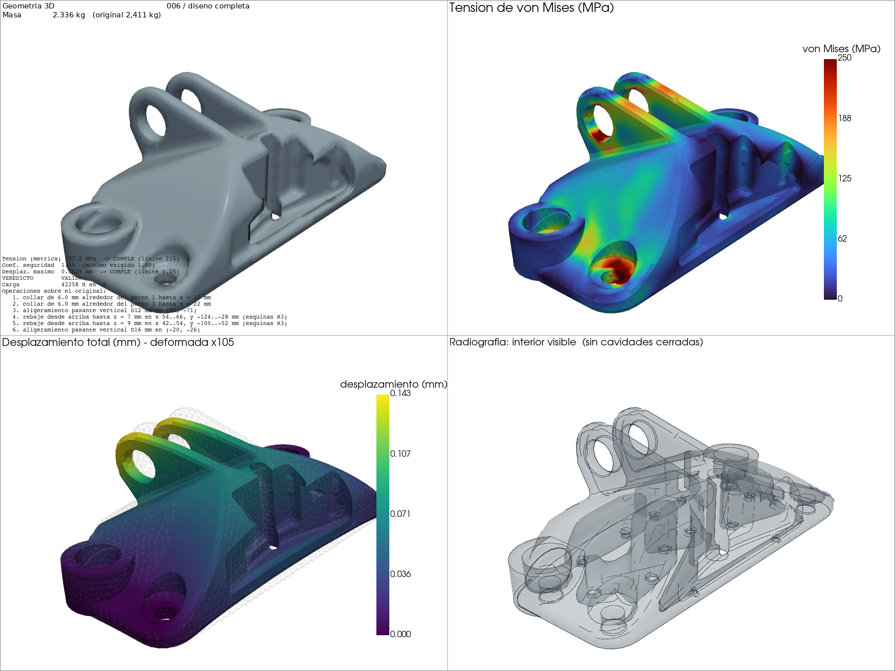

# Historial de hitos (verificados con malla fina, con proyecto Workbench)

Original: 2.423 kg | limite 215 MPa | carga 42258 N

| n | diseno | masa (kg) | tension (MPa) | ficha | proyecto |
|---|---|---|---|---|---|
| 01 | 01_it001_2.504kg | 2.504 | 201.9 |  | [Workbench](historial/01_it001_2.504kg/workbench/soporte_it001.wbpz) |
| 02 | 02_it002_2.470kg | 2.470 | 196.2 |  | [Workbench](historial/02_it002_2.470kg/workbench/soporte_it002.wbpz) |
| 03 | 03_it002_2.470kg | 2.470 | 196.2 |  | [Workbench](historial/03_it002_2.470kg/workbench/soporte_it002.wbpz) |
| 04 | 04_it003_2.413kg | 2.413 | 207.7 |  | [Workbench](historial/04_it003_2.413kg/workbench/soporte_it003.wbpz) |
| 05 | 05_it004_2.365kg | 2.365 | 195.3 |  | [Workbench](historial/05_it004_2.365kg/workbench/soporte_it004.wbpz) |
| 06 | 06_it006_2.336kg | 2.336 | 197.2 |  | [Workbench](historial/06_it006_2.336kg/workbench/soporte_it006.wbpz) |
| 07 | 07_it007_2.308kg | 2.308 | 203.5 |  | [Workbench](historial/07_it007_2.308kg/workbench/soporte_it007.wbpz) |
