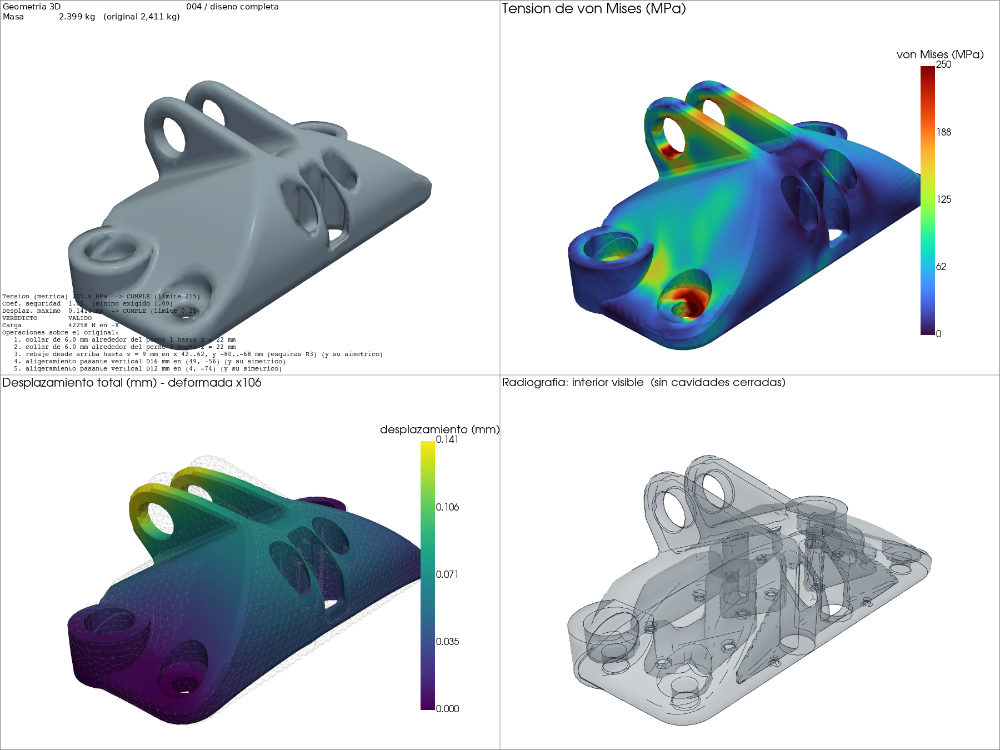

# Historial de hitos (verificados con malla fina, con proyecto Workbench)

Original: 2.423 kg | limite 215 MPa | carga 42258 N

| n | diseno | masa (kg) | tension (MPa) | ficha | proyecto |
|---|---|---|---|---|---|
| 01 | 01_it003_2.428kg | 2.428 | 206.0 |  | [Workbench](historial/01_it003_2.428kg/workbench/soporte_it003.wbpz) |
| 02 | 02_it004_2.399kg | 2.399 | 205.6 |  | [Workbench](historial/02_it004_2.399kg/workbench/soporte_it004.wbpz) |
| 03 | 03_it006_2.355kg | 2.355 | 196.6 |  | [Workbench](historial/03_it006_2.355kg/workbench/soporte_it006.wbpz) |
