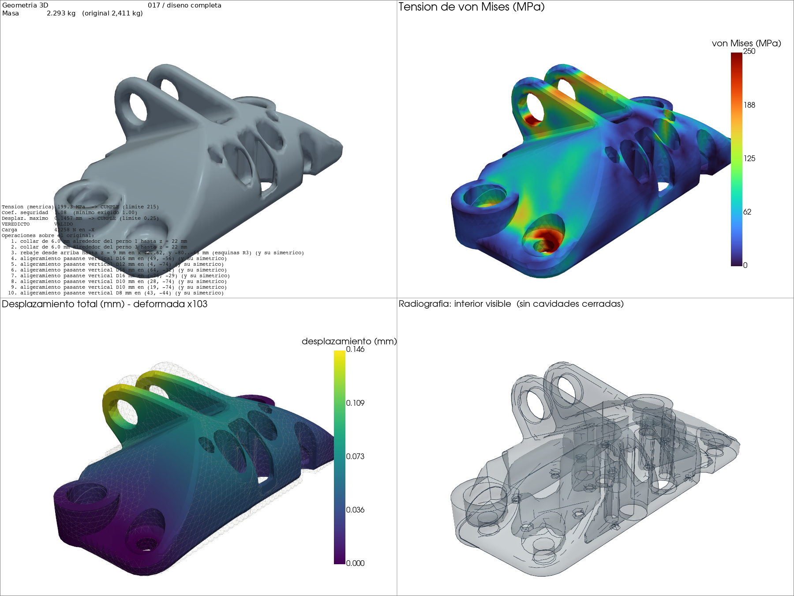
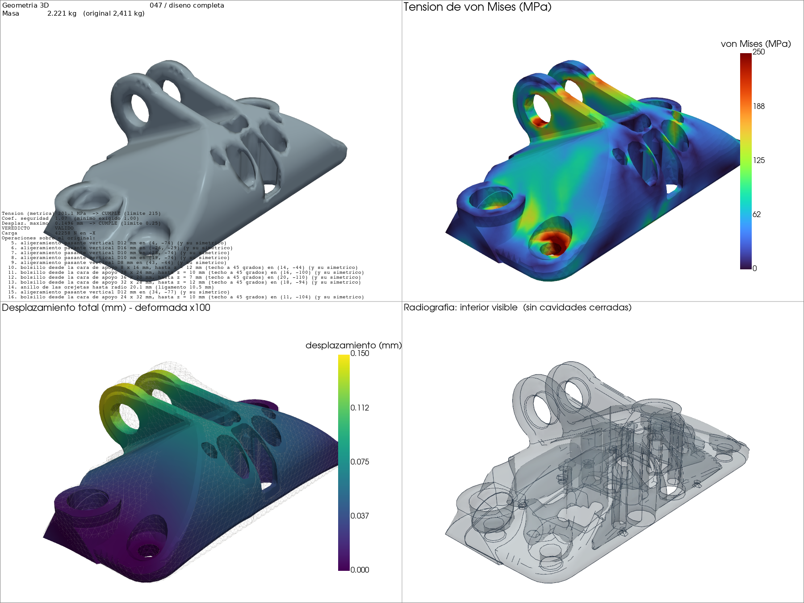

# Historial de hitos (verificados con malla fina, con proyecto Workbench)

Original: 2.423 kg | limite 215 MPa | carga 42258 N

| n | diseno | masa (kg) | tension (MPa) | ficha | proyecto |
|---|---|---|---|---|---|
| 01 | 01_it003_2.428kg | 2.428 | 206.0 |  | [Workbench](historial/01_it003_2.428kg/workbench/soporte_it003.wbpz) |
| 02 | 02_it004_2.399kg | 2.399 | 205.6 |  | [Workbench](historial/02_it004_2.399kg/workbench/soporte_it004.wbpz) |
| 03 | 03_it006_2.355kg | 2.355 | 196.6 |  | [Workbench](historial/03_it006_2.355kg/workbench/soporte_it006.wbpz) |
| 04 | 04_it008_2.320kg | 2.320 | 198.0 |  | [Workbench](historial/04_it008_2.320kg/workbench/soporte_it008.wbpz) |
| 05 | 05_it011_2.293kg | 2.293 | 199.3 |  | [Workbench](historial/05_it011_2.293kg/workbench/soporte_it011.wbpz) |
| 06 | 06_it017_2.293kg | 2.293 | 199.3 |  | [Workbench](historial/06_it017_2.293kg/workbench/soporte_it017.wbpz) |
| 07 | 07_it019_2.259kg | 2.259 | 199.6 |  | [Workbench](historial/07_it019_2.259kg/workbench/soporte_it019.wbpz) |
| 08 | 08_it020_2.241kg | 2.241 | 199.3 |  | [Workbench](historial/08_it020_2.241kg/workbench/soporte_it020.wbpz) |
| 09 | 09_it029_2.257kg | 2.257 | 202.1 |  | [Workbench](historial/09_it029_2.257kg/workbench/soporte_it029.wbpz) |
| 10 | 10_it047_2.221kg | 2.221 | 201.1 |  | [Workbench](historial/10_it047_2.221kg/workbench/soporte_it047.wbpz) |
