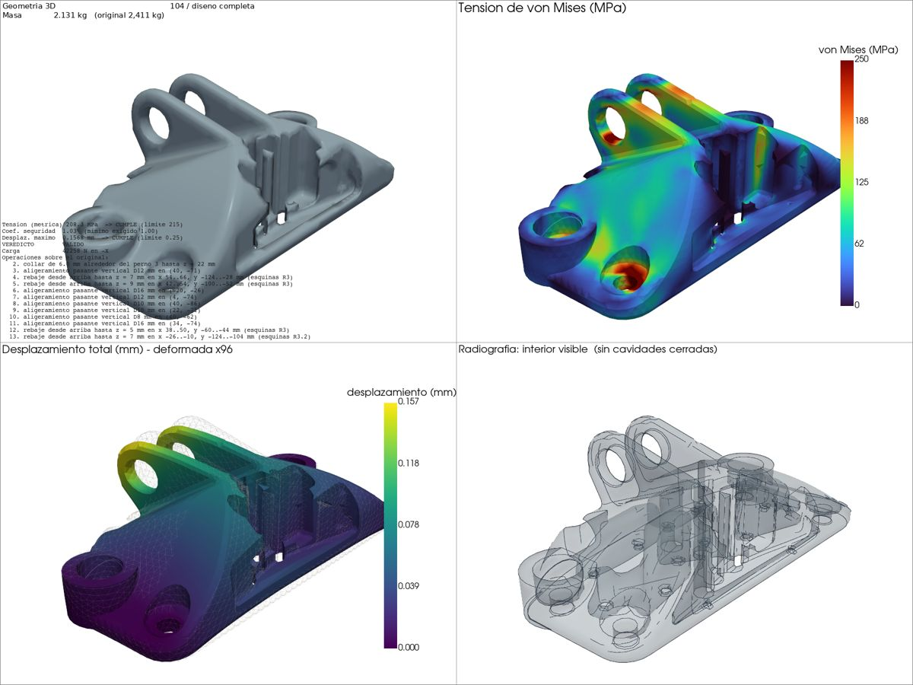
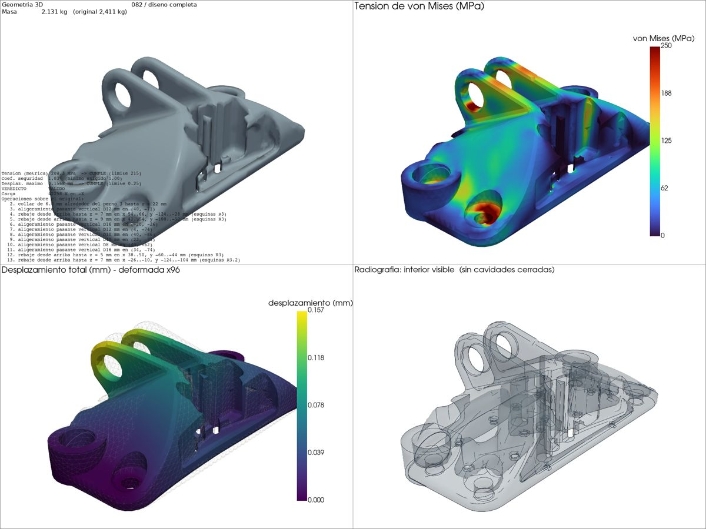
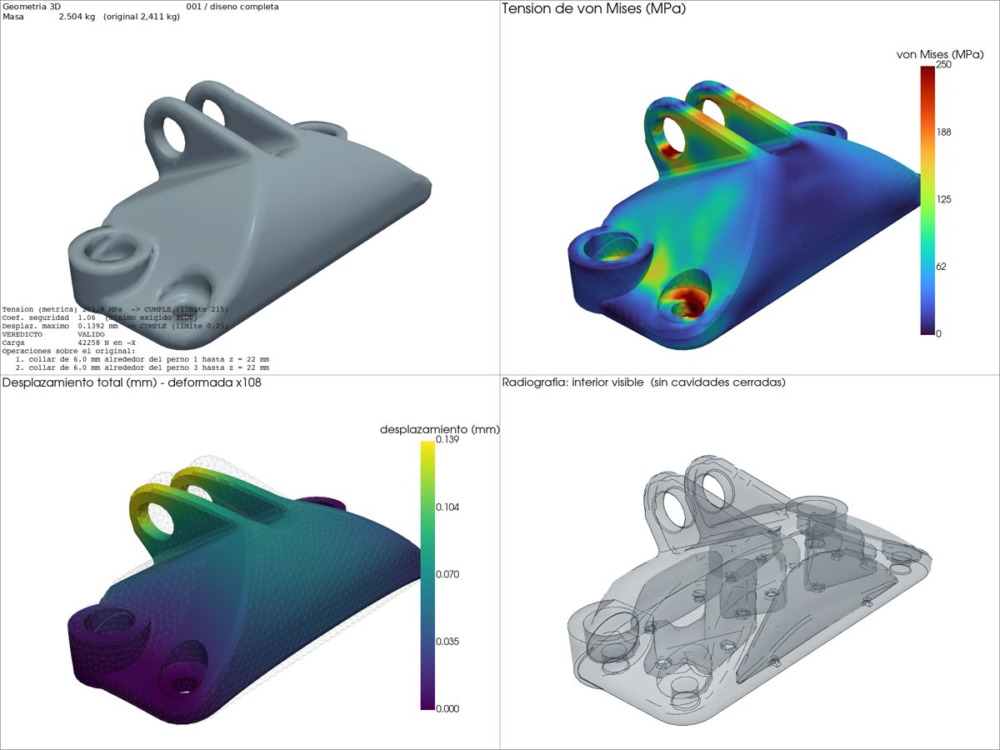

# Registro de iteraciones (changelog de la pieza)

Carga 42258 N | limite 215 MPa (coef. de seguridad >= 1.00) y 0.25 mm | reglas: [DESIGN_RULES.md](../../DESIGN_RULES.md) | la mas reciente arriba

## Iteracion 113 - ACEPTADA: R1 aligeramiento pasante vertical D10 mm en (43, -98)

*2026-11-24 03:45*

- **Pieza de partida:** 2.1608 kg | 203.1 MPa | CS 1.06 | 0.155 mm
- **Por que (regla R1):** Toda la columna en (43, -98) hasta 8 mm de radio trabaja como maximo al 34 % del limite (umbral de material ocioso: 35 %): no esta en el camino de la carga. Con Kt ~ 3 el borde del agujero quedaria por debajo del ~100 %; el pico (203 MPa, en cuerpo, lado de las orejetas (x < 15 mm)) esta a 88 mm. Evidencia: en los 16 disenos publicados VALIDOS, la mitad mas ligera tiene un 25 % de material ocioso (por debajo del 15 % de su pico) frente al 51 % del original; en ese grupo, a mas material ocioso mas masa (Spearman +0.55). Agujeros pasantes: en ese grupo, a mas agujeros pasantes (genus de la malla) menos masa (Spearman -0.11, p = 0.69).
- **Se esperaba:** mediana de las 105 veces que se ha aplicado: +1.3 % (prevision rapida: 2.1450 kg | 199.3 MPa | CS 1.08 | 0.156 mm)
- **Resultado (malla completa):** 2.1443 kg | 204.4 MPa | CS 1.05 | 0.156 mm (tension +0.6 %, masa -17 g)
- **Decision:** ACEPTADA - cumple y mejora al mejor (puntuacion 2.1608 -> 2.1443; masa 2.1608 -> 2.1443 kg)
- Descartada en la evaluacion rapida: [R3] hueco interior 12 x 16 x 8 mm (techo a 45 grados + evacuacion D5) en (12, -44) -> pasa la evaluacion rapida (2.1568 kg | 200.4 MPa | CS 1.07 | 0.155 mm) pero otra es mas prometedora; se podra proponer de nuevo
- Descartada en la evaluacion rapida: [R1] aligeramiento pasante vertical D8 mm en (16, -104) -> pasa la evaluacion rapida (2.1481 kg | 200.7 MPa | CS 1.07 | 0.156 mm) pero otra es mas prometedora; se podra proponer de nuevo

## Iteracion 112 - ACEPTADA: R1 aligeramiento pasante vertical D10 mm en (34, -83)

*2026-11-24 03:41*

- **Pieza de partida:** 2.1443 kg | 204.4 MPa | CS 1.05 | 0.156 mm
- **Por que (regla R1):** Toda la columna en (34, -83) hasta 8 mm de radio trabaja como maximo al 35 % del limite (umbral de material ocioso: 35 %): no esta en el camino de la carga. Con Kt ~ 3 el borde del agujero quedaria por debajo del ~100 %; el pico (204 MPa, en cuerpo, lado de las orejetas (x < 15 mm)) esta a 71 mm. Evidencia: en los 16 disenos publicados VALIDOS, la mitad mas ligera tiene un 25 % de material ocioso (por debajo del 15 % de su pico) frente al 51 % del original; en ese grupo, a mas material ocioso mas masa (Spearman +0.55). Agujeros pasantes: en ese grupo, a mas agujeros pasantes (genus de la malla) menos masa (Spearman -0.11, p = 0.69).
- **Se esperaba:** mediana de las 104 veces que se ha aplicado: +1.1 % (prevision rapida: 2.1319 kg | 204.3 MPa | CS 1.05 | 0.157 mm)
- **Resultado (malla completa):** 2.1307 kg | 208.3 MPa | CS 1.03 | 0.157 mm (tension +1.9 %, masa -14 g)
- **Decision:** ACEPTADA - cumple y mejora al mejor (puntuacion 2.1443 -> 2.1307; masa 2.1443 -> 2.1307 kg)
- Descartada en la evaluacion rapida: [R3] hueco interior 12 x 16 x 8 mm (techo a 45 grados + evacuacion D5) en (12, -44) -> pasa la evaluacion rapida (2.1404 kg | 202.6 MPa | CS 1.06 | 0.156 mm) pero otra es mas prometedora; se podra proponer de nuevo
- Descartada en la evaluacion rapida: [R1] aligeramiento pasante vertical D16 mm en (67, -23) -> pasa la evaluacion rapida (2.1322 kg | 205.1 MPa | CS 1.05 | 0.157 mm) pero otra es mas prometedora; se podra proponer de nuevo

## Iteracion 111 - ACEPTADA: R1 aligeramiento pasante vertical D10 mm en (43, -98)

*2026-11-24 03:37*

- **Pieza de partida:** 2.1608 kg | 203.1 MPa | CS 1.06 | 0.155 mm
- **Por que (regla R1):** Toda la columna en (43, -98) hasta 8 mm de radio trabaja como maximo al 34 % del limite (umbral de material ocioso: 35 %): no esta en el camino de la carga. Con Kt ~ 3 el borde del agujero quedaria por debajo del ~100 %; el pico (203 MPa, en cuerpo, lado de las orejetas (x < 15 mm)) esta a 88 mm. Evidencia: en los 16 disenos publicados VALIDOS, la mitad mas ligera tiene un 25 % de material ocioso (por debajo del 15 % de su pico) frente al 51 % del original; en ese grupo, a mas material ocioso mas masa (Spearman +0.55). Agujeros pasantes: en ese grupo, a mas agujeros pasantes (genus de la malla) menos masa (Spearman -0.11, p = 0.69).
- **Se esperaba:** mediana de las 103 veces que se ha aplicado: +1.3 % (prevision rapida: 2.1450 kg | 199.3 MPa | CS 1.08 | 0.156 mm)
- **Resultado (malla completa):** 2.1443 kg | 204.4 MPa | CS 1.05 | 0.156 mm (tension +0.6 %, masa -17 g)
- **Decision:** ACEPTADA - cumple y mejora al mejor (puntuacion 2.1608 -> 2.1443; masa 2.1608 -> 2.1443 kg)
- Descartada en la evaluacion rapida: [R3] hueco interior 12 x 16 x 8 mm (techo a 45 grados + evacuacion D5) en (12, -44) -> pasa la evaluacion rapida (2.1568 kg | 200.4 MPa | CS 1.07 | 0.155 mm) pero otra es mas prometedora; se podra proponer de nuevo
- Descartada en la evaluacion rapida: [R1] aligeramiento pasante vertical D8 mm en (16, -104) -> pasa la evaluacion rapida (2.1481 kg | 200.7 MPa | CS 1.07 | 0.156 mm) pero otra es mas prometedora; se podra proponer de nuevo

## Iteracion 110 - ACEPTADA: R1 aligeramiento pasante vertical D10 mm en (34, -83)

*2026-11-24 03:33*

- **Pieza de partida:** 2.1443 kg | 204.4 MPa | CS 1.05 | 0.156 mm
- **Por que (regla R1):** Toda la columna en (34, -83) hasta 8 mm de radio trabaja como maximo al 35 % del limite (umbral de material ocioso: 35 %): no esta en el camino de la carga. Con Kt ~ 3 el borde del agujero quedaria por debajo del ~100 %; el pico (204 MPa, en cuerpo, lado de las orejetas (x < 15 mm)) esta a 71 mm. Evidencia: en los 16 disenos publicados VALIDOS, la mitad mas ligera tiene un 25 % de material ocioso (por debajo del 15 % de su pico) frente al 51 % del original; en ese grupo, a mas material ocioso mas masa (Spearman +0.55). Agujeros pasantes: en ese grupo, a mas agujeros pasantes (genus de la malla) menos masa (Spearman -0.11, p = 0.69).
- **Se esperaba:** mediana de las 102 veces que se ha aplicado: +1.1 % (prevision rapida: 2.1319 kg | 204.3 MPa | CS 1.05 | 0.157 mm)
- **Resultado (malla completa):** 2.1307 kg | 208.3 MPa | CS 1.03 | 0.157 mm (tension +1.9 %, masa -14 g)
- **Decision:** ACEPTADA - cumple y mejora al mejor (puntuacion 2.1443 -> 2.1307; masa 2.1443 -> 2.1307 kg)
- Descartada en la evaluacion rapida: [R3] hueco interior 12 x 16 x 8 mm (techo a 45 grados + evacuacion D5) en (12, -44) -> pasa la evaluacion rapida (2.1404 kg | 202.6 MPa | CS 1.06 | 0.156 mm) pero otra es mas prometedora; se podra proponer de nuevo
- Descartada en la evaluacion rapida: [R1] aligeramiento pasante vertical D16 mm en (67, -23) -> pasa la evaluacion rapida (2.1322 kg | 205.1 MPa | CS 1.05 | 0.157 mm) pero otra es mas prometedora; se podra proponer de nuevo

## Iteracion 109 - ACEPTADA: R1 aligeramiento pasante vertical D10 mm en (43, -98)

*2026-11-24 03:28*

- **Pieza de partida:** 2.1608 kg | 203.1 MPa | CS 1.06 | 0.155 mm
- **Por que (regla R1):** Toda la columna en (43, -98) hasta 8 mm de radio trabaja como maximo al 34 % del limite (umbral de material ocioso: 35 %): no esta en el camino de la carga. Con Kt ~ 3 el borde del agujero quedaria por debajo del ~100 %; el pico (203 MPa, en cuerpo, lado de las orejetas (x < 15 mm)) esta a 88 mm. Evidencia: en los 16 disenos publicados VALIDOS, la mitad mas ligera tiene un 25 % de material ocioso (por debajo del 15 % de su pico) frente al 51 % del original; en ese grupo, a mas material ocioso mas masa (Spearman +0.55). Agujeros pasantes: en ese grupo, a mas agujeros pasantes (genus de la malla) menos masa (Spearman -0.11, p = 0.69).
- **Se esperaba:** mediana de las 101 veces que se ha aplicado: +1.3 % (prevision rapida: 2.1450 kg | 199.3 MPa | CS 1.08 | 0.156 mm)
- **Resultado (malla completa):** 2.1443 kg | 204.4 MPa | CS 1.05 | 0.156 mm (tension +0.6 %, masa -17 g)
- **Decision:** ACEPTADA - cumple y mejora al mejor (puntuacion 2.1608 -> 2.1443; masa 2.1608 -> 2.1443 kg)
- Descartada en la evaluacion rapida: [R3] hueco interior 12 x 16 x 8 mm (techo a 45 grados + evacuacion D5) en (12, -44) -> pasa la evaluacion rapida (2.1568 kg | 200.4 MPa | CS 1.07 | 0.155 mm) pero otra es mas prometedora; se podra proponer de nuevo
- Descartada en la evaluacion rapida: [R1] aligeramiento pasante vertical D8 mm en (16, -104) -> pasa la evaluacion rapida (2.1481 kg | 200.7 MPa | CS 1.07 | 0.156 mm) pero otra es mas prometedora; se podra proponer de nuevo

## Iteracion 108 - ACEPTADA: R1 aligeramiento pasante vertical D10 mm en (34, -83)

*2026-11-24 03:24*

- **Pieza de partida:** 2.1443 kg | 204.4 MPa | CS 1.05 | 0.156 mm
- **Por que (regla R1):** Toda la columna en (34, -83) hasta 8 mm de radio trabaja como maximo al 35 % del limite (umbral de material ocioso: 35 %): no esta en el camino de la carga. Con Kt ~ 3 el borde del agujero quedaria por debajo del ~100 %; el pico (204 MPa, en cuerpo, lado de las orejetas (x < 15 mm)) esta a 71 mm. Evidencia: en los 16 disenos publicados VALIDOS, la mitad mas ligera tiene un 25 % de material ocioso (por debajo del 15 % de su pico) frente al 51 % del original; en ese grupo, a mas material ocioso mas masa (Spearman +0.55). Agujeros pasantes: en ese grupo, a mas agujeros pasantes (genus de la malla) menos masa (Spearman -0.11, p = 0.69).
- **Se esperaba:** mediana de las 100 veces que se ha aplicado: +1.1 % (prevision rapida: 2.1319 kg | 204.3 MPa | CS 1.05 | 0.157 mm)
- **Resultado (malla completa):** 2.1307 kg | 208.3 MPa | CS 1.03 | 0.157 mm (tension +1.9 %, masa -14 g)
- **Decision:** ACEPTADA - cumple y mejora al mejor (puntuacion 2.1443 -> 2.1307; masa 2.1443 -> 2.1307 kg)
- Descartada en la evaluacion rapida: [R3] hueco interior 12 x 16 x 8 mm (techo a 45 grados + evacuacion D5) en (12, -44) -> pasa la evaluacion rapida (2.1404 kg | 202.6 MPa | CS 1.06 | 0.156 mm) pero otra es mas prometedora; se podra proponer de nuevo
- Descartada en la evaluacion rapida: [R1] aligeramiento pasante vertical D16 mm en (67, -23) -> pasa la evaluacion rapida (2.1322 kg | 205.1 MPa | CS 1.05 | 0.157 mm) pero otra es mas prometedora; se podra proponer de nuevo

## Iteracion 107 - ACEPTADA: R1 aligeramiento pasante vertical D10 mm en (43, -98)

*2026-11-24 03:20*

- **Pieza de partida:** 2.1608 kg | 203.1 MPa | CS 1.06 | 0.155 mm
- **Por que (regla R1):** Toda la columna en (43, -98) hasta 8 mm de radio trabaja como maximo al 34 % del limite (umbral de material ocioso: 35 %): no esta en el camino de la carga. Con Kt ~ 3 el borde del agujero quedaria por debajo del ~100 %; el pico (203 MPa, en cuerpo, lado de las orejetas (x < 15 mm)) esta a 88 mm. Evidencia: en los 16 disenos publicados VALIDOS, la mitad mas ligera tiene un 25 % de material ocioso (por debajo del 15 % de su pico) frente al 51 % del original; en ese grupo, a mas material ocioso mas masa (Spearman +0.55). Agujeros pasantes: en ese grupo, a mas agujeros pasantes (genus de la malla) menos masa (Spearman -0.11, p = 0.69).
- **Se esperaba:** mediana de las 99 veces que se ha aplicado: +1.3 % (prevision rapida: 2.1450 kg | 199.3 MPa | CS 1.08 | 0.156 mm)
- **Resultado (malla completa):** 2.1443 kg | 204.4 MPa | CS 1.05 | 0.156 mm (tension +0.6 %, masa -17 g)
- **Decision:** ACEPTADA - cumple y mejora al mejor (puntuacion 2.1608 -> 2.1443; masa 2.1608 -> 2.1443 kg)
- Descartada en la evaluacion rapida: [R3] hueco interior 12 x 16 x 8 mm (techo a 45 grados + evacuacion D5) en (12, -44) -> pasa la evaluacion rapida (2.1568 kg | 200.4 MPa | CS 1.07 | 0.155 mm) pero otra es mas prometedora; se podra proponer de nuevo
- Descartada en la evaluacion rapida: [R1] aligeramiento pasante vertical D8 mm en (16, -104) -> pasa la evaluacion rapida (2.1481 kg | 200.7 MPa | CS 1.07 | 0.156 mm) pero otra es mas prometedora; se podra proponer de nuevo

## Iteracion 106 - ACEPTADA: R1 aligeramiento pasante vertical D10 mm en (34, -83)

*2026-11-24 03:16*

- **Pieza de partida:** 2.1443 kg | 204.4 MPa | CS 1.05 | 0.156 mm
- **Por que (regla R1):** Toda la columna en (34, -83) hasta 8 mm de radio trabaja como maximo al 35 % del limite (umbral de material ocioso: 35 %): no esta en el camino de la carga. Con Kt ~ 3 el borde del agujero quedaria por debajo del ~100 %; el pico (204 MPa, en cuerpo, lado de las orejetas (x < 15 mm)) esta a 71 mm. Evidencia: en los 16 disenos publicados VALIDOS, la mitad mas ligera tiene un 25 % de material ocioso (por debajo del 15 % de su pico) frente al 51 % del original; en ese grupo, a mas material ocioso mas masa (Spearman +0.55). Agujeros pasantes: en ese grupo, a mas agujeros pasantes (genus de la malla) menos masa (Spearman -0.11, p = 0.69).
- **Se esperaba:** mediana de las 98 veces que se ha aplicado: +1.1 % (prevision rapida: 2.1319 kg | 204.3 MPa | CS 1.05 | 0.157 mm)
- **Resultado (malla completa):** 2.1307 kg | 208.3 MPa | CS 1.03 | 0.157 mm (tension +1.9 %, masa -14 g)
- **Decision:** ACEPTADA - cumple y mejora al mejor (puntuacion 2.1443 -> 2.1307; masa 2.1443 -> 2.1307 kg)
- Descartada en la evaluacion rapida: [R3] hueco interior 12 x 16 x 8 mm (techo a 45 grados + evacuacion D5) en (12, -44) -> pasa la evaluacion rapida (2.1404 kg | 202.6 MPa | CS 1.06 | 0.156 mm) pero otra es mas prometedora; se podra proponer de nuevo
- Descartada en la evaluacion rapida: [R1] aligeramiento pasante vertical D16 mm en (67, -23) -> pasa la evaluacion rapida (2.1322 kg | 205.1 MPa | CS 1.05 | 0.157 mm) pero otra es mas prometedora; se podra proponer de nuevo

## Iteracion 105 - ACEPTADA: R1 aligeramiento pasante vertical D10 mm en (43, -98)

*2026-11-24 03:12*

- **Pieza de partida:** 2.1608 kg | 203.1 MPa | CS 1.06 | 0.155 mm
- **Por que (regla R1):** Toda la columna en (43, -98) hasta 8 mm de radio trabaja como maximo al 34 % del limite (umbral de material ocioso: 35 %): no esta en el camino de la carga. Con Kt ~ 3 el borde del agujero quedaria por debajo del ~100 %; el pico (203 MPa, en cuerpo, lado de las orejetas (x < 15 mm)) esta a 88 mm. Evidencia: en los 16 disenos publicados VALIDOS, la mitad mas ligera tiene un 25 % de material ocioso (por debajo del 15 % de su pico) frente al 51 % del original; en ese grupo, a mas material ocioso mas masa (Spearman +0.55). Agujeros pasantes: en ese grupo, a mas agujeros pasantes (genus de la malla) menos masa (Spearman -0.11, p = 0.69).
- **Se esperaba:** mediana de las 97 veces que se ha aplicado: +1.3 % (prevision rapida: 2.1450 kg | 199.3 MPa | CS 1.08 | 0.156 mm)
- **Resultado (malla completa):** 2.1443 kg | 204.4 MPa | CS 1.05 | 0.156 mm (tension +0.6 %, masa -17 g)
- **Decision:** ACEPTADA - cumple y mejora al mejor (puntuacion 2.1608 -> 2.1443; masa 2.1608 -> 2.1443 kg)
- Descartada en la evaluacion rapida: [R3] hueco interior 12 x 16 x 8 mm (techo a 45 grados + evacuacion D5) en (12, -44) -> pasa la evaluacion rapida (2.1568 kg | 200.4 MPa | CS 1.07 | 0.155 mm) pero otra es mas prometedora; se podra proponer de nuevo
- Descartada en la evaluacion rapida: [R1] aligeramiento pasante vertical D8 mm en (16, -104) -> pasa la evaluacion rapida (2.1481 kg | 200.7 MPa | CS 1.07 | 0.156 mm) pero otra es mas prometedora; se podra proponer de nuevo

## Iteracion 104 - ACEPTADA: R1 aligeramiento pasante vertical D10 mm en (34, -83)

*2026-11-24 03:08*

- **Pieza de partida:** 2.1443 kg | 204.4 MPa | CS 1.05 | 0.156 mm
- **Por que (regla R1):** Toda la columna en (34, -83) hasta 8 mm de radio trabaja como maximo al 35 % del limite (umbral de material ocioso: 35 %): no esta en el camino de la carga. Con Kt ~ 3 el borde del agujero quedaria por debajo del ~100 %; el pico (204 MPa, en cuerpo, lado de las orejetas (x < 15 mm)) esta a 71 mm. Evidencia: en los 16 disenos publicados VALIDOS, la mitad mas ligera tiene un 25 % de material ocioso (por debajo del 15 % de su pico) frente al 51 % del original; en ese grupo, a mas material ocioso mas masa (Spearman +0.55). Agujeros pasantes: en ese grupo, a mas agujeros pasantes (genus de la malla) menos masa (Spearman -0.11, p = 0.69).
- **Se esperaba:** mediana de las 96 veces que se ha aplicado: +1.1 % (prevision rapida: 2.1319 kg | 204.3 MPa | CS 1.05 | 0.157 mm)
- **Resultado (malla completa):** 2.1307 kg | 208.3 MPa | CS 1.03 | 0.157 mm (tension +1.9 %, masa -14 g)
- **Decision:** ACEPTADA - cumple y mejora al mejor (puntuacion 2.1443 -> 2.1307; masa 2.1443 -> 2.1307 kg)
- Descartada en la evaluacion rapida: [R3] hueco interior 12 x 16 x 8 mm (techo a 45 grados + evacuacion D5) en (12, -44) -> pasa la evaluacion rapida (2.1404 kg | 202.6 MPa | CS 1.06 | 0.156 mm) pero otra es mas prometedora; se podra proponer de nuevo
- Descartada en la evaluacion rapida: [R1] aligeramiento pasante vertical D16 mm en (67, -23) -> pasa la evaluacion rapida (2.1322 kg | 205.1 MPa | CS 1.05 | 0.157 mm) pero otra es mas prometedora; se podra proponer de nuevo

## Iteracion 103 - ACEPTADA: R1 aligeramiento pasante vertical D10 mm en (43, -98)

*2026-11-24 03:04*

- **Pieza de partida:** 2.1608 kg | 203.1 MPa | CS 1.06 | 0.155 mm
- **Por que (regla R1):** Toda la columna en (43, -98) hasta 8 mm de radio trabaja como maximo al 34 % del limite (umbral de material ocioso: 35 %): no esta en el camino de la carga. Con Kt ~ 3 el borde del agujero quedaria por debajo del ~100 %; el pico (203 MPa, en cuerpo, lado de las orejetas (x < 15 mm)) esta a 88 mm. Evidencia: en los 16 disenos publicados VALIDOS, la mitad mas ligera tiene un 25 % de material ocioso (por debajo del 15 % de su pico) frente al 51 % del original; en ese grupo, a mas material ocioso mas masa (Spearman +0.55). Agujeros pasantes: en ese grupo, a mas agujeros pasantes (genus de la malla) menos masa (Spearman -0.11, p = 0.69).
- **Se esperaba:** mediana de las 95 veces que se ha aplicado: +1.3 % (prevision rapida: 2.1450 kg | 199.3 MPa | CS 1.08 | 0.156 mm)
- **Resultado (malla completa):** 2.1443 kg | 204.4 MPa | CS 1.05 | 0.156 mm (tension +0.6 %, masa -17 g)
- **Decision:** ACEPTADA - cumple y mejora al mejor (puntuacion 2.1608 -> 2.1443; masa 2.1608 -> 2.1443 kg)
- Descartada en la evaluacion rapida: [R3] hueco interior 12 x 16 x 8 mm (techo a 45 grados + evacuacion D5) en (12, -44) -> pasa la evaluacion rapida (2.1568 kg | 200.4 MPa | CS 1.07 | 0.155 mm) pero otra es mas prometedora; se podra proponer de nuevo
- Descartada en la evaluacion rapida: [R1] aligeramiento pasante vertical D8 mm en (16, -104) -> pasa la evaluacion rapida (2.1481 kg | 200.7 MPa | CS 1.07 | 0.156 mm) pero otra es mas prometedora; se podra proponer de nuevo

## Iteracion 102 - ACEPTADA: R1 aligeramiento pasante vertical D10 mm en (34, -83)

*2026-11-24 03:00*

- **Pieza de partida:** 2.1443 kg | 204.4 MPa | CS 1.05 | 0.156 mm
- **Por que (regla R1):** Toda la columna en (34, -83) hasta 8 mm de radio trabaja como maximo al 35 % del limite (umbral de material ocioso: 35 %): no esta en el camino de la carga. Con Kt ~ 3 el borde del agujero quedaria por debajo del ~100 %; el pico (204 MPa, en cuerpo, lado de las orejetas (x < 15 mm)) esta a 71 mm. Evidencia: en los 16 disenos publicados VALIDOS, la mitad mas ligera tiene un 25 % de material ocioso (por debajo del 15 % de su pico) frente al 51 % del original; en ese grupo, a mas material ocioso mas masa (Spearman +0.55). Agujeros pasantes: en ese grupo, a mas agujeros pasantes (genus de la malla) menos masa (Spearman -0.11, p = 0.69).
- **Se esperaba:** mediana de las 94 veces que se ha aplicado: +1.1 % (prevision rapida: 2.1319 kg | 204.3 MPa | CS 1.05 | 0.157 mm)
- **Resultado (malla completa):** 2.1307 kg | 208.3 MPa | CS 1.03 | 0.157 mm (tension +1.9 %, masa -14 g)
- **Decision:** ACEPTADA - cumple y mejora al mejor (puntuacion 2.1443 -> 2.1307; masa 2.1443 -> 2.1307 kg)
- Descartada en la evaluacion rapida: [R3] hueco interior 12 x 16 x 8 mm (techo a 45 grados + evacuacion D5) en (12, -44) -> pasa la evaluacion rapida (2.1404 kg | 202.6 MPa | CS 1.06 | 0.156 mm) pero otra es mas prometedora; se podra proponer de nuevo
- Descartada en la evaluacion rapida: [R1] aligeramiento pasante vertical D16 mm en (67, -23) -> pasa la evaluacion rapida (2.1322 kg | 205.1 MPa | CS 1.05 | 0.157 mm) pero otra es mas prometedora; se podra proponer de nuevo

## Iteracion 101 - ACEPTADA: R1 aligeramiento pasante vertical D10 mm en (43, -98)

*2026-11-24 02:56*

- **Pieza de partida:** 2.1608 kg | 203.1 MPa | CS 1.06 | 0.155 mm
- **Por que (regla R1):** Toda la columna en (43, -98) hasta 8 mm de radio trabaja como maximo al 34 % del limite (umbral de material ocioso: 35 %): no esta en el camino de la carga. Con Kt ~ 3 el borde del agujero quedaria por debajo del ~100 %; el pico (203 MPa, en cuerpo, lado de las orejetas (x < 15 mm)) esta a 88 mm. Evidencia: en los 16 disenos publicados VALIDOS, la mitad mas ligera tiene un 25 % de material ocioso (por debajo del 15 % de su pico) frente al 51 % del original; en ese grupo, a mas material ocioso mas masa (Spearman +0.55). Agujeros pasantes: en ese grupo, a mas agujeros pasantes (genus de la malla) menos masa (Spearman -0.11, p = 0.69).
- **Se esperaba:** mediana de las 93 veces que se ha aplicado: +1.3 % (prevision rapida: 2.1450 kg | 199.3 MPa | CS 1.08 | 0.156 mm)
- **Resultado (malla completa):** 2.1443 kg | 204.4 MPa | CS 1.05 | 0.156 mm (tension +0.6 %, masa -17 g)
- **Decision:** ACEPTADA - cumple y mejora al mejor (puntuacion 2.1608 -> 2.1443; masa 2.1608 -> 2.1443 kg)
- Descartada en la evaluacion rapida: [R3] hueco interior 12 x 16 x 8 mm (techo a 45 grados + evacuacion D5) en (12, -44) -> pasa la evaluacion rapida (2.1568 kg | 200.4 MPa | CS 1.07 | 0.155 mm) pero otra es mas prometedora; se podra proponer de nuevo
- Descartada en la evaluacion rapida: [R1] aligeramiento pasante vertical D8 mm en (16, -104) -> pasa la evaluacion rapida (2.1481 kg | 200.7 MPa | CS 1.07 | 0.156 mm) pero otra es mas prometedora; se podra proponer de nuevo

## Iteracion 100 - ACEPTADA: R1 aligeramiento pasante vertical D10 mm en (34, -83)

*2026-11-24 02:52*

- **Pieza de partida:** 2.1443 kg | 204.4 MPa | CS 1.05 | 0.156 mm
- **Por que (regla R1):** Toda la columna en (34, -83) hasta 8 mm de radio trabaja como maximo al 35 % del limite (umbral de material ocioso: 35 %): no esta en el camino de la carga. Con Kt ~ 3 el borde del agujero quedaria por debajo del ~100 %; el pico (204 MPa, en cuerpo, lado de las orejetas (x < 15 mm)) esta a 71 mm. Evidencia: en los 16 disenos publicados VALIDOS, la mitad mas ligera tiene un 25 % de material ocioso (por debajo del 15 % de su pico) frente al 51 % del original; en ese grupo, a mas material ocioso mas masa (Spearman +0.55). Agujeros pasantes: en ese grupo, a mas agujeros pasantes (genus de la malla) menos masa (Spearman -0.11, p = 0.69).
- **Se esperaba:** mediana de las 92 veces que se ha aplicado: +1.1 % (prevision rapida: 2.1319 kg | 204.3 MPa | CS 1.05 | 0.157 mm)
- **Resultado (malla completa):** 2.1307 kg | 208.3 MPa | CS 1.03 | 0.157 mm (tension +1.9 %, masa -14 g)
- **Decision:** ACEPTADA - cumple y mejora al mejor (puntuacion 2.1443 -> 2.1307; masa 2.1443 -> 2.1307 kg)
- Descartada en la evaluacion rapida: [R3] hueco interior 12 x 16 x 8 mm (techo a 45 grados + evacuacion D5) en (12, -44) -> pasa la evaluacion rapida (2.1404 kg | 202.6 MPa | CS 1.06 | 0.156 mm) pero otra es mas prometedora; se podra proponer de nuevo
- Descartada en la evaluacion rapida: [R1] aligeramiento pasante vertical D16 mm en (67, -23) -> pasa la evaluacion rapida (2.1322 kg | 205.1 MPa | CS 1.05 | 0.157 mm) pero otra es mas prometedora; se podra proponer de nuevo

## Iteracion 99 - ACEPTADA: R1 aligeramiento pasante vertical D10 mm en (43, -98)

*2026-11-24 02:48*

- **Pieza de partida:** 2.1608 kg | 203.1 MPa | CS 1.06 | 0.155 mm
- **Por que (regla R1):** Toda la columna en (43, -98) hasta 8 mm de radio trabaja como maximo al 34 % del limite (umbral de material ocioso: 35 %): no esta en el camino de la carga. Con Kt ~ 3 el borde del agujero quedaria por debajo del ~100 %; el pico (203 MPa, en cuerpo, lado de las orejetas (x < 15 mm)) esta a 88 mm. Evidencia: en los 16 disenos publicados VALIDOS, la mitad mas ligera tiene un 25 % de material ocioso (por debajo del 15 % de su pico) frente al 51 % del original; en ese grupo, a mas material ocioso mas masa (Spearman +0.55). Agujeros pasantes: en ese grupo, a mas agujeros pasantes (genus de la malla) menos masa (Spearman -0.11, p = 0.69).
- **Se esperaba:** mediana de las 91 veces que se ha aplicado: +1.3 % (prevision rapida: 2.1450 kg | 199.3 MPa | CS 1.08 | 0.156 mm)
- **Resultado (malla completa):** 2.1443 kg | 204.4 MPa | CS 1.05 | 0.156 mm (tension +0.6 %, masa -17 g)
- **Decision:** ACEPTADA - cumple y mejora al mejor (puntuacion 2.1608 -> 2.1443; masa 2.1608 -> 2.1443 kg)
- Descartada en la evaluacion rapida: [R3] hueco interior 12 x 16 x 8 mm (techo a 45 grados + evacuacion D5) en (12, -44) -> pasa la evaluacion rapida (2.1568 kg | 200.4 MPa | CS 1.07 | 0.155 mm) pero otra es mas prometedora; se podra proponer de nuevo
- Descartada en la evaluacion rapida: [R1] aligeramiento pasante vertical D8 mm en (16, -104) -> pasa la evaluacion rapida (2.1481 kg | 200.7 MPa | CS 1.07 | 0.156 mm) pero otra es mas prometedora; se podra proponer de nuevo

## Iteracion 98 - ACEPTADA: R1 aligeramiento pasante vertical D10 mm en (34, -83)

*2026-11-24 02:44*

- **Pieza de partida:** 2.1443 kg | 204.4 MPa | CS 1.05 | 0.156 mm
- **Por que (regla R1):** Toda la columna en (34, -83) hasta 8 mm de radio trabaja como maximo al 35 % del limite (umbral de material ocioso: 35 %): no esta en el camino de la carga. Con Kt ~ 3 el borde del agujero quedaria por debajo del ~100 %; el pico (204 MPa, en cuerpo, lado de las orejetas (x < 15 mm)) esta a 71 mm. Evidencia: en los 16 disenos publicados VALIDOS, la mitad mas ligera tiene un 25 % de material ocioso (por debajo del 15 % de su pico) frente al 51 % del original; en ese grupo, a mas material ocioso mas masa (Spearman +0.55). Agujeros pasantes: en ese grupo, a mas agujeros pasantes (genus de la malla) menos masa (Spearman -0.11, p = 0.69).
- **Se esperaba:** mediana de las 90 veces que se ha aplicado: +1.1 % (prevision rapida: 2.1319 kg | 204.3 MPa | CS 1.05 | 0.157 mm)
- **Resultado (malla completa):** 2.1307 kg | 208.3 MPa | CS 1.03 | 0.157 mm (tension +1.9 %, masa -14 g)
- **Decision:** ACEPTADA - cumple y mejora al mejor (puntuacion 2.1443 -> 2.1307; masa 2.1443 -> 2.1307 kg)
- Descartada en la evaluacion rapida: [R3] hueco interior 12 x 16 x 8 mm (techo a 45 grados + evacuacion D5) en (12, -44) -> pasa la evaluacion rapida (2.1404 kg | 202.6 MPa | CS 1.06 | 0.156 mm) pero otra es mas prometedora; se podra proponer de nuevo
- Descartada en la evaluacion rapida: [R1] aligeramiento pasante vertical D16 mm en (67, -23) -> pasa la evaluacion rapida (2.1322 kg | 205.1 MPa | CS 1.05 | 0.157 mm) pero otra es mas prometedora; se podra proponer de nuevo

## Iteracion 97 - ACEPTADA: R1 aligeramiento pasante vertical D10 mm en (43, -98)

*2026-11-24 02:40*

- **Pieza de partida:** 2.1608 kg | 203.1 MPa | CS 1.06 | 0.155 mm
- **Por que (regla R1):** Toda la columna en (43, -98) hasta 8 mm de radio trabaja como maximo al 34 % del limite (umbral de material ocioso: 35 %): no esta en el camino de la carga. Con Kt ~ 3 el borde del agujero quedaria por debajo del ~100 %; el pico (203 MPa, en cuerpo, lado de las orejetas (x < 15 mm)) esta a 88 mm. Evidencia: en los 16 disenos publicados VALIDOS, la mitad mas ligera tiene un 25 % de material ocioso (por debajo del 15 % de su pico) frente al 51 % del original; en ese grupo, a mas material ocioso mas masa (Spearman +0.55). Agujeros pasantes: en ese grupo, a mas agujeros pasantes (genus de la malla) menos masa (Spearman -0.11, p = 0.69).
- **Se esperaba:** mediana de las 89 veces que se ha aplicado: +1.3 % (prevision rapida: 2.1450 kg | 199.3 MPa | CS 1.08 | 0.156 mm)
- **Resultado (malla completa):** 2.1443 kg | 204.4 MPa | CS 1.05 | 0.156 mm (tension +0.6 %, masa -17 g)
- **Decision:** ACEPTADA - cumple y mejora al mejor (puntuacion 2.1608 -> 2.1443; masa 2.1608 -> 2.1443 kg)
- Descartada en la evaluacion rapida: [R3] hueco interior 12 x 16 x 8 mm (techo a 45 grados + evacuacion D5) en (12, -44) -> pasa la evaluacion rapida (2.1568 kg | 200.4 MPa | CS 1.07 | 0.155 mm) pero otra es mas prometedora; se podra proponer de nuevo
- Descartada en la evaluacion rapida: [R1] aligeramiento pasante vertical D8 mm en (16, -104) -> pasa la evaluacion rapida (2.1481 kg | 200.7 MPa | CS 1.07 | 0.156 mm) pero otra es mas prometedora; se podra proponer de nuevo

## Iteracion 96 - ACEPTADA: R1 aligeramiento pasante vertical D10 mm en (34, -83)

*2026-11-24 02:36*

- **Pieza de partida:** 2.1443 kg | 204.4 MPa | CS 1.05 | 0.156 mm
- **Por que (regla R1):** Toda la columna en (34, -83) hasta 8 mm de radio trabaja como maximo al 35 % del limite (umbral de material ocioso: 35 %): no esta en el camino de la carga. Con Kt ~ 3 el borde del agujero quedaria por debajo del ~100 %; el pico (204 MPa, en cuerpo, lado de las orejetas (x < 15 mm)) esta a 71 mm. Evidencia: en los 16 disenos publicados VALIDOS, la mitad mas ligera tiene un 25 % de material ocioso (por debajo del 15 % de su pico) frente al 51 % del original; en ese grupo, a mas material ocioso mas masa (Spearman +0.55). Agujeros pasantes: en ese grupo, a mas agujeros pasantes (genus de la malla) menos masa (Spearman -0.11, p = 0.69).
- **Se esperaba:** mediana de las 88 veces que se ha aplicado: +1.1 % (prevision rapida: 2.1319 kg | 204.3 MPa | CS 1.05 | 0.157 mm)
- **Resultado (malla completa):** 2.1307 kg | 208.3 MPa | CS 1.03 | 0.157 mm (tension +1.9 %, masa -14 g)
- **Decision:** ACEPTADA - cumple y mejora al mejor (puntuacion 2.1443 -> 2.1307; masa 2.1443 -> 2.1307 kg)
- Descartada en la evaluacion rapida: [R3] hueco interior 12 x 16 x 8 mm (techo a 45 grados + evacuacion D5) en (12, -44) -> pasa la evaluacion rapida (2.1404 kg | 202.6 MPa | CS 1.06 | 0.156 mm) pero otra es mas prometedora; se podra proponer de nuevo
- Descartada en la evaluacion rapida: [R1] aligeramiento pasante vertical D16 mm en (67, -23) -> pasa la evaluacion rapida (2.1322 kg | 205.1 MPa | CS 1.05 | 0.157 mm) pero otra es mas prometedora; se podra proponer de nuevo

## Iteracion 95 - ACEPTADA: R1 aligeramiento pasante vertical D10 mm en (43, -98)

*2026-11-24 02:32*

- **Pieza de partida:** 2.1608 kg | 203.1 MPa | CS 1.06 | 0.155 mm
- **Por que (regla R1):** Toda la columna en (43, -98) hasta 8 mm de radio trabaja como maximo al 34 % del limite (umbral de material ocioso: 35 %): no esta en el camino de la carga. Con Kt ~ 3 el borde del agujero quedaria por debajo del ~100 %; el pico (203 MPa, en cuerpo, lado de las orejetas (x < 15 mm)) esta a 88 mm. Evidencia: en los 16 disenos publicados VALIDOS, la mitad mas ligera tiene un 25 % de material ocioso (por debajo del 15 % de su pico) frente al 51 % del original; en ese grupo, a mas material ocioso mas masa (Spearman +0.55). Agujeros pasantes: en ese grupo, a mas agujeros pasantes (genus de la malla) menos masa (Spearman -0.11, p = 0.69).
- **Se esperaba:** mediana de las 87 veces que se ha aplicado: +1.3 % (prevision rapida: 2.1450 kg | 199.3 MPa | CS 1.08 | 0.156 mm)
- **Resultado (malla completa):** 2.1443 kg | 204.4 MPa | CS 1.05 | 0.156 mm (tension +0.6 %, masa -17 g)
- **Decision:** ACEPTADA - cumple y mejora al mejor (puntuacion 2.1608 -> 2.1443; masa 2.1608 -> 2.1443 kg)
- Descartada en la evaluacion rapida: [R3] hueco interior 12 x 16 x 8 mm (techo a 45 grados + evacuacion D5) en (12, -44) -> pasa la evaluacion rapida (2.1568 kg | 200.4 MPa | CS 1.07 | 0.155 mm) pero otra es mas prometedora; se podra proponer de nuevo
- Descartada en la evaluacion rapida: [R1] aligeramiento pasante vertical D8 mm en (16, -104) -> pasa la evaluacion rapida (2.1481 kg | 200.7 MPa | CS 1.07 | 0.156 mm) pero otra es mas prometedora; se podra proponer de nuevo

## Iteracion 94 - ACEPTADA: R1 aligeramiento pasante vertical D10 mm en (34, -83)

*2026-11-24 02:28*

- **Pieza de partida:** 2.1443 kg | 204.4 MPa | CS 1.05 | 0.156 mm
- **Por que (regla R1):** Toda la columna en (34, -83) hasta 8 mm de radio trabaja como maximo al 35 % del limite (umbral de material ocioso: 35 %): no esta en el camino de la carga. Con Kt ~ 3 el borde del agujero quedaria por debajo del ~100 %; el pico (204 MPa, en cuerpo, lado de las orejetas (x < 15 mm)) esta a 71 mm. Evidencia: en los 16 disenos publicados VALIDOS, la mitad mas ligera tiene un 25 % de material ocioso (por debajo del 15 % de su pico) frente al 51 % del original; en ese grupo, a mas material ocioso mas masa (Spearman +0.55). Agujeros pasantes: en ese grupo, a mas agujeros pasantes (genus de la malla) menos masa (Spearman -0.11, p = 0.69).
- **Se esperaba:** mediana de las 86 veces que se ha aplicado: +1.1 % (prevision rapida: 2.1319 kg | 204.3 MPa | CS 1.05 | 0.157 mm)
- **Resultado (malla completa):** 2.1307 kg | 208.3 MPa | CS 1.03 | 0.157 mm (tension +1.9 %, masa -14 g)
- **Decision:** ACEPTADA - cumple y mejora al mejor (puntuacion 2.1443 -> 2.1307; masa 2.1443 -> 2.1307 kg)
- Descartada en la evaluacion rapida: [R3] hueco interior 12 x 16 x 8 mm (techo a 45 grados + evacuacion D5) en (12, -44) -> pasa la evaluacion rapida (2.1404 kg | 202.6 MPa | CS 1.06 | 0.156 mm) pero otra es mas prometedora; se podra proponer de nuevo
- Descartada en la evaluacion rapida: [R1] aligeramiento pasante vertical D16 mm en (67, -23) -> pasa la evaluacion rapida (2.1322 kg | 205.1 MPa | CS 1.05 | 0.157 mm) pero otra es mas prometedora; se podra proponer de nuevo

## Iteracion 93 - ACEPTADA: R1 aligeramiento pasante vertical D10 mm en (43, -98)

*2026-11-24 02:24*

- **Pieza de partida:** 2.1608 kg | 203.1 MPa | CS 1.06 | 0.155 mm
- **Por que (regla R1):** Toda la columna en (43, -98) hasta 8 mm de radio trabaja como maximo al 34 % del limite (umbral de material ocioso: 35 %): no esta en el camino de la carga. Con Kt ~ 3 el borde del agujero quedaria por debajo del ~100 %; el pico (203 MPa, en cuerpo, lado de las orejetas (x < 15 mm)) esta a 88 mm. Evidencia: en los 16 disenos publicados VALIDOS, la mitad mas ligera tiene un 25 % de material ocioso (por debajo del 15 % de su pico) frente al 51 % del original; en ese grupo, a mas material ocioso mas masa (Spearman +0.55). Agujeros pasantes: en ese grupo, a mas agujeros pasantes (genus de la malla) menos masa (Spearman -0.11, p = 0.69).
- **Se esperaba:** mediana de las 85 veces que se ha aplicado: +1.3 % (prevision rapida: 2.1450 kg | 199.3 MPa | CS 1.08 | 0.156 mm)
- **Resultado (malla completa):** 2.1443 kg | 204.4 MPa | CS 1.05 | 0.156 mm (tension +0.6 %, masa -17 g)
- **Decision:** ACEPTADA - cumple y mejora al mejor (puntuacion 2.1608 -> 2.1443; masa 2.1608 -> 2.1443 kg)
- Descartada en la evaluacion rapida: [R3] hueco interior 12 x 16 x 8 mm (techo a 45 grados + evacuacion D5) en (12, -44) -> pasa la evaluacion rapida (2.1568 kg | 200.4 MPa | CS 1.07 | 0.155 mm) pero otra es mas prometedora; se podra proponer de nuevo
- Descartada en la evaluacion rapida: [R1] aligeramiento pasante vertical D8 mm en (16, -104) -> pasa la evaluacion rapida (2.1481 kg | 200.7 MPa | CS 1.07 | 0.156 mm) pero otra es mas prometedora; se podra proponer de nuevo

## Iteracion 92 - ACEPTADA: R1 aligeramiento pasante vertical D10 mm en (34, -83)

*2026-11-24 02:20*

- **Pieza de partida:** 2.1443 kg | 204.4 MPa | CS 1.05 | 0.156 mm
- **Por que (regla R1):** Toda la columna en (34, -83) hasta 8 mm de radio trabaja como maximo al 35 % del limite (umbral de material ocioso: 35 %): no esta en el camino de la carga. Con Kt ~ 3 el borde del agujero quedaria por debajo del ~100 %; el pico (204 MPa, en cuerpo, lado de las orejetas (x < 15 mm)) esta a 71 mm. Evidencia: en los 16 disenos publicados VALIDOS, la mitad mas ligera tiene un 25 % de material ocioso (por debajo del 15 % de su pico) frente al 51 % del original; en ese grupo, a mas material ocioso mas masa (Spearman +0.55). Agujeros pasantes: en ese grupo, a mas agujeros pasantes (genus de la malla) menos masa (Spearman -0.11, p = 0.69).
- **Se esperaba:** mediana de las 84 veces que se ha aplicado: +1.1 % (prevision rapida: 2.1319 kg | 204.3 MPa | CS 1.05 | 0.157 mm)
- **Resultado (malla completa):** 2.1307 kg | 208.3 MPa | CS 1.03 | 0.157 mm (tension +1.9 %, masa -14 g)
- **Decision:** ACEPTADA - cumple y mejora al mejor (puntuacion 2.1443 -> 2.1307; masa 2.1443 -> 2.1307 kg)
- Descartada en la evaluacion rapida: [R3] hueco interior 12 x 16 x 8 mm (techo a 45 grados + evacuacion D5) en (12, -44) -> pasa la evaluacion rapida (2.1404 kg | 202.6 MPa | CS 1.06 | 0.156 mm) pero otra es mas prometedora; se podra proponer de nuevo
- Descartada en la evaluacion rapida: [R1] aligeramiento pasante vertical D16 mm en (67, -23) -> pasa la evaluacion rapida (2.1322 kg | 205.1 MPa | CS 1.05 | 0.157 mm) pero otra es mas prometedora; se podra proponer de nuevo

## Iteracion 91 - ACEPTADA: R1 aligeramiento pasante vertical D10 mm en (43, -98)

*2026-11-24 02:16*

- **Pieza de partida:** 2.1608 kg | 203.1 MPa | CS 1.06 | 0.155 mm
- **Por que (regla R1):** Toda la columna en (43, -98) hasta 8 mm de radio trabaja como maximo al 34 % del limite (umbral de material ocioso: 35 %): no esta en el camino de la carga. Con Kt ~ 3 el borde del agujero quedaria por debajo del ~100 %; el pico (203 MPa, en cuerpo, lado de las orejetas (x < 15 mm)) esta a 88 mm. Evidencia: en los 16 disenos publicados VALIDOS, la mitad mas ligera tiene un 25 % de material ocioso (por debajo del 15 % de su pico) frente al 51 % del original; en ese grupo, a mas material ocioso mas masa (Spearman +0.55). Agujeros pasantes: en ese grupo, a mas agujeros pasantes (genus de la malla) menos masa (Spearman -0.11, p = 0.69).
- **Se esperaba:** mediana de las 83 veces que se ha aplicado: +1.3 % (prevision rapida: 2.1450 kg | 199.3 MPa | CS 1.08 | 0.156 mm)
- **Resultado (malla completa):** 2.1443 kg | 204.4 MPa | CS 1.05 | 0.156 mm (tension +0.6 %, masa -17 g)
- **Decision:** ACEPTADA - cumple y mejora al mejor (puntuacion 2.1608 -> 2.1443; masa 2.1608 -> 2.1443 kg)
- Descartada en la evaluacion rapida: [R3] hueco interior 12 x 16 x 8 mm (techo a 45 grados + evacuacion D5) en (12, -44) -> pasa la evaluacion rapida (2.1568 kg | 200.4 MPa | CS 1.07 | 0.155 mm) pero otra es mas prometedora; se podra proponer de nuevo
- Descartada en la evaluacion rapida: [R1] aligeramiento pasante vertical D8 mm en (16, -104) -> pasa la evaluacion rapida (2.1481 kg | 200.7 MPa | CS 1.07 | 0.156 mm) pero otra es mas prometedora; se podra proponer de nuevo

## Iteracion 90 - ACEPTADA: R1 aligeramiento pasante vertical D10 mm en (34, -83)

*2026-11-24 02:12*

- **Pieza de partida:** 2.1443 kg | 204.4 MPa | CS 1.05 | 0.156 mm
- **Por que (regla R1):** Toda la columna en (34, -83) hasta 8 mm de radio trabaja como maximo al 35 % del limite (umbral de material ocioso: 35 %): no esta en el camino de la carga. Con Kt ~ 3 el borde del agujero quedaria por debajo del ~100 %; el pico (204 MPa, en cuerpo, lado de las orejetas (x < 15 mm)) esta a 71 mm. Evidencia: en los 16 disenos publicados VALIDOS, la mitad mas ligera tiene un 25 % de material ocioso (por debajo del 15 % de su pico) frente al 51 % del original; en ese grupo, a mas material ocioso mas masa (Spearman +0.55). Agujeros pasantes: en ese grupo, a mas agujeros pasantes (genus de la malla) menos masa (Spearman -0.11, p = 0.69).
- **Se esperaba:** mediana de las 82 veces que se ha aplicado: +1.1 % (prevision rapida: 2.1319 kg | 204.3 MPa | CS 1.05 | 0.157 mm)
- **Resultado (malla completa):** 2.1307 kg | 208.3 MPa | CS 1.03 | 0.157 mm (tension +1.9 %, masa -14 g)
- **Decision:** ACEPTADA - cumple y mejora al mejor (puntuacion 2.1443 -> 2.1307; masa 2.1443 -> 2.1307 kg)
- Descartada en la evaluacion rapida: [R3] hueco interior 12 x 16 x 8 mm (techo a 45 grados + evacuacion D5) en (12, -44) -> pasa la evaluacion rapida (2.1404 kg | 202.6 MPa | CS 1.06 | 0.156 mm) pero otra es mas prometedora; se podra proponer de nuevo
- Descartada en la evaluacion rapida: [R1] aligeramiento pasante vertical D16 mm en (67, -23) -> pasa la evaluacion rapida (2.1322 kg | 205.1 MPa | CS 1.05 | 0.157 mm) pero otra es mas prometedora; se podra proponer de nuevo

## Iteracion 89 - ACEPTADA: R1 aligeramiento pasante vertical D10 mm en (43, -98)

*2026-11-24 02:07*

- **Pieza de partida:** 2.1608 kg | 203.1 MPa | CS 1.06 | 0.155 mm
- **Por que (regla R1):** Toda la columna en (43, -98) hasta 8 mm de radio trabaja como maximo al 34 % del limite (umbral de material ocioso: 35 %): no esta en el camino de la carga. Con Kt ~ 3 el borde del agujero quedaria por debajo del ~100 %; el pico (203 MPa, en cuerpo, lado de las orejetas (x < 15 mm)) esta a 88 mm. Evidencia: en los 16 disenos publicados VALIDOS, la mitad mas ligera tiene un 25 % de material ocioso (por debajo del 15 % de su pico) frente al 51 % del original; en ese grupo, a mas material ocioso mas masa (Spearman +0.55). Agujeros pasantes: en ese grupo, a mas agujeros pasantes (genus de la malla) menos masa (Spearman -0.11, p = 0.69).
- **Se esperaba:** mediana de las 81 veces que se ha aplicado: +1.3 % (prevision rapida: 2.1450 kg | 199.3 MPa | CS 1.08 | 0.156 mm)
- **Resultado (malla completa):** 2.1443 kg | 204.4 MPa | CS 1.05 | 0.156 mm (tension +0.6 %, masa -17 g)
- **Decision:** ACEPTADA - cumple y mejora al mejor (puntuacion 2.1608 -> 2.1443; masa 2.1608 -> 2.1443 kg)
- Descartada en la evaluacion rapida: [R3] hueco interior 12 x 16 x 8 mm (techo a 45 grados + evacuacion D5) en (12, -44) -> pasa la evaluacion rapida (2.1568 kg | 200.4 MPa | CS 1.07 | 0.155 mm) pero otra es mas prometedora; se podra proponer de nuevo
- Descartada en la evaluacion rapida: [R1] aligeramiento pasante vertical D8 mm en (16, -104) -> pasa la evaluacion rapida (2.1481 kg | 200.7 MPa | CS 1.07 | 0.156 mm) pero otra es mas prometedora; se podra proponer de nuevo

## Iteracion 88 - ACEPTADA: R1 aligeramiento pasante vertical D10 mm en (34, -83)

*2026-11-24 02:03*

- **Pieza de partida:** 2.1443 kg | 204.4 MPa | CS 1.05 | 0.156 mm
- **Por que (regla R1):** Toda la columna en (34, -83) hasta 8 mm de radio trabaja como maximo al 35 % del limite (umbral de material ocioso: 35 %): no esta en el camino de la carga. Con Kt ~ 3 el borde del agujero quedaria por debajo del ~100 %; el pico (204 MPa, en cuerpo, lado de las orejetas (x < 15 mm)) esta a 71 mm. Evidencia: en los 16 disenos publicados VALIDOS, la mitad mas ligera tiene un 25 % de material ocioso (por debajo del 15 % de su pico) frente al 51 % del original; en ese grupo, a mas material ocioso mas masa (Spearman +0.55). Agujeros pasantes: en ese grupo, a mas agujeros pasantes (genus de la malla) menos masa (Spearman -0.11, p = 0.69).
- **Se esperaba:** mediana de las 80 veces que se ha aplicado: +1.1 % (prevision rapida: 2.1319 kg | 204.3 MPa | CS 1.05 | 0.157 mm)
- **Resultado (malla completa):** 2.1307 kg | 208.3 MPa | CS 1.03 | 0.157 mm (tension +1.9 %, masa -14 g)
- **Decision:** ACEPTADA - cumple y mejora al mejor (puntuacion 2.1443 -> 2.1307; masa 2.1443 -> 2.1307 kg)
- Descartada en la evaluacion rapida: [R3] hueco interior 12 x 16 x 8 mm (techo a 45 grados + evacuacion D5) en (12, -44) -> pasa la evaluacion rapida (2.1404 kg | 202.6 MPa | CS 1.06 | 0.156 mm) pero otra es mas prometedora; se podra proponer de nuevo
- Descartada en la evaluacion rapida: [R1] aligeramiento pasante vertical D16 mm en (67, -23) -> pasa la evaluacion rapida (2.1322 kg | 205.1 MPa | CS 1.05 | 0.157 mm) pero otra es mas prometedora; se podra proponer de nuevo

## Iteracion 87 - ACEPTADA: R1 aligeramiento pasante vertical D10 mm en (43, -98)

*2026-11-24 01:59*

- **Pieza de partida:** 2.1608 kg | 203.1 MPa | CS 1.06 | 0.155 mm
- **Por que (regla R1):** Toda la columna en (43, -98) hasta 8 mm de radio trabaja como maximo al 34 % del limite (umbral de material ocioso: 35 %): no esta en el camino de la carga. Con Kt ~ 3 el borde del agujero quedaria por debajo del ~100 %; el pico (203 MPa, en cuerpo, lado de las orejetas (x < 15 mm)) esta a 88 mm. Evidencia: en los 16 disenos publicados VALIDOS, la mitad mas ligera tiene un 25 % de material ocioso (por debajo del 15 % de su pico) frente al 51 % del original; en ese grupo, a mas material ocioso mas masa (Spearman +0.55). Agujeros pasantes: en ese grupo, a mas agujeros pasantes (genus de la malla) menos masa (Spearman -0.11, p = 0.69).
- **Se esperaba:** mediana de las 79 veces que se ha aplicado: +1.3 % (prevision rapida: 2.1450 kg | 199.3 MPa | CS 1.08 | 0.156 mm)
- **Resultado (malla completa):** 2.1443 kg | 204.4 MPa | CS 1.05 | 0.156 mm (tension +0.6 %, masa -17 g)
- **Decision:** ACEPTADA - cumple y mejora al mejor (puntuacion 2.1608 -> 2.1443; masa 2.1608 -> 2.1443 kg)
- Descartada en la evaluacion rapida: [R3] hueco interior 12 x 16 x 8 mm (techo a 45 grados + evacuacion D5) en (12, -44) -> pasa la evaluacion rapida (2.1568 kg | 200.4 MPa | CS 1.07 | 0.155 mm) pero otra es mas prometedora; se podra proponer de nuevo
- Descartada en la evaluacion rapida: [R1] aligeramiento pasante vertical D8 mm en (16, -104) -> pasa la evaluacion rapida (2.1481 kg | 200.7 MPa | CS 1.07 | 0.156 mm) pero otra es mas prometedora; se podra proponer de nuevo

## Iteracion 86 - ACEPTADA: R1 aligeramiento pasante vertical D10 mm en (34, -83)

*2026-11-24 01:55*

- **Pieza de partida:** 2.1443 kg | 204.4 MPa | CS 1.05 | 0.156 mm
- **Por que (regla R1):** Toda la columna en (34, -83) hasta 8 mm de radio trabaja como maximo al 35 % del limite (umbral de material ocioso: 35 %): no esta en el camino de la carga. Con Kt ~ 3 el borde del agujero quedaria por debajo del ~100 %; el pico (204 MPa, en cuerpo, lado de las orejetas (x < 15 mm)) esta a 71 mm. Evidencia: en los 16 disenos publicados VALIDOS, la mitad mas ligera tiene un 25 % de material ocioso (por debajo del 15 % de su pico) frente al 51 % del original; en ese grupo, a mas material ocioso mas masa (Spearman +0.55). Agujeros pasantes: en ese grupo, a mas agujeros pasantes (genus de la malla) menos masa (Spearman -0.11, p = 0.69).
- **Se esperaba:** mediana de las 78 veces que se ha aplicado: +1.1 % (prevision rapida: 2.1319 kg | 204.3 MPa | CS 1.05 | 0.157 mm)
- **Resultado (malla completa):** 2.1307 kg | 208.3 MPa | CS 1.03 | 0.157 mm (tension +1.9 %, masa -14 g)
- **Decision:** ACEPTADA - cumple y mejora al mejor (puntuacion 2.1443 -> 2.1307; masa 2.1443 -> 2.1307 kg)
- Descartada en la evaluacion rapida: [R3] hueco interior 12 x 16 x 8 mm (techo a 45 grados + evacuacion D5) en (12, -44) -> pasa la evaluacion rapida (2.1404 kg | 202.6 MPa | CS 1.06 | 0.156 mm) pero otra es mas prometedora; se podra proponer de nuevo
- Descartada en la evaluacion rapida: [R1] aligeramiento pasante vertical D16 mm en (67, -23) -> pasa la evaluacion rapida (2.1322 kg | 205.1 MPa | CS 1.05 | 0.157 mm) pero otra es mas prometedora; se podra proponer de nuevo

## Iteracion 85 - ACEPTADA: R1 aligeramiento pasante vertical D10 mm en (43, -98)

*2026-11-24 01:51*

- **Pieza de partida:** 2.1608 kg | 203.1 MPa | CS 1.06 | 0.155 mm
- **Por que (regla R1):** Toda la columna en (43, -98) hasta 8 mm de radio trabaja como maximo al 34 % del limite (umbral de material ocioso: 35 %): no esta en el camino de la carga. Con Kt ~ 3 el borde del agujero quedaria por debajo del ~100 %; el pico (203 MPa, en cuerpo, lado de las orejetas (x < 15 mm)) esta a 88 mm. Evidencia: en los 16 disenos publicados VALIDOS, la mitad mas ligera tiene un 25 % de material ocioso (por debajo del 15 % de su pico) frente al 51 % del original; en ese grupo, a mas material ocioso mas masa (Spearman +0.55). Agujeros pasantes: en ese grupo, a mas agujeros pasantes (genus de la malla) menos masa (Spearman -0.11, p = 0.69).
- **Se esperaba:** mediana de las 77 veces que se ha aplicado: +1.3 % (prevision rapida: 2.1450 kg | 199.3 MPa | CS 1.08 | 0.156 mm)
- **Resultado (malla completa):** 2.1443 kg | 204.4 MPa | CS 1.05 | 0.156 mm (tension +0.6 %, masa -17 g)
- **Decision:** ACEPTADA - cumple y mejora al mejor (puntuacion 2.1608 -> 2.1443; masa 2.1608 -> 2.1443 kg)
- Descartada en la evaluacion rapida: [R3] hueco interior 12 x 16 x 8 mm (techo a 45 grados + evacuacion D5) en (12, -44) -> pasa la evaluacion rapida (2.1568 kg | 200.4 MPa | CS 1.07 | 0.155 mm) pero otra es mas prometedora; se podra proponer de nuevo
- Descartada en la evaluacion rapida: [R1] aligeramiento pasante vertical D8 mm en (16, -104) -> pasa la evaluacion rapida (2.1481 kg | 200.7 MPa | CS 1.07 | 0.156 mm) pero otra es mas prometedora; se podra proponer de nuevo

## Iteracion 84 - ACEPTADA: R1 aligeramiento pasante vertical D10 mm en (34, -83)

*2026-11-24 01:47*

- **Pieza de partida:** 2.1443 kg | 204.4 MPa | CS 1.05 | 0.156 mm
- **Por que (regla R1):** Toda la columna en (34, -83) hasta 8 mm de radio trabaja como maximo al 35 % del limite (umbral de material ocioso: 35 %): no esta en el camino de la carga. Con Kt ~ 3 el borde del agujero quedaria por debajo del ~100 %; el pico (204 MPa, en cuerpo, lado de las orejetas (x < 15 mm)) esta a 71 mm. Evidencia: en los 16 disenos publicados VALIDOS, la mitad mas ligera tiene un 25 % de material ocioso (por debajo del 15 % de su pico) frente al 51 % del original; en ese grupo, a mas material ocioso mas masa (Spearman +0.55). Agujeros pasantes: en ese grupo, a mas agujeros pasantes (genus de la malla) menos masa (Spearman -0.11, p = 0.69).
- **Se esperaba:** mediana de las 76 veces que se ha aplicado: +1.1 % (prevision rapida: 2.1319 kg | 204.3 MPa | CS 1.05 | 0.157 mm)
- **Resultado (malla completa):** 2.1307 kg | 208.3 MPa | CS 1.03 | 0.157 mm (tension +1.9 %, masa -14 g)
- **Decision:** ACEPTADA - cumple y mejora al mejor (puntuacion 2.1443 -> 2.1307; masa 2.1443 -> 2.1307 kg)
- Descartada en la evaluacion rapida: [R3] hueco interior 12 x 16 x 8 mm (techo a 45 grados + evacuacion D5) en (12, -44) -> pasa la evaluacion rapida (2.1404 kg | 202.6 MPa | CS 1.06 | 0.156 mm) pero otra es mas prometedora; se podra proponer de nuevo
- Descartada en la evaluacion rapida: [R1] aligeramiento pasante vertical D16 mm en (67, -23) -> pasa la evaluacion rapida (2.1322 kg | 205.1 MPa | CS 1.05 | 0.157 mm) pero otra es mas prometedora; se podra proponer de nuevo

## Iteracion 83 - ACEPTADA: R1 aligeramiento pasante vertical D10 mm en (43, -98)

*2026-11-24 01:43*

- **Pieza de partida:** 2.1608 kg | 203.1 MPa | CS 1.06 | 0.155 mm
- **Por que (regla R1):** Toda la columna en (43, -98) hasta 8 mm de radio trabaja como maximo al 34 % del limite (umbral de material ocioso: 35 %): no esta en el camino de la carga. Con Kt ~ 3 el borde del agujero quedaria por debajo del ~100 %; el pico (203 MPa, en cuerpo, lado de las orejetas (x < 15 mm)) esta a 88 mm. Evidencia: en los 16 disenos publicados VALIDOS, la mitad mas ligera tiene un 25 % de material ocioso (por debajo del 15 % de su pico) frente al 51 % del original; en ese grupo, a mas material ocioso mas masa (Spearman +0.55). Agujeros pasantes: en ese grupo, a mas agujeros pasantes (genus de la malla) menos masa (Spearman -0.11, p = 0.69).
- **Se esperaba:** mediana de las 75 veces que se ha aplicado: +1.3 % (prevision rapida: 2.1450 kg | 199.3 MPa | CS 1.08 | 0.156 mm)
- **Resultado (malla completa):** 2.1443 kg | 204.4 MPa | CS 1.05 | 0.156 mm (tension +0.6 %, masa -17 g)
- **Decision:** ACEPTADA - cumple y mejora al mejor (puntuacion 2.1608 -> 2.1443; masa 2.1608 -> 2.1443 kg)
- Descartada en la evaluacion rapida: [R3] hueco interior 12 x 16 x 8 mm (techo a 45 grados + evacuacion D5) en (12, -44) -> pasa la evaluacion rapida (2.1568 kg | 200.4 MPa | CS 1.07 | 0.155 mm) pero otra es mas prometedora; se podra proponer de nuevo
- Descartada en la evaluacion rapida: [R1] aligeramiento pasante vertical D8 mm en (16, -104) -> pasa la evaluacion rapida (2.1481 kg | 200.7 MPa | CS 1.07 | 0.156 mm) pero otra es mas prometedora; se podra proponer de nuevo

## Iteracion 82 - ACEPTADA: R1 aligeramiento pasante vertical D10 mm en (34, -83)

*2026-11-24 01:39*

- **Pieza de partida:** 2.1443 kg | 204.4 MPa | CS 1.05 | 0.156 mm
- **Por que (regla R1):** Toda la columna en (34, -83) hasta 8 mm de radio trabaja como maximo al 35 % del limite (umbral de material ocioso: 35 %): no esta en el camino de la carga. Con Kt ~ 3 el borde del agujero quedaria por debajo del ~100 %; el pico (204 MPa, en cuerpo, lado de las orejetas (x < 15 mm)) esta a 71 mm. Evidencia: en los 16 disenos publicados VALIDOS, la mitad mas ligera tiene un 25 % de material ocioso (por debajo del 15 % de su pico) frente al 51 % del original; en ese grupo, a mas material ocioso mas masa (Spearman +0.55). Agujeros pasantes: en ese grupo, a mas agujeros pasantes (genus de la malla) menos masa (Spearman -0.11, p = 0.69).
- **Se esperaba:** mediana de las 74 veces que se ha aplicado: +1.1 % (prevision rapida: 2.1319 kg | 204.3 MPa | CS 1.05 | 0.157 mm)
- **Resultado (malla completa):** 2.1307 kg | 208.3 MPa | CS 1.03 | 0.157 mm (tension +1.9 %, masa -14 g)
- **Decision:** ACEPTADA - cumple y mejora al mejor (puntuacion 2.1443 -> 2.1307; masa 2.1443 -> 2.1307 kg)
- Descartada en la evaluacion rapida: [R3] hueco interior 12 x 16 x 8 mm (techo a 45 grados + evacuacion D5) en (12, -44) -> pasa la evaluacion rapida (2.1404 kg | 202.6 MPa | CS 1.06 | 0.156 mm) pero otra es mas prometedora; se podra proponer de nuevo
- Descartada en la evaluacion rapida: [R1] aligeramiento pasante vertical D16 mm en (67, -23) -> pasa la evaluacion rapida (2.1322 kg | 205.1 MPa | CS 1.05 | 0.157 mm) pero otra es mas prometedora; se podra proponer de nuevo

## Iteracion 81 - ACEPTADA: R1 aligeramiento pasante vertical D10 mm en (43, -98)

*2026-11-24 01:35*

- **Pieza de partida:** 2.1608 kg | 203.1 MPa | CS 1.06 | 0.155 mm
- **Por que (regla R1):** Toda la columna en (43, -98) hasta 8 mm de radio trabaja como maximo al 34 % del limite (umbral de material ocioso: 35 %): no esta en el camino de la carga. Con Kt ~ 3 el borde del agujero quedaria por debajo del ~100 %; el pico (203 MPa, en cuerpo, lado de las orejetas (x < 15 mm)) esta a 88 mm. Evidencia: en los 16 disenos publicados VALIDOS, la mitad mas ligera tiene un 25 % de material ocioso (por debajo del 15 % de su pico) frente al 51 % del original; en ese grupo, a mas material ocioso mas masa (Spearman +0.55). Agujeros pasantes: en ese grupo, a mas agujeros pasantes (genus de la malla) menos masa (Spearman -0.11, p = 0.69).
- **Se esperaba:** mediana de las 73 veces que se ha aplicado: +1.3 % (prevision rapida: 2.1450 kg | 199.3 MPa | CS 1.08 | 0.156 mm)
- **Resultado (malla completa):** 2.1443 kg | 204.4 MPa | CS 1.05 | 0.156 mm (tension +0.6 %, masa -17 g)
- **Decision:** ACEPTADA - cumple y mejora al mejor (puntuacion 2.1608 -> 2.1443; masa 2.1608 -> 2.1443 kg)
- Descartada en la evaluacion rapida: [R3] hueco interior 12 x 16 x 8 mm (techo a 45 grados + evacuacion D5) en (12, -44) -> pasa la evaluacion rapida (2.1568 kg | 200.4 MPa | CS 1.07 | 0.155 mm) pero otra es mas prometedora; se podra proponer de nuevo
- Descartada en la evaluacion rapida: [R1] aligeramiento pasante vertical D8 mm en (16, -104) -> pasa la evaluacion rapida (2.1481 kg | 200.7 MPa | CS 1.07 | 0.156 mm) pero otra es mas prometedora; se podra proponer de nuevo

## Iteracion 80 - ACEPTADA: R1 aligeramiento pasante vertical D10 mm en (34, -83)

*2026-11-24 01:31*

- **Pieza de partida:** 2.1443 kg | 204.4 MPa | CS 1.05 | 0.156 mm
- **Por que (regla R1):** Toda la columna en (34, -83) hasta 8 mm de radio trabaja como maximo al 35 % del limite (umbral de material ocioso: 35 %): no esta en el camino de la carga. Con Kt ~ 3 el borde del agujero quedaria por debajo del ~100 %; el pico (204 MPa, en cuerpo, lado de las orejetas (x < 15 mm)) esta a 71 mm. Evidencia: en los 16 disenos publicados VALIDOS, la mitad mas ligera tiene un 25 % de material ocioso (por debajo del 15 % de su pico) frente al 51 % del original; en ese grupo, a mas material ocioso mas masa (Spearman +0.55). Agujeros pasantes: en ese grupo, a mas agujeros pasantes (genus de la malla) menos masa (Spearman -0.11, p = 0.69).
- **Se esperaba:** mediana de las 72 veces que se ha aplicado: +1.1 % (prevision rapida: 2.1319 kg | 204.3 MPa | CS 1.05 | 0.157 mm)
- **Resultado (malla completa):** 2.1307 kg | 208.3 MPa | CS 1.03 | 0.157 mm (tension +1.9 %, masa -14 g)
- **Decision:** ACEPTADA - cumple y mejora al mejor (puntuacion 2.1443 -> 2.1307; masa 2.1443 -> 2.1307 kg)
- Descartada en la evaluacion rapida: [R3] hueco interior 12 x 16 x 8 mm (techo a 45 grados + evacuacion D5) en (12, -44) -> pasa la evaluacion rapida (2.1404 kg | 202.6 MPa | CS 1.06 | 0.156 mm) pero otra es mas prometedora; se podra proponer de nuevo
- Descartada en la evaluacion rapida: [R1] aligeramiento pasante vertical D16 mm en (67, -23) -> pasa la evaluacion rapida (2.1322 kg | 205.1 MPa | CS 1.05 | 0.157 mm) pero otra es mas prometedora; se podra proponer de nuevo

## Iteracion 79 - ACEPTADA: R1 aligeramiento pasante vertical D10 mm en (43, -98)

*2026-11-24 01:27*

- **Pieza de partida:** 2.1608 kg | 203.1 MPa | CS 1.06 | 0.155 mm
- **Por que (regla R1):** Toda la columna en (43, -98) hasta 8 mm de radio trabaja como maximo al 34 % del limite (umbral de material ocioso: 35 %): no esta en el camino de la carga. Con Kt ~ 3 el borde del agujero quedaria por debajo del ~100 %; el pico (203 MPa, en cuerpo, lado de las orejetas (x < 15 mm)) esta a 88 mm. Evidencia: en los 16 disenos publicados VALIDOS, la mitad mas ligera tiene un 25 % de material ocioso (por debajo del 15 % de su pico) frente al 51 % del original; en ese grupo, a mas material ocioso mas masa (Spearman +0.55). Agujeros pasantes: en ese grupo, a mas agujeros pasantes (genus de la malla) menos masa (Spearman -0.11, p = 0.69).
- **Se esperaba:** mediana de las 71 veces que se ha aplicado: +1.3 % (prevision rapida: 2.1450 kg | 199.3 MPa | CS 1.08 | 0.156 mm)
- **Resultado (malla completa):** 2.1443 kg | 204.4 MPa | CS 1.05 | 0.156 mm (tension +0.6 %, masa -17 g)
- **Decision:** ACEPTADA - cumple y mejora al mejor (puntuacion 2.1608 -> 2.1443; masa 2.1608 -> 2.1443 kg)
- Descartada en la evaluacion rapida: [R3] hueco interior 12 x 16 x 8 mm (techo a 45 grados + evacuacion D5) en (12, -44) -> pasa la evaluacion rapida (2.1568 kg | 200.4 MPa | CS 1.07 | 0.155 mm) pero otra es mas prometedora; se podra proponer de nuevo
- Descartada en la evaluacion rapida: [R1] aligeramiento pasante vertical D8 mm en (16, -104) -> pasa la evaluacion rapida (2.1481 kg | 200.7 MPa | CS 1.07 | 0.156 mm) pero otra es mas prometedora; se podra proponer de nuevo

## Iteracion 78 - ACEPTADA: R1 aligeramiento pasante vertical D10 mm en (34, -83)

*2026-11-24 01:23*

- **Pieza de partida:** 2.1443 kg | 204.4 MPa | CS 1.05 | 0.156 mm
- **Por que (regla R1):** Toda la columna en (34, -83) hasta 8 mm de radio trabaja como maximo al 35 % del limite (umbral de material ocioso: 35 %): no esta en el camino de la carga. Con Kt ~ 3 el borde del agujero quedaria por debajo del ~100 %; el pico (204 MPa, en cuerpo, lado de las orejetas (x < 15 mm)) esta a 71 mm. Evidencia: en los 16 disenos publicados VALIDOS, la mitad mas ligera tiene un 25 % de material ocioso (por debajo del 15 % de su pico) frente al 51 % del original; en ese grupo, a mas material ocioso mas masa (Spearman +0.55). Agujeros pasantes: en ese grupo, a mas agujeros pasantes (genus de la malla) menos masa (Spearman -0.11, p = 0.69).
- **Se esperaba:** mediana de las 70 veces que se ha aplicado: +1.1 % (prevision rapida: 2.1319 kg | 204.3 MPa | CS 1.05 | 0.157 mm)
- **Resultado (malla completa):** 2.1307 kg | 208.3 MPa | CS 1.03 | 0.157 mm (tension +1.9 %, masa -14 g)
- **Decision:** ACEPTADA - cumple y mejora al mejor (puntuacion 2.1443 -> 2.1307; masa 2.1443 -> 2.1307 kg)
- Descartada en la evaluacion rapida: [R3] hueco interior 12 x 16 x 8 mm (techo a 45 grados + evacuacion D5) en (12, -44) -> pasa la evaluacion rapida (2.1404 kg | 202.6 MPa | CS 1.06 | 0.156 mm) pero otra es mas prometedora; se podra proponer de nuevo
- Descartada en la evaluacion rapida: [R1] aligeramiento pasante vertical D16 mm en (67, -23) -> pasa la evaluacion rapida (2.1322 kg | 205.1 MPa | CS 1.05 | 0.157 mm) pero otra es mas prometedora; se podra proponer de nuevo

## Iteracion 77 - ACEPTADA: R1 aligeramiento pasante vertical D10 mm en (43, -98)

*2026-11-24 01:19*

- **Pieza de partida:** 2.1608 kg | 203.1 MPa | CS 1.06 | 0.155 mm
- **Por que (regla R1):** Toda la columna en (43, -98) hasta 8 mm de radio trabaja como maximo al 34 % del limite (umbral de material ocioso: 35 %): no esta en el camino de la carga. Con Kt ~ 3 el borde del agujero quedaria por debajo del ~100 %; el pico (203 MPa, en cuerpo, lado de las orejetas (x < 15 mm)) esta a 88 mm. Evidencia: en los 16 disenos publicados VALIDOS, la mitad mas ligera tiene un 25 % de material ocioso (por debajo del 15 % de su pico) frente al 51 % del original; en ese grupo, a mas material ocioso mas masa (Spearman +0.55). Agujeros pasantes: en ese grupo, a mas agujeros pasantes (genus de la malla) menos masa (Spearman -0.11, p = 0.69).
- **Se esperaba:** mediana de las 69 veces que se ha aplicado: +1.3 % (prevision rapida: 2.1450 kg | 199.3 MPa | CS 1.08 | 0.156 mm)
- **Resultado (malla completa):** 2.1443 kg | 204.4 MPa | CS 1.05 | 0.156 mm (tension +0.6 %, masa -17 g)
- **Decision:** ACEPTADA - cumple y mejora al mejor (puntuacion 2.1608 -> 2.1443; masa 2.1608 -> 2.1443 kg)
- Descartada en la evaluacion rapida: [R3] hueco interior 12 x 16 x 8 mm (techo a 45 grados + evacuacion D5) en (12, -44) -> pasa la evaluacion rapida (2.1568 kg | 200.4 MPa | CS 1.07 | 0.155 mm) pero otra es mas prometedora; se podra proponer de nuevo
- Descartada en la evaluacion rapida: [R1] aligeramiento pasante vertical D8 mm en (16, -104) -> pasa la evaluacion rapida (2.1481 kg | 200.7 MPa | CS 1.07 | 0.156 mm) pero otra es mas prometedora; se podra proponer de nuevo

## Iteracion 76 - ACEPTADA: R1 aligeramiento pasante vertical D10 mm en (34, -83)

*2026-11-24 01:15*

- **Pieza de partida:** 2.1443 kg | 204.4 MPa | CS 1.05 | 0.156 mm
- **Por que (regla R1):** Toda la columna en (34, -83) hasta 8 mm de radio trabaja como maximo al 35 % del limite (umbral de material ocioso: 35 %): no esta en el camino de la carga. Con Kt ~ 3 el borde del agujero quedaria por debajo del ~100 %; el pico (204 MPa, en cuerpo, lado de las orejetas (x < 15 mm)) esta a 71 mm. Evidencia: en los 16 disenos publicados VALIDOS, la mitad mas ligera tiene un 25 % de material ocioso (por debajo del 15 % de su pico) frente al 51 % del original; en ese grupo, a mas material ocioso mas masa (Spearman +0.55). Agujeros pasantes: en ese grupo, a mas agujeros pasantes (genus de la malla) menos masa (Spearman -0.11, p = 0.69).
- **Se esperaba:** mediana de las 68 veces que se ha aplicado: +1.1 % (prevision rapida: 2.1319 kg | 204.3 MPa | CS 1.05 | 0.157 mm)
- **Resultado (malla completa):** 2.1307 kg | 208.3 MPa | CS 1.03 | 0.157 mm (tension +1.9 %, masa -14 g)
- **Decision:** ACEPTADA - cumple y mejora al mejor (puntuacion 2.1443 -> 2.1307; masa 2.1443 -> 2.1307 kg)
- Descartada en la evaluacion rapida: [R3] hueco interior 12 x 16 x 8 mm (techo a 45 grados + evacuacion D5) en (12, -44) -> pasa la evaluacion rapida (2.1404 kg | 202.6 MPa | CS 1.06 | 0.156 mm) pero otra es mas prometedora; se podra proponer de nuevo
- Descartada en la evaluacion rapida: [R1] aligeramiento pasante vertical D16 mm en (67, -23) -> pasa la evaluacion rapida (2.1322 kg | 205.1 MPa | CS 1.05 | 0.157 mm) pero otra es mas prometedora; se podra proponer de nuevo

## Iteracion 75 - ACEPTADA: R1 aligeramiento pasante vertical D10 mm en (43, -98)

*2026-11-24 01:11*

- **Pieza de partida:** 2.1608 kg | 203.1 MPa | CS 1.06 | 0.155 mm
- **Por que (regla R1):** Toda la columna en (43, -98) hasta 8 mm de radio trabaja como maximo al 34 % del limite (umbral de material ocioso: 35 %): no esta en el camino de la carga. Con Kt ~ 3 el borde del agujero quedaria por debajo del ~100 %; el pico (203 MPa, en cuerpo, lado de las orejetas (x < 15 mm)) esta a 88 mm. Evidencia: en los 16 disenos publicados VALIDOS, la mitad mas ligera tiene un 25 % de material ocioso (por debajo del 15 % de su pico) frente al 51 % del original; en ese grupo, a mas material ocioso mas masa (Spearman +0.55). Agujeros pasantes: en ese grupo, a mas agujeros pasantes (genus de la malla) menos masa (Spearman -0.11, p = 0.69).
- **Se esperaba:** mediana de las 67 veces que se ha aplicado: +1.3 % (prevision rapida: 2.1450 kg | 199.3 MPa | CS 1.08 | 0.156 mm)
- **Resultado (malla completa):** 2.1443 kg | 204.4 MPa | CS 1.05 | 0.156 mm (tension +0.6 %, masa -17 g)
- **Decision:** ACEPTADA - cumple y mejora al mejor (puntuacion 2.1608 -> 2.1443; masa 2.1608 -> 2.1443 kg)
- Descartada en la evaluacion rapida: [R3] hueco interior 12 x 16 x 8 mm (techo a 45 grados + evacuacion D5) en (12, -44) -> pasa la evaluacion rapida (2.1568 kg | 200.4 MPa | CS 1.07 | 0.155 mm) pero otra es mas prometedora; se podra proponer de nuevo
- Descartada en la evaluacion rapida: [R1] aligeramiento pasante vertical D8 mm en (16, -104) -> pasa la evaluacion rapida (2.1481 kg | 200.7 MPa | CS 1.07 | 0.156 mm) pero otra es mas prometedora; se podra proponer de nuevo

## Iteracion 74 - ACEPTADA: R1 aligeramiento pasante vertical D10 mm en (34, -83)

*2026-11-24 01:07*

- **Pieza de partida:** 2.1443 kg | 204.4 MPa | CS 1.05 | 0.156 mm
- **Por que (regla R1):** Toda la columna en (34, -83) hasta 8 mm de radio trabaja como maximo al 35 % del limite (umbral de material ocioso: 35 %): no esta en el camino de la carga. Con Kt ~ 3 el borde del agujero quedaria por debajo del ~100 %; el pico (204 MPa, en cuerpo, lado de las orejetas (x < 15 mm)) esta a 71 mm. Evidencia: en los 16 disenos publicados VALIDOS, la mitad mas ligera tiene un 25 % de material ocioso (por debajo del 15 % de su pico) frente al 51 % del original; en ese grupo, a mas material ocioso mas masa (Spearman +0.55). Agujeros pasantes: en ese grupo, a mas agujeros pasantes (genus de la malla) menos masa (Spearman -0.11, p = 0.69).
- **Se esperaba:** mediana de las 66 veces que se ha aplicado: +1.1 % (prevision rapida: 2.1319 kg | 204.3 MPa | CS 1.05 | 0.157 mm)
- **Resultado (malla completa):** 2.1307 kg | 208.3 MPa | CS 1.03 | 0.157 mm (tension +1.9 %, masa -14 g)
- **Decision:** ACEPTADA - cumple y mejora al mejor (puntuacion 2.1443 -> 2.1307; masa 2.1443 -> 2.1307 kg)
- Descartada en la evaluacion rapida: [R3] hueco interior 12 x 16 x 8 mm (techo a 45 grados + evacuacion D5) en (12, -44) -> pasa la evaluacion rapida (2.1404 kg | 202.6 MPa | CS 1.06 | 0.156 mm) pero otra es mas prometedora; se podra proponer de nuevo
- Descartada en la evaluacion rapida: [R1] aligeramiento pasante vertical D16 mm en (67, -23) -> pasa la evaluacion rapida (2.1322 kg | 205.1 MPa | CS 1.05 | 0.157 mm) pero otra es mas prometedora; se podra proponer de nuevo

## Iteracion 73 - ACEPTADA: R1 aligeramiento pasante vertical D10 mm en (43, -98)

*2026-11-24 01:02*

- **Pieza de partida:** 2.1608 kg | 203.1 MPa | CS 1.06 | 0.155 mm
- **Por que (regla R1):** Toda la columna en (43, -98) hasta 8 mm de radio trabaja como maximo al 34 % del limite (umbral de material ocioso: 35 %): no esta en el camino de la carga. Con Kt ~ 3 el borde del agujero quedaria por debajo del ~100 %; el pico (203 MPa, en cuerpo, lado de las orejetas (x < 15 mm)) esta a 88 mm. Evidencia: en los 16 disenos publicados VALIDOS, la mitad mas ligera tiene un 25 % de material ocioso (por debajo del 15 % de su pico) frente al 51 % del original; en ese grupo, a mas material ocioso mas masa (Spearman +0.55). Agujeros pasantes: en ese grupo, a mas agujeros pasantes (genus de la malla) menos masa (Spearman -0.11, p = 0.69).
- **Se esperaba:** mediana de las 65 veces que se ha aplicado: +1.3 % (prevision rapida: 2.1450 kg | 199.3 MPa | CS 1.08 | 0.156 mm)
- **Resultado (malla completa):** 2.1443 kg | 204.4 MPa | CS 1.05 | 0.156 mm (tension +0.6 %, masa -17 g)
- **Decision:** ACEPTADA - cumple y mejora al mejor (puntuacion 2.1608 -> 2.1443; masa 2.1608 -> 2.1443 kg)
- Descartada en la evaluacion rapida: [R3] hueco interior 12 x 16 x 8 mm (techo a 45 grados + evacuacion D5) en (12, -44) -> pasa la evaluacion rapida (2.1568 kg | 200.4 MPa | CS 1.07 | 0.155 mm) pero otra es mas prometedora; se podra proponer de nuevo
- Descartada en la evaluacion rapida: [R1] aligeramiento pasante vertical D8 mm en (16, -104) -> pasa la evaluacion rapida (2.1481 kg | 200.7 MPa | CS 1.07 | 0.156 mm) pero otra es mas prometedora; se podra proponer de nuevo

## Iteracion 72 - ACEPTADA: R1 aligeramiento pasante vertical D10 mm en (34, -83)

*2026-11-24 00:58*

- **Pieza de partida:** 2.1443 kg | 204.4 MPa | CS 1.05 | 0.156 mm
- **Por que (regla R1):** Toda la columna en (34, -83) hasta 8 mm de radio trabaja como maximo al 35 % del limite (umbral de material ocioso: 35 %): no esta en el camino de la carga. Con Kt ~ 3 el borde del agujero quedaria por debajo del ~100 %; el pico (204 MPa, en cuerpo, lado de las orejetas (x < 15 mm)) esta a 71 mm. Evidencia: en los 16 disenos publicados VALIDOS, la mitad mas ligera tiene un 25 % de material ocioso (por debajo del 15 % de su pico) frente al 51 % del original; en ese grupo, a mas material ocioso mas masa (Spearman +0.55). Agujeros pasantes: en ese grupo, a mas agujeros pasantes (genus de la malla) menos masa (Spearman -0.11, p = 0.69).
- **Se esperaba:** mediana de las 64 veces que se ha aplicado: +1.1 % (prevision rapida: 2.1319 kg | 204.3 MPa | CS 1.05 | 0.157 mm)
- **Resultado (malla completa):** 2.1307 kg | 208.3 MPa | CS 1.03 | 0.157 mm (tension +1.9 %, masa -14 g)
- **Decision:** ACEPTADA - cumple y mejora al mejor (puntuacion 2.1443 -> 2.1307; masa 2.1443 -> 2.1307 kg)
- Descartada en la evaluacion rapida: [R3] hueco interior 12 x 16 x 8 mm (techo a 45 grados + evacuacion D5) en (12, -44) -> pasa la evaluacion rapida (2.1404 kg | 202.6 MPa | CS 1.06 | 0.156 mm) pero otra es mas prometedora; se podra proponer de nuevo
- Descartada en la evaluacion rapida: [R1] aligeramiento pasante vertical D16 mm en (67, -23) -> pasa la evaluacion rapida (2.1322 kg | 205.1 MPa | CS 1.05 | 0.157 mm) pero otra es mas prometedora; se podra proponer de nuevo

## Iteracion 71 - ACEPTADA: R1 aligeramiento pasante vertical D10 mm en (43, -98)

*2026-11-24 00:54*

- **Pieza de partida:** 2.1608 kg | 203.1 MPa | CS 1.06 | 0.155 mm
- **Por que (regla R1):** Toda la columna en (43, -98) hasta 8 mm de radio trabaja como maximo al 34 % del limite (umbral de material ocioso: 35 %): no esta en el camino de la carga. Con Kt ~ 3 el borde del agujero quedaria por debajo del ~100 %; el pico (203 MPa, en cuerpo, lado de las orejetas (x < 15 mm)) esta a 88 mm. Evidencia: en los 16 disenos publicados VALIDOS, la mitad mas ligera tiene un 25 % de material ocioso (por debajo del 15 % de su pico) frente al 51 % del original; en ese grupo, a mas material ocioso mas masa (Spearman +0.55). Agujeros pasantes: en ese grupo, a mas agujeros pasantes (genus de la malla) menos masa (Spearman -0.11, p = 0.69).
- **Se esperaba:** mediana de las 63 veces que se ha aplicado: +1.3 % (prevision rapida: 2.1450 kg | 199.3 MPa | CS 1.08 | 0.156 mm)
- **Resultado (malla completa):** 2.1443 kg | 204.4 MPa | CS 1.05 | 0.156 mm (tension +0.6 %, masa -17 g)
- **Decision:** ACEPTADA - cumple y mejora al mejor (puntuacion 2.1608 -> 2.1443; masa 2.1608 -> 2.1443 kg)
- Descartada en la evaluacion rapida: [R3] hueco interior 12 x 16 x 8 mm (techo a 45 grados + evacuacion D5) en (12, -44) -> pasa la evaluacion rapida (2.1568 kg | 200.4 MPa | CS 1.07 | 0.155 mm) pero otra es mas prometedora; se podra proponer de nuevo
- Descartada en la evaluacion rapida: [R1] aligeramiento pasante vertical D8 mm en (16, -104) -> pasa la evaluacion rapida (2.1481 kg | 200.7 MPa | CS 1.07 | 0.156 mm) pero otra es mas prometedora; se podra proponer de nuevo

## Iteracion 70 - ACEPTADA: R1 aligeramiento pasante vertical D10 mm en (34, -83)

*2026-11-24 00:50*

- **Pieza de partida:** 2.1443 kg | 204.4 MPa | CS 1.05 | 0.156 mm
- **Por que (regla R1):** Toda la columna en (34, -83) hasta 8 mm de radio trabaja como maximo al 35 % del limite (umbral de material ocioso: 35 %): no esta en el camino de la carga. Con Kt ~ 3 el borde del agujero quedaria por debajo del ~100 %; el pico (204 MPa, en cuerpo, lado de las orejetas (x < 15 mm)) esta a 71 mm. Evidencia: en los 16 disenos publicados VALIDOS, la mitad mas ligera tiene un 25 % de material ocioso (por debajo del 15 % de su pico) frente al 51 % del original; en ese grupo, a mas material ocioso mas masa (Spearman +0.55). Agujeros pasantes: en ese grupo, a mas agujeros pasantes (genus de la malla) menos masa (Spearman -0.11, p = 0.69).
- **Se esperaba:** mediana de las 62 veces que se ha aplicado: +1.1 % (prevision rapida: 2.1319 kg | 204.3 MPa | CS 1.05 | 0.157 mm)
- **Resultado (malla completa):** 2.1307 kg | 208.3 MPa | CS 1.03 | 0.157 mm (tension +1.9 %, masa -14 g)
- **Decision:** ACEPTADA - cumple y mejora al mejor (puntuacion 2.1443 -> 2.1307; masa 2.1443 -> 2.1307 kg)
- Descartada en la evaluacion rapida: [R3] hueco interior 12 x 16 x 8 mm (techo a 45 grados + evacuacion D5) en (12, -44) -> pasa la evaluacion rapida (2.1404 kg | 202.6 MPa | CS 1.06 | 0.156 mm) pero otra es mas prometedora; se podra proponer de nuevo
- Descartada en la evaluacion rapida: [R1] aligeramiento pasante vertical D16 mm en (67, -23) -> pasa la evaluacion rapida (2.1322 kg | 205.1 MPa | CS 1.05 | 0.157 mm) pero otra es mas prometedora; se podra proponer de nuevo

## Iteracion 69 - ACEPTADA: R1 aligeramiento pasante vertical D10 mm en (43, -98)

*2026-11-24 00:46*

- **Pieza de partida:** 2.1608 kg | 203.1 MPa | CS 1.06 | 0.155 mm
- **Por que (regla R1):** Toda la columna en (43, -98) hasta 8 mm de radio trabaja como maximo al 34 % del limite (umbral de material ocioso: 35 %): no esta en el camino de la carga. Con Kt ~ 3 el borde del agujero quedaria por debajo del ~100 %; el pico (203 MPa, en cuerpo, lado de las orejetas (x < 15 mm)) esta a 88 mm. Evidencia: en los 16 disenos publicados VALIDOS, la mitad mas ligera tiene un 25 % de material ocioso (por debajo del 15 % de su pico) frente al 51 % del original; en ese grupo, a mas material ocioso mas masa (Spearman +0.55). Agujeros pasantes: en ese grupo, a mas agujeros pasantes (genus de la malla) menos masa (Spearman -0.11, p = 0.69).
- **Se esperaba:** mediana de las 61 veces que se ha aplicado: +1.3 % (prevision rapida: 2.1450 kg | 199.3 MPa | CS 1.08 | 0.156 mm)
- **Resultado (malla completa):** 2.1443 kg | 204.4 MPa | CS 1.05 | 0.156 mm (tension +0.6 %, masa -17 g)
- **Decision:** ACEPTADA - cumple y mejora al mejor (puntuacion 2.1608 -> 2.1443; masa 2.1608 -> 2.1443 kg)
- Descartada en la evaluacion rapida: [R3] hueco interior 12 x 16 x 8 mm (techo a 45 grados + evacuacion D5) en (12, -44) -> pasa la evaluacion rapida (2.1568 kg | 200.4 MPa | CS 1.07 | 0.155 mm) pero otra es mas prometedora; se podra proponer de nuevo
- Descartada en la evaluacion rapida: [R1] aligeramiento pasante vertical D8 mm en (16, -104) -> pasa la evaluacion rapida (2.1481 kg | 200.7 MPa | CS 1.07 | 0.156 mm) pero otra es mas prometedora; se podra proponer de nuevo

## Iteracion 68 - ACEPTADA: R1 aligeramiento pasante vertical D10 mm en (34, -83)

*2026-11-24 00:42*

- **Pieza de partida:** 2.1443 kg | 204.4 MPa | CS 1.05 | 0.156 mm
- **Por que (regla R1):** Toda la columna en (34, -83) hasta 8 mm de radio trabaja como maximo al 35 % del limite (umbral de material ocioso: 35 %): no esta en el camino de la carga. Con Kt ~ 3 el borde del agujero quedaria por debajo del ~100 %; el pico (204 MPa, en cuerpo, lado de las orejetas (x < 15 mm)) esta a 71 mm. Evidencia: en los 16 disenos publicados VALIDOS, la mitad mas ligera tiene un 25 % de material ocioso (por debajo del 15 % de su pico) frente al 51 % del original; en ese grupo, a mas material ocioso mas masa (Spearman +0.55). Agujeros pasantes: en ese grupo, a mas agujeros pasantes (genus de la malla) menos masa (Spearman -0.11, p = 0.69).
- **Se esperaba:** mediana de las 60 veces que se ha aplicado: +1.1 % (prevision rapida: 2.1319 kg | 204.3 MPa | CS 1.05 | 0.157 mm)
- **Resultado (malla completa):** 2.1307 kg | 208.3 MPa | CS 1.03 | 0.157 mm (tension +1.9 %, masa -14 g)
- **Decision:** ACEPTADA - cumple y mejora al mejor (puntuacion 2.1443 -> 2.1307; masa 2.1443 -> 2.1307 kg)
- Descartada en la evaluacion rapida: [R3] hueco interior 12 x 16 x 8 mm (techo a 45 grados + evacuacion D5) en (12, -44) -> pasa la evaluacion rapida (2.1404 kg | 202.6 MPa | CS 1.06 | 0.156 mm) pero otra es mas prometedora; se podra proponer de nuevo
- Descartada en la evaluacion rapida: [R1] aligeramiento pasante vertical D16 mm en (67, -23) -> pasa la evaluacion rapida (2.1322 kg | 205.1 MPa | CS 1.05 | 0.157 mm) pero otra es mas prometedora; se podra proponer de nuevo

## Iteracion 67 - ACEPTADA: R1 aligeramiento pasante vertical D10 mm en (43, -98)

*2026-11-24 00:38*

- **Pieza de partida:** 2.1608 kg | 203.1 MPa | CS 1.06 | 0.155 mm
- **Por que (regla R1):** Toda la columna en (43, -98) hasta 8 mm de radio trabaja como maximo al 34 % del limite (umbral de material ocioso: 35 %): no esta en el camino de la carga. Con Kt ~ 3 el borde del agujero quedaria por debajo del ~100 %; el pico (203 MPa, en cuerpo, lado de las orejetas (x < 15 mm)) esta a 88 mm. Evidencia: en los 16 disenos publicados VALIDOS, la mitad mas ligera tiene un 25 % de material ocioso (por debajo del 15 % de su pico) frente al 51 % del original; en ese grupo, a mas material ocioso mas masa (Spearman +0.55). Agujeros pasantes: en ese grupo, a mas agujeros pasantes (genus de la malla) menos masa (Spearman -0.11, p = 0.69).
- **Se esperaba:** mediana de las 59 veces que se ha aplicado: +1.3 % (prevision rapida: 2.1450 kg | 199.3 MPa | CS 1.08 | 0.156 mm)
- **Resultado (malla completa):** 2.1443 kg | 204.4 MPa | CS 1.05 | 0.156 mm (tension +0.6 %, masa -17 g)
- **Decision:** ACEPTADA - cumple y mejora al mejor (puntuacion 2.1608 -> 2.1443; masa 2.1608 -> 2.1443 kg)
- Descartada en la evaluacion rapida: [R3] hueco interior 12 x 16 x 8 mm (techo a 45 grados + evacuacion D5) en (12, -44) -> pasa la evaluacion rapida (2.1568 kg | 200.4 MPa | CS 1.07 | 0.155 mm) pero otra es mas prometedora; se podra proponer de nuevo
- Descartada en la evaluacion rapida: [R1] aligeramiento pasante vertical D8 mm en (16, -104) -> pasa la evaluacion rapida (2.1481 kg | 200.7 MPa | CS 1.07 | 0.156 mm) pero otra es mas prometedora; se podra proponer de nuevo

## Iteracion 66 - ACEPTADA: R1 aligeramiento pasante vertical D10 mm en (34, -83)

*2026-11-24 00:34*

- **Pieza de partida:** 2.1443 kg | 204.4 MPa | CS 1.05 | 0.156 mm
- **Por que (regla R1):** Toda la columna en (34, -83) hasta 8 mm de radio trabaja como maximo al 35 % del limite (umbral de material ocioso: 35 %): no esta en el camino de la carga. Con Kt ~ 3 el borde del agujero quedaria por debajo del ~100 %; el pico (204 MPa, en cuerpo, lado de las orejetas (x < 15 mm)) esta a 71 mm. Evidencia: en los 16 disenos publicados VALIDOS, la mitad mas ligera tiene un 25 % de material ocioso (por debajo del 15 % de su pico) frente al 51 % del original; en ese grupo, a mas material ocioso mas masa (Spearman +0.55). Agujeros pasantes: en ese grupo, a mas agujeros pasantes (genus de la malla) menos masa (Spearman -0.11, p = 0.69).
- **Se esperaba:** mediana de las 58 veces que se ha aplicado: +1.1 % (prevision rapida: 2.1319 kg | 204.3 MPa | CS 1.05 | 0.157 mm)
- **Resultado (malla completa):** 2.1307 kg | 208.3 MPa | CS 1.03 | 0.157 mm (tension +1.9 %, masa -14 g)
- **Decision:** ACEPTADA - cumple y mejora al mejor (puntuacion 2.1443 -> 2.1307; masa 2.1443 -> 2.1307 kg)
- Descartada en la evaluacion rapida: [R3] hueco interior 12 x 16 x 8 mm (techo a 45 grados + evacuacion D5) en (12, -44) -> pasa la evaluacion rapida (2.1404 kg | 202.6 MPa | CS 1.06 | 0.156 mm) pero otra es mas prometedora; se podra proponer de nuevo
- Descartada en la evaluacion rapida: [R1] aligeramiento pasante vertical D16 mm en (67, -23) -> pasa la evaluacion rapida (2.1322 kg | 205.1 MPa | CS 1.05 | 0.157 mm) pero otra es mas prometedora; se podra proponer de nuevo

## Iteracion 65 - ACEPTADA: R1 aligeramiento pasante vertical D10 mm en (43, -98)

*2026-11-24 00:30*

- **Pieza de partida:** 2.1608 kg | 203.1 MPa | CS 1.06 | 0.155 mm
- **Por que (regla R1):** Toda la columna en (43, -98) hasta 8 mm de radio trabaja como maximo al 34 % del limite (umbral de material ocioso: 35 %): no esta en el camino de la carga. Con Kt ~ 3 el borde del agujero quedaria por debajo del ~100 %; el pico (203 MPa, en cuerpo, lado de las orejetas (x < 15 mm)) esta a 88 mm. Evidencia: en los 16 disenos publicados VALIDOS, la mitad mas ligera tiene un 25 % de material ocioso (por debajo del 15 % de su pico) frente al 51 % del original; en ese grupo, a mas material ocioso mas masa (Spearman +0.55). Agujeros pasantes: en ese grupo, a mas agujeros pasantes (genus de la malla) menos masa (Spearman -0.11, p = 0.69).
- **Se esperaba:** mediana de las 57 veces que se ha aplicado: +1.3 % (prevision rapida: 2.1450 kg | 199.3 MPa | CS 1.08 | 0.156 mm)
- **Resultado (malla completa):** 2.1443 kg | 204.4 MPa | CS 1.05 | 0.156 mm (tension +0.6 %, masa -17 g)
- **Decision:** ACEPTADA - cumple y mejora al mejor (puntuacion 2.1608 -> 2.1443; masa 2.1608 -> 2.1443 kg)
- Descartada en la evaluacion rapida: [R3] hueco interior 12 x 16 x 8 mm (techo a 45 grados + evacuacion D5) en (12, -44) -> pasa la evaluacion rapida (2.1568 kg | 200.4 MPa | CS 1.07 | 0.155 mm) pero otra es mas prometedora; se podra proponer de nuevo
- Descartada en la evaluacion rapida: [R1] aligeramiento pasante vertical D8 mm en (16, -104) -> pasa la evaluacion rapida (2.1481 kg | 200.7 MPa | CS 1.07 | 0.156 mm) pero otra es mas prometedora; se podra proponer de nuevo

## Iteracion 64 - ACEPTADA: R1 aligeramiento pasante vertical D10 mm en (34, -83)

*2026-11-24 00:26*

- **Pieza de partida:** 2.1443 kg | 204.4 MPa | CS 1.05 | 0.156 mm
- **Por que (regla R1):** Toda la columna en (34, -83) hasta 8 mm de radio trabaja como maximo al 35 % del limite (umbral de material ocioso: 35 %): no esta en el camino de la carga. Con Kt ~ 3 el borde del agujero quedaria por debajo del ~100 %; el pico (204 MPa, en cuerpo, lado de las orejetas (x < 15 mm)) esta a 71 mm. Evidencia: en los 16 disenos publicados VALIDOS, la mitad mas ligera tiene un 25 % de material ocioso (por debajo del 15 % de su pico) frente al 51 % del original; en ese grupo, a mas material ocioso mas masa (Spearman +0.55). Agujeros pasantes: en ese grupo, a mas agujeros pasantes (genus de la malla) menos masa (Spearman -0.11, p = 0.69).
- **Se esperaba:** mediana de las 56 veces que se ha aplicado: +1.1 % (prevision rapida: 2.1319 kg | 204.3 MPa | CS 1.05 | 0.157 mm)
- **Resultado (malla completa):** 2.1307 kg | 208.3 MPa | CS 1.03 | 0.157 mm (tension +1.9 %, masa -14 g)
- **Decision:** ACEPTADA - cumple y mejora al mejor (puntuacion 2.1443 -> 2.1307; masa 2.1443 -> 2.1307 kg)
- Descartada en la evaluacion rapida: [R3] hueco interior 12 x 16 x 8 mm (techo a 45 grados + evacuacion D5) en (12, -44) -> pasa la evaluacion rapida (2.1404 kg | 202.6 MPa | CS 1.06 | 0.156 mm) pero otra es mas prometedora; se podra proponer de nuevo
- Descartada en la evaluacion rapida: [R1] aligeramiento pasante vertical D16 mm en (67, -23) -> pasa la evaluacion rapida (2.1322 kg | 205.1 MPa | CS 1.05 | 0.157 mm) pero otra es mas prometedora; se podra proponer de nuevo

## Iteracion 63 - ACEPTADA: R1 aligeramiento pasante vertical D10 mm en (43, -98)

*2026-11-24 00:22*

- **Pieza de partida:** 2.1608 kg | 203.1 MPa | CS 1.06 | 0.155 mm
- **Por que (regla R1):** Toda la columna en (43, -98) hasta 8 mm de radio trabaja como maximo al 34 % del limite (umbral de material ocioso: 35 %): no esta en el camino de la carga. Con Kt ~ 3 el borde del agujero quedaria por debajo del ~100 %; el pico (203 MPa, en cuerpo, lado de las orejetas (x < 15 mm)) esta a 88 mm. Evidencia: en los 16 disenos publicados VALIDOS, la mitad mas ligera tiene un 25 % de material ocioso (por debajo del 15 % de su pico) frente al 51 % del original; en ese grupo, a mas material ocioso mas masa (Spearman +0.55). Agujeros pasantes: en ese grupo, a mas agujeros pasantes (genus de la malla) menos masa (Spearman -0.11, p = 0.69).
- **Se esperaba:** mediana de las 55 veces que se ha aplicado: +1.3 % (prevision rapida: 2.1450 kg | 199.3 MPa | CS 1.08 | 0.156 mm)
- **Resultado (malla completa):** 2.1443 kg | 204.4 MPa | CS 1.05 | 0.156 mm (tension +0.6 %, masa -17 g)
- **Decision:** ACEPTADA - cumple y mejora al mejor (puntuacion 2.1608 -> 2.1443; masa 2.1608 -> 2.1443 kg)
- Descartada en la evaluacion rapida: [R3] hueco interior 12 x 16 x 8 mm (techo a 45 grados + evacuacion D5) en (12, -44) -> pasa la evaluacion rapida (2.1568 kg | 200.4 MPa | CS 1.07 | 0.155 mm) pero otra es mas prometedora; se podra proponer de nuevo
- Descartada en la evaluacion rapida: [R1] aligeramiento pasante vertical D8 mm en (16, -104) -> pasa la evaluacion rapida (2.1481 kg | 200.7 MPa | CS 1.07 | 0.156 mm) pero otra es mas prometedora; se podra proponer de nuevo

## Iteracion 62 - ACEPTADA: R1 aligeramiento pasante vertical D10 mm en (34, -83)

*2026-11-24 00:18*

- **Pieza de partida:** 2.1443 kg | 204.4 MPa | CS 1.05 | 0.156 mm
- **Por que (regla R1):** Toda la columna en (34, -83) hasta 8 mm de radio trabaja como maximo al 35 % del limite (umbral de material ocioso: 35 %): no esta en el camino de la carga. Con Kt ~ 3 el borde del agujero quedaria por debajo del ~100 %; el pico (204 MPa, en cuerpo, lado de las orejetas (x < 15 mm)) esta a 71 mm. Evidencia: en los 16 disenos publicados VALIDOS, la mitad mas ligera tiene un 25 % de material ocioso (por debajo del 15 % de su pico) frente al 51 % del original; en ese grupo, a mas material ocioso mas masa (Spearman +0.55). Agujeros pasantes: en ese grupo, a mas agujeros pasantes (genus de la malla) menos masa (Spearman -0.11, p = 0.69).
- **Se esperaba:** mediana de las 54 veces que se ha aplicado: +1.1 % (prevision rapida: 2.1319 kg | 204.3 MPa | CS 1.05 | 0.157 mm)
- **Resultado (malla completa):** 2.1307 kg | 208.3 MPa | CS 1.03 | 0.157 mm (tension +1.9 %, masa -14 g)
- **Decision:** ACEPTADA - cumple y mejora al mejor (puntuacion 2.1443 -> 2.1307; masa 2.1443 -> 2.1307 kg)
- Descartada en la evaluacion rapida: [R3] hueco interior 12 x 16 x 8 mm (techo a 45 grados + evacuacion D5) en (12, -44) -> pasa la evaluacion rapida (2.1404 kg | 202.6 MPa | CS 1.06 | 0.156 mm) pero otra es mas prometedora; se podra proponer de nuevo
- Descartada en la evaluacion rapida: [R1] aligeramiento pasante vertical D16 mm en (67, -23) -> pasa la evaluacion rapida (2.1322 kg | 205.1 MPa | CS 1.05 | 0.157 mm) pero otra es mas prometedora; se podra proponer de nuevo

## Iteracion 61 - ACEPTADA: R1 aligeramiento pasante vertical D10 mm en (43, -98)

*2026-11-24 00:14*

- **Pieza de partida:** 2.1608 kg | 203.1 MPa | CS 1.06 | 0.155 mm
- **Por que (regla R1):** Toda la columna en (43, -98) hasta 8 mm de radio trabaja como maximo al 34 % del limite (umbral de material ocioso: 35 %): no esta en el camino de la carga. Con Kt ~ 3 el borde del agujero quedaria por debajo del ~100 %; el pico (203 MPa, en cuerpo, lado de las orejetas (x < 15 mm)) esta a 88 mm. Evidencia: en los 16 disenos publicados VALIDOS, la mitad mas ligera tiene un 25 % de material ocioso (por debajo del 15 % de su pico) frente al 51 % del original; en ese grupo, a mas material ocioso mas masa (Spearman +0.55). Agujeros pasantes: en ese grupo, a mas agujeros pasantes (genus de la malla) menos masa (Spearman -0.11, p = 0.69).
- **Se esperaba:** mediana de las 53 veces que se ha aplicado: +1.3 % (prevision rapida: 2.1450 kg | 199.3 MPa | CS 1.08 | 0.156 mm)
- **Resultado (malla completa):** 2.1443 kg | 204.4 MPa | CS 1.05 | 0.156 mm (tension +0.6 %, masa -17 g)
- **Decision:** ACEPTADA - cumple y mejora al mejor (puntuacion 2.1608 -> 2.1443; masa 2.1608 -> 2.1443 kg)
- Descartada en la evaluacion rapida: [R3] hueco interior 12 x 16 x 8 mm (techo a 45 grados + evacuacion D5) en (12, -44) -> pasa la evaluacion rapida (2.1568 kg | 200.4 MPa | CS 1.07 | 0.155 mm) pero otra es mas prometedora; se podra proponer de nuevo
- Descartada en la evaluacion rapida: [R1] aligeramiento pasante vertical D8 mm en (16, -104) -> pasa la evaluacion rapida (2.1481 kg | 200.7 MPa | CS 1.07 | 0.156 mm) pero otra es mas prometedora; se podra proponer de nuevo

## Iteracion 60 - ACEPTADA: R1 aligeramiento pasante vertical D10 mm en (34, -83)

*2026-11-24 00:10*

- **Pieza de partida:** 2.1443 kg | 204.4 MPa | CS 1.05 | 0.156 mm
- **Por que (regla R1):** Toda la columna en (34, -83) hasta 8 mm de radio trabaja como maximo al 35 % del limite (umbral de material ocioso: 35 %): no esta en el camino de la carga. Con Kt ~ 3 el borde del agujero quedaria por debajo del ~100 %; el pico (204 MPa, en cuerpo, lado de las orejetas (x < 15 mm)) esta a 71 mm. Evidencia: en los 16 disenos publicados VALIDOS, la mitad mas ligera tiene un 25 % de material ocioso (por debajo del 15 % de su pico) frente al 51 % del original; en ese grupo, a mas material ocioso mas masa (Spearman +0.55). Agujeros pasantes: en ese grupo, a mas agujeros pasantes (genus de la malla) menos masa (Spearman -0.11, p = 0.69).
- **Se esperaba:** mediana de las 52 veces que se ha aplicado: +1.1 % (prevision rapida: 2.1319 kg | 204.3 MPa | CS 1.05 | 0.157 mm)
- **Resultado (malla completa):** 2.1307 kg | 208.3 MPa | CS 1.03 | 0.157 mm (tension +1.9 %, masa -14 g)
- **Decision:** ACEPTADA - cumple y mejora al mejor (puntuacion 2.1443 -> 2.1307; masa 2.1443 -> 2.1307 kg)
- Descartada en la evaluacion rapida: [R3] hueco interior 12 x 16 x 8 mm (techo a 45 grados + evacuacion D5) en (12, -44) -> pasa la evaluacion rapida (2.1404 kg | 202.6 MPa | CS 1.06 | 0.156 mm) pero otra es mas prometedora; se podra proponer de nuevo
- Descartada en la evaluacion rapida: [R1] aligeramiento pasante vertical D16 mm en (67, -23) -> pasa la evaluacion rapida (2.1322 kg | 205.1 MPa | CS 1.05 | 0.157 mm) pero otra es mas prometedora; se podra proponer de nuevo

## Iteracion 59 - ACEPTADA: R1 aligeramiento pasante vertical D10 mm en (43, -98)

*2026-11-24 00:06*

- **Pieza de partida:** 2.1608 kg | 203.1 MPa | CS 1.06 | 0.155 mm
- **Por que (regla R1):** Toda la columna en (43, -98) hasta 8 mm de radio trabaja como maximo al 34 % del limite (umbral de material ocioso: 35 %): no esta en el camino de la carga. Con Kt ~ 3 el borde del agujero quedaria por debajo del ~100 %; el pico (203 MPa, en cuerpo, lado de las orejetas (x < 15 mm)) esta a 88 mm. Evidencia: en los 16 disenos publicados VALIDOS, la mitad mas ligera tiene un 25 % de material ocioso (por debajo del 15 % de su pico) frente al 51 % del original; en ese grupo, a mas material ocioso mas masa (Spearman +0.55). Agujeros pasantes: en ese grupo, a mas agujeros pasantes (genus de la malla) menos masa (Spearman -0.11, p = 0.69).
- **Se esperaba:** mediana de las 51 veces que se ha aplicado: +1.3 % (prevision rapida: 2.1450 kg | 199.3 MPa | CS 1.08 | 0.156 mm)
- **Resultado (malla completa):** 2.1443 kg | 204.4 MPa | CS 1.05 | 0.156 mm (tension +0.6 %, masa -17 g)
- **Decision:** ACEPTADA - cumple y mejora al mejor (puntuacion 2.1608 -> 2.1443; masa 2.1608 -> 2.1443 kg)
- Descartada en la evaluacion rapida: [R3] hueco interior 12 x 16 x 8 mm (techo a 45 grados + evacuacion D5) en (12, -44) -> pasa la evaluacion rapida (2.1568 kg | 200.4 MPa | CS 1.07 | 0.155 mm) pero otra es mas prometedora; se podra proponer de nuevo
- Descartada en la evaluacion rapida: [R1] aligeramiento pasante vertical D8 mm en (16, -104) -> pasa la evaluacion rapida (2.1481 kg | 200.7 MPa | CS 1.07 | 0.156 mm) pero otra es mas prometedora; se podra proponer de nuevo

## Iteracion 58 - ACEPTADA: R1 aligeramiento pasante vertical D10 mm en (34, -83)

*2026-11-24 00:02*

- **Pieza de partida:** 2.1443 kg | 204.4 MPa | CS 1.05 | 0.156 mm
- **Por que (regla R1):** Toda la columna en (34, -83) hasta 8 mm de radio trabaja como maximo al 35 % del limite (umbral de material ocioso: 35 %): no esta en el camino de la carga. Con Kt ~ 3 el borde del agujero quedaria por debajo del ~100 %; el pico (204 MPa, en cuerpo, lado de las orejetas (x < 15 mm)) esta a 71 mm. Evidencia: en los 16 disenos publicados VALIDOS, la mitad mas ligera tiene un 25 % de material ocioso (por debajo del 15 % de su pico) frente al 51 % del original; en ese grupo, a mas material ocioso mas masa (Spearman +0.55). Agujeros pasantes: en ese grupo, a mas agujeros pasantes (genus de la malla) menos masa (Spearman -0.11, p = 0.69).
- **Se esperaba:** mediana de las 50 veces que se ha aplicado: +1.1 % (prevision rapida: 2.1319 kg | 204.3 MPa | CS 1.05 | 0.157 mm)
- **Resultado (malla completa):** 2.1307 kg | 208.3 MPa | CS 1.03 | 0.157 mm (tension +1.9 %, masa -14 g)
- **Decision:** ACEPTADA - cumple y mejora al mejor (puntuacion 2.1443 -> 2.1307; masa 2.1443 -> 2.1307 kg)
- Descartada en la evaluacion rapida: [R3] hueco interior 12 x 16 x 8 mm (techo a 45 grados + evacuacion D5) en (12, -44) -> pasa la evaluacion rapida (2.1404 kg | 202.6 MPa | CS 1.06 | 0.156 mm) pero otra es mas prometedora; se podra proponer de nuevo
- Descartada en la evaluacion rapida: [R1] aligeramiento pasante vertical D16 mm en (67, -23) -> pasa la evaluacion rapida (2.1322 kg | 205.1 MPa | CS 1.05 | 0.157 mm) pero otra es mas prometedora; se podra proponer de nuevo

## Iteracion 57 - ACEPTADA: R1 aligeramiento pasante vertical D10 mm en (43, -98)

*2026-11-23 23:58*

- **Pieza de partida:** 2.1608 kg | 203.1 MPa | CS 1.06 | 0.155 mm
- **Por que (regla R1):** Toda la columna en (43, -98) hasta 8 mm de radio trabaja como maximo al 34 % del limite (umbral de material ocioso: 35 %): no esta en el camino de la carga. Con Kt ~ 3 el borde del agujero quedaria por debajo del ~100 %; el pico (203 MPa, en cuerpo, lado de las orejetas (x < 15 mm)) esta a 88 mm. Evidencia: en los 16 disenos publicados VALIDOS, la mitad mas ligera tiene un 25 % de material ocioso (por debajo del 15 % de su pico) frente al 51 % del original; en ese grupo, a mas material ocioso mas masa (Spearman +0.55). Agujeros pasantes: en ese grupo, a mas agujeros pasantes (genus de la malla) menos masa (Spearman -0.11, p = 0.69).
- **Se esperaba:** mediana de las 49 veces que se ha aplicado: +1.3 % (prevision rapida: 2.1450 kg | 199.3 MPa | CS 1.08 | 0.156 mm)
- **Resultado (malla completa):** 2.1443 kg | 204.4 MPa | CS 1.05 | 0.156 mm (tension +0.6 %, masa -17 g)
- **Decision:** ACEPTADA - cumple y mejora al mejor (puntuacion 2.1608 -> 2.1443; masa 2.1608 -> 2.1443 kg)
- Descartada en la evaluacion rapida: [R3] hueco interior 12 x 16 x 8 mm (techo a 45 grados + evacuacion D5) en (12, -44) -> pasa la evaluacion rapida (2.1568 kg | 200.4 MPa | CS 1.07 | 0.155 mm) pero otra es mas prometedora; se podra proponer de nuevo
- Descartada en la evaluacion rapida: [R1] aligeramiento pasante vertical D8 mm en (16, -104) -> pasa la evaluacion rapida (2.1481 kg | 200.7 MPa | CS 1.07 | 0.156 mm) pero otra es mas prometedora; se podra proponer de nuevo

## Iteracion 56 - ACEPTADA: R1 aligeramiento pasante vertical D10 mm en (34, -83)

*2026-11-23 23:54*

- **Pieza de partida:** 2.1443 kg | 204.4 MPa | CS 1.05 | 0.156 mm
- **Por que (regla R1):** Toda la columna en (34, -83) hasta 8 mm de radio trabaja como maximo al 35 % del limite (umbral de material ocioso: 35 %): no esta en el camino de la carga. Con Kt ~ 3 el borde del agujero quedaria por debajo del ~100 %; el pico (204 MPa, en cuerpo, lado de las orejetas (x < 15 mm)) esta a 71 mm. Evidencia: en los 16 disenos publicados VALIDOS, la mitad mas ligera tiene un 25 % de material ocioso (por debajo del 15 % de su pico) frente al 51 % del original; en ese grupo, a mas material ocioso mas masa (Spearman +0.55). Agujeros pasantes: en ese grupo, a mas agujeros pasantes (genus de la malla) menos masa (Spearman -0.11, p = 0.69).
- **Se esperaba:** mediana de las 48 veces que se ha aplicado: +1.1 % (prevision rapida: 2.1319 kg | 204.3 MPa | CS 1.05 | 0.157 mm)
- **Resultado (malla completa):** 2.1307 kg | 208.3 MPa | CS 1.03 | 0.157 mm (tension +1.9 %, masa -14 g)
- **Decision:** ACEPTADA - cumple y mejora al mejor (puntuacion 2.1443 -> 2.1307; masa 2.1443 -> 2.1307 kg)
- Descartada en la evaluacion rapida: [R3] hueco interior 12 x 16 x 8 mm (techo a 45 grados + evacuacion D5) en (12, -44) -> pasa la evaluacion rapida (2.1404 kg | 202.6 MPa | CS 1.06 | 0.156 mm) pero otra es mas prometedora; se podra proponer de nuevo
- Descartada en la evaluacion rapida: [R1] aligeramiento pasante vertical D16 mm en (67, -23) -> pasa la evaluacion rapida (2.1322 kg | 205.1 MPa | CS 1.05 | 0.157 mm) pero otra es mas prometedora; se podra proponer de nuevo

## Iteracion 55 - ACEPTADA: R1 aligeramiento pasante vertical D10 mm en (43, -98)

*2026-11-23 23:50*

- **Pieza de partida:** 2.1608 kg | 203.1 MPa | CS 1.06 | 0.155 mm
- **Por que (regla R1):** Toda la columna en (43, -98) hasta 8 mm de radio trabaja como maximo al 34 % del limite (umbral de material ocioso: 35 %): no esta en el camino de la carga. Con Kt ~ 3 el borde del agujero quedaria por debajo del ~100 %; el pico (203 MPa, en cuerpo, lado de las orejetas (x < 15 mm)) esta a 88 mm. Evidencia: en los 16 disenos publicados VALIDOS, la mitad mas ligera tiene un 25 % de material ocioso (por debajo del 15 % de su pico) frente al 51 % del original; en ese grupo, a mas material ocioso mas masa (Spearman +0.55). Agujeros pasantes: en ese grupo, a mas agujeros pasantes (genus de la malla) menos masa (Spearman -0.11, p = 0.69).
- **Se esperaba:** mediana de las 47 veces que se ha aplicado: +1.3 % (prevision rapida: 2.1450 kg | 199.3 MPa | CS 1.08 | 0.156 mm)
- **Resultado (malla completa):** 2.1443 kg | 204.4 MPa | CS 1.05 | 0.156 mm (tension +0.6 %, masa -17 g)
- **Decision:** ACEPTADA - cumple y mejora al mejor (puntuacion 2.1608 -> 2.1443; masa 2.1608 -> 2.1443 kg)
- Descartada en la evaluacion rapida: [R3] hueco interior 12 x 16 x 8 mm (techo a 45 grados + evacuacion D5) en (12, -44) -> pasa la evaluacion rapida (2.1568 kg | 200.4 MPa | CS 1.07 | 0.155 mm) pero otra es mas prometedora; se podra proponer de nuevo
- Descartada en la evaluacion rapida: [R1] aligeramiento pasante vertical D8 mm en (16, -104) -> pasa la evaluacion rapida (2.1481 kg | 200.7 MPa | CS 1.07 | 0.156 mm) pero otra es mas prometedora; se podra proponer de nuevo

## Iteracion 54 - ACEPTADA: R1 aligeramiento pasante vertical D10 mm en (34, -83)

*2026-11-23 23:46*

- **Pieza de partida:** 2.1443 kg | 204.4 MPa | CS 1.05 | 0.156 mm
- **Por que (regla R1):** Toda la columna en (34, -83) hasta 8 mm de radio trabaja como maximo al 35 % del limite (umbral de material ocioso: 35 %): no esta en el camino de la carga. Con Kt ~ 3 el borde del agujero quedaria por debajo del ~100 %; el pico (204 MPa, en cuerpo, lado de las orejetas (x < 15 mm)) esta a 71 mm. Evidencia: en los 16 disenos publicados VALIDOS, la mitad mas ligera tiene un 25 % de material ocioso (por debajo del 15 % de su pico) frente al 51 % del original; en ese grupo, a mas material ocioso mas masa (Spearman +0.55). Agujeros pasantes: en ese grupo, a mas agujeros pasantes (genus de la malla) menos masa (Spearman -0.11, p = 0.69).
- **Se esperaba:** mediana de las 46 veces que se ha aplicado: +1.1 % (prevision rapida: 2.1319 kg | 204.3 MPa | CS 1.05 | 0.157 mm)
- **Resultado (malla completa):** 2.1307 kg | 208.3 MPa | CS 1.03 | 0.157 mm (tension +1.9 %, masa -14 g)
- **Decision:** ACEPTADA - cumple y mejora al mejor (puntuacion 2.1443 -> 2.1307; masa 2.1443 -> 2.1307 kg)
- Descartada en la evaluacion rapida: [R3] hueco interior 12 x 16 x 8 mm (techo a 45 grados + evacuacion D5) en (12, -44) -> pasa la evaluacion rapida (2.1404 kg | 202.6 MPa | CS 1.06 | 0.156 mm) pero otra es mas prometedora; se podra proponer de nuevo
- Descartada en la evaluacion rapida: [R1] aligeramiento pasante vertical D16 mm en (67, -23) -> pasa la evaluacion rapida (2.1322 kg | 205.1 MPa | CS 1.05 | 0.157 mm) pero otra es mas prometedora; se podra proponer de nuevo

## Iteracion 53 - ACEPTADA: R1 aligeramiento pasante vertical D10 mm en (43, -98)

*2026-11-23 23:42*

- **Pieza de partida:** 2.1608 kg | 203.1 MPa | CS 1.06 | 0.155 mm
- **Por que (regla R1):** Toda la columna en (43, -98) hasta 8 mm de radio trabaja como maximo al 34 % del limite (umbral de material ocioso: 35 %): no esta en el camino de la carga. Con Kt ~ 3 el borde del agujero quedaria por debajo del ~100 %; el pico (203 MPa, en cuerpo, lado de las orejetas (x < 15 mm)) esta a 88 mm. Evidencia: en los 16 disenos publicados VALIDOS, la mitad mas ligera tiene un 25 % de material ocioso (por debajo del 15 % de su pico) frente al 51 % del original; en ese grupo, a mas material ocioso mas masa (Spearman +0.55). Agujeros pasantes: en ese grupo, a mas agujeros pasantes (genus de la malla) menos masa (Spearman -0.11, p = 0.69).
- **Se esperaba:** mediana de las 45 veces que se ha aplicado: +1.3 % (prevision rapida: 2.1450 kg | 199.3 MPa | CS 1.08 | 0.156 mm)
- **Resultado (malla completa):** 2.1443 kg | 204.4 MPa | CS 1.05 | 0.156 mm (tension +0.6 %, masa -17 g)
- **Decision:** ACEPTADA - cumple y mejora al mejor (puntuacion 2.1608 -> 2.1443; masa 2.1608 -> 2.1443 kg)
- Descartada en la evaluacion rapida: [R3] hueco interior 12 x 16 x 8 mm (techo a 45 grados + evacuacion D5) en (12, -44) -> pasa la evaluacion rapida (2.1568 kg | 200.4 MPa | CS 1.07 | 0.155 mm) pero otra es mas prometedora; se podra proponer de nuevo
- Descartada en la evaluacion rapida: [R1] aligeramiento pasante vertical D8 mm en (16, -104) -> pasa la evaluacion rapida (2.1481 kg | 200.7 MPa | CS 1.07 | 0.156 mm) pero otra es mas prometedora; se podra proponer de nuevo

## Iteracion 52 - ACEPTADA: R1 aligeramiento pasante vertical D10 mm en (34, -83)

*2026-11-23 23:38*

- **Pieza de partida:** 2.1443 kg | 204.4 MPa | CS 1.05 | 0.156 mm
- **Por que (regla R1):** Toda la columna en (34, -83) hasta 8 mm de radio trabaja como maximo al 35 % del limite (umbral de material ocioso: 35 %): no esta en el camino de la carga. Con Kt ~ 3 el borde del agujero quedaria por debajo del ~100 %; el pico (204 MPa, en cuerpo, lado de las orejetas (x < 15 mm)) esta a 71 mm. Evidencia: en los 16 disenos publicados VALIDOS, la mitad mas ligera tiene un 25 % de material ocioso (por debajo del 15 % de su pico) frente al 51 % del original; en ese grupo, a mas material ocioso mas masa (Spearman +0.55). Agujeros pasantes: en ese grupo, a mas agujeros pasantes (genus de la malla) menos masa (Spearman -0.11, p = 0.69).
- **Se esperaba:** mediana de las 44 veces que se ha aplicado: +1.1 % (prevision rapida: 2.1319 kg | 204.3 MPa | CS 1.05 | 0.157 mm)
- **Resultado (malla completa):** 2.1307 kg | 208.3 MPa | CS 1.03 | 0.157 mm (tension +1.9 %, masa -14 g)
- **Decision:** ACEPTADA - cumple y mejora al mejor (puntuacion 2.1443 -> 2.1307; masa 2.1443 -> 2.1307 kg)
- Descartada en la evaluacion rapida: [R3] hueco interior 12 x 16 x 8 mm (techo a 45 grados + evacuacion D5) en (12, -44) -> pasa la evaluacion rapida (2.1404 kg | 202.6 MPa | CS 1.06 | 0.156 mm) pero otra es mas prometedora; se podra proponer de nuevo
- Descartada en la evaluacion rapida: [R1] aligeramiento pasante vertical D16 mm en (67, -23) -> pasa la evaluacion rapida (2.1322 kg | 205.1 MPa | CS 1.05 | 0.157 mm) pero otra es mas prometedora; se podra proponer de nuevo

## Iteracion 51 - ACEPTADA: R1 aligeramiento pasante vertical D10 mm en (43, -98)

*2026-11-23 23:33*

- **Pieza de partida:** 2.1608 kg | 203.1 MPa | CS 1.06 | 0.155 mm
- **Por que (regla R1):** Toda la columna en (43, -98) hasta 8 mm de radio trabaja como maximo al 34 % del limite (umbral de material ocioso: 35 %): no esta en el camino de la carga. Con Kt ~ 3 el borde del agujero quedaria por debajo del ~100 %; el pico (203 MPa, en cuerpo, lado de las orejetas (x < 15 mm)) esta a 88 mm. Evidencia: en los 16 disenos publicados VALIDOS, la mitad mas ligera tiene un 25 % de material ocioso (por debajo del 15 % de su pico) frente al 51 % del original; en ese grupo, a mas material ocioso mas masa (Spearman +0.55). Agujeros pasantes: en ese grupo, a mas agujeros pasantes (genus de la malla) menos masa (Spearman -0.11, p = 0.69).
- **Se esperaba:** mediana de las 43 veces que se ha aplicado: +1.3 % (prevision rapida: 2.1450 kg | 199.3 MPa | CS 1.08 | 0.156 mm)
- **Resultado (malla completa):** 2.1443 kg | 204.4 MPa | CS 1.05 | 0.156 mm (tension +0.6 %, masa -17 g)
- **Decision:** ACEPTADA - cumple y mejora al mejor (puntuacion 2.1608 -> 2.1443; masa 2.1608 -> 2.1443 kg)
- Descartada en la evaluacion rapida: [R3] hueco interior 12 x 16 x 8 mm (techo a 45 grados + evacuacion D5) en (12, -44) -> pasa la evaluacion rapida (2.1568 kg | 200.4 MPa | CS 1.07 | 0.155 mm) pero otra es mas prometedora; se podra proponer de nuevo
- Descartada en la evaluacion rapida: [R1] aligeramiento pasante vertical D8 mm en (16, -104) -> pasa la evaluacion rapida (2.1481 kg | 200.7 MPa | CS 1.07 | 0.156 mm) pero otra es mas prometedora; se podra proponer de nuevo

## Iteracion 50 - ACEPTADA: R1 aligeramiento pasante vertical D10 mm en (34, -83)

*2026-11-23 23:29*

- **Pieza de partida:** 2.1443 kg | 204.4 MPa | CS 1.05 | 0.156 mm
- **Por que (regla R1):** Toda la columna en (34, -83) hasta 8 mm de radio trabaja como maximo al 35 % del limite (umbral de material ocioso: 35 %): no esta en el camino de la carga. Con Kt ~ 3 el borde del agujero quedaria por debajo del ~100 %; el pico (204 MPa, en cuerpo, lado de las orejetas (x < 15 mm)) esta a 71 mm. Evidencia: en los 16 disenos publicados VALIDOS, la mitad mas ligera tiene un 25 % de material ocioso (por debajo del 15 % de su pico) frente al 51 % del original; en ese grupo, a mas material ocioso mas masa (Spearman +0.55). Agujeros pasantes: en ese grupo, a mas agujeros pasantes (genus de la malla) menos masa (Spearman -0.11, p = 0.69).
- **Se esperaba:** mediana de las 42 veces que se ha aplicado: +1.1 % (prevision rapida: 2.1319 kg | 204.3 MPa | CS 1.05 | 0.157 mm)
- **Resultado (malla completa):** 2.1307 kg | 208.3 MPa | CS 1.03 | 0.157 mm (tension +1.9 %, masa -14 g)
- **Decision:** ACEPTADA - cumple y mejora al mejor (puntuacion 2.1443 -> 2.1307; masa 2.1443 -> 2.1307 kg)
- Descartada en la evaluacion rapida: [R3] hueco interior 12 x 16 x 8 mm (techo a 45 grados + evacuacion D5) en (12, -44) -> pasa la evaluacion rapida (2.1404 kg | 202.6 MPa | CS 1.06 | 0.156 mm) pero otra es mas prometedora; se podra proponer de nuevo
- Descartada en la evaluacion rapida: [R1] aligeramiento pasante vertical D16 mm en (67, -23) -> pasa la evaluacion rapida (2.1322 kg | 205.1 MPa | CS 1.05 | 0.157 mm) pero otra es mas prometedora; se podra proponer de nuevo

## Iteracion 49 - ACEPTADA: R1 aligeramiento pasante vertical D10 mm en (43, -98)

*2026-11-23 23:25*

- **Pieza de partida:** 2.1608 kg | 203.1 MPa | CS 1.06 | 0.155 mm
- **Por que (regla R1):** Toda la columna en (43, -98) hasta 8 mm de radio trabaja como maximo al 34 % del limite (umbral de material ocioso: 35 %): no esta en el camino de la carga. Con Kt ~ 3 el borde del agujero quedaria por debajo del ~100 %; el pico (203 MPa, en cuerpo, lado de las orejetas (x < 15 mm)) esta a 88 mm. Evidencia: en los 16 disenos publicados VALIDOS, la mitad mas ligera tiene un 25 % de material ocioso (por debajo del 15 % de su pico) frente al 51 % del original; en ese grupo, a mas material ocioso mas masa (Spearman +0.55). Agujeros pasantes: en ese grupo, a mas agujeros pasantes (genus de la malla) menos masa (Spearman -0.11, p = 0.69).
- **Se esperaba:** mediana de las 41 veces que se ha aplicado: +1.3 % (prevision rapida: 2.1450 kg | 199.3 MPa | CS 1.08 | 0.156 mm)
- **Resultado (malla completa):** 2.1443 kg | 204.4 MPa | CS 1.05 | 0.156 mm (tension +0.6 %, masa -17 g)
- **Decision:** ACEPTADA - cumple y mejora al mejor (puntuacion 2.1608 -> 2.1443; masa 2.1608 -> 2.1443 kg)
- Descartada en la evaluacion rapida: [R3] hueco interior 12 x 16 x 8 mm (techo a 45 grados + evacuacion D5) en (12, -44) -> pasa la evaluacion rapida (2.1568 kg | 200.4 MPa | CS 1.07 | 0.155 mm) pero otra es mas prometedora; se podra proponer de nuevo
- Descartada en la evaluacion rapida: [R1] aligeramiento pasante vertical D8 mm en (16, -104) -> pasa la evaluacion rapida (2.1481 kg | 200.7 MPa | CS 1.07 | 0.156 mm) pero otra es mas prometedora; se podra proponer de nuevo

## Iteracion 48 - ACEPTADA: R1 aligeramiento pasante vertical D10 mm en (34, -83)

*2026-11-23 23:21*

- **Pieza de partida:** 2.1443 kg | 204.4 MPa | CS 1.05 | 0.156 mm
- **Por que (regla R1):** Toda la columna en (34, -83) hasta 8 mm de radio trabaja como maximo al 35 % del limite (umbral de material ocioso: 35 %): no esta en el camino de la carga. Con Kt ~ 3 el borde del agujero quedaria por debajo del ~100 %; el pico (204 MPa, en cuerpo, lado de las orejetas (x < 15 mm)) esta a 71 mm. Evidencia: en los 16 disenos publicados VALIDOS, la mitad mas ligera tiene un 25 % de material ocioso (por debajo del 15 % de su pico) frente al 51 % del original; en ese grupo, a mas material ocioso mas masa (Spearman +0.55). Agujeros pasantes: en ese grupo, a mas agujeros pasantes (genus de la malla) menos masa (Spearman -0.11, p = 0.69).
- **Se esperaba:** mediana de las 40 veces que se ha aplicado: +1.1 % (prevision rapida: 2.1319 kg | 204.3 MPa | CS 1.05 | 0.157 mm)
- **Resultado (malla completa):** 2.1307 kg | 208.3 MPa | CS 1.03 | 0.157 mm (tension +1.9 %, masa -14 g)
- **Decision:** ACEPTADA - cumple y mejora al mejor (puntuacion 2.1443 -> 2.1307; masa 2.1443 -> 2.1307 kg)
- Descartada en la evaluacion rapida: [R3] hueco interior 12 x 16 x 8 mm (techo a 45 grados + evacuacion D5) en (12, -44) -> pasa la evaluacion rapida (2.1404 kg | 202.6 MPa | CS 1.06 | 0.156 mm) pero otra es mas prometedora; se podra proponer de nuevo
- Descartada en la evaluacion rapida: [R1] aligeramiento pasante vertical D16 mm en (67, -23) -> pasa la evaluacion rapida (2.1322 kg | 205.1 MPa | CS 1.05 | 0.157 mm) pero otra es mas prometedora; se podra proponer de nuevo

## Iteracion 47 - ACEPTADA: R1 aligeramiento pasante vertical D10 mm en (43, -98)

*2026-11-23 23:17*

- **Pieza de partida:** 2.1608 kg | 203.1 MPa | CS 1.06 | 0.155 mm
- **Por que (regla R1):** Toda la columna en (43, -98) hasta 8 mm de radio trabaja como maximo al 34 % del limite (umbral de material ocioso: 35 %): no esta en el camino de la carga. Con Kt ~ 3 el borde del agujero quedaria por debajo del ~100 %; el pico (203 MPa, en cuerpo, lado de las orejetas (x < 15 mm)) esta a 88 mm. Evidencia: en los 16 disenos publicados VALIDOS, la mitad mas ligera tiene un 25 % de material ocioso (por debajo del 15 % de su pico) frente al 51 % del original; en ese grupo, a mas material ocioso mas masa (Spearman +0.55). Agujeros pasantes: en ese grupo, a mas agujeros pasantes (genus de la malla) menos masa (Spearman -0.11, p = 0.69).
- **Se esperaba:** mediana de las 39 veces que se ha aplicado: +1.3 % (prevision rapida: 2.1450 kg | 199.3 MPa | CS 1.08 | 0.156 mm)
- **Resultado (malla completa):** 2.1443 kg | 204.4 MPa | CS 1.05 | 0.156 mm (tension +0.6 %, masa -17 g)
- **Decision:** ACEPTADA - cumple y mejora al mejor (puntuacion 2.1608 -> 2.1443; masa 2.1608 -> 2.1443 kg)
- Descartada en la evaluacion rapida: [R3] hueco interior 12 x 16 x 8 mm (techo a 45 grados + evacuacion D5) en (12, -44) -> pasa la evaluacion rapida (2.1568 kg | 200.4 MPa | CS 1.07 | 0.155 mm) pero otra es mas prometedora; se podra proponer de nuevo
- Descartada en la evaluacion rapida: [R1] aligeramiento pasante vertical D8 mm en (16, -104) -> pasa la evaluacion rapida (2.1481 kg | 200.7 MPa | CS 1.07 | 0.156 mm) pero otra es mas prometedora; se podra proponer de nuevo

## Iteracion 46 - ACEPTADA: R1 aligeramiento pasante vertical D10 mm en (34, -83)

*2026-11-23 23:13*

- **Pieza de partida:** 2.1443 kg | 204.4 MPa | CS 1.05 | 0.156 mm
- **Por que (regla R1):** Toda la columna en (34, -83) hasta 8 mm de radio trabaja como maximo al 35 % del limite (umbral de material ocioso: 35 %): no esta en el camino de la carga. Con Kt ~ 3 el borde del agujero quedaria por debajo del ~100 %; el pico (204 MPa, en cuerpo, lado de las orejetas (x < 15 mm)) esta a 71 mm. Evidencia: en los 16 disenos publicados VALIDOS, la mitad mas ligera tiene un 25 % de material ocioso (por debajo del 15 % de su pico) frente al 51 % del original; en ese grupo, a mas material ocioso mas masa (Spearman +0.55). Agujeros pasantes: en ese grupo, a mas agujeros pasantes (genus de la malla) menos masa (Spearman -0.11, p = 0.69).
- **Se esperaba:** mediana de las 38 veces que se ha aplicado: +1.1 % (prevision rapida: 2.1319 kg | 204.3 MPa | CS 1.05 | 0.157 mm)
- **Resultado (malla completa):** 2.1307 kg | 208.3 MPa | CS 1.03 | 0.157 mm (tension +1.9 %, masa -14 g)
- **Decision:** ACEPTADA - cumple y mejora al mejor (puntuacion 2.1443 -> 2.1307; masa 2.1443 -> 2.1307 kg)
- Descartada en la evaluacion rapida: [R3] hueco interior 12 x 16 x 8 mm (techo a 45 grados + evacuacion D5) en (12, -44) -> pasa la evaluacion rapida (2.1404 kg | 202.6 MPa | CS 1.06 | 0.156 mm) pero otra es mas prometedora; se podra proponer de nuevo
- Descartada en la evaluacion rapida: [R1] aligeramiento pasante vertical D16 mm en (67, -23) -> pasa la evaluacion rapida (2.1322 kg | 205.1 MPa | CS 1.05 | 0.157 mm) pero otra es mas prometedora; se podra proponer de nuevo

## Iteracion 45 - ACEPTADA: R1 aligeramiento pasante vertical D10 mm en (43, -98)

*2026-11-23 23:09*

- **Pieza de partida:** 2.1608 kg | 203.1 MPa | CS 1.06 | 0.155 mm
- **Por que (regla R1):** Toda la columna en (43, -98) hasta 8 mm de radio trabaja como maximo al 34 % del limite (umbral de material ocioso: 35 %): no esta en el camino de la carga. Con Kt ~ 3 el borde del agujero quedaria por debajo del ~100 %; el pico (203 MPa, en cuerpo, lado de las orejetas (x < 15 mm)) esta a 88 mm. Evidencia: en los 16 disenos publicados VALIDOS, la mitad mas ligera tiene un 25 % de material ocioso (por debajo del 15 % de su pico) frente al 51 % del original; en ese grupo, a mas material ocioso mas masa (Spearman +0.55). Agujeros pasantes: en ese grupo, a mas agujeros pasantes (genus de la malla) menos masa (Spearman -0.11, p = 0.69).
- **Se esperaba:** mediana de las 37 veces que se ha aplicado: +1.3 % (prevision rapida: 2.1450 kg | 199.3 MPa | CS 1.08 | 0.156 mm)
- **Resultado (malla completa):** 2.1443 kg | 204.4 MPa | CS 1.05 | 0.156 mm (tension +0.6 %, masa -17 g)
- **Decision:** ACEPTADA - cumple y mejora al mejor (puntuacion 2.1608 -> 2.1443; masa 2.1608 -> 2.1443 kg)
- Descartada en la evaluacion rapida: [R3] hueco interior 12 x 16 x 8 mm (techo a 45 grados + evacuacion D5) en (12, -44) -> pasa la evaluacion rapida (2.1568 kg | 200.4 MPa | CS 1.07 | 0.155 mm) pero otra es mas prometedora; se podra proponer de nuevo
- Descartada en la evaluacion rapida: [R1] aligeramiento pasante vertical D8 mm en (16, -104) -> pasa la evaluacion rapida (2.1481 kg | 200.7 MPa | CS 1.07 | 0.156 mm) pero otra es mas prometedora; se podra proponer de nuevo

## Iteracion 44 - ACEPTADA: R1 aligeramiento pasante vertical D10 mm en (34, -83)

*2026-11-23 23:05*

- **Pieza de partida:** 2.1443 kg | 204.4 MPa | CS 1.05 | 0.156 mm
- **Por que (regla R1):** Toda la columna en (34, -83) hasta 8 mm de radio trabaja como maximo al 35 % del limite (umbral de material ocioso: 35 %): no esta en el camino de la carga. Con Kt ~ 3 el borde del agujero quedaria por debajo del ~100 %; el pico (204 MPa, en cuerpo, lado de las orejetas (x < 15 mm)) esta a 71 mm. Evidencia: en los 16 disenos publicados VALIDOS, la mitad mas ligera tiene un 25 % de material ocioso (por debajo del 15 % de su pico) frente al 51 % del original; en ese grupo, a mas material ocioso mas masa (Spearman +0.55). Agujeros pasantes: en ese grupo, a mas agujeros pasantes (genus de la malla) menos masa (Spearman -0.11, p = 0.69).
- **Se esperaba:** mediana de las 36 veces que se ha aplicado: +1.1 % (prevision rapida: 2.1319 kg | 204.3 MPa | CS 1.05 | 0.157 mm)
- **Resultado (malla completa):** 2.1307 kg | 208.3 MPa | CS 1.03 | 0.157 mm (tension +1.9 %, masa -14 g)
- **Decision:** ACEPTADA - cumple y mejora al mejor (puntuacion 2.1443 -> 2.1307; masa 2.1443 -> 2.1307 kg)
- Descartada en la evaluacion rapida: [R3] hueco interior 12 x 16 x 8 mm (techo a 45 grados + evacuacion D5) en (12, -44) -> pasa la evaluacion rapida (2.1404 kg | 202.6 MPa | CS 1.06 | 0.156 mm) pero otra es mas prometedora; se podra proponer de nuevo
- Descartada en la evaluacion rapida: [R1] aligeramiento pasante vertical D16 mm en (67, -23) -> pasa la evaluacion rapida (2.1322 kg | 205.1 MPa | CS 1.05 | 0.157 mm) pero otra es mas prometedora; se podra proponer de nuevo

## Iteracion 43 - ACEPTADA: R1 aligeramiento pasante vertical D10 mm en (43, -98)

*2026-11-23 23:01*

- **Pieza de partida:** 2.1608 kg | 203.1 MPa | CS 1.06 | 0.155 mm
- **Por que (regla R1):** Toda la columna en (43, -98) hasta 8 mm de radio trabaja como maximo al 34 % del limite (umbral de material ocioso: 35 %): no esta en el camino de la carga. Con Kt ~ 3 el borde del agujero quedaria por debajo del ~100 %; el pico (203 MPa, en cuerpo, lado de las orejetas (x < 15 mm)) esta a 88 mm. Evidencia: en los 16 disenos publicados VALIDOS, la mitad mas ligera tiene un 25 % de material ocioso (por debajo del 15 % de su pico) frente al 51 % del original; en ese grupo, a mas material ocioso mas masa (Spearman +0.55). Agujeros pasantes: en ese grupo, a mas agujeros pasantes (genus de la malla) menos masa (Spearman -0.11, p = 0.69).
- **Se esperaba:** mediana de las 35 veces que se ha aplicado: +1.3 % (prevision rapida: 2.1450 kg | 199.3 MPa | CS 1.08 | 0.156 mm)
- **Resultado (malla completa):** 2.1443 kg | 204.4 MPa | CS 1.05 | 0.156 mm (tension +0.6 %, masa -17 g)
- **Decision:** ACEPTADA - cumple y mejora al mejor (puntuacion 2.1608 -> 2.1443; masa 2.1608 -> 2.1443 kg)
- Descartada en la evaluacion rapida: [R3] hueco interior 12 x 16 x 8 mm (techo a 45 grados + evacuacion D5) en (12, -44) -> pasa la evaluacion rapida (2.1568 kg | 200.4 MPa | CS 1.07 | 0.155 mm) pero otra es mas prometedora; se podra proponer de nuevo
- Descartada en la evaluacion rapida: [R1] aligeramiento pasante vertical D8 mm en (16, -104) -> pasa la evaluacion rapida (2.1481 kg | 200.7 MPa | CS 1.07 | 0.156 mm) pero otra es mas prometedora; se podra proponer de nuevo

## Iteracion 42 - ACEPTADA: R1 aligeramiento pasante vertical D10 mm en (34, -83)

*2026-11-23 22:57*

- **Pieza de partida:** 2.1443 kg | 204.4 MPa | CS 1.05 | 0.156 mm
- **Por que (regla R1):** Toda la columna en (34, -83) hasta 8 mm de radio trabaja como maximo al 35 % del limite (umbral de material ocioso: 35 %): no esta en el camino de la carga. Con Kt ~ 3 el borde del agujero quedaria por debajo del ~100 %; el pico (204 MPa, en cuerpo, lado de las orejetas (x < 15 mm)) esta a 71 mm. Evidencia: en los 16 disenos publicados VALIDOS, la mitad mas ligera tiene un 25 % de material ocioso (por debajo del 15 % de su pico) frente al 51 % del original; en ese grupo, a mas material ocioso mas masa (Spearman +0.55). Agujeros pasantes: en ese grupo, a mas agujeros pasantes (genus de la malla) menos masa (Spearman -0.11, p = 0.69).
- **Se esperaba:** mediana de las 34 veces que se ha aplicado: +1.1 % (prevision rapida: 2.1319 kg | 204.3 MPa | CS 1.05 | 0.157 mm)
- **Resultado (malla completa):** 2.1307 kg | 208.3 MPa | CS 1.03 | 0.157 mm (tension +1.9 %, masa -14 g)
- **Decision:** ACEPTADA - cumple y mejora al mejor (puntuacion 2.1443 -> 2.1307; masa 2.1443 -> 2.1307 kg)
- Descartada en la evaluacion rapida: [R3] hueco interior 12 x 16 x 8 mm (techo a 45 grados + evacuacion D5) en (12, -44) -> pasa la evaluacion rapida (2.1404 kg | 202.6 MPa | CS 1.06 | 0.156 mm) pero otra es mas prometedora; se podra proponer de nuevo
- Descartada en la evaluacion rapida: [R1] aligeramiento pasante vertical D16 mm en (67, -23) -> pasa la evaluacion rapida (2.1322 kg | 205.1 MPa | CS 1.05 | 0.157 mm) pero otra es mas prometedora; se podra proponer de nuevo

## Iteracion 41 - ACEPTADA: R1 aligeramiento pasante vertical D10 mm en (43, -98)

*2026-11-23 22:53*

- **Pieza de partida:** 2.1608 kg | 203.1 MPa | CS 1.06 | 0.155 mm
- **Por que (regla R1):** Toda la columna en (43, -98) hasta 8 mm de radio trabaja como maximo al 34 % del limite (umbral de material ocioso: 35 %): no esta en el camino de la carga. Con Kt ~ 3 el borde del agujero quedaria por debajo del ~100 %; el pico (203 MPa, en cuerpo, lado de las orejetas (x < 15 mm)) esta a 88 mm. Evidencia: en los 16 disenos publicados VALIDOS, la mitad mas ligera tiene un 25 % de material ocioso (por debajo del 15 % de su pico) frente al 51 % del original; en ese grupo, a mas material ocioso mas masa (Spearman +0.55). Agujeros pasantes: en ese grupo, a mas agujeros pasantes (genus de la malla) menos masa (Spearman -0.11, p = 0.69).
- **Se esperaba:** mediana de las 33 veces que se ha aplicado: +1.3 % (prevision rapida: 2.1450 kg | 199.3 MPa | CS 1.08 | 0.156 mm)
- **Resultado (malla completa):** 2.1443 kg | 204.4 MPa | CS 1.05 | 0.156 mm (tension +0.6 %, masa -17 g)
- **Decision:** ACEPTADA - cumple y mejora al mejor (puntuacion 2.1608 -> 2.1443; masa 2.1608 -> 2.1443 kg)
- Descartada en la evaluacion rapida: [R3] hueco interior 12 x 16 x 8 mm (techo a 45 grados + evacuacion D5) en (12, -44) -> pasa la evaluacion rapida (2.1568 kg | 200.4 MPa | CS 1.07 | 0.155 mm) pero otra es mas prometedora; se podra proponer de nuevo
- Descartada en la evaluacion rapida: [R1] aligeramiento pasante vertical D8 mm en (16, -104) -> pasa la evaluacion rapida (2.1481 kg | 200.7 MPa | CS 1.07 | 0.156 mm) pero otra es mas prometedora; se podra proponer de nuevo

## Iteracion 40 - ACEPTADA: R1 aligeramiento pasante vertical D10 mm en (34, -83)

*2026-11-23 22:49*

- **Pieza de partida:** 2.1443 kg | 204.4 MPa | CS 1.05 | 0.156 mm
- **Por que (regla R1):** Toda la columna en (34, -83) hasta 8 mm de radio trabaja como maximo al 35 % del limite (umbral de material ocioso: 35 %): no esta en el camino de la carga. Con Kt ~ 3 el borde del agujero quedaria por debajo del ~100 %; el pico (204 MPa, en cuerpo, lado de las orejetas (x < 15 mm)) esta a 71 mm. Evidencia: en los 16 disenos publicados VALIDOS, la mitad mas ligera tiene un 25 % de material ocioso (por debajo del 15 % de su pico) frente al 51 % del original; en ese grupo, a mas material ocioso mas masa (Spearman +0.55). Agujeros pasantes: en ese grupo, a mas agujeros pasantes (genus de la malla) menos masa (Spearman -0.11, p = 0.69).
- **Se esperaba:** mediana de las 32 veces que se ha aplicado: +1.1 % (prevision rapida: 2.1319 kg | 204.3 MPa | CS 1.05 | 0.157 mm)
- **Resultado (malla completa):** 2.1307 kg | 208.3 MPa | CS 1.03 | 0.157 mm (tension +1.9 %, masa -14 g)
- **Decision:** ACEPTADA - cumple y mejora al mejor (puntuacion 2.1443 -> 2.1307; masa 2.1443 -> 2.1307 kg)
- Descartada en la evaluacion rapida: [R3] hueco interior 12 x 16 x 8 mm (techo a 45 grados + evacuacion D5) en (12, -44) -> pasa la evaluacion rapida (2.1404 kg | 202.6 MPa | CS 1.06 | 0.156 mm) pero otra es mas prometedora; se podra proponer de nuevo
- Descartada en la evaluacion rapida: [R1] aligeramiento pasante vertical D16 mm en (67, -23) -> pasa la evaluacion rapida (2.1322 kg | 205.1 MPa | CS 1.05 | 0.157 mm) pero otra es mas prometedora; se podra proponer de nuevo

## Iteracion 39 - ACEPTADA: R1 aligeramiento pasante vertical D10 mm en (43, -98)

*2026-11-23 22:45*

- **Pieza de partida:** 2.1608 kg | 203.1 MPa | CS 1.06 | 0.155 mm
- **Por que (regla R1):** Toda la columna en (43, -98) hasta 8 mm de radio trabaja como maximo al 34 % del limite (umbral de material ocioso: 35 %): no esta en el camino de la carga. Con Kt ~ 3 el borde del agujero quedaria por debajo del ~100 %; el pico (203 MPa, en cuerpo, lado de las orejetas (x < 15 mm)) esta a 88 mm. Evidencia: en los 16 disenos publicados VALIDOS, la mitad mas ligera tiene un 25 % de material ocioso (por debajo del 15 % de su pico) frente al 51 % del original; en ese grupo, a mas material ocioso mas masa (Spearman +0.55). Agujeros pasantes: en ese grupo, a mas agujeros pasantes (genus de la malla) menos masa (Spearman -0.11, p = 0.69).
- **Se esperaba:** mediana de las 31 veces que se ha aplicado: +1.3 % (prevision rapida: 2.1450 kg | 199.3 MPa | CS 1.08 | 0.156 mm)
- **Resultado (malla completa):** 2.1443 kg | 204.4 MPa | CS 1.05 | 0.156 mm (tension +0.6 %, masa -17 g)
- **Decision:** ACEPTADA - cumple y mejora al mejor (puntuacion 2.1608 -> 2.1443; masa 2.1608 -> 2.1443 kg)
- Descartada en la evaluacion rapida: [R3] hueco interior 12 x 16 x 8 mm (techo a 45 grados + evacuacion D5) en (12, -44) -> pasa la evaluacion rapida (2.1568 kg | 200.4 MPa | CS 1.07 | 0.155 mm) pero otra es mas prometedora; se podra proponer de nuevo
- Descartada en la evaluacion rapida: [R1] aligeramiento pasante vertical D8 mm en (16, -104) -> pasa la evaluacion rapida (2.1481 kg | 200.7 MPa | CS 1.07 | 0.156 mm) pero otra es mas prometedora; se podra proponer de nuevo

## Iteracion 38 - ACEPTADA: R1 aligeramiento pasante vertical D10 mm en (34, -83)

*2026-11-23 22:41*

- **Pieza de partida:** 2.1443 kg | 204.4 MPa | CS 1.05 | 0.156 mm
- **Por que (regla R1):** Toda la columna en (34, -83) hasta 8 mm de radio trabaja como maximo al 35 % del limite (umbral de material ocioso: 35 %): no esta en el camino de la carga. Con Kt ~ 3 el borde del agujero quedaria por debajo del ~100 %; el pico (204 MPa, en cuerpo, lado de las orejetas (x < 15 mm)) esta a 71 mm. Evidencia: en los 16 disenos publicados VALIDOS, la mitad mas ligera tiene un 25 % de material ocioso (por debajo del 15 % de su pico) frente al 51 % del original; en ese grupo, a mas material ocioso mas masa (Spearman +0.55). Agujeros pasantes: en ese grupo, a mas agujeros pasantes (genus de la malla) menos masa (Spearman -0.11, p = 0.69).
- **Se esperaba:** mediana de las 30 veces que se ha aplicado: +1.1 % (prevision rapida: 2.1319 kg | 204.3 MPa | CS 1.05 | 0.157 mm)
- **Resultado (malla completa):** 2.1307 kg | 208.3 MPa | CS 1.03 | 0.157 mm (tension +1.9 %, masa -14 g)
- **Decision:** ACEPTADA - cumple y mejora al mejor (puntuacion 2.1443 -> 2.1307; masa 2.1443 -> 2.1307 kg)
- Descartada en la evaluacion rapida: [R3] hueco interior 12 x 16 x 8 mm (techo a 45 grados + evacuacion D5) en (12, -44) -> pasa la evaluacion rapida (2.1404 kg | 202.6 MPa | CS 1.06 | 0.156 mm) pero otra es mas prometedora; se podra proponer de nuevo
- Descartada en la evaluacion rapida: [R1] aligeramiento pasante vertical D16 mm en (67, -23) -> pasa la evaluacion rapida (2.1322 kg | 205.1 MPa | CS 1.05 | 0.157 mm) pero otra es mas prometedora; se podra proponer de nuevo

## Iteracion 37 - ACEPTADA: R1 aligeramiento pasante vertical D10 mm en (43, -98)

*2026-11-23 22:37*

- **Pieza de partida:** 2.1608 kg | 203.1 MPa | CS 1.06 | 0.155 mm
- **Por que (regla R1):** Toda la columna en (43, -98) hasta 8 mm de radio trabaja como maximo al 34 % del limite (umbral de material ocioso: 35 %): no esta en el camino de la carga. Con Kt ~ 3 el borde del agujero quedaria por debajo del ~100 %; el pico (203 MPa, en cuerpo, lado de las orejetas (x < 15 mm)) esta a 88 mm. Evidencia: en los 16 disenos publicados VALIDOS, la mitad mas ligera tiene un 25 % de material ocioso (por debajo del 15 % de su pico) frente al 51 % del original; en ese grupo, a mas material ocioso mas masa (Spearman +0.55). Agujeros pasantes: en ese grupo, a mas agujeros pasantes (genus de la malla) menos masa (Spearman -0.11, p = 0.69).
- **Se esperaba:** mediana de las 29 veces que se ha aplicado: +1.3 % (prevision rapida: 2.1450 kg | 199.3 MPa | CS 1.08 | 0.156 mm)
- **Resultado (malla completa):** 2.1443 kg | 204.4 MPa | CS 1.05 | 0.156 mm (tension +0.6 %, masa -17 g)
- **Decision:** ACEPTADA - cumple y mejora al mejor (puntuacion 2.1608 -> 2.1443; masa 2.1608 -> 2.1443 kg)
- Descartada en la evaluacion rapida: [R3] hueco interior 12 x 16 x 8 mm (techo a 45 grados + evacuacion D5) en (12, -44) -> pasa la evaluacion rapida (2.1568 kg | 200.4 MPa | CS 1.07 | 0.155 mm) pero otra es mas prometedora; se podra proponer de nuevo
- Descartada en la evaluacion rapida: [R1] aligeramiento pasante vertical D8 mm en (16, -104) -> pasa la evaluacion rapida (2.1481 kg | 200.7 MPa | CS 1.07 | 0.156 mm) pero otra es mas prometedora; se podra proponer de nuevo

## Iteracion 36 - ACEPTADA: R1 aligeramiento pasante vertical D10 mm en (34, -83)

*2026-11-23 22:33*

- **Pieza de partida:** 2.1443 kg | 204.4 MPa | CS 1.05 | 0.156 mm
- **Por que (regla R1):** Toda la columna en (34, -83) hasta 8 mm de radio trabaja como maximo al 35 % del limite (umbral de material ocioso: 35 %): no esta en el camino de la carga. Con Kt ~ 3 el borde del agujero quedaria por debajo del ~100 %; el pico (204 MPa, en cuerpo, lado de las orejetas (x < 15 mm)) esta a 71 mm. Evidencia: en los 16 disenos publicados VALIDOS, la mitad mas ligera tiene un 25 % de material ocioso (por debajo del 15 % de su pico) frente al 51 % del original; en ese grupo, a mas material ocioso mas masa (Spearman +0.55). Agujeros pasantes: en ese grupo, a mas agujeros pasantes (genus de la malla) menos masa (Spearman -0.11, p = 0.69).
- **Se esperaba:** mediana de las 28 veces que se ha aplicado: +1.1 % (prevision rapida: 2.1319 kg | 204.3 MPa | CS 1.05 | 0.157 mm)
- **Resultado (malla completa):** 2.1307 kg | 208.3 MPa | CS 1.03 | 0.157 mm (tension +1.9 %, masa -14 g)
- **Decision:** ACEPTADA - cumple y mejora al mejor (puntuacion 2.1443 -> 2.1307; masa 2.1443 -> 2.1307 kg)
- Descartada en la evaluacion rapida: [R3] hueco interior 12 x 16 x 8 mm (techo a 45 grados + evacuacion D5) en (12, -44) -> pasa la evaluacion rapida (2.1404 kg | 202.6 MPa | CS 1.06 | 0.156 mm) pero otra es mas prometedora; se podra proponer de nuevo
- Descartada en la evaluacion rapida: [R1] aligeramiento pasante vertical D16 mm en (67, -23) -> pasa la evaluacion rapida (2.1322 kg | 205.1 MPa | CS 1.05 | 0.157 mm) pero otra es mas prometedora; se podra proponer de nuevo

## Iteracion 35 - ACEPTADA: R1 aligeramiento pasante vertical D10 mm en (43, -98)

*2026-11-23 22:28*

- **Pieza de partida:** 2.1608 kg | 203.1 MPa | CS 1.06 | 0.155 mm
- **Por que (regla R1):** Toda la columna en (43, -98) hasta 8 mm de radio trabaja como maximo al 34 % del limite (umbral de material ocioso: 35 %): no esta en el camino de la carga. Con Kt ~ 3 el borde del agujero quedaria por debajo del ~100 %; el pico (203 MPa, en cuerpo, lado de las orejetas (x < 15 mm)) esta a 88 mm. Evidencia: en los 16 disenos publicados VALIDOS, la mitad mas ligera tiene un 25 % de material ocioso (por debajo del 15 % de su pico) frente al 51 % del original; en ese grupo, a mas material ocioso mas masa (Spearman +0.55). Agujeros pasantes: en ese grupo, a mas agujeros pasantes (genus de la malla) menos masa (Spearman -0.11, p = 0.69).
- **Se esperaba:** mediana de las 27 veces que se ha aplicado: +1.3 % (prevision rapida: 2.1450 kg | 199.3 MPa | CS 1.08 | 0.156 mm)
- **Resultado (malla completa):** 2.1443 kg | 204.4 MPa | CS 1.05 | 0.156 mm (tension +0.6 %, masa -17 g)
- **Decision:** ACEPTADA - cumple y mejora al mejor (puntuacion 2.1608 -> 2.1443; masa 2.1608 -> 2.1443 kg)
- Descartada en la evaluacion rapida: [R3] hueco interior 12 x 16 x 8 mm (techo a 45 grados + evacuacion D5) en (12, -44) -> pasa la evaluacion rapida (2.1568 kg | 200.4 MPa | CS 1.07 | 0.155 mm) pero otra es mas prometedora; se podra proponer de nuevo
- Descartada en la evaluacion rapida: [R1] aligeramiento pasante vertical D8 mm en (16, -104) -> pasa la evaluacion rapida (2.1481 kg | 200.7 MPa | CS 1.07 | 0.156 mm) pero otra es mas prometedora; se podra proponer de nuevo

## Iteracion 34 - ACEPTADA: R1 aligeramiento pasante vertical D10 mm en (34, -83)

*2026-11-23 22:24*

- **Pieza de partida:** 2.1443 kg | 204.4 MPa | CS 1.05 | 0.156 mm
- **Por que (regla R1):** Toda la columna en (34, -83) hasta 8 mm de radio trabaja como maximo al 35 % del limite (umbral de material ocioso: 35 %): no esta en el camino de la carga. Con Kt ~ 3 el borde del agujero quedaria por debajo del ~100 %; el pico (204 MPa, en cuerpo, lado de las orejetas (x < 15 mm)) esta a 71 mm. Evidencia: en los 16 disenos publicados VALIDOS, la mitad mas ligera tiene un 25 % de material ocioso (por debajo del 15 % de su pico) frente al 51 % del original; en ese grupo, a mas material ocioso mas masa (Spearman +0.55). Agujeros pasantes: en ese grupo, a mas agujeros pasantes (genus de la malla) menos masa (Spearman -0.11, p = 0.69).
- **Se esperaba:** mediana de las 26 veces que se ha aplicado: +1.1 % (prevision rapida: 2.1319 kg | 204.3 MPa | CS 1.05 | 0.157 mm)
- **Resultado (malla completa):** 2.1307 kg | 208.3 MPa | CS 1.03 | 0.157 mm (tension +1.9 %, masa -14 g)
- **Decision:** ACEPTADA - cumple y mejora al mejor (puntuacion 2.1443 -> 2.1307; masa 2.1443 -> 2.1307 kg)
- Descartada en la evaluacion rapida: [R3] hueco interior 12 x 16 x 8 mm (techo a 45 grados + evacuacion D5) en (12, -44) -> pasa la evaluacion rapida (2.1404 kg | 202.6 MPa | CS 1.06 | 0.156 mm) pero otra es mas prometedora; se podra proponer de nuevo
- Descartada en la evaluacion rapida: [R1] aligeramiento pasante vertical D16 mm en (67, -23) -> pasa la evaluacion rapida (2.1322 kg | 205.1 MPa | CS 1.05 | 0.157 mm) pero otra es mas prometedora; se podra proponer de nuevo

## Iteracion 33 - ACEPTADA: R1 aligeramiento pasante vertical D10 mm en (43, -98)

*2026-11-23 22:20*

- **Pieza de partida:** 2.1608 kg | 203.1 MPa | CS 1.06 | 0.155 mm
- **Por que (regla R1):** Toda la columna en (43, -98) hasta 8 mm de radio trabaja como maximo al 34 % del limite (umbral de material ocioso: 35 %): no esta en el camino de la carga. Con Kt ~ 3 el borde del agujero quedaria por debajo del ~100 %; el pico (203 MPa, en cuerpo, lado de las orejetas (x < 15 mm)) esta a 88 mm. Evidencia: en los 16 disenos publicados VALIDOS, la mitad mas ligera tiene un 25 % de material ocioso (por debajo del 15 % de su pico) frente al 51 % del original; en ese grupo, a mas material ocioso mas masa (Spearman +0.55). Agujeros pasantes: en ese grupo, a mas agujeros pasantes (genus de la malla) menos masa (Spearman -0.11, p = 0.69).
- **Se esperaba:** mediana de las 25 veces que se ha aplicado: +1.3 % (prevision rapida: 2.1450 kg | 199.3 MPa | CS 1.08 | 0.156 mm)
- **Resultado (malla completa):** 2.1443 kg | 204.4 MPa | CS 1.05 | 0.156 mm (tension +0.6 %, masa -17 g)
- **Decision:** ACEPTADA - cumple y mejora al mejor (puntuacion 2.1608 -> 2.1443; masa 2.1608 -> 2.1443 kg)
- Descartada en la evaluacion rapida: [R3] hueco interior 12 x 16 x 8 mm (techo a 45 grados + evacuacion D5) en (12, -44) -> pasa la evaluacion rapida (2.1568 kg | 200.4 MPa | CS 1.07 | 0.155 mm) pero otra es mas prometedora; se podra proponer de nuevo
- Descartada en la evaluacion rapida: [R1] aligeramiento pasante vertical D8 mm en (16, -104) -> pasa la evaluacion rapida (2.1481 kg | 200.7 MPa | CS 1.07 | 0.156 mm) pero otra es mas prometedora; se podra proponer de nuevo

## Iteracion 32 - ACEPTADA: R1 aligeramiento pasante vertical D10 mm en (34, -83)

*2026-11-23 22:16*

- **Pieza de partida:** 2.1443 kg | 204.4 MPa | CS 1.05 | 0.156 mm
- **Por que (regla R1):** Toda la columna en (34, -83) hasta 8 mm de radio trabaja como maximo al 35 % del limite (umbral de material ocioso: 35 %): no esta en el camino de la carga. Con Kt ~ 3 el borde del agujero quedaria por debajo del ~100 %; el pico (204 MPa, en cuerpo, lado de las orejetas (x < 15 mm)) esta a 71 mm. Evidencia: en los 16 disenos publicados VALIDOS, la mitad mas ligera tiene un 25 % de material ocioso (por debajo del 15 % de su pico) frente al 51 % del original; en ese grupo, a mas material ocioso mas masa (Spearman +0.55). Agujeros pasantes: en ese grupo, a mas agujeros pasantes (genus de la malla) menos masa (Spearman -0.11, p = 0.69).
- **Se esperaba:** mediana de las 24 veces que se ha aplicado: +1.1 % (prevision rapida: 2.1319 kg | 204.3 MPa | CS 1.05 | 0.157 mm)
- **Resultado (malla completa):** 2.1307 kg | 208.3 MPa | CS 1.03 | 0.157 mm (tension +1.9 %, masa -14 g)
- **Decision:** ACEPTADA - cumple y mejora al mejor (puntuacion 2.1443 -> 2.1307; masa 2.1443 -> 2.1307 kg)
- Descartada en la evaluacion rapida: [R3] hueco interior 12 x 16 x 8 mm (techo a 45 grados + evacuacion D5) en (12, -44) -> pasa la evaluacion rapida (2.1404 kg | 202.6 MPa | CS 1.06 | 0.156 mm) pero otra es mas prometedora; se podra proponer de nuevo
- Descartada en la evaluacion rapida: [R1] aligeramiento pasante vertical D16 mm en (67, -23) -> pasa la evaluacion rapida (2.1322 kg | 205.1 MPa | CS 1.05 | 0.157 mm) pero otra es mas prometedora; se podra proponer de nuevo

## Iteracion 31 - ACEPTADA: R1 aligeramiento pasante vertical D10 mm en (43, -98)

*2026-11-23 22:12*

- **Pieza de partida:** 2.1608 kg | 203.1 MPa | CS 1.06 | 0.155 mm
- **Por que (regla R1):** Toda la columna en (43, -98) hasta 8 mm de radio trabaja como maximo al 34 % del limite (umbral de material ocioso: 35 %): no esta en el camino de la carga. Con Kt ~ 3 el borde del agujero quedaria por debajo del ~100 %; el pico (203 MPa, en cuerpo, lado de las orejetas (x < 15 mm)) esta a 88 mm. Evidencia: en los 16 disenos publicados VALIDOS, la mitad mas ligera tiene un 25 % de material ocioso (por debajo del 15 % de su pico) frente al 51 % del original; en ese grupo, a mas material ocioso mas masa (Spearman +0.55). Agujeros pasantes: en ese grupo, a mas agujeros pasantes (genus de la malla) menos masa (Spearman -0.11, p = 0.69).
- **Se esperaba:** mediana de las 23 veces que se ha aplicado: +1.3 % (prevision rapida: 2.1450 kg | 199.3 MPa | CS 1.08 | 0.156 mm)
- **Resultado (malla completa):** 2.1443 kg | 204.4 MPa | CS 1.05 | 0.156 mm (tension +0.6 %, masa -17 g)
- **Decision:** ACEPTADA - cumple y mejora al mejor (puntuacion 2.1608 -> 2.1443; masa 2.1608 -> 2.1443 kg)
- Descartada en la evaluacion rapida: [R3] hueco interior 12 x 16 x 8 mm (techo a 45 grados + evacuacion D5) en (12, -44) -> pasa la evaluacion rapida (2.1568 kg | 200.4 MPa | CS 1.07 | 0.155 mm) pero otra es mas prometedora; se podra proponer de nuevo
- Descartada en la evaluacion rapida: [R1] aligeramiento pasante vertical D8 mm en (16, -104) -> pasa la evaluacion rapida (2.1481 kg | 200.7 MPa | CS 1.07 | 0.156 mm) pero otra es mas prometedora; se podra proponer de nuevo

## Iteracion 30 - ACEPTADA: R1 aligeramiento pasante vertical D10 mm en (34, -83)

*2026-11-23 22:08*

- **Pieza de partida:** 2.1443 kg | 204.4 MPa | CS 1.05 | 0.156 mm
- **Por que (regla R1):** Toda la columna en (34, -83) hasta 8 mm de radio trabaja como maximo al 35 % del limite (umbral de material ocioso: 35 %): no esta en el camino de la carga. Con Kt ~ 3 el borde del agujero quedaria por debajo del ~100 %; el pico (204 MPa, en cuerpo, lado de las orejetas (x < 15 mm)) esta a 71 mm. Evidencia: en los 16 disenos publicados VALIDOS, la mitad mas ligera tiene un 25 % de material ocioso (por debajo del 15 % de su pico) frente al 51 % del original; en ese grupo, a mas material ocioso mas masa (Spearman +0.55). Agujeros pasantes: en ese grupo, a mas agujeros pasantes (genus de la malla) menos masa (Spearman -0.11, p = 0.69).
- **Se esperaba:** mediana de las 22 veces que se ha aplicado: +1.1 % (prevision rapida: 2.1319 kg | 204.3 MPa | CS 1.05 | 0.157 mm)
- **Resultado (malla completa):** 2.1307 kg | 208.3 MPa | CS 1.03 | 0.157 mm (tension +1.9 %, masa -14 g)
- **Decision:** ACEPTADA - cumple y mejora al mejor (puntuacion 2.1443 -> 2.1307; masa 2.1443 -> 2.1307 kg)
- Descartada en la evaluacion rapida: [R3] hueco interior 12 x 16 x 8 mm (techo a 45 grados + evacuacion D5) en (12, -44) -> pasa la evaluacion rapida (2.1404 kg | 202.6 MPa | CS 1.06 | 0.156 mm) pero otra es mas prometedora; se podra proponer de nuevo
- Descartada en la evaluacion rapida: [R1] aligeramiento pasante vertical D16 mm en (67, -23) -> pasa la evaluacion rapida (2.1322 kg | 205.1 MPa | CS 1.05 | 0.157 mm) pero otra es mas prometedora; se podra proponer de nuevo

## Iteracion 29 - ACEPTADA: R1 aligeramiento pasante vertical D10 mm en (43, -98)

*2026-11-23 22:04*

- **Pieza de partida:** 2.1608 kg | 203.1 MPa | CS 1.06 | 0.155 mm
- **Por que (regla R1):** Toda la columna en (43, -98) hasta 8 mm de radio trabaja como maximo al 34 % del limite (umbral de material ocioso: 35 %): no esta en el camino de la carga. Con Kt ~ 3 el borde del agujero quedaria por debajo del ~100 %; el pico (203 MPa, en cuerpo, lado de las orejetas (x < 15 mm)) esta a 88 mm. Evidencia: en los 16 disenos publicados VALIDOS, la mitad mas ligera tiene un 25 % de material ocioso (por debajo del 15 % de su pico) frente al 51 % del original; en ese grupo, a mas material ocioso mas masa (Spearman +0.55). Agujeros pasantes: en ese grupo, a mas agujeros pasantes (genus de la malla) menos masa (Spearman -0.11, p = 0.69).
- **Se esperaba:** mediana de las 21 veces que se ha aplicado: +1.3 % (prevision rapida: 2.1450 kg | 199.3 MPa | CS 1.08 | 0.156 mm)
- **Resultado (malla completa):** 2.1443 kg | 204.4 MPa | CS 1.05 | 0.156 mm (tension +0.6 %, masa -17 g)
- **Decision:** ACEPTADA - cumple y mejora al mejor (puntuacion 2.1608 -> 2.1443; masa 2.1608 -> 2.1443 kg)
- Descartada en la evaluacion rapida: [R3] hueco interior 12 x 16 x 8 mm (techo a 45 grados + evacuacion D5) en (12, -44) -> pasa la evaluacion rapida (2.1568 kg | 200.4 MPa | CS 1.07 | 0.155 mm) pero otra es mas prometedora; se podra proponer de nuevo
- Descartada en la evaluacion rapida: [R1] aligeramiento pasante vertical D8 mm en (16, -104) -> pasa la evaluacion rapida (2.1481 kg | 200.7 MPa | CS 1.07 | 0.156 mm) pero otra es mas prometedora; se podra proponer de nuevo

## Iteracion 28 - ACEPTADA: R1 aligeramiento pasante vertical D10 mm en (34, -83)

*2026-11-23 22:00*

- **Pieza de partida:** 2.1443 kg | 204.4 MPa | CS 1.05 | 0.156 mm
- **Por que (regla R1):** Toda la columna en (34, -83) hasta 8 mm de radio trabaja como maximo al 35 % del limite (umbral de material ocioso: 35 %): no esta en el camino de la carga. Con Kt ~ 3 el borde del agujero quedaria por debajo del ~100 %; el pico (204 MPa, en cuerpo, lado de las orejetas (x < 15 mm)) esta a 71 mm. Evidencia: en los 16 disenos publicados VALIDOS, la mitad mas ligera tiene un 25 % de material ocioso (por debajo del 15 % de su pico) frente al 51 % del original; en ese grupo, a mas material ocioso mas masa (Spearman +0.55). Agujeros pasantes: en ese grupo, a mas agujeros pasantes (genus de la malla) menos masa (Spearman -0.11, p = 0.69).
- **Se esperaba:** mediana de las 20 veces que se ha aplicado: +1.1 % (prevision rapida: 2.1319 kg | 204.3 MPa | CS 1.05 | 0.157 mm)
- **Resultado (malla completa):** 2.1307 kg | 208.3 MPa | CS 1.03 | 0.157 mm (tension +1.9 %, masa -14 g)
- **Decision:** ACEPTADA - cumple y mejora al mejor (puntuacion 2.1443 -> 2.1307; masa 2.1443 -> 2.1307 kg)
- Descartada en la evaluacion rapida: [R3] hueco interior 12 x 16 x 8 mm (techo a 45 grados + evacuacion D5) en (12, -44) -> pasa la evaluacion rapida (2.1404 kg | 202.6 MPa | CS 1.06 | 0.156 mm) pero otra es mas prometedora; se podra proponer de nuevo
- Descartada en la evaluacion rapida: [R1] aligeramiento pasante vertical D16 mm en (67, -23) -> pasa la evaluacion rapida (2.1322 kg | 205.1 MPa | CS 1.05 | 0.157 mm) pero otra es mas prometedora; se podra proponer de nuevo

## Iteracion 27 - ACEPTADA: R1 aligeramiento pasante vertical D10 mm en (43, -98)

*2026-11-23 21:56*

- **Pieza de partida:** 2.1608 kg | 203.1 MPa | CS 1.06 | 0.155 mm
- **Por que (regla R1):** Toda la columna en (43, -98) hasta 8 mm de radio trabaja como maximo al 34 % del limite (umbral de material ocioso: 35 %): no esta en el camino de la carga. Con Kt ~ 3 el borde del agujero quedaria por debajo del ~100 %; el pico (203 MPa, en cuerpo, lado de las orejetas (x < 15 mm)) esta a 88 mm. Evidencia: en los 16 disenos publicados VALIDOS, la mitad mas ligera tiene un 25 % de material ocioso (por debajo del 15 % de su pico) frente al 51 % del original; en ese grupo, a mas material ocioso mas masa (Spearman +0.55). Agujeros pasantes: en ese grupo, a mas agujeros pasantes (genus de la malla) menos masa (Spearman -0.11, p = 0.69).
- **Se esperaba:** mediana de las 19 veces que se ha aplicado: +1.3 % (prevision rapida: 2.1450 kg | 199.3 MPa | CS 1.08 | 0.156 mm)
- **Resultado (malla completa):** 2.1443 kg | 204.4 MPa | CS 1.05 | 0.156 mm (tension +0.6 %, masa -17 g)
- **Decision:** ACEPTADA - cumple y mejora al mejor (puntuacion 2.1608 -> 2.1443; masa 2.1608 -> 2.1443 kg)
- Descartada en la evaluacion rapida: [R3] hueco interior 12 x 16 x 8 mm (techo a 45 grados + evacuacion D5) en (12, -44) -> pasa la evaluacion rapida (2.1568 kg | 200.4 MPa | CS 1.07 | 0.155 mm) pero otra es mas prometedora; se podra proponer de nuevo
- Descartada en la evaluacion rapida: [R1] aligeramiento pasante vertical D8 mm en (16, -104) -> pasa la evaluacion rapida (2.1481 kg | 200.7 MPa | CS 1.07 | 0.156 mm) pero otra es mas prometedora; se podra proponer de nuevo

## Iteracion 26 - ACEPTADA: R1 aligeramiento pasante vertical D10 mm en (34, -83)

*2026-11-23 21:52*

- **Pieza de partida:** 2.1443 kg | 204.4 MPa | CS 1.05 | 0.156 mm
- **Por que (regla R1):** Toda la columna en (34, -83) hasta 8 mm de radio trabaja como maximo al 35 % del limite (umbral de material ocioso: 35 %): no esta en el camino de la carga. Con Kt ~ 3 el borde del agujero quedaria por debajo del ~100 %; el pico (204 MPa, en cuerpo, lado de las orejetas (x < 15 mm)) esta a 71 mm. Evidencia: en los 16 disenos publicados VALIDOS, la mitad mas ligera tiene un 25 % de material ocioso (por debajo del 15 % de su pico) frente al 51 % del original; en ese grupo, a mas material ocioso mas masa (Spearman +0.55). Agujeros pasantes: en ese grupo, a mas agujeros pasantes (genus de la malla) menos masa (Spearman -0.11, p = 0.69).
- **Se esperaba:** mediana de las 18 veces que se ha aplicado: +1.1 % (prevision rapida: 2.1319 kg | 204.3 MPa | CS 1.05 | 0.157 mm)
- **Resultado (malla completa):** 2.1307 kg | 208.3 MPa | CS 1.03 | 0.157 mm (tension +1.9 %, masa -14 g)
- **Decision:** ACEPTADA - cumple y mejora al mejor (puntuacion 2.1443 -> 2.1307; masa 2.1443 -> 2.1307 kg)
- Descartada en la evaluacion rapida: [R3] hueco interior 12 x 16 x 8 mm (techo a 45 grados + evacuacion D5) en (12, -44) -> pasa la evaluacion rapida (2.1404 kg | 202.6 MPa | CS 1.06 | 0.156 mm) pero otra es mas prometedora; se podra proponer de nuevo
- Descartada en la evaluacion rapida: [R1] aligeramiento pasante vertical D16 mm en (67, -23) -> pasa la evaluacion rapida (2.1322 kg | 205.1 MPa | CS 1.05 | 0.157 mm) pero otra es mas prometedora; se podra proponer de nuevo

## Iteracion 25 - ACEPTADA: R1 aligeramiento pasante vertical D10 mm en (43, -98)

*2026-11-23 21:48*

- **Pieza de partida:** 2.1608 kg | 203.1 MPa | CS 1.06 | 0.155 mm
- **Por que (regla R1):** Toda la columna en (43, -98) hasta 8 mm de radio trabaja como maximo al 34 % del limite (umbral de material ocioso: 35 %): no esta en el camino de la carga. Con Kt ~ 3 el borde del agujero quedaria por debajo del ~100 %; el pico (203 MPa, en cuerpo, lado de las orejetas (x < 15 mm)) esta a 88 mm. Evidencia: en los 16 disenos publicados VALIDOS, la mitad mas ligera tiene un 25 % de material ocioso (por debajo del 15 % de su pico) frente al 51 % del original; en ese grupo, a mas material ocioso mas masa (Spearman +0.55). Agujeros pasantes: en ese grupo, a mas agujeros pasantes (genus de la malla) menos masa (Spearman -0.11, p = 0.69).
- **Se esperaba:** mediana de las 17 veces que se ha aplicado: +1.3 % (prevision rapida: 2.1450 kg | 199.3 MPa | CS 1.08 | 0.156 mm)
- **Resultado (malla completa):** 2.1443 kg | 204.4 MPa | CS 1.05 | 0.156 mm (tension +0.6 %, masa -17 g)
- **Decision:** ACEPTADA - cumple y mejora al mejor (puntuacion 2.1608 -> 2.1443; masa 2.1608 -> 2.1443 kg)
- Descartada en la evaluacion rapida: [R3] hueco interior 12 x 16 x 8 mm (techo a 45 grados + evacuacion D5) en (12, -44) -> pasa la evaluacion rapida (2.1568 kg | 200.4 MPa | CS 1.07 | 0.155 mm) pero otra es mas prometedora; se podra proponer de nuevo
- Descartada en la evaluacion rapida: [R1] aligeramiento pasante vertical D8 mm en (16, -104) -> pasa la evaluacion rapida (2.1481 kg | 200.7 MPa | CS 1.07 | 0.156 mm) pero otra es mas prometedora; se podra proponer de nuevo

## Iteracion 24 - ACEPTADA: R1 aligeramiento pasante vertical D10 mm en (34, -83)

*2026-11-23 21:44*

- **Pieza de partida:** 2.1443 kg | 204.4 MPa | CS 1.05 | 0.156 mm
- **Por que (regla R1):** Toda la columna en (34, -83) hasta 8 mm de radio trabaja como maximo al 35 % del limite (umbral de material ocioso: 35 %): no esta en el camino de la carga. Con Kt ~ 3 el borde del agujero quedaria por debajo del ~100 %; el pico (204 MPa, en cuerpo, lado de las orejetas (x < 15 mm)) esta a 71 mm. Evidencia: en los 16 disenos publicados VALIDOS, la mitad mas ligera tiene un 25 % de material ocioso (por debajo del 15 % de su pico) frente al 51 % del original; en ese grupo, a mas material ocioso mas masa (Spearman +0.55). Agujeros pasantes: en ese grupo, a mas agujeros pasantes (genus de la malla) menos masa (Spearman -0.11, p = 0.69).
- **Se esperaba:** mediana de las 16 veces que se ha aplicado: +1.1 % (prevision rapida: 2.1319 kg | 204.3 MPa | CS 1.05 | 0.157 mm)
- **Resultado (malla completa):** 2.1307 kg | 208.3 MPa | CS 1.03 | 0.157 mm (tension +1.9 %, masa -14 g)
- **Decision:** ACEPTADA - cumple y mejora al mejor (puntuacion 2.1443 -> 2.1307; masa 2.1443 -> 2.1307 kg)
- Descartada en la evaluacion rapida: [R3] hueco interior 12 x 16 x 8 mm (techo a 45 grados + evacuacion D5) en (12, -44) -> pasa la evaluacion rapida (2.1404 kg | 202.6 MPa | CS 1.06 | 0.156 mm) pero otra es mas prometedora; se podra proponer de nuevo
- Descartada en la evaluacion rapida: [R1] aligeramiento pasante vertical D16 mm en (67, -23) -> pasa la evaluacion rapida (2.1322 kg | 205.1 MPa | CS 1.05 | 0.157 mm) pero otra es mas prometedora; se podra proponer de nuevo

## Iteracion 23 - ACEPTADA: R1 aligeramiento pasante vertical D10 mm en (43, -98)

*2026-11-23 21:40*

- **Pieza de partida:** 2.1608 kg | 203.1 MPa | CS 1.06 | 0.155 mm
- **Por que (regla R1):** Toda la columna en (43, -98) hasta 8 mm de radio trabaja como maximo al 34 % del limite (umbral de material ocioso: 35 %): no esta en el camino de la carga. Con Kt ~ 3 el borde del agujero quedaria por debajo del ~100 %; el pico (203 MPa, en cuerpo, lado de las orejetas (x < 15 mm)) esta a 88 mm. Evidencia: en los 16 disenos publicados VALIDOS, la mitad mas ligera tiene un 25 % de material ocioso (por debajo del 15 % de su pico) frente al 51 % del original; en ese grupo, a mas material ocioso mas masa (Spearman +0.55). Agujeros pasantes: en ese grupo, a mas agujeros pasantes (genus de la malla) menos masa (Spearman -0.11, p = 0.69).
- **Se esperaba:** mediana de las 15 veces que se ha aplicado: +1.3 % (prevision rapida: 2.1450 kg | 199.3 MPa | CS 1.08 | 0.156 mm)
- **Resultado (malla completa):** 2.1443 kg | 204.4 MPa | CS 1.05 | 0.156 mm (tension +0.6 %, masa -17 g)
- **Decision:** ACEPTADA - cumple y mejora al mejor (puntuacion 2.1608 -> 2.1443; masa 2.1608 -> 2.1443 kg)
- Descartada en la evaluacion rapida: [R3] hueco interior 12 x 16 x 8 mm (techo a 45 grados + evacuacion D5) en (12, -44) -> pasa la evaluacion rapida (2.1568 kg | 200.4 MPa | CS 1.07 | 0.155 mm) pero otra es mas prometedora; se podra proponer de nuevo
- Descartada en la evaluacion rapida: [R1] aligeramiento pasante vertical D8 mm en (16, -104) -> pasa la evaluacion rapida (2.1481 kg | 200.7 MPa | CS 1.07 | 0.156 mm) pero otra es mas prometedora; se podra proponer de nuevo

## Iteracion 22 - ACEPTADA: R1 aligeramiento pasante vertical D10 mm en (34, -83)

*2026-11-23 21:36*

- **Pieza de partida:** 2.1443 kg | 204.4 MPa | CS 1.05 | 0.156 mm
- **Por que (regla R1):** Toda la columna en (34, -83) hasta 8 mm de radio trabaja como maximo al 35 % del limite (umbral de material ocioso: 35 %): no esta en el camino de la carga. Con Kt ~ 3 el borde del agujero quedaria por debajo del ~100 %; el pico (204 MPa, en cuerpo, lado de las orejetas (x < 15 mm)) esta a 71 mm. Evidencia: en los 16 disenos publicados VALIDOS, la mitad mas ligera tiene un 25 % de material ocioso (por debajo del 15 % de su pico) frente al 51 % del original; en ese grupo, a mas material ocioso mas masa (Spearman +0.55). Agujeros pasantes: en ese grupo, a mas agujeros pasantes (genus de la malla) menos masa (Spearman -0.11, p = 0.69).
- **Se esperaba:** mediana de las 14 veces que se ha aplicado: +1.1 % (prevision rapida: 2.1319 kg | 204.3 MPa | CS 1.05 | 0.157 mm)
- **Resultado (malla completa):** 2.1307 kg | 208.3 MPa | CS 1.03 | 0.157 mm (tension +1.9 %, masa -14 g)
- **Decision:** ACEPTADA - cumple y mejora al mejor (puntuacion 2.1443 -> 2.1307; masa 2.1443 -> 2.1307 kg)
- Descartada en la evaluacion rapida: [R3] hueco interior 12 x 16 x 8 mm (techo a 45 grados + evacuacion D5) en (12, -44) -> pasa la evaluacion rapida (2.1404 kg | 202.6 MPa | CS 1.06 | 0.156 mm) pero otra es mas prometedora; se podra proponer de nuevo
- Descartada en la evaluacion rapida: [R1] aligeramiento pasante vertical D16 mm en (67, -23) -> pasa la evaluacion rapida (2.1322 kg | 205.1 MPa | CS 1.05 | 0.157 mm) pero otra es mas prometedora; se podra proponer de nuevo

## Iteracion 21 - ACEPTADA: R1 aligeramiento pasante vertical D10 mm en (43, -98)

*2026-11-23 21:31*

- **Pieza de partida:** 2.1608 kg | 203.1 MPa | CS 1.06 | 0.155 mm
- **Por que (regla R1):** Toda la columna en (43, -98) hasta 8 mm de radio trabaja como maximo al 34 % del limite (umbral de material ocioso: 35 %): no esta en el camino de la carga. Con Kt ~ 3 el borde del agujero quedaria por debajo del ~100 %; el pico (203 MPa, en cuerpo, lado de las orejetas (x < 15 mm)) esta a 88 mm. Evidencia: en los 16 disenos publicados VALIDOS, la mitad mas ligera tiene un 25 % de material ocioso (por debajo del 15 % de su pico) frente al 51 % del original; en ese grupo, a mas material ocioso mas masa (Spearman +0.55). Agujeros pasantes: en ese grupo, a mas agujeros pasantes (genus de la malla) menos masa (Spearman -0.11, p = 0.69).
- **Se esperaba:** mediana de las 13 veces que se ha aplicado: +1.3 % (prevision rapida: 2.1450 kg | 199.3 MPa | CS 1.08 | 0.156 mm)
- **Resultado (malla completa):** 2.1443 kg | 204.4 MPa | CS 1.05 | 0.156 mm (tension +0.6 %, masa -17 g)
- **Decision:** ACEPTADA - cumple y mejora al mejor (puntuacion 2.1608 -> 2.1443; masa 2.1608 -> 2.1443 kg)
- Descartada en la evaluacion rapida: [R3] hueco interior 12 x 16 x 8 mm (techo a 45 grados + evacuacion D5) en (12, -44) -> pasa la evaluacion rapida (2.1568 kg | 200.4 MPa | CS 1.07 | 0.155 mm) pero otra es mas prometedora; se podra proponer de nuevo
- Descartada en la evaluacion rapida: [R1] aligeramiento pasante vertical D8 mm en (16, -104) -> pasa la evaluacion rapida (2.1481 kg | 200.7 MPa | CS 1.07 | 0.156 mm) pero otra es mas prometedora; se podra proponer de nuevo

## Iteracion 20 - ACEPTADA: R1 aligeramiento pasante vertical D10 mm en (34, -83)

*2026-11-23 21:27*

- **Pieza de partida:** 2.1443 kg | 204.4 MPa | CS 1.05 | 0.156 mm
- **Por que (regla R1):** Toda la columna en (34, -83) hasta 8 mm de radio trabaja como maximo al 35 % del limite (umbral de material ocioso: 35 %): no esta en el camino de la carga. Con Kt ~ 3 el borde del agujero quedaria por debajo del ~100 %; el pico (204 MPa, en cuerpo, lado de las orejetas (x < 15 mm)) esta a 71 mm. Evidencia: en los 16 disenos publicados VALIDOS, la mitad mas ligera tiene un 25 % de material ocioso (por debajo del 15 % de su pico) frente al 51 % del original; en ese grupo, a mas material ocioso mas masa (Spearman +0.55). Agujeros pasantes: en ese grupo, a mas agujeros pasantes (genus de la malla) menos masa (Spearman -0.11, p = 0.69).
- **Se esperaba:** mediana de las 12 veces que se ha aplicado: +1.1 % (prevision rapida: 2.1319 kg | 204.3 MPa | CS 1.05 | 0.157 mm)
- **Resultado (malla completa):** 2.1307 kg | 208.3 MPa | CS 1.03 | 0.157 mm (tension +1.9 %, masa -14 g)
- **Decision:** ACEPTADA - cumple y mejora al mejor (puntuacion 2.1443 -> 2.1307; masa 2.1443 -> 2.1307 kg)
- Descartada en la evaluacion rapida: [R3] hueco interior 12 x 16 x 8 mm (techo a 45 grados + evacuacion D5) en (12, -44) -> pasa la evaluacion rapida (2.1404 kg | 202.6 MPa | CS 1.06 | 0.156 mm) pero otra es mas prometedora; se podra proponer de nuevo
- Descartada en la evaluacion rapida: [R1] aligeramiento pasante vertical D16 mm en (67, -23) -> pasa la evaluacion rapida (2.1322 kg | 205.1 MPa | CS 1.05 | 0.157 mm) pero otra es mas prometedora; se podra proponer de nuevo

## Iteracion 19 - ACEPTADA: R1 aligeramiento pasante vertical D10 mm en (43, -98)

*2026-11-23 21:23*

- **Pieza de partida:** 2.1608 kg | 203.1 MPa | CS 1.06 | 0.155 mm
- **Por que (regla R1):** Toda la columna en (43, -98) hasta 8 mm de radio trabaja como maximo al 34 % del limite (umbral de material ocioso: 35 %): no esta en el camino de la carga. Con Kt ~ 3 el borde del agujero quedaria por debajo del ~100 %; el pico (203 MPa, en cuerpo, lado de las orejetas (x < 15 mm)) esta a 88 mm. Evidencia: en los 16 disenos publicados VALIDOS, la mitad mas ligera tiene un 25 % de material ocioso (por debajo del 15 % de su pico) frente al 51 % del original; en ese grupo, a mas material ocioso mas masa (Spearman +0.55). Agujeros pasantes: en ese grupo, a mas agujeros pasantes (genus de la malla) menos masa (Spearman -0.11, p = 0.69).
- **Se esperaba:** mediana de las 11 veces que se ha aplicado: +1.3 % (prevision rapida: 2.1450 kg | 199.3 MPa | CS 1.08 | 0.156 mm)
- **Resultado (malla completa):** 2.1443 kg | 204.4 MPa | CS 1.05 | 0.156 mm (tension +0.6 %, masa -17 g)
- **Decision:** ACEPTADA - cumple y mejora al mejor (puntuacion 2.1608 -> 2.1443; masa 2.1608 -> 2.1443 kg)
- Descartada en la evaluacion rapida: [R3] hueco interior 12 x 16 x 8 mm (techo a 45 grados + evacuacion D5) en (12, -44) -> pasa la evaluacion rapida (2.1568 kg | 200.4 MPa | CS 1.07 | 0.155 mm) pero otra es mas prometedora; se podra proponer de nuevo
- Descartada en la evaluacion rapida: [R1] aligeramiento pasante vertical D8 mm en (16, -104) -> pasa la evaluacion rapida (2.1481 kg | 200.7 MPa | CS 1.07 | 0.156 mm) pero otra es mas prometedora; se podra proponer de nuevo

## Iteracion 18 - ACEPTADA: R1 aligeramiento pasante vertical D10 mm en (34, -83)

*2026-11-23 21:19*

- **Pieza de partida:** 2.1398 kg | 212.3 MPa | CS 1.01 | 0.156 mm
- **Por que (regla R1):** Toda la columna en (34, -83) hasta 8 mm de radio trabaja como maximo al 34 % del limite (umbral de material ocioso: 35 %): no esta en el camino de la carga. Con Kt ~ 3 el borde del agujero quedaria por debajo del ~100 %; el pico (212 MPa, en orejetas del bulon) esta a 45 mm. Evidencia: en los 16 disenos publicados VALIDOS, la mitad mas ligera tiene un 25 % de material ocioso (por debajo del 15 % de su pico) frente al 51 % del original; en ese grupo, a mas material ocioso mas masa (Spearman +0.55). Agujeros pasantes: en ese grupo, a mas agujeros pasantes (genus de la malla) menos masa (Spearman -0.11, p = 0.69).
- **Se esperaba:** mediana de las 10 veces que se ha aplicado: +1.6 % (prevision rapida: 2.1271 kg | 211.5 MPa | CS 1.02 | 0.157 mm)
- **Resultado (malla completa):** 2.1260 kg | 212.4 MPa | CS 1.01 | 0.157 mm (tension +0.0 %, masa -14 g)
- **Decision:** ACEPTADA - cumple y mejora al mejor (puntuacion 2.1398 -> 2.1260; masa 2.1398 -> 2.1260 kg)
- Descartada en la evaluacion rapida: [R7] anillo de las orejetas hasta radio 20.1 mm (ligamento 10.5 mm) -> tension prevista 223 MPa: supera el limite (215 MPa)
- Descartada en la evaluacion rapida: [R1] aligeramiento pasante vertical D10 mm en (22, -29) -> pasa la evaluacion rapida (2.1274 kg | 212.5 MPa | CS 1.01 | 0.157 mm) pero otra es mas prometedora; se podra proponer de nuevo

## Iteracion 17 - ACEPTADA: R1 aligeramiento pasante vertical D10 mm en (43, -98)

*2026-11-23 21:17*

- **Pieza de partida:** 2.1561 kg | 206.3 MPa | CS 1.04 | 0.155 mm
- **Por que (regla R1):** Toda la columna en (43, -98) hasta 8 mm de radio trabaja como maximo al 35 % del limite (umbral de material ocioso: 35 %): no esta en el camino de la carga. Con Kt ~ 3 el borde del agujero quedaria por debajo del ~100 %; el pico (206 MPa, en orejetas del bulon) esta a 59 mm. Evidencia: en los 16 disenos publicados VALIDOS, la mitad mas ligera tiene un 25 % de material ocioso (por debajo del 15 % de su pico) frente al 51 % del original; en ese grupo, a mas material ocioso mas masa (Spearman +0.55). Agujeros pasantes: en ese grupo, a mas agujeros pasantes (genus de la malla) menos masa (Spearman -0.11, p = 0.69).
- **Se esperaba:** mediana de las 9 veces que se ha aplicado: +1.3 % (prevision rapida: 2.1404 kg | 205.8 MPa | CS 1.04 | 0.156 mm)
- **Resultado (malla completa):** 2.1398 kg | 212.3 MPa | CS 1.01 | 0.156 mm (tension +2.9 %, masa -16 g)
- **Decision:** ACEPTADA - cumple y mejora al mejor (puntuacion 2.1561 -> 2.1398; masa 2.1561 -> 2.1398 kg)
- Descartada en la evaluacion rapida: [R1] aligeramiento pasante vertical D8 mm en (16, -104) -> pasa la evaluacion rapida (2.1429 kg | 206.0 MPa | CS 1.04 | 0.157 mm) pero otra es mas prometedora; se podra proponer de nuevo
- Descartada en la evaluacion rapida: [R1] aligeramiento pasante vertical D16 mm en (67, -20) -> pasa la evaluacion rapida (2.1422 kg | 205.9 MPa | CS 1.04 | 0.156 mm) pero otra es mas prometedora; se podra proponer de nuevo

## Iteracion 16 - RECHAZADA: R1 aligeramiento pasante vertical D12 mm en (49, -122)

*2026-11-23 21:13*

- **Pieza de partida:** 2.1561 kg | 206.3 MPa | CS 1.04 | 0.155 mm
- **Por que (regla R1):** Toda la columna en (49, -122) hasta 9 mm de radio trabaja como maximo al 32 % del limite (umbral de material ocioso: 35 %): no esta en el camino de la carga. Con Kt ~ 3 el borde del agujero quedaria por debajo del ~96 %; el pico (206 MPa, en orejetas del bulon) esta a 81 mm. Evidencia: en los 16 disenos publicados VALIDOS, la mitad mas ligera tiene un 25 % de material ocioso (por debajo del 15 % de su pico) frente al 51 % del original; en ese grupo, a mas material ocioso mas masa (Spearman +0.55). Agujeros pasantes: en ese grupo, a mas agujeros pasantes (genus de la malla) menos masa (Spearman -0.11, p = 0.69).
- **Se esperaba:** mediana de las 8 veces que se ha aplicado: +1.1 % (prevision rapida: 2.1336 kg | 207.2 MPa | CS 1.04 | 0.160 mm)
- **Resultado (malla completa):** 2.1333 kg | 230.6 MPa | CS 0.93 | 0.160 mm (tension +11.8 %, masa -23 g)
- **Decision:** RECHAZADA - la tension sube a 230.6 MPa (> 215 MPa): no cumple
- Descartada en la evaluacion rapida: [R1] aligeramiento pasante vertical D10 mm en (43, -98) -> pasa la evaluacion rapida (2.1404 kg | 205.8 MPa | CS 1.04 | 0.156 mm) pero otra es mas prometedora; se podra proponer de nuevo
- Descartada en la evaluacion rapida: [R1] aligeramiento pasante vertical D8 mm en (16, -104) -> pasa la evaluacion rapida (2.1429 kg | 206.0 MPa | CS 1.04 | 0.157 mm) pero otra es mas prometedora; se podra proponer de nuevo

## Iteracion 15 - ACEPTADA: R3 hueco interior 12 x 16 x 8 mm (techo a 45 grados + evacuacion D5) en (12, -44)

*2026-11-23 21:10*

- **Pieza de partida:** 2.1608 kg | 203.1 MPa | CS 1.06 | 0.155 mm
- **Por que (regla R3):** El nucleo de esa zona (a mas de 4 mm de cualquier superficie) trabaja por debajo del 35 % del limite: en flexion la tension crece con la distancia a la fibra neutra, asi que vaciarlo conserva las pieles, que son las que trabajan. Evidencia: en los 16 disenos publicados VALIDOS, la mitad mas ligera tiene un 25 % de material ocioso (por debajo del 15 % de su pico) frente al 51 % del original; en ese grupo, a mas material ocioso mas masa (Spearman +0.55). Huecos interiores cerrados en ese grupo: 1 de 16 (en el concurso no se podian dejar cavidades cerradas; aqui se dejan con evacuacion).
- **Se esperaba:** la tension sube poco (prevision rapida: 2.1568 kg | 203.7 MPa | CS 1.06 | 0.155 mm)
- **Resultado (malla completa):** 2.1561 kg | 206.3 MPa | CS 1.04 | 0.155 mm (tension +1.5 %, masa -5 g)
- **Decision:** ACEPTADA - cumple y mejora al mejor (puntuacion 2.1608 -> 2.1561; masa 2.1608 -> 2.1561 kg)
- Descartada en la evaluacion rapida: [R1] aligeramiento pasante vertical D16 mm en (-20, -74) -> tension prevista 305 MPa: supera el limite (215 MPa)
- Descartada en la evaluacion rapida: [R2] rebaje desde arriba hasta z = 5 mm en x -29..-6, y -80..-68 mm (esquinas R3) -> tension prevista 279 MPa: supera el limite (215 MPa)

## Iteracion 14 - ACEPTADA: R2 rebaje desde arriba hasta z = 7 mm en x -26..-10, y -124..-104 mm (esquinas R3.2)

*2026-11-23 21:04*

- **Pieza de partida:** 2.1883 kg | 205.1 MPa | CS 1.05 | 0.149 mm
- **Por que (regla R2):** Todo el material por encima de z = 7 mm en esa zona (y 4 mm alrededor) trabaja por debajo del 35 % del limite: ni el momento de vuelco ni el cortante pasan por ahi. El rebaje deja un suelo horizontal (imprimible) y acuerdos redondeados. Evidencia: en los 16 disenos publicados VALIDOS, la mitad mas ligera tiene un 25 % de material ocioso (por debajo del 15 % de su pico) frente al 51 % del original; en ese grupo, a mas material ocioso mas masa (Spearman +0.55).
- **Se esperaba:** mediana de las 4 veces que se ha aplicado: +0.7 % (prevision rapida: 2.1602 kg | 202.8 MPa | CS 1.06 | 0.155 mm)
- **Resultado (malla completa):** 2.1608 kg | 203.1 MPa | CS 1.06 | 0.155 mm (tension -0.9 %, masa -27 g)
- **Decision:** ACEPTADA - cumple y mejora al mejor (puntuacion 2.1883 -> 2.1608; masa 2.1883 -> 2.1608 kg)
- Descartada en la evaluacion rapida: [R1] aligeramiento pasante vertical D12 mm en (46, -116) -> pasa la evaluacion rapida (2.1615 kg | 219.2 MPa | CS 0.98 | 0.152 mm) pero otra es mas prometedora; se podra proponer de nuevo
- Descartada en la evaluacion rapida: [R3] hueco interior 12 x 16 x 8 mm (techo a 45 grados + evacuacion D5) en (12, -44) -> pasa la evaluacion rapida (2.1839 kg | 201.3 MPa | CS 1.07 | 0.149 mm) pero otra es mas prometedora; se podra proponer de nuevo

## Iteracion 13 - ACEPTADA: R2 rebaje desde arriba hasta z = 5 mm en x 38..50, y -60..-44 mm (esquinas R3)

*2026-11-23 20:58*

- **Pieza de partida:** 2.2224 kg | 202.5 MPa | CS 1.06 | 0.147 mm
- **Por que (regla R2):** Todo el material por encima de z = 5 mm en esa zona (y 4 mm alrededor) trabaja por debajo del 35 % del limite: ni el momento de vuelco ni el cortante pasan por ahi. El rebaje deja un suelo horizontal (imprimible) y acuerdos redondeados. Evidencia: en los 16 disenos publicados VALIDOS, la mitad mas ligera tiene un 25 % de material ocioso (por debajo del 15 % de su pico) frente al 51 % del original; en ese grupo, a mas material ocioso mas masa (Spearman +0.55).
- **Se esperaba:** mediana de las 3 veces que se ha aplicado: +0.1 % (prevision rapida: 2.1888 kg | 208.5 MPa | CS 1.03 | 0.149 mm)
- **Resultado (malla completa):** 2.1883 kg | 205.1 MPa | CS 1.05 | 0.149 mm (tension +1.3 %, masa -34 g)
- **Decision:** ACEPTADA - cumple y mejora al mejor (puntuacion 2.2224 -> 2.1883; masa 2.2224 -> 2.1883 kg)
- Descartada en la evaluacion rapida: [R1] aligeramiento pasante vertical D12 mm en (43, -44) -> la malla o el calculo han fallado (RuntimeError: todas las estrategias de malla/solucion fallaron: MAPDL alg10 h6.00: elementos con forma no valida | malla)
- Descartada en la evaluacion rapida: [R3] hueco interior 12 x 20 x 8 mm (techo a 45 grados + evacuacion D5) en (12, -42) -> la malla o el calculo han fallado (RuntimeError: todas las estrategias de malla/solucion fallaron: MAPDL alg10 h6.00: elementos con forma no valida | MAPDL)

## Iteracion 12 - ACEPTADA: R1 aligeramiento pasante vertical D16 mm en (34, -74)

*2026-11-23 20:52*

- **Pieza de partida:** 2.2607 kg | 198.7 MPa | CS 1.08 | 0.145 mm
- **Por que (regla R1):** Toda la columna en (34, -74) hasta 11 mm de radio trabaja como maximo al 31 % del limite (umbral de material ocioso: 35 %): no esta en el camino de la carga. Con Kt ~ 3 el borde del agujero quedaria por debajo del ~92 %; el pico (199 MPa, en cuerpo, lado de las orejetas (x < 15 mm)) esta a 64 mm. Evidencia: en los 16 disenos publicados VALIDOS, la mitad mas ligera tiene un 25 % de material ocioso (por debajo del 15 % de su pico) frente al 51 % del original; en ese grupo, a mas material ocioso mas masa (Spearman +0.55). Agujeros pasantes: en ese grupo, a mas agujeros pasantes (genus de la malla) menos masa (Spearman -0.11, p = 0.69).
- **Se esperaba:** mediana de las 7 veces que se ha aplicado: +0.9 % (prevision rapida: 2.2229 kg | 196.9 MPa | CS 1.09 | 0.147 mm)
- **Resultado (malla completa):** 2.2224 kg | 202.5 MPa | CS 1.06 | 0.147 mm (tension +2.0 %, masa -38 g)
- **Decision:** ACEPTADA - cumple y mejora al mejor (puntuacion 2.2607 -> 2.2224; masa 2.2607 -> 2.2224 kg)
- Descartada en la evaluacion rapida: [R2] rebaje desde arriba hasta z = 7 mm en x -10..14, y -120..-104 mm (esquinas R3.2) -> tension prevista 280 MPa: supera el limite (215 MPa)
- Descartada en la evaluacion rapida: [R3] hueco interior 12 x 20 x 8 mm (techo a 45 grados + evacuacion D5) en (12, -42) -> pasa la evaluacion rapida (2.2555 kg | 197.5 MPa | CS 1.09 | 0.145 mm) pero otra es mas prometedora; se podra proponer de nuevo

## Iteracion 11 - RECHAZADA: R1 aligeramiento pasante vertical D16 mm en (10, -113)

*2026-11-23 20:49*

- **Pieza de partida:** 2.2607 kg | 198.7 MPa | CS 1.08 | 0.145 mm
- **Por que (regla R1):** Toda la columna en (10, -113) hasta 11 mm de radio trabaja como maximo al 35 % del limite (umbral de material ocioso: 35 %): no esta en el camino de la carga. Con Kt ~ 3 el borde del agujero quedaria por debajo del ~100 %; el pico (199 MPa, en cuerpo, lado de las orejetas (x < 15 mm)) esta a 85 mm. Evidencia: en los 16 disenos publicados VALIDOS, la mitad mas ligera tiene un 25 % de material ocioso (por debajo del 15 % de su pico) frente al 51 % del original; en ese grupo, a mas material ocioso mas masa (Spearman +0.55). Agujeros pasantes: en ese grupo, a mas agujeros pasantes (genus de la malla) menos masa (Spearman -0.11, p = 0.69).
- **Se esperaba:** mediana de las 6 veces que se ha aplicado: +0.3 % (prevision rapida: 2.2048 kg | 203.4 MPa | CS 1.06 | 0.150 mm)
- **Resultado (malla completa):** 2.2031 kg | 222.3 MPa | CS 0.97 | 0.151 mm (tension +11.9 %, masa -58 g)
- **Decision:** RECHAZADA - la tension sube a 222.3 MPa (> 215 MPa): no cumple
- Descartada en la evaluacion rapida: [R2] rebaje desde arriba hasta z = 7 mm en x -26..14, y -120..-104 mm (esquinas R3.2) -> tension prevista 375 MPa: supera el limite (215 MPa)
- Descartada en la evaluacion rapida: [R3] hueco interior 12 x 20 x 8 mm (techo a 45 grados + evacuacion D5) en (12, -42) -> pasa la evaluacion rapida (2.2555 kg | 197.5 MPa | CS 1.09 | 0.145 mm) pero otra es mas prometedora; se podra proponer de nuevo
- Nota: R10: ya no queda material por debajo del 25 % del limite donde quepa un corte -> se pasa al umbral del 35 %

## Iteracion 10 - ACEPTADA: R1 aligeramiento pasante vertical D8 mm en (40, -62)

*2026-11-23 20:47*

- **Pieza de partida:** 2.2736 kg | 199.2 MPa | CS 1.08 | 0.144 mm
- **Por que (regla R1):** Toda la columna en (40, -62) hasta 7 mm de radio trabaja como maximo al 25 % del limite (umbral de material ocioso: 25 %): no esta en el camino de la carga. Con Kt ~ 3 el borde del agujero quedaria por debajo del ~75 %; el pico (199 MPa, en alrededor de los pernos delanteros) esta a 55 mm. Evidencia: en los 16 disenos publicados VALIDOS, la mitad mas ligera tiene un 25 % de material ocioso (por debajo del 15 % de su pico) frente al 51 % del original; en ese grupo, a mas material ocioso mas masa (Spearman +0.55). Agujeros pasantes: en ese grupo, a mas agujeros pasantes (genus de la malla) menos masa (Spearman -0.11, p = 0.69).
- **Se esperaba:** mediana de las 5 veces que se ha aplicado: +0.9 % (prevision rapida: 2.2615 kg | 200.1 MPa | CS 1.07 | 0.145 mm)
- **Resultado (malla completa):** 2.2607 kg | 198.7 MPa | CS 1.08 | 0.145 mm (tension -0.3 %, masa -13 g)
- **Decision:** ACEPTADA - cumple y mejora al mejor (puntuacion 2.2736 -> 2.2607; masa 2.2736 -> 2.2607 kg)

## Iteracion 9 - ACEPTADA: R1 aligeramiento pasante vertical D10 mm en (22, -71)

*2026-11-23 20:42*

- **Pieza de partida:** 2.2877 kg | 196.7 MPa | CS 1.09 | 0.144 mm
- **Por que (regla R1):** Toda la columna en (22, -71) hasta 8 mm de radio trabaja como maximo al 21 % del limite (umbral de material ocioso: 25 %): no esta en el camino de la carga. Con Kt ~ 3 el borde del agujero quedaria por debajo del ~64 %; el pico (197 MPa, en alrededor de los pernos traseros) esta a 71 mm. Evidencia: en los 16 disenos publicados VALIDOS, la mitad mas ligera tiene un 25 % de material ocioso (por debajo del 15 % de su pico) frente al 51 % del original; en ese grupo, a mas material ocioso mas masa (Spearman +0.55). Agujeros pasantes: en ese grupo, a mas agujeros pasantes (genus de la malla) menos masa (Spearman -0.11, p = 0.69).
- **Se esperaba:** mediana de las 4 veces que se ha aplicado: -0.9 % (prevision rapida: 2.2753 kg | 195.6 MPa | CS 1.10 | 0.144 mm)
- **Resultado (malla completa):** 2.2736 kg | 199.2 MPa | CS 1.08 | 0.144 mm (tension +1.3 %, masa -14 g)
- **Decision:** ACEPTADA - cumple y mejora al mejor (puntuacion 2.2877 -> 2.2736; masa 2.2877 -> 2.2736 kg)
- Descartada en la evaluacion rapida: [R1] aligeramiento pasante vertical D16 mm en (-23, -119) -> tension prevista 432 MPa: supera el limite (215 MPa)
- Nota: R11 (Sustituir un bloque que trabaja poco por un nervio en la trayectoria de la carga (FORMA NUEVA)) suspendida: 9 intentos sin ninguna mejora

## Iteracion 8 - ACEPTADA: R1 aligeramiento pasante vertical D10 mm en (40, -86)

*2026-11-23 20:39*

- **Pieza de partida:** 2.3085 kg | 203.5 MPa | CS 1.06 | 0.144 mm
- **Por que (regla R1):** Toda la columna en (40, -86) hasta 8 mm de radio trabaja como maximo al 22 % del limite (umbral de material ocioso: 25 %): no esta en el camino de la carga. Con Kt ~ 3 el borde del agujero quedaria por debajo del ~66 %; el pico (203 MPa, en orejetas del bulon) esta a 52 mm. Evidencia: en los 16 disenos publicados VALIDOS, la mitad mas ligera tiene un 25 % de material ocioso (por debajo del 15 % de su pico) frente al 51 % del original; en ese grupo, a mas material ocioso mas masa (Spearman +0.55). Agujeros pasantes: en ese grupo, a mas agujeros pasantes (genus de la malla) menos masa (Spearman -0.11, p = 0.69).
- **Se esperaba:** mediana de las 3 veces que se ha aplicado: +0.9 % (prevision rapida: 2.2881 kg | 196.8 MPa | CS 1.09 | 0.144 mm)
- **Resultado (malla completa):** 2.2877 kg | 196.7 MPa | CS 1.09 | 0.144 mm (tension -3.3 %, masa -21 g)
- **Decision:** ACEPTADA - cumple y mejora al mejor (puntuacion 2.3085 -> 2.2877; masa 2.3085 -> 2.2877 kg)
- Descartada en la evaluacion rapida: [R11] sustituir el bloque x -6..66, y -48..-20 (por encima de z = 5) por 2 nervio(s) en la trayectoria de la carga -> la malla o el calculo han fallado (RuntimeError: todas las estrategias de malla/solucion fallaron: malla alg10 h6.00: Exception: HXT 3D mesh failed | malla)
- Descartada en la evaluacion rapida: [R11] sustituir el bloque x 22..42, y -128..-68 (por encima de z = 5) por 2 nervio(s) en la trayectoria de la carga -> la malla o el calculo han fallado (RuntimeError: todas las estrategias de malla/solucion fallaron: malla alg10 h6.00: Exception: HXT 3D mesh failed | malla)

## Iteracion 7 - ACEPTADA: R1 aligeramiento pasante vertical D12 mm en (4, -74)

*2026-11-23 20:33*

- **Pieza de partida:** 2.3358 kg | 197.2 MPa | CS 1.09 | 0.143 mm
- **Por que (regla R1):** Toda la columna en (4, -74) hasta 9 mm de radio trabaja como maximo al 22 % del limite (umbral de material ocioso: 25 %): no esta en el camino de la carga. Con Kt ~ 3 el borde del agujero quedaria por debajo del ~65 %; el pico (197 MPa, en alrededor de los pernos delanteros) esta a 80 mm. Evidencia: en los 16 disenos publicados VALIDOS, la mitad mas ligera tiene un 25 % de material ocioso (por debajo del 15 % de su pico) frente al 51 % del original; en ese grupo, a mas material ocioso mas masa (Spearman +0.55). Agujeros pasantes: en ese grupo, a mas agujeros pasantes (genus de la malla) menos masa (Spearman -0.11, p = 0.69).
- **Se esperaba:** mediana de las 2 veces que se ha aplicado: -0.9 % (prevision rapida: 2.3096 kg | 202.0 MPa | CS 1.06 | 0.144 mm)
- **Resultado (malla completa):** 2.3085 kg | 203.5 MPa | CS 1.06 | 0.144 mm (tension +3.2 %, masa -27 g)
- **Decision:** ACEPTADA - cumple y mejora al mejor (puntuacion 2.3358 -> 2.3085; masa 2.3358 -> 2.3085 kg)
- Descartada en la evaluacion rapida: [R11] sustituir el bloque x -26..26, y -124..-100 (por encima de z = 5) por 1 nervio(s) en la trayectoria de la carga -> la malla o el calculo han fallado (RuntimeError: todas las estrategias de malla/solucion fallaron: malla alg10 h6.00: Exception: HXT 3D mesh failed | malla)
- Descartada en la evaluacion rapida: [R11] sustituir el bloque x 34..58, y -112..-44 (por encima de z = 9) por 1 nervio(s) en la trayectoria de la carga -> tension prevista 661 MPa: supera el limite (215 MPa)

## Iteracion 6 - ACEPTADA: R1 aligeramiento pasante vertical D16 mm en (-20, -26)

*2026-11-23 20:27*

- **Pieza de partida:** 2.3652 kg | 195.3 MPa | CS 1.10 | 0.142 mm
- **Por que (regla R1):** Toda la columna en (-20, -26) hasta 11 mm de radio trabaja como maximo al 24 % del limite (umbral de material ocioso: 25 %): no esta en el camino de la carga. Con Kt ~ 3 el borde del agujero quedaria por debajo del ~72 %; el pico (195 MPa, en alrededor de los pernos traseros) esta a 121 mm. Evidencia: en los 16 disenos publicados VALIDOS, la mitad mas ligera tiene un 25 % de material ocioso (por debajo del 15 % de su pico) frente al 51 % del original; en ese grupo, a mas material ocioso mas masa (Spearman +0.55). Agujeros pasantes: en ese grupo, a mas agujeros pasantes (genus de la malla) menos masa (Spearman -0.11, p = 0.69).
- **Se esperaba:** la tension maxima casi no cambia (prevision rapida: 2.3360 kg | 197.6 MPa | CS 1.09 | 0.143 mm)
- **Resultado (malla completa):** 2.3358 kg | 197.2 MPa | CS 1.09 | 0.143 mm (tension +0.9 %, masa -29 g)
- **Decision:** ACEPTADA - cumple y mejora al mejor (puntuacion 2.3652 -> 2.3358; masa 2.3652 -> 2.3358 kg)
- Descartada en la evaluacion rapida: [R11] sustituir el bloque x -38..58, y -128..-100 (por encima de z = 5) por 2 nervio(s) en la trayectoria de la carga -> la geometria no se puede construir (operacion 6 (rebaje): el rebaje ha fallado (2 solidos, resto 11 mm3))
- Descartada en la evaluacion rapida: [R2] rebaje desde arriba hasta z = 5 mm en x -30..-18, y -40..-20 mm (esquinas R3) -> pasa la evaluacion rapida (2.3651 kg | 194.3 MPa | CS 1.11 | 0.142 mm) pero otra es mas prometedora; se podra proponer de nuevo

## Iteracion 5 - RECHAZADA: R2 rebaje desde arriba hasta z = 5 mm en x -30..-18, y -40..-8 mm (esquinas R3)

*2026-11-23 20:23*

- **Pieza de partida:** 2.3652 kg | 195.3 MPa | CS 1.10 | 0.142 mm
- **Por que (regla R2):** Todo el material por encima de z = 5 mm en esa zona (y 4 mm alrededor) trabaja por debajo del 25 % del limite: ni el momento de vuelco ni el cortante pasan por ahi. El rebaje deja un suelo horizontal (imprimible) y acuerdos redondeados. Evidencia: en los 16 disenos publicados VALIDOS, la mitad mas ligera tiene un 25 % de material ocioso (por debajo del 15 % de su pico) frente al 51 % del original; en ese grupo, a mas material ocioso mas masa (Spearman +0.55).
- **Se esperaba:** mediana de las 2 veces que se ha aplicado: -0.0 % (prevision rapida: 2.3647 kg | 194.4 MPa | CS 1.11 | 0.142 mm)
- **Resultado (malla completa):** 2.3654 kg | 195.4 MPa | CS 1.10 | 0.142 mm (tension +0.0 %, masa +0 g)
- **Decision:** RECHAZADA - cumple pero no mejora al mejor (puntuacion 2.3654 frente a 2.3652)
- Descartada en la evaluacion rapida: [R11] sustituir el bloque x -30..54, y -48..-20 (por encima de z = 5) por 2 nervio(s) en la trayectoria de la carga -> la malla o el calculo han fallado (RuntimeError: todas las estrategias de malla/solucion fallaron: malla alg10 h6.00: Exception: HXT 3D mesh failed | malla)
- Descartada en la evaluacion rapida: [R1] aligeramiento pasante vertical D20 mm en (-23, -26) -> la malla o el calculo han fallado (RuntimeError: todas las estrategias de malla/solucion fallaron: malla alg10 h6.00: Exception: HXT 3D mesh failed | malla)

## Iteracion 4 - ACEPTADA: R2 rebaje desde arriba hasta z = 9 mm en x 42..54, y -100..-52 mm (esquinas R3)

*2026-11-23 20:17*

- **Pieza de partida:** 2.4126 kg | 207.7 MPa | CS 1.03 | 0.141 mm
- **Por que (regla R2):** Todo el material por encima de z = 9 mm en esa zona (y 4 mm alrededor) trabaja por debajo del 25 % del limite: ni el momento de vuelco ni el cortante pasan por ahi. El rebaje deja un suelo horizontal (imprimible) y acuerdos redondeados. Evidencia: en los 16 disenos publicados VALIDOS, la mitad mas ligera tiene un 25 % de material ocioso (por debajo del 15 % de su pico) frente al 51 % del original; en ese grupo, a mas material ocioso mas masa (Spearman +0.55).
- **Se esperaba:** la tension maxima casi no cambia (prevision rapida: 2.3656 kg | 208.6 MPa | CS 1.03 | 0.142 mm)
- **Resultado (malla completa):** 2.3652 kg | 195.3 MPa | CS 1.10 | 0.142 mm (tension -6.0 %, masa -47 g)
- **Decision:** ACEPTADA - cumple y mejora al mejor (puntuacion 2.4126 -> 2.3652; masa 2.4126 -> 2.3652 kg)
- Descartada en la evaluacion rapida: [R11] sustituir el bloque x 22..58, y -128..-24 (por encima de z = 5) por 1 nervio(s) en la trayectoria de la carga -> la malla o el calculo han fallado (RuntimeError: todas las estrategias de malla/solucion fallaron: malla alg10 h6.00: Exception: HXT 3D mesh failed | malla)
- Descartada en la evaluacion rapida: [R1] aligeramiento pasante vertical D20 mm en (52, -56) -> tension prevista 245 MPa: supera el limite (215 MPa)

## Iteracion 3 - ACEPTADA: R2 rebaje desde arriba hasta z = 7 mm en x 54..66, y -124..-28 mm (esquinas R3)

*2026-11-23 20:08*

- **Pieza de partida:** 2.4704 kg | 196.2 MPa | CS 1.10 | 0.140 mm
- **Por que (regla R2):** Todo el material por encima de z = 7 mm en esa zona (y 4 mm alrededor) trabaja por debajo del 25 % del limite: ni el momento de vuelco ni el cortante pasan por ahi. El rebaje deja un suelo horizontal (imprimible) y acuerdos redondeados. Evidencia: en los 16 disenos publicados VALIDOS, la mitad mas ligera tiene un 25 % de material ocioso (por debajo del 15 % de su pico) frente al 51 % del original; en ese grupo, a mas material ocioso mas masa (Spearman +0.55).
- **Se esperaba:** la tension maxima casi no cambia (prevision rapida: 2.4132 kg | 196.1 MPa | CS 1.10 | 0.141 mm)
- **Resultado (malla completa):** 2.4126 kg | 207.7 MPa | CS 1.03 | 0.141 mm (tension +5.9 %, masa -58 g)
- **Decision:** ACEPTADA - cumple y mejora al mejor (puntuacion 2.4704 -> 2.4126; masa 2.4704 -> 2.4126 kg)
- Descartada en la evaluacion rapida: [R11] sustituir el bloque x -42..54, y -48..-20 (por encima de z = 5) por 2 nervio(s) en la trayectoria de la carga -> la malla o el calculo han fallado (RuntimeError: todas las estrategias de malla/solucion fallaron: malla alg10 h6.00: Exception: HXT 3D mesh failed | malla)
- Descartada en la evaluacion rapida: [R1] aligeramiento pasante vertical D20 mm en (52, -56) -> pasa la evaluacion rapida (2.4284 kg | 197.1 MPa | CS 1.09 | 0.140 mm) pero otra es mas prometedora; se podra proponer de nuevo
- Nota: R10: ya no queda material por debajo del 15 % del limite donde quepa un corte -> se pasa al umbral del 25 %

## Iteracion 2 - ACEPTADA: R1 aligeramiento pasante vertical D12 mm en (40, -71)

*2026-11-23 20:01*

- **Pieza de partida:** 2.5044 kg | 201.9 MPa | CS 1.06 | 0.139 mm
- **Por que (regla R1):** Toda la columna en (40, -71) hasta 9 mm de radio trabaja como maximo al 12 % del limite (umbral de material ocioso: 15 %): no esta en el camino de la carga. Con Kt ~ 3 el borde del agujero quedaria por debajo del ~36 %; el pico (202 MPa, en orejetas del bulon) esta a 46 mm. Evidencia: en los 16 disenos publicados VALIDOS, la mitad mas ligera tiene un 25 % de material ocioso (por debajo del 15 % de su pico) frente al 51 % del original; en ese grupo, a mas material ocioso mas masa (Spearman +0.55). Agujeros pasantes: en ese grupo, a mas agujeros pasantes (genus de la malla) menos masa (Spearman -0.11, p = 0.69).
- **Se esperaba:** la tension maxima casi no cambia (prevision rapida: 2.4704 kg | 204.4 MPa | CS 1.05 | 0.140 mm)
- **Resultado (malla completa):** 2.4704 kg | 196.2 MPa | CS 1.10 | 0.140 mm (tension -2.8 %, masa -34 g)
- **Decision:** ACEPTADA - cumple y mejora al mejor (puntuacion 2.5044 -> 2.4704; masa 2.5044 -> 2.4704 kg)
- Descartada en la evaluacion rapida: [R11] sustituir el bloque x 26..66, y -128..-16 (por encima de z = 5) por 1 nervio(s) en la trayectoria de la carga -> la malla o el calculo han fallado (RuntimeError: todas las estrategias de malla/solucion fallaron: malla alg10 h6.00: Exception: HXT 3D mesh failed | malla)
- Descartada en la evaluacion rapida: [R2] rebaje desde arriba hasta z = 9 mm en x 42..62, y -88..-64 mm (esquinas R4) -> pasa la evaluacion rapida (2.4711 kg | 204.5 MPa | CS 1.05 | 0.140 mm) pero otra es mas prometedora; se podra proponer de nuevo

## Iteracion 1 - ACEPTADA: R4 collar de 6 mm en los pernos 1 y 3

*2026-11-23 19:40*

- **Pieza de partida:** 2.4234 kg | 238.0 MPa | CS 0.90 | 0.144 mm
- **Por que (regla R4):** El pico (238 MPa, 111 % del limite) esta junto al alojamiento del perno 1 (concentracion local x2.4). El momento de vuelco de la carga (F x 44,7 mm) llega a los pernos por una seccion pequena alrededor del alojamiento: un collar de 6 mm aumenta esa seccion. El perno 3 es su simetrico respecto al plano medio de las orejetas y trabaja igual. Evidencia: prueba directa en ANSYS sobre el original (bitacora 22/11): collares de 6 mm -> pico de 238 a 203 MPa (-15 %) con +159 g (escalado lineal a 42258 N); en 228 disenos de la familia refuerzo, mas collar delantero -> menos tension (Spearman -0.25, p = 0.00014); material junto a los pernos delanteros: original 25 cm3, mediana del grupo de referencia 37 cm3; en 104 de 297 disenos publicados calculados el pico esta junto a un perno.
- **Se esperaba:** del orden de -15 % (collares anteriores: -15 % con 6 mm) (prevision rapida: 2.5045 kg | 221.9 MPa | CS 0.97 | 0.139 mm)
- **Resultado (malla completa):** 2.5044 kg | 201.9 MPa | CS 1.06 | 0.139 mm (tension -15.2 %, masa +81 g)
- **Decision:** ACEPTADA - primera pieza que CUMPLE
- Descartada en la evaluacion rapida: [R4] collar de 4 mm en los pernos 1 y 3 -> pasa la evaluacion rapida (2.4652 kg | 232.7 MPa | CS 0.92 | 0.142 mm) pero otra es mas prometedora; se podra proponer de nuevo
- Nota: R5 (Alojamiento de la cabeza mas ancho con acuerdo de fondo mayor) desactivada: los datos la contradicen

## Iteracion 0 - INICIO

*2026-11-23 19:40*

- **Resultado (malla completa):** 2.4234 kg | 238.0 MPa | CS 0.90 | 0.144 mm
- **Decision:** INICIO - NO cumple (238 MPa > 215): primero hay que reforzar donde esta el pico

