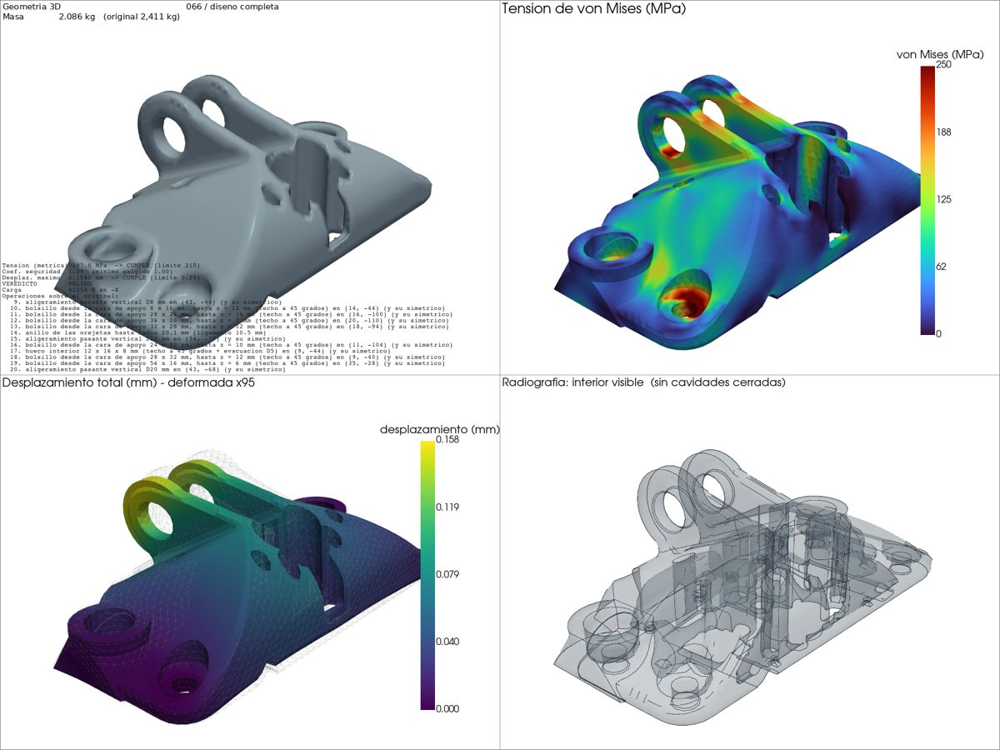
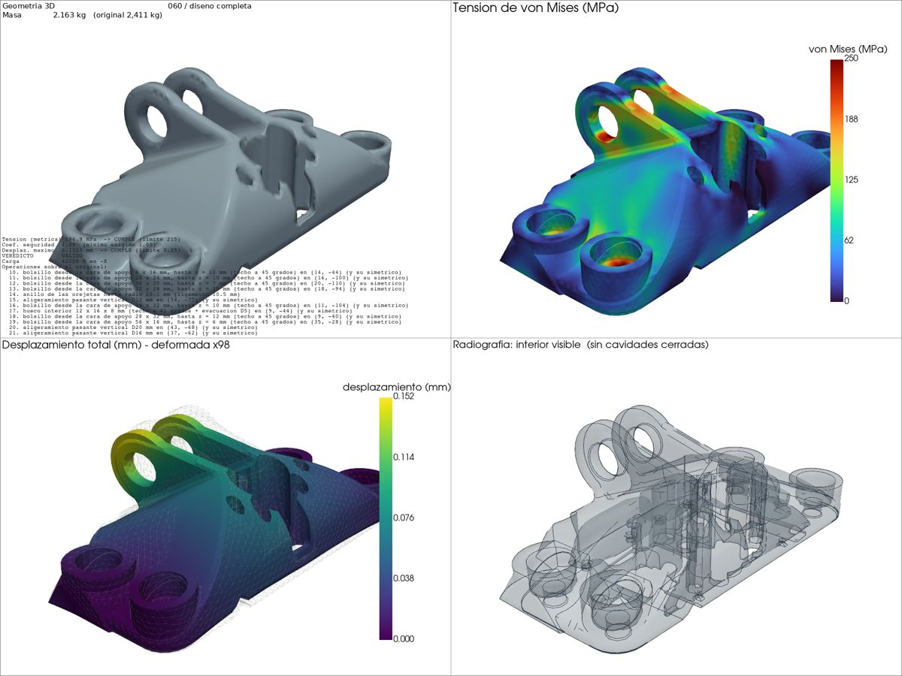
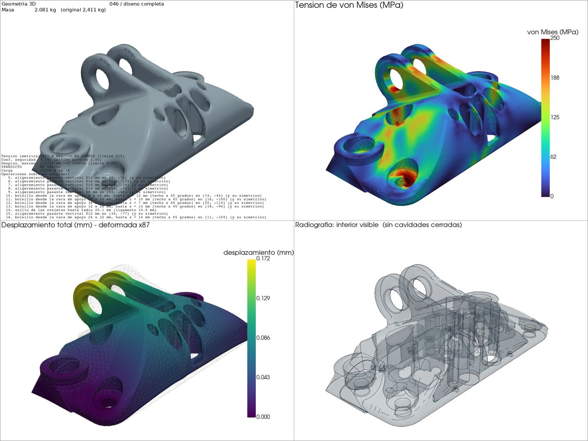
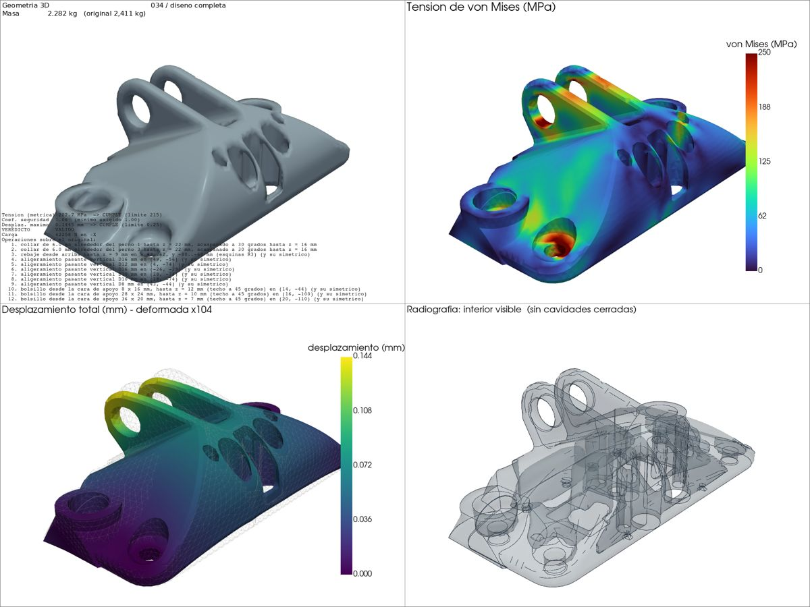

# Registro de iteraciones (changelog de la pieza)

Carga 42258 N | limite 215 MPa (coef. de seguridad >= 1.00) y 0.25 mm | reglas: [DESIGN_RULES.md](../../DESIGN_RULES.md) | la mas reciente arriba

## Iteracion 70 - SIN CAMBIO

*2026-11-24 20:33*

- **Pieza de partida:** 2.0776 kg | 195.2 MPa | CS 1.10 | 0.159 mm
- **Decision:** SIN CAMBIO - ninguna regla encuentra ya una modificacion posible (no queda material ocioso donde quepa un corte y el pico no admite refuerzo)
- Nota: umbral 45 %: 5 cortes descartados por SIMETRIA (quitarian distinto material en un lado que en su simetrico: el contorno del original no es simetrico en esa zona)

## Iteracion 69 - SIN CAMBIO

*2026-11-24 20:32*

- **Pieza de partida:** 2.0776 kg | 195.2 MPa | CS 1.10 | 0.159 mm
- **Decision:** SIN CAMBIO - todas las modificaciones propuestas se descartaron en la evaluacion rapida
- Descartada en la evaluacion rapida: [R1] aligeramiento pasante vertical D12 mm en (-23, -47) (y su simetrico) -> la malla o el calculo han fallado (RuntimeError: todas las estrategias de malla/solucion fallaron: malla alg10 h6.00: Exception: HXT 3D mesh failed | malla)
- Nota: umbral 45 %: 5 cortes descartados por SIMETRIA (quitarian distinto material en un lado que en su simetrico: el contorno del original no es simetrico en esa zona)

## Iteracion 68 - ACEPTADA: R14 bolsillo desde la cara de apoyo 28 x 64 mm, hasta z = 12 mm (techo a 45 grados) en (-31, -76) (y su simetrico)

*2026-11-24 20:28*

- **Pieza de partida:** 2.0858 kg | 197.0 MPa | CS 1.09 | 0.158 mm
- **Por que (regla R14):** Todo el material por debajo de z = 12 mm en esa zona (y 4 mm alrededor y encima) trabaja por debajo del 45 % del limite: la placa base bajo el cuerpo no lleva carga (el soporte solo se sujeta por los pernos). Se vacia desde la cara de apoyo con techo a 45 grados (imprimible), sin tocar el cuerpo de encima; el pico (197 MPa, en alrededor de los pernos traseros) esta lejos. Evidencia: placa base (z < 10 mm): original 67 cm3 con un 77 % de material ocioso; mediana de la mitad mas ligera de los 16 disenos publicados VALIDOS: 45 cm3.
- **Se esperaba:** mediana de las 12 veces que se ha aplicado: +1.4 % (prevision rapida: 2.0784 kg | 187.6 MPa | CS 1.15 | 0.159 mm)
- **Resultado (malla completa):** 2.0776 kg | 195.2 MPa | CS 1.10 | 0.159 mm (tension -0.9 %, masa -8 g)
- **Decision:** ACEPTADA - cumple y mejora al mejor (puntuacion 2.0858 -> 2.0776; masa 2.0858 -> 2.0776 kg)
- Descartada en la evaluacion rapida: [R1] aligeramiento pasante vertical D12 mm en (-23, -104) (y su simetrico) -> tension prevista 409 MPa: supera el limite (215 MPa)
- Descartada en la evaluacion rapida: [R1] aligeramiento pasante vertical D10 mm en (-23, -47) (y su simetrico) -> pasa la evaluacion rapida (2.0628 kg | 365.3 MPa | CS 0.59 | 0.169 mm) pero otra es mas prometedora; se podra proponer de nuevo
- Nota: umbral 35 %: 2 cortes descartados por SIMETRIA (quitarian distinto material en un lado que en su simetrico: el contorno del original no es simetrico en esa zona)
- Nota: umbral 45 %: 5 cortes descartados por SIMETRIA (quitarian distinto material en un lado que en su simetrico: el contorno del original no es simetrico en esa zona)
- Nota: R10: ya no queda material por debajo del 35 % del limite donde quepa un corte -> se pasa al umbral del 45 %

## Iteracion 67 - SIN CAMBIO

*2026-11-24 20:26*

- **Pieza de partida:** 2.0858 kg | 197.0 MPa | CS 1.09 | 0.158 mm
- **Decision:** SIN CAMBIO - todas las modificaciones propuestas se descartaron en la evaluacion rapida
- Descartada en la evaluacion rapida: [R1] aligeramiento pasante vertical D12 mm en (-17, -74) (y su simetrico) -> tension prevista 215 MPa: supera el limite (215 MPa)
- Descartada en la evaluacion rapida: [R16] eliminar la lamina de 1.8 mm en (4, -82, z -0..1) -> tension prevista 222 MPa: supera el limite (215 MPa)
- Descartada en la evaluacion rapida: [R16] eliminar la lamina de 1.9 mm en (4, -66, z -0..1) -> tension prevista 221 MPa: supera el limite (215 MPa)
- Nota: umbral 35 %: 2 cortes descartados por SIMETRIA (quitarian distinto material en un lado que en su simetrico: el contorno del original no es simetrico en esa zona)
- Nota: R10: ya no queda material por debajo del 15 % del limite donde quepa un corte -> se pasa al umbral del 35 %

## Iteracion 66 - ACEPTADA: R1 aligeramiento pasante vertical D10 mm en (4, -110) (y su simetrico)

*2026-11-24 20:20*

- **Pieza de partida:** 2.1213 kg | 203.3 MPa | CS 1.06 | 0.154 mm
- **Por que (regla R1):** Toda la columna en (4, -110) hasta 8 mm de radio trabaja como maximo al 41 % del limite (umbral de material ocioso: 45 %): no esta en el camino de la carga. Con Kt ~ 3 el borde del agujero quedaria por debajo del ~100 %; el pico (203 MPa, en alrededor de los pernos traseros) esta a 41 mm. Evidencia: en los 16 disenos publicados VALIDOS, la mitad mas ligera tiene un 25 % de material ocioso (por debajo del 15 % de su pico) frente al 51 % del original; en ese grupo, a mas material ocioso mas masa (Spearman +0.55). Agujeros pasantes: en ese grupo, a mas agujeros pasantes (genus de la malla) menos masa (Spearman -0.11, p = 0.69).
- **Se esperaba:** mediana de las 204 veces que se ha aplicado: +1.9 % (prevision rapida: 2.0874 kg | 190.0 MPa | CS 1.13 | 0.156 mm)
- **Resultado (malla completa):** 2.0858 kg | 197.0 MPa | CS 1.09 | 0.158 mm (tension -3.1 %, masa -35 g)
- **Decision:** ACEPTADA - cumple y mejora al mejor (puntuacion 2.1213 -> 2.0858; masa 2.1213 -> 2.0858 kg)
- Descartada en la evaluacion rapida: [R2] rebaje desde arriba hasta z = 5 mm en x 3..15, y -120..-108 mm (esquinas R3) (y su simetrico) -> tension prevista 218 MPa: supera el limite (215 MPa)
- Descartada en la evaluacion rapida: [R16] eliminar la lamina de 0.9 mm en (31, -43, z 0..3) -> pasa la evaluacion rapida (2.1213 kg | 180.6 MPa | CS 1.19 | 0.153 mm) pero otra es mas prometedora; se podra proponer de nuevo
- Nota: umbral 45 %: 5 cortes descartados por SIMETRIA (quitarian distinto material en un lado que en su simetrico: el contorno del original no es simetrico en esa zona)
- Nota: R17 (Unir dos aligeramientos separados por una pared fina que no trabaja) suspendida: 8 intentos sin ninguna mejora
- Nota: el cambio baja la tension un 3.1 %: se vuelven a permitir los 10 cortes que se habian rechazado por tension con menos margen

## Iteracion 65 - RECHAZADA: R1 aligeramiento pasante vertical D10 mm en (1, -41) (y su simetrico)

*2026-11-24 20:15*

- **Pieza de partida:** 2.1213 kg | 203.3 MPa | CS 1.06 | 0.154 mm
- **Por que (regla R1):** Toda la columna en (1, -41) hasta 8 mm de radio trabaja como maximo al 44 % del limite (umbral de material ocioso: 45 %): no esta en el camino de la carga. Con Kt ~ 3 el borde del agujero quedaria por debajo del ~100 %; el pico (203 MPa, en alrededor de los pernos traseros) esta a 102 mm. Evidencia: en los 16 disenos publicados VALIDOS, la mitad mas ligera tiene un 25 % de material ocioso (por debajo del 15 % de su pico) frente al 51 % del original; en ese grupo, a mas material ocioso mas masa (Spearman +0.55). Agujeros pasantes: en ese grupo, a mas agujeros pasantes (genus de la malla) menos masa (Spearman -0.11, p = 0.69).
- **Se esperaba:** mediana de las 203 veces que se ha aplicado: +1.9 % (prevision rapida: 2.0878 kg | 177.2 MPa | CS 1.21 | 0.156 mm)
- **Resultado (malla completa):** 2.0870 kg | 206.0 MPa | CS 1.04 | 0.158 mm (tension +1.4 %, masa -34 g)
- **Decision:** RECHAZADA - no cumple: 206.0 MPa con la malla normal, que corregidos a malla fina (x1.054) son 217.1 MPa > 215 MPa
- Descartada en la evaluacion rapida: [R2] rebaje desde arriba hasta z = 7 mm en x -9..3, y -128..-104 mm (esquinas R3) (y su simetrico) -> tension prevista 247 MPa: supera el limite (215 MPa)
- Descartada en la evaluacion rapida: [R17] ranura que une los aligeramientos de (28, -74) y (43, -68) (quita la pared fina entre ellos) (y su simetrico) -> pasa la evaluacion rapida (2.1203 kg | 180.7 MPa | CS 1.19 | 0.153 mm) pero otra es mas prometedora; se podra proponer de nuevo
- Nota: umbral 45 %: 5 cortes descartados por SIMETRIA (quitarian distinto material en un lado que en su simetrico: el contorno del original no es simetrico en esa zona)

## Iteracion 64 - RECHAZADA: R2 rebaje desde arriba hasta z = 5 mm en x -5..7, y -44..-24 mm (esquinas R3) (y su simetrico)

*2026-11-24 20:12*

- **Pieza de partida:** 2.1213 kg | 203.3 MPa | CS 1.06 | 0.154 mm
- **Por que (regla R2):** Todo el material por encima de z = 5 mm en esa zona (y 4 mm alrededor) trabaja por debajo del 45 % del limite: ni el momento de vuelco ni el cortante pasan por ahi. El rebaje deja un suelo horizontal (imprimible) y acuerdos redondeados. Evidencia: en los 16 disenos publicados VALIDOS, la mitad mas ligera tiene un 25 % de material ocioso (por debajo del 15 % de su pico) frente al 51 % del original; en ese grupo, a mas material ocioso mas masa (Spearman +0.55).
- **Se esperaba:** mediana de las 10 veces que se ha aplicado: +1.4 % (prevision rapida: 2.0256 kg | 274.6 MPa | CS 0.78 | 0.168 mm)
- **Resultado (malla completa):** 2.0244 kg | 333.4 MPa | CS 0.64 | 0.170 mm (tension +64.0 %, masa -97 g)
- **Decision:** RECHAZADA - no cumple: 333.4 MPa con la malla normal, que corregidos a malla fina (x1.054) son 351.2 MPa > 215 MPa
- Descartada en la evaluacion rapida: [R1] aligeramiento pasante vertical D10 mm en (1, -41) (y su simetrico) -> pasa la evaluacion rapida (2.0878 kg | 177.2 MPa | CS 1.21 | 0.156 mm) pero otra es mas prometedora; se podra proponer de nuevo
- Descartada en la evaluacion rapida: [R17] ranura que une los aligeramientos de (28, -74) y (43, -68) (quita la pared fina entre ellos) (y su simetrico) -> pasa la evaluacion rapida (2.1203 kg | 180.7 MPa | CS 1.19 | 0.153 mm) pero otra es mas prometedora; se podra proponer de nuevo
- Nota: umbral 45 %: 5 cortes descartados por SIMETRIA (quitarian distinto material en un lado que en su simetrico: el contorno del original no es simetrico en esa zona)

## Iteracion 63 - RECHAZADA: R2 rebaje desde arriba hasta z = 5 mm en x -1..15, y -120..-104 mm (esquinas R3.2) (y su simetrico)

*2026-11-24 20:10*

- **Pieza de partida:** 2.1213 kg | 203.3 MPa | CS 1.06 | 0.154 mm
- **Por que (regla R2):** Todo el material por encima de z = 5 mm en esa zona (y 4 mm alrededor) trabaja por debajo del 45 % del limite: ni el momento de vuelco ni el cortante pasan por ahi. El rebaje deja un suelo horizontal (imprimible) y acuerdos redondeados. Evidencia: en los 16 disenos publicados VALIDOS, la mitad mas ligera tiene un 25 % de material ocioso (por debajo del 15 % de su pico) frente al 51 % del original; en ese grupo, a mas material ocioso mas masa (Spearman +0.55).
- **Se esperaba:** mediana de las 9 veces que se ha aplicado: +1.2 % (prevision rapida: 2.0169 kg | 265.0 MPa | CS 0.81 | 0.168 mm)
- **Resultado (malla completa):** 2.0147 kg | 293.5 MPa | CS 0.73 | 0.171 mm (tension +44.4 %, masa -107 g)
- **Decision:** RECHAZADA - no cumple: 293.5 MPa con la malla normal, que corregidos a malla fina (x1.054) son 309.2 MPa > 215 MPa
- Descartada en la evaluacion rapida: [R1] aligeramiento pasante vertical D10 mm en (-2, -29) (y su simetrico) -> la malla o el calculo han fallado (RuntimeError: todas las estrategias de malla/solucion fallaron: malla alg10 h6.00: Exception: HXT 3D mesh failed | malla)
- Descartada en la evaluacion rapida: [R17] ranura que une los aligeramientos de (28, -74) y (43, -68) (quita la pared fina entre ellos) (y su simetrico) -> pasa la evaluacion rapida (2.1203 kg | 180.7 MPa | CS 1.19 | 0.153 mm) pero otra es mas prometedora; se podra proponer de nuevo
- Nota: umbral 45 %: 5 cortes descartados por SIMETRIA (quitarian distinto material en un lado que en su simetrico: el contorno del original no es simetrico en esa zona)

## Iteracion 62 - RECHAZADA: R2 rebaje desde arriba hasta z = 9 mm en x -9..11, y -44..-24 mm (esquinas R4) (y su simetrico)

*2026-11-24 20:06*

- **Pieza de partida:** 2.1213 kg | 203.3 MPa | CS 1.06 | 0.154 mm
- **Por que (regla R2):** Todo el material por encima de z = 9 mm en esa zona (y 4 mm alrededor) trabaja por debajo del 45 % del limite: ni el momento de vuelco ni el cortante pasan por ahi. El rebaje deja un suelo horizontal (imprimible) y acuerdos redondeados. Evidencia: en los 16 disenos publicados VALIDOS, la mitad mas ligera tiene un 25 % de material ocioso (por debajo del 15 % de su pico) frente al 51 % del original; en ese grupo, a mas material ocioso mas masa (Spearman +0.55).
- **Se esperaba:** mediana de las 8 veces que se ha aplicado: +0.7 % (prevision rapida: 1.9906 kg | 264.7 MPa | CS 0.81 | 0.181 mm)
- **Resultado (malla completa):** 1.9882 kg | 331.3 MPa | CS 0.65 | 0.185 mm (tension +63.0 %, masa -133 g)
- **Decision:** RECHAZADA - no cumple: 331.3 MPa con la malla normal, que corregidos a malla fina (x1.054) son 349.0 MPa > 215 MPa
- Descartada en la evaluacion rapida: [R1] aligeramiento pasante vertical D12 mm en (1, -122) (y su simetrico) -> tension prevista 245 MPa: supera el limite (215 MPa)
- Descartada en la evaluacion rapida: [R17] ranura que une los aligeramientos de (28, -74) y (43, -68) (quita la pared fina entre ellos) (y su simetrico) -> pasa la evaluacion rapida (2.1203 kg | 180.7 MPa | CS 1.19 | 0.153 mm) pero otra es mas prometedora; se podra proponer de nuevo
- Nota: umbral 45 %: 4 cortes descartados por SIMETRIA (quitarian distinto material en un lado que en su simetrico: el contorno del original no es simetrico en esa zona)

## Iteracion 61 - RECHAZADA: R4 collar de 6 mm en los pernos 4 y 2

*2026-11-24 20:02*

- **Pieza de partida:** 2.1213 kg | 203.3 MPa | CS 1.06 | 0.154 mm
- **Por que (regla R4):** El pico (203 MPa, 100 % del limite) esta junto al alojamiento del perno 4 (concentracion local x2.1). El momento de vuelco de la carga (F x 44,7 mm) llega a los pernos por una seccion pequena alrededor del alojamiento: un collar de 6 mm aumenta esa seccion. El perno 2 es su simetrico respecto al plano medio de las orejetas y trabaja igual. Evidencia: prueba directa en ANSYS sobre el original (bitacora 22/11): collares de 6 mm -> pico de 238 a 203 MPa (-15 %) con +159 g (escalado lineal a 42258 N); en 228 disenos de la familia refuerzo, mas collar delantero -> menos tension (Spearman -0.25, p = 0.00014); material junto a los pernos delanteros: original 25 cm3, mediana del grupo de referencia 37 cm3; en 104 de 297 disenos publicados calculados el pico esta junto a un perno.
- **Se esperaba:** mediana de las 4 veces que se ha aplicado: -3.2 % (refuerzo: sin evaluacion rapida)
- **Resultado (malla completa):** 2.1984 kg | 194.6 MPa | CS 1.10 | 0.151 mm (tension -4.3 %, masa +77 g)
- **Decision:** RECHAZADA - cumple pero no mejora al mejor (puntuacion 2.1984 frente a 2.1213)
- Descartada en la evaluacion rapida: [R2] rebaje desde arriba hasta z = 7 mm en x -9..15, y -124..-104 mm (esquinas R4) (y su simetrico) -> tension prevista 297 MPa: supera el limite (215 MPa)
- Descartada en la evaluacion rapida: [R17] ranura que une los aligeramientos de (28, -74) y (43, -68) (quita la pared fina entre ellos) (y su simetrico) -> pasa la evaluacion rapida (2.1203 kg | 180.7 MPa | CS 1.19 | 0.153 mm) pero otra es mas prometedora; se podra proponer de nuevo
- Nota: umbral 45 %: 4 cortes descartados por SIMETRIA (quitarian distinto material en un lado que en su simetrico: el contorno del original no es simetrico en esa zona)

## Iteracion 60 - RECHAZADA: R4 collar de 4 mm en los pernos 4 y 2

*2026-11-24 19:56*

- **Pieza de partida:** 2.1213 kg | 203.3 MPa | CS 1.06 | 0.154 mm
- **Por que (regla R4):** El pico (203 MPa, 100 % del limite) esta junto al alojamiento del perno 4 (concentracion local x2.1). El momento de vuelco de la carga (F x 44,7 mm) llega a los pernos por una seccion pequena alrededor del alojamiento: un collar de 4 mm aumenta esa seccion. El perno 2 es su simetrico respecto al plano medio de las orejetas y trabaja igual. Evidencia: prueba directa en ANSYS sobre el original (bitacora 22/11): collares de 6 mm -> pico de 238 a 203 MPa (-15 %) con +159 g (escalado lineal a 42258 N); en 228 disenos de la familia refuerzo, mas collar delantero -> menos tension (Spearman -0.25, p = 0.00014); material junto a los pernos delanteros: original 25 cm3, mediana del grupo de referencia 37 cm3; en 104 de 297 disenos publicados calculados el pico esta junto a un perno.
- **Se esperaba:** mediana de las 3 veces que se ha aplicado: -3.3 % (refuerzo: sin evaluacion rapida)
- **Resultado (malla completa):** 2.1630 kg | 196.9 MPa | CS 1.09 | 0.152 mm (tension -3.1 %, masa +42 g)
- **Decision:** RECHAZADA - cumple pero no mejora al mejor (puntuacion 2.1630 frente a 2.1213)
- Descartada en la evaluacion rapida: [R4] collar de 6 mm en los pernos 4 y 2 -> refuerzo pero otra es mas prometedora; se podra proponer de nuevo
- Descartada en la evaluacion rapida: [R17] ranura que une los aligeramientos de (28, -74) y (43, -68) (quita la pared fina entre ellos) (y su simetrico) -> pasa la evaluacion rapida (2.1203 kg | 180.7 MPa | CS 1.19 | 0.153 mm) pero otra es mas prometedora; se podra proponer de nuevo
- Nota: umbral 45 %: 4 cortes descartados por SIMETRIA (quitarian distinto material en un lado que en su simetrico: el contorno del original no es simetrico en esa zona)

## Iteracion 59 - ACEPTADA: R1 aligeramiento pasante vertical D16 mm en (37, -62) (y su simetrico)

*2026-11-24 19:50*

- **Pieza de partida:** 2.1806 kg | 199.6 MPa | CS 1.08 | 0.152 mm
- **Por que (regla R1):** Toda la columna en (37, -62) hasta 11 mm de radio trabaja como maximo al 43 % del limite (umbral de material ocioso: 45 %): no esta en el camino de la carga. Con Kt ~ 3 el borde del agujero quedaria por debajo del ~100 %; el pico (200 MPa, en orejetas del bulon) esta a 38 mm. Evidencia: en los 16 disenos publicados VALIDOS, la mitad mas ligera tiene un 25 % de material ocioso (por debajo del 15 % de su pico) frente al 51 % del original; en ese grupo, a mas material ocioso mas masa (Spearman +0.55). Agujeros pasantes: en ese grupo, a mas agujeros pasantes (genus de la malla) menos masa (Spearman -0.11, p = 0.69).
- **Se esperaba:** mediana de las 202 veces que se ha aplicado: +1.9 % (prevision rapida: 2.1218 kg | 203.3 MPa | CS 1.06 | 0.154 mm)
- **Resultado (malla completa):** 2.1213 kg | 203.3 MPa | CS 1.06 | 0.154 mm (tension +1.8 %, masa -59 g)
- **Decision:** ACEPTADA - cumple y mejora al mejor (puntuacion 2.1806 -> 2.1213; masa 2.1806 -> 2.1213 kg)
- Descartada en la evaluacion rapida: [R2] rebaje desde arriba hasta z = 7 mm en x -9..15, y -124..-104 mm (esquinas R4) (y su simetrico) -> pasa la evaluacion rapida (2.0216 kg | 317.4 MPa | CS 0.68 | 0.187 mm) pero otra es mas prometedora; se podra proponer de nuevo
- Descartada en la evaluacion rapida: [R17] ranura que une los aligeramientos de (28, -74) y (43, -68) (quita la pared fina entre ellos) (y su simetrico) -> pasa la evaluacion rapida (2.1763 kg | 181.0 MPa | CS 1.19 | 0.151 mm) pero otra es mas prometedora; se podra proponer de nuevo
- Nota: umbral 45 %: 2 cortes descartados por SIMETRIA (quitarian distinto material en un lado que en su simetrico: el contorno del original no es simetrico en esa zona)

## Iteracion 58 - RECHAZADA: R7 anillo de las orejetas hasta radio 23.1 mm (ligamento 13.5 mm)

*2026-11-24 19:45*

- **Pieza de partida:** 2.1806 kg | 199.6 MPa | CS 1.08 | 0.152 mm
- **Por que (regla R7):** El pico (200 MPa) esta en la orejeta. Delante del bulon hay 10.1 mm de ligamento; la tension de aplastamiento/cortadura va como 1/e: +3 mm la reduce ~23 %. Evidencia: ligamento delante del bulon: original 7.5 mm, mediana de los 16 disenos publicados VALIDOS: 7.6 mm, y 7.5 mm en los 25 disenos cuyo pico esta en la orejeta.
- **Se esperaba:** ~-23 % (s ~ 1/e) (refuerzo: sin evaluacion rapida)
- **Resultado (malla completa):** 2.2039 kg | 208.2 MPa | CS 1.03 | 0.155 mm (tension +4.3 %, masa +23 g)
- **Decision:** RECHAZADA - no cumple: 208.2 MPa con la malla normal, que corregidos a malla fina (x1.054) son 219.4 MPa > 215 MPa
- Descartada en la evaluacion rapida: [R2] rebaje desde arriba hasta z = 7 mm en x -9..15, y -124..-104 mm (esquinas R4) (y su simetrico) -> pasa la evaluacion rapida (2.0216 kg | 317.4 MPa | CS 0.68 | 0.187 mm) pero otra es mas prometedora; se podra proponer de nuevo
- Descartada en la evaluacion rapida: [R17] ranura que une los aligeramientos de (28, -74) y (43, -68) (quita la pared fina entre ellos) (y su simetrico) -> pasa la evaluacion rapida (2.1763 kg | 181.0 MPa | CS 1.19 | 0.151 mm) pero otra es mas prometedora; se podra proponer de nuevo
- Nota: umbral 35 %: 1 cortes descartados por SIMETRIA (quitarian distinto material en un lado que en su simetrico: el contorno del original no es simetrico en esa zona)
- Nota: umbral 45 %: 2 cortes descartados por SIMETRIA (quitarian distinto material en un lado que en su simetrico: el contorno del original no es simetrico en esa zona)
- Nota: R10: ya no queda material por debajo del 35 % del limite donde quepa un corte -> se pasa al umbral del 45 %

## Iteracion 57 - ACEPTADA: R1 aligeramiento pasante vertical D20 mm en (43, -68) (y su simetrico)

*2026-11-24 19:36*

- **Pieza de partida:** 2.2404 kg | 195.4 MPa | CS 1.10 | 0.149 mm
- **Por que (regla R1):** Toda la columna en (43, -68) hasta 13 mm de radio trabaja como maximo al 35 % del limite (umbral de material ocioso: 35 %): no esta en el camino de la carga. Con Kt ~ 3 el borde del agujero quedaria por debajo del ~100 %; el pico (195 MPa, en alrededor de los pernos delanteros) esta a 63 mm. Evidencia: en los 16 disenos publicados VALIDOS, la mitad mas ligera tiene un 25 % de material ocioso (por debajo del 15 % de su pico) frente al 51 % del original; en ese grupo, a mas material ocioso mas masa (Spearman +0.55). Agujeros pasantes: en ese grupo, a mas agujeros pasantes (genus de la malla) menos masa (Spearman -0.11, p = 0.69).
- **Se esperaba:** mediana de las 201 veces que se ha aplicado: +1.9 % (prevision rapida: 2.1816 kg | 221.8 MPa | CS 0.97 | 0.153 mm)
- **Resultado (malla completa):** 2.1806 kg | 199.6 MPa | CS 1.08 | 0.152 mm (tension +2.1 %, masa -60 g)
- **Decision:** ACEPTADA - cumple y mejora al mejor (puntuacion 2.2002 -> 2.1806; masa 2.2002 -> 2.1806 kg)
- Descartada en la evaluacion rapida: [R1] aligeramiento pasante vertical D8 mm en (40, -86) (y su simetrico) -> la malla o el calculo han fallado (RuntimeError: todas las estrategias de malla/solucion fallaron: malla alg10 h6.00: Exception: HXT 3D mesh failed | malla)
- Descartada en la evaluacion rapida: [R2] rebaje desde arriba hasta z = 5 mm en x 35..47, y -72..-60 mm (esquinas R3) (y su simetrico) -> pasa la evaluacion rapida (2.2031 kg | 218.2 MPa | CS 0.99 | 0.152 mm) pero otra es mas prometedora; se podra proponer de nuevo
- Nota: umbral 35 %: 2 cortes descartados por SIMETRIA (quitarian distinto material en un lado que en su simetrico: el contorno del original no es simetrico en esa zona)

## Iteracion 56 - RECHAZADA: R1 aligeramiento pasante vertical D12 mm en (-17, -74) (y su simetrico)

*2026-11-24 19:31*

- **Pieza de partida:** 2.2404 kg | 195.4 MPa | CS 1.10 | 0.149 mm
- **Por que (regla R1):** Toda la columna en (-17, -74) hasta 9 mm de radio trabaja como maximo al 32 % del limite (umbral de material ocioso: 35 %): no esta en el camino de la carga. Con Kt ~ 3 el borde del agujero quedaria por debajo del ~95 %; el pico (195 MPa, en alrededor de los pernos delanteros) esta a 91 mm. Evidencia: en los 16 disenos publicados VALIDOS, la mitad mas ligera tiene un 25 % de material ocioso (por debajo del 15 % de su pico) frente al 51 % del original; en ese grupo, a mas material ocioso mas masa (Spearman +0.55). Agujeros pasantes: en ese grupo, a mas agujeros pasantes (genus de la malla) menos masa (Spearman -0.11, p = 0.69).
- **Se esperaba:** mediana de las 200 veces que se ha aplicado: +1.9 % (prevision rapida: 2.2210 kg | 198.7 MPa | CS 1.08 | 0.150 mm)
- **Resultado (malla completa):** 2.2207 kg | 220.5 MPa | CS 0.98 | 0.150 mm (tension +12.8 %, masa -20 g)
- **Decision:** RECHAZADA - no cumple: 220.5 MPa con la malla normal, que corregidos a malla fina (x1.058) son 233.3 MPa > 215 MPa
- Descartada en la evaluacion rapida: [R1] aligeramiento pasante vertical D20 mm en (43, -68) (y su simetrico) -> pasa la evaluacion rapida (2.1816 kg | 221.8 MPa | CS 0.97 | 0.153 mm) pero otra es mas prometedora; se podra proponer de nuevo
- Descartada en la evaluacion rapida: [R2] rebaje desde arriba hasta z = 5 mm en x 35..47, y -72..-60 mm (esquinas R3) (y su simetrico) -> pasa la evaluacion rapida (2.2031 kg | 218.2 MPa | CS 0.99 | 0.152 mm) pero otra es mas prometedora; se podra proponer de nuevo
- Nota: umbral 35 %: 2 cortes descartados por SIMETRIA (quitarian distinto material en un lado que en su simetrico: el contorno del original no es simetrico en esa zona)
- Nota: R10: ya no queda material por debajo del 15 % del limite donde quepa un corte -> se pasa al umbral del 35 %

## Iteracion 55 - INVERSION: R8 reducir la operacion 4 (aligeramiento pasante vertical D16 mm en (49, -56) (y su simetrico))

*2026-11-24 19:27*

- **Pieza de partida:** 2.2002 kg | 203.0 MPa | CS 1.06 | 0.150 mm
- **Por que (regla R8):** El pico (203 MPa) esta a 0.0 mm del corte 4 (aligeramiento pasante vertical D16 mm en (49, -56) (y su simetrico)): ese material SI estaba en el camino de carga. Se reduce el corte a 0,6 veces su tamano. Evidencia: regla de procedimiento: se juzga por sus resultados en el optimizador.
- **Se esperaba:** baja el pico (vuelve material a donde trabaja) (refuerzo: sin evaluacion rapida)
- **Resultado (malla completa):** 2.2404 kg | 195.4 MPa | CS 1.10 | 0.149 mm (tension -3.7 %, masa +40 g)
- **Decision:** INVERSION - refuerzo eficiente: compra 3.7 % de margen de tension con +40 g (1.8 % de masa); ese margen se gastara aligerando en las siguientes iteraciones (si no, se deshace)
- Descartada en la evaluacion rapida: [R1] aligeramiento pasante vertical D10 mm en (1, -38) (y su simetrico) -> pasa la evaluacion rapida (2.1671 kg | 203.1 MPa | CS 1.06 | 0.153 mm) pero otra es mas prometedora; se podra proponer de nuevo
- Descartada en la evaluacion rapida: [R14] bolsillo desde la cara de apoyo 28 x 64 mm, hasta z = 12 mm (techo a 45 grados) en (-31, -76) (y su simetrico) -> pasa la evaluacion rapida (2.1923 kg | 202.2 MPa | CS 1.06 | 0.150 mm) pero otra es mas prometedora; se podra proponer de nuevo
- Nota: umbral 35 %: 3 cortes descartados por SIMETRIA (quitarian distinto material en un lado que en su simetrico: el contorno del original no es simetrico en esa zona)
- Nota: umbral 45 %: 6 cortes descartados por SIMETRIA (quitarian distinto material en un lado que en su simetrico: el contorno del original no es simetrico en esa zona)
- Nota: R10: ya no queda material por debajo del 15 % del limite donde quepa un corte -> se pasa al umbral del 45 %
- Nota: el cambio baja la tension un 3.7 %: se vuelven a permitir los 19 cortes que se habian rechazado por tension con menos margen

## Iteracion 54 - RECHAZADA: R1 aligeramiento pasante vertical D10 mm en (4, -110) (y su simetrico)

*2026-11-24 19:12*

- **Pieza de partida:** 2.2002 kg | 203.0 MPa | CS 1.06 | 0.150 mm
- **Por que (regla R1):** Toda la columna en (4, -110) hasta 8 mm de radio trabaja como maximo al 41 % del limite (umbral de material ocioso: 45 %): no esta en el camino de la carga. Con Kt ~ 3 el borde del agujero quedaria por debajo del ~100 %; el pico (203 MPa, en placa base (z < 10 mm)) esta a 57 mm. Evidencia: en los 16 disenos publicados VALIDOS, la mitad mas ligera tiene un 25 % de material ocioso (por debajo del 15 % de su pico) frente al 51 % del original; en ese grupo, a mas material ocioso mas masa (Spearman +0.55). Agujeros pasantes: en ese grupo, a mas agujeros pasantes (genus de la malla) menos masa (Spearman -0.11, p = 0.69).
- **Se esperaba:** mediana de las 199 veces que se ha aplicado: +1.9 % (prevision rapida: 2.1665 kg | 204.3 MPa | CS 1.05 | 0.153 mm)
- **Resultado (malla completa):** 2.1648 kg | 208.1 MPa | CS 1.03 | 0.153 mm (tension +2.5 %, masa -35 g)
- **Decision:** RECHAZADA - no cumple: 208.1 MPa con la malla normal, que corregidos a malla fina (x1.058) son 220.1 MPa > 215 MPa
- Descartada en la evaluacion rapida: [R1] aligeramiento pasante vertical D16 mm en (10, -74) (y su simetrico) -> tension prevista 237 MPa: supera el limite (215 MPa)
- Descartada en la evaluacion rapida: [R1] aligeramiento pasante vertical D10 mm en (1, -38) (y su simetrico) -> pasa la evaluacion rapida (2.1669 kg | 218.8 MPa | CS 0.98 | 0.154 mm) pero otra es mas prometedora; se podra proponer de nuevo
- Nota: umbral 45 %: 5 cortes descartados por SIMETRIA (quitarian distinto material en un lado que en su simetrico: el contorno del original no es simetrico en esa zona)

## Iteracion 53 - RECHAZADA: R1 aligeramiento pasante vertical D10 mm en (1, -26) (y su simetrico)

*2026-11-24 19:08*

- **Pieza de partida:** 2.2002 kg | 203.0 MPa | CS 1.06 | 0.150 mm
- **Por que (regla R1):** Toda la columna en (1, -26) hasta 8 mm de radio trabaja como maximo al 43 % del limite (umbral de material ocioso: 45 %): no esta en el camino de la carga. Con Kt ~ 3 el borde del agujero quedaria por debajo del ~100 %; el pico (203 MPa, en placa base (z < 10 mm)) esta a 84 mm. Evidencia: en los 16 disenos publicados VALIDOS, la mitad mas ligera tiene un 25 % de material ocioso (por debajo del 15 % de su pico) frente al 51 % del original; en ese grupo, a mas material ocioso mas masa (Spearman +0.55). Agujeros pasantes: en ese grupo, a mas agujeros pasantes (genus de la malla) menos masa (Spearman -0.11, p = 0.69).
- **Se esperaba:** mediana de las 198 veces que se ha aplicado: +1.8 % (prevision rapida: 2.1662 kg | 204.2 MPa | CS 1.05 | 0.153 mm)
- **Resultado (malla completa):** 2.1639 kg | 208.4 MPa | CS 1.03 | 0.154 mm (tension +2.6 %, masa -36 g)
- **Decision:** RECHAZADA - no cumple: 208.4 MPa con la malla normal, que corregidos a malla fina (x1.058) son 220.5 MPa > 215 MPa
- Descartada en la evaluacion rapida: [R1] aligeramiento pasante vertical D10 mm en (1, -41) (y su simetrico) -> pasa la evaluacion rapida (2.1668 kg | 204.6 MPa | CS 1.05 | 0.153 mm) pero otra es mas prometedora; se podra proponer de nuevo
- Descartada en la evaluacion rapida: [R1] aligeramiento pasante vertical D10 mm en (4, -110) (y su simetrico) -> pasa la evaluacion rapida (2.1665 kg | 204.3 MPa | CS 1.05 | 0.153 mm) pero otra es mas prometedora; se podra proponer de nuevo
- Nota: umbral 45 %: 5 cortes descartados por SIMETRIA (quitarian distinto material en un lado que en su simetrico: el contorno del original no es simetrico en esa zona)

## Iteracion 52 - ACEPTADA: R14 bolsillo desde la cara de apoyo 56 x 16 mm, hasta z = 6 mm (techo a 45 grados) en (35, -28) (y su simetrico)

*2026-11-24 19:06*

- **Pieza de partida:** 2.2207 kg | 201.1 MPa | CS 1.07 | 0.150 mm
- **Por que (regla R14):** Todo el material por debajo de z = 6 mm en esa zona (y 4 mm alrededor y encima) trabaja por debajo del 45 % del limite: la placa base bajo el cuerpo no lleva carga (el soporte solo se sujeta por los pernos). Se vacia desde la cara de apoyo con techo a 45 grados (imprimible), sin tocar el cuerpo de encima; el pico (201 MPa, en placa base (z < 10 mm)) esta lejos. Evidencia: placa base (z < 10 mm): original 67 cm3 con un 77 % de material ocioso; mediana de la mitad mas ligera de los 16 disenos publicados VALIDOS: 45 cm3.
- **Se esperaba:** mediana de las 11 veces que se ha aplicado: +1.8 % (prevision rapida: 2.1998 kg | 201.2 MPa | CS 1.07 | 0.150 mm)
- **Resultado (malla completa):** 2.2002 kg | 203.0 MPa | CS 1.06 | 0.150 mm (tension +1.0 %, masa -20 g)
- **Decision:** ACEPTADA - cumple y mejora al mejor (puntuacion 2.2207 -> 2.2002; masa 2.2207 -> 2.2002 kg)
- Descartada en la evaluacion rapida: [R1] aligeramiento pasante vertical D12 mm en (4, -110) (y su simetrico) -> la malla o el calculo han fallado (RuntimeError: todas las estrategias de malla/solucion fallaron: malla alg10 h6.00: Exception: HXT 3D mesh failed | malla)
- Descartada en la evaluacion rapida: [R1] aligeramiento pasante vertical D12 mm en (4, -41) (y su simetrico) -> la malla o el calculo han fallado (RuntimeError: todas las estrategias de malla/solucion fallaron: malla alg10 h6.00: Exception: HXT 3D mesh failed | malla)
- Nota: umbral 45 %: 5 cortes descartados por SIMETRIA (quitarian distinto material en un lado que en su simetrico: el contorno del original no es simetrico en esa zona)

## Iteracion 51 - RECHAZADA: R1 aligeramiento pasante vertical D10 mm en (37, -86) (y su simetrico)

*2026-11-24 19:03*

- **Pieza de partida:** 2.2207 kg | 201.1 MPa | CS 1.07 | 0.150 mm
- **Por que (regla R1):** Toda la columna en (37, -86) hasta 8 mm de radio trabaja como maximo al 37 % del limite (umbral de material ocioso: 45 %): no esta en el camino de la carga. Con Kt ~ 3 el borde del agujero quedaria por debajo del ~100 %; el pico (201 MPa, en placa base (z < 10 mm)) esta a 20 mm. Evidencia: en los 16 disenos publicados VALIDOS, la mitad mas ligera tiene un 25 % de material ocioso (por debajo del 15 % de su pico) frente al 51 % del original; en ese grupo, a mas material ocioso mas masa (Spearman +0.55). Agujeros pasantes: en ese grupo, a mas agujeros pasantes (genus de la malla) menos masa (Spearman -0.11, p = 0.69).
- **Se esperaba:** mediana de las 197 veces que se ha aplicado: +1.7 % (prevision rapida: 2.1750 kg | 237.0 MPa | CS 0.91 | 0.155 mm)
- **Resultado (malla completa):** 2.1716 kg | 249.4 MPa | CS 0.86 | 0.154 mm (tension +24.0 %, masa -49 g)
- **Decision:** RECHAZADA - no cumple: 249.4 MPa con la malla normal, que corregidos a malla fina (x1.058) son 263.8 MPa > 215 MPa
- Descartada en la evaluacion rapida: [R2] rebaje desde arriba hasta z = 5 mm en x -1..11, y -40..-28 mm (esquinas R3) (y su simetrico) -> tension prevista 278 MPa: supera el limite (215 MPa)
- Descartada en la evaluacion rapida: [R14] bolsillo desde la cara de apoyo 28 x 28 mm, hasta z = 12 mm (techo a 45 grados) en (9, -38) (y su simetrico) -> la geometria no se puede construir (operacion 19 (hueco): el hueco interior no quita material (cae fuera de la pieza o dentro de zona protegida))
- Nota: umbral 45 %: 4 cortes descartados por SIMETRIA (quitarian distinto material en un lado que en su simetrico: el contorno del original no es simetrico en esa zona)

## Iteracion 50 - RECHAZADA: R2 rebaje desde arriba hasta z = 5 mm en x -1..11, y -124..-112 mm (esquinas R3) (y su simetrico)

*2026-11-24 19:00*

- **Pieza de partida:** 2.2207 kg | 201.1 MPa | CS 1.07 | 0.150 mm
- **Por que (regla R2):** Todo el material por encima de z = 5 mm en esa zona (y 4 mm alrededor) trabaja por debajo del 45 % del limite: ni el momento de vuelco ni el cortante pasan por ahi. El rebaje deja un suelo horizontal (imprimible) y acuerdos redondeados. Evidencia: en los 16 disenos publicados VALIDOS, la mitad mas ligera tiene un 25 % de material ocioso (por debajo del 15 % de su pico) frente al 51 % del original; en ese grupo, a mas material ocioso mas masa (Spearman +0.55).
- **Se esperaba:** mediana de las 7 veces que se ha aplicado: +0.1 % (prevision rapida: 2.1629 kg | 257.3 MPa | CS 0.84 | 0.158 mm)
- **Resultado (malla completa):** 2.1618 kg | 215.3 MPa | CS 1.00 | 0.158 mm (tension +7.1 %, masa -59 g)
- **Decision:** RECHAZADA - no cumple: 215.3 MPa con la malla normal, que corregidos a malla fina (x1.058) son 227.8 MPa > 215 MPa
- Descartada en la evaluacion rapida: [R14] bolsillo desde la cara de apoyo 28 x 32 mm, hasta z = 12 mm (techo a 45 grados) en (9, -40) (y su simetrico) -> la geometria no se puede construir (operacion 19 (hueco): el hueco interior no quita material (cae fuera de la pieza o dentro de zona protegida))
- Descartada en la evaluacion rapida: [R1] aligeramiento pasante vertical D10 mm en (37, -86) (y su simetrico) -> pasa la evaluacion rapida (2.1750 kg | 237.0 MPa | CS 0.91 | 0.155 mm) pero otra es mas prometedora; se podra proponer de nuevo
- Nota: umbral 45 %: 4 cortes descartados por SIMETRIA (quitarian distinto material en un lado que en su simetrico: el contorno del original no es simetrico en esa zona)

## Iteracion 49 - RECHAZADA: R14 bolsillo desde la cara de apoyo 28 x 32 mm, hasta z = 12 mm (techo a 45 grados) en (29, -52) (y su simetrico)

*2026-11-24 18:56*

- **Pieza de partida:** 2.2207 kg | 201.1 MPa | CS 1.07 | 0.150 mm
- **Por que (regla R14):** Todo el material por debajo de z = 12 mm en esa zona (y 4 mm alrededor y encima) trabaja por debajo del 45 % del limite: la placa base bajo el cuerpo no lleva carga (el soporte solo se sujeta por los pernos). Se vacia desde la cara de apoyo con techo a 45 grados (imprimible), sin tocar el cuerpo de encima; el pico (201 MPa, en placa base (z < 10 mm)) esta lejos. Evidencia: placa base (z < 10 mm): original 67 cm3 con un 77 % de material ocioso; mediana de la mitad mas ligera de los 16 disenos publicados VALIDOS: 45 cm3.
- **Se esperaba:** mediana de las 10 veces que se ha aplicado: +1.1 % (prevision rapida: 2.1941 kg | 202.2 MPa | CS 1.06 | 0.150 mm)
- **Resultado (malla completa):** 2.1945 kg | 206.8 MPa | CS 1.04 | 0.150 mm (tension +2.8 %, masa -26 g)
- **Decision:** RECHAZADA - no cumple: 206.8 MPa con la malla normal, que corregidos a malla fina (x1.058) son 218.8 MPa > 215 MPa
- Descartada en la evaluacion rapida: [R2] rebaje desde arriba hasta z = 7 mm en x -9..3, y -128..-104 mm (esquinas R3) (y su simetrico) -> tension prevista 271 MPa: supera el limite (215 MPa)
- Descartada en la evaluacion rapida: [R1] aligeramiento pasante vertical D10 mm en (37, -86) (y su simetrico) -> pasa la evaluacion rapida (2.1750 kg | 237.0 MPa | CS 0.91 | 0.155 mm) pero otra es mas prometedora; se podra proponer de nuevo
- Nota: umbral 45 %: 4 cortes descartados por SIMETRIA (quitarian distinto material en un lado que en su simetrico: el contorno del original no es simetrico en esa zona)

## Iteracion 48 - RECHAZADA: R14 bolsillo desde la cara de apoyo 28 x 32 mm, hasta z = 12 mm (techo a 45 grados) en (29, -96) (y su simetrico)

*2026-11-24 18:53*

- **Pieza de partida:** 2.2207 kg | 201.1 MPa | CS 1.07 | 0.150 mm
- **Por que (regla R14):** Todo el material por debajo de z = 12 mm en esa zona (y 4 mm alrededor y encima) trabaja por debajo del 45 % del limite: la placa base bajo el cuerpo no lleva carga (el soporte solo se sujeta por los pernos). Se vacia desde la cara de apoyo con techo a 45 grados (imprimible), sin tocar el cuerpo de encima; el pico (201 MPa, en placa base (z < 10 mm)) esta lejos. Evidencia: placa base (z < 10 mm): original 67 cm3 con un 77 % de material ocioso; mediana de la mitad mas ligera de los 16 disenos publicados VALIDOS: 45 cm3.
- **Se esperaba:** mediana de las 9 veces que se ha aplicado: +0.3 % (prevision rapida: 2.1988 kg | 201.0 MPa | CS 1.07 | 0.150 mm)
- **Resultado (malla completa):** 2.1987 kg | 207.3 MPa | CS 1.04 | 0.150 mm (tension +3.1 %, masa -22 g)
- **Decision:** RECHAZADA - no cumple: 207.3 MPa con la malla normal, que corregidos a malla fina (x1.058) son 219.3 MPa > 215 MPa
- Descartada en la evaluacion rapida: [R2] rebaje desde arriba hasta z = 5 mm en x -1..11, y -44..-24 mm (esquinas R3) (y su simetrico) -> tension prevista 276 MPa: supera el limite (215 MPa)
- Descartada en la evaluacion rapida: [R1] aligeramiento pasante vertical D12 mm en (7, -122) (y su simetrico) -> tension prevista 355 MPa: supera el limite (215 MPa)
- Nota: umbral 45 %: 4 cortes descartados por SIMETRIA (quitarian distinto material en un lado que en su simetrico: el contorno del original no es simetrico en esa zona)

## Iteracion 47 - ACEPTADA: R14 bolsillo desde la cara de apoyo 28 x 32 mm, hasta z = 12 mm (techo a 45 grados) en (9, -40) (y su simetrico)

*2026-11-24 18:40*

- **Pieza de partida:** 2.2362 kg | 200.9 MPa | CS 1.07 | 0.149 mm
- **Por que (regla R14):** Todo el material por debajo de z = 12 mm en esa zona (y 4 mm alrededor y encima) trabaja por debajo del 45 % del limite: la placa base bajo el cuerpo no lleva carga (el soporte solo se sujeta por los pernos). Se vacia desde la cara de apoyo con techo a 45 grados (imprimible), sin tocar el cuerpo de encima; el pico (201 MPa, en placa base (z < 10 mm)) esta lejos. Evidencia: placa base (z < 10 mm): original 67 cm3 con un 77 % de material ocioso; mediana de la mitad mas ligera de los 16 disenos publicados VALIDOS: 45 cm3.
- **Se esperaba:** mediana de las 8 veces que se ha aplicado: +1.1 % (prevision rapida: 2.2207 kg | 200.1 MPa | CS 1.07 | 0.148 mm)
- **Resultado (malla completa):** 2.2207 kg | 201.1 MPa | CS 1.07 | 0.150 mm (tension +0.1 %, masa -16 g)
- **Decision:** ACEPTADA - cumple y mejora al mejor (puntuacion 2.2362 -> 2.2207; masa 2.2362 -> 2.2207 kg)
- Descartada en la evaluacion rapida: [R2] rebaje desde arriba hasta z = 5 mm en x -1..15, y -124..-108 mm (esquinas R3.2) (y su simetrico) -> tension prevista 284 MPa: supera el limite (215 MPa)
- Descartada en la evaluacion rapida: [R1] aligeramiento pasante vertical D12 mm en (1, -29) (y su simetrico) -> la malla o el calculo han fallado (RuntimeError: todas las estrategias de malla/solucion fallaron: malla alg10 h6.00: Exception: HXT 3D mesh failed | malla)
- Nota: umbral 45 %: 6 cortes descartados por SIMETRIA (quitarian distinto material en un lado que en su simetrico: el contorno del original no es simetrico en esa zona)

## Iteracion 46 - RECHAZADA: R1 aligeramiento pasante vertical D20 mm en (7, -116) (y su simetrico)

*2026-11-24 18:37*

- **Pieza de partida:** 2.2362 kg | 200.9 MPa | CS 1.07 | 0.149 mm
- **Por que (regla R1):** Toda la columna en (7, -116) hasta 13 mm de radio trabaja como maximo al 42 % del limite (umbral de material ocioso: 45 %): no esta en el camino de la carga. Con Kt ~ 3 el borde del agujero quedaria por debajo del ~100 %; el pico (201 MPa, en placa base (z < 10 mm)) esta a 57 mm. Evidencia: en los 16 disenos publicados VALIDOS, la mitad mas ligera tiene un 25 % de material ocioso (por debajo del 15 % de su pico) frente al 51 % del original; en ese grupo, a mas material ocioso mas masa (Spearman +0.55). Agujeros pasantes: en ese grupo, a mas agujeros pasantes (genus de la malla) menos masa (Spearman -0.11, p = 0.69).
- **Se esperaba:** mediana de las 196 veces que se ha aplicado: +1.7 % (prevision rapida: 2.0831 kg | 279.0 MPa | CS 0.77 | 0.169 mm)
- **Resultado (malla completa):** 2.0809 kg | 292.4 MPa | CS 0.74 | 0.172 mm (tension +45.6 %, masa -155 g)
- **Decision:** RECHAZADA - no cumple: 292.4 MPa con la malla normal, que corregidos a malla fina (x1.058) son 309.3 MPa > 215 MPa
- Descartada en la evaluacion rapida: [R2] rebaje desde arriba hasta z = 7 mm en x -9..11, y -44..-24 mm (esquinas R4) (y su simetrico) -> tension prevista 295 MPa: supera el limite (215 MPa)
- Descartada en la evaluacion rapida: [R14] bolsillo desde la cara de apoyo 28 x 32 mm, hasta z = 12 mm (techo a 45 grados) en (9, -40) (y su simetrico) -> pasa la evaluacion rapida (2.2207 kg | 200.1 MPa | CS 1.07 | 0.148 mm) pero otra es mas prometedora; se podra proponer de nuevo
- Nota: umbral 45 %: 5 cortes descartados por SIMETRIA (quitarian distinto material en un lado que en su simetrico: el contorno del original no es simetrico en esa zona)

## Iteracion 45 - RECHAZADA: R1 aligeramiento pasante vertical D24 mm en (4, -32) (y su simetrico)

*2026-11-24 18:33*

- **Pieza de partida:** 2.2362 kg | 200.9 MPa | CS 1.07 | 0.149 mm
- **Por que (regla R1):** Toda la columna en (4, -32) hasta 15 mm de radio trabaja como maximo al 44 % del limite (umbral de material ocioso: 45 %): no esta en el camino de la carga. Con Kt ~ 3 el borde del agujero quedaria por debajo del ~100 %; el pico (201 MPa, en placa base (z < 10 mm)) esta a 78 mm. Evidencia: en los 16 disenos publicados VALIDOS, la mitad mas ligera tiene un 25 % de material ocioso (por debajo del 15 % de su pico) frente al 51 % del original; en ese grupo, a mas material ocioso mas masa (Spearman +0.55). Agujeros pasantes: en ese grupo, a mas agujeros pasantes (genus de la malla) menos masa (Spearman -0.11, p = 0.69).
- **Se esperaba:** mediana de las 195 veces que se ha aplicado: +1.6 % (prevision rapida: 2.0266 kg | 523.6 MPa | CS 0.41 | 0.184 mm)
- **Resultado (malla completa):** 2.0240 kg | 594.1 MPa | CS 0.36 | 0.187 mm (tension +195.8 %, masa -212 g)
- **Decision:** RECHAZADA - no cumple: 594.1 MPa con la malla normal, que corregidos a malla fina (x1.058) son 628.4 MPa > 215 MPa
- Descartada en la evaluacion rapida: [R2] rebaje desde arriba hasta z = 7 mm en x -9..15, y -124..-104 mm (esquinas R4) (y su simetrico) -> tension prevista 322 MPa: supera el limite (215 MPa)
- Descartada en la evaluacion rapida: [R14] bolsillo desde la cara de apoyo 28 x 32 mm, hasta z = 12 mm (techo a 45 grados) en (9, -40) (y su simetrico) -> pasa la evaluacion rapida (2.2207 kg | 200.1 MPa | CS 1.07 | 0.148 mm) pero otra es mas prometedora; se podra proponer de nuevo
- Nota: umbral 35 %: 3 cortes descartados por SIMETRIA (quitarian distinto material en un lado que en su simetrico: el contorno del original no es simetrico en esa zona)
- Nota: umbral 45 %: 5 cortes descartados por SIMETRIA (quitarian distinto material en un lado que en su simetrico: el contorno del original no es simetrico en esa zona)
- Nota: R10: ya no queda material por debajo del 35 % del limite donde quepa un corte -> se pasa al umbral del 45 %

## Iteracion 44 - SIN CAMBIO

*2026-11-24 18:31*

- **Pieza de partida:** 2.2362 kg | 200.9 MPa | CS 1.07 | 0.149 mm
- **Decision:** SIN CAMBIO - todas las modificaciones propuestas se descartaron en la evaluacion rapida
- Descartada en la evaluacion rapida: [R1] aligeramiento pasante vertical D12 mm en (-20, -74) (y su simetrico) -> tension prevista 571 MPa: supera el limite (215 MPa)
- Nota: umbral 35 %: 3 cortes descartados por SIMETRIA (quitarian distinto material en un lado que en su simetrico: el contorno del original no es simetrico en esa zona)

## Iteracion 43 - ACEPTADA: R3 hueco interior 12 x 16 x 8 mm (techo a 45 grados + evacuacion D5) en (9, -44) (y su simetrico)

*2026-11-24 18:25*

- **Pieza de partida:** 2.2433 kg | 200.3 MPa | CS 1.07 | 0.149 mm
- **Por que (regla R3):** El nucleo de esa zona (a mas de 4 mm de cualquier superficie) trabaja por debajo del 35 % del limite: en flexion la tension crece con la distancia a la fibra neutra, asi que vaciarlo conserva las pieles, que son las que trabajan. Evidencia: en los 16 disenos publicados VALIDOS, la mitad mas ligera tiene un 25 % de material ocioso (por debajo del 15 % de su pico) frente al 51 % del original; en ese grupo, a mas material ocioso mas masa (Spearman +0.55). Huecos interiores cerrados en ese grupo: 1 de 16 (en el concurso no se podian dejar cavidades cerradas; aqui se dejan con evacuacion).
- **Se esperaba:** mediana de las 2 veces que se ha aplicado: +1.5 % (prevision rapida: 2.2365 kg | 200.4 MPa | CS 1.07 | 0.149 mm)
- **Resultado (malla completa):** 2.2362 kg | 200.9 MPa | CS 1.07 | 0.149 mm (tension +0.3 %, masa -7 g)
- **Decision:** ACEPTADA - cumple y mejora al mejor (puntuacion 2.2433 -> 2.2362; masa 2.2433 -> 2.2362 kg)
- Descartada en la evaluacion rapida: [R1] aligeramiento pasante vertical D12 mm en (-8, -74) (y su simetrico) -> tension prevista 214 MPa: supera el limite (215 MPa)
- Descartada en la evaluacion rapida: [R14] bolsillo desde la cara de apoyo 24 x 32 mm, hasta z = 10 mm (techo a 45 grados) en (11, -104) (y su simetrico) -> la geometria no se puede construir (operacion 17 (hueco): el hueco interior no quita material (cae fuera de la pieza o dentro de zona protegida))
- Nota: umbral 35 %: 3 cortes descartados por SIMETRIA (quitarian distinto material en un lado que en su simetrico: el contorno del original no es simetrico en esa zona)

## Iteracion 42 - ACEPTADA: R14 bolsillo desde la cara de apoyo 24 x 32 mm, hasta z = 10 mm (techo a 45 grados) en (11, -104) (y su simetrico)

*2026-11-24 18:20*

- **Pieza de partida:** 2.2514 kg | 200.1 MPa | CS 1.07 | 0.149 mm
- **Por que (regla R14):** Todo el material por debajo de z = 10 mm en esa zona (y 4 mm alrededor y encima) trabaja por debajo del 35 % del limite: la placa base bajo el cuerpo no lleva carga (el soporte solo se sujeta por los pernos). Se vacia desde la cara de apoyo con techo a 45 grados (imprimible), sin tocar el cuerpo de encima; el pico (200 MPa, en placa base (z < 10 mm)) esta lejos. Evidencia: placa base (z < 10 mm): original 67 cm3 con un 77 % de material ocioso; mediana de la mitad mas ligera de los 16 disenos publicados VALIDOS: 45 cm3.
- **Se esperaba:** mediana de las 7 veces que se ha aplicado: +1.8 % (prevision rapida: 2.2435 kg | 201.8 MPa | CS 1.07 | 0.149 mm)
- **Resultado (malla completa):** 2.2433 kg | 200.3 MPa | CS 1.07 | 0.149 mm (tension +0.1 %, masa -8 g)
- **Decision:** ACEPTADA - cumple y mejora al mejor (puntuacion 2.2514 -> 2.2433; masa 2.2514 -> 2.2433 kg)
- Descartada en la evaluacion rapida: [R6] redondeo R3.0 de las aristas junto a (57, -88, -0) (y su simetrico) -> la geometria no se puede construir (operacion 16 (redondeo): el redondeo no se puede hacer en esas aristas (StdFail_NotDone))
- Descartada en la evaluacion rapida: [R1] aligeramiento pasante vertical D12 mm en (-17, -74) (y su simetrico) -> pasa la evaluacion rapida (2.2318 kg | 206.5 MPa | CS 1.04 | 0.151 mm) pero otra es mas prometedora; se podra proponer de nuevo
- Nota: umbral 35 %: 2 cortes descartados por SIMETRIA (quitarian distinto material en un lado que en su simetrico: el contorno del original no es simetrico en esa zona)

## Iteracion 41 - ACEPTADA: R1 aligeramiento pasante vertical D12 mm en (34, -77) (y su simetrico)

*2026-11-24 15:35*

- **Pieza de partida:** 2.3018 kg | 193.8 MPa | CS 1.11 | 0.147 mm
- **Por que (regla R1):** Toda la columna en (34, -77) hasta 9 mm de radio trabaja como maximo al 34 % del limite (umbral de material ocioso: 35 %): no esta en el camino de la carga. Con Kt ~ 3 el borde del agujero quedaria por debajo del ~100 %; el pico (194 MPa, en orejetas del bulon) esta a 38 mm. Evidencia: en los 16 disenos publicados VALIDOS, la mitad mas ligera tiene un 25 % de material ocioso (por debajo del 15 % de su pico) frente al 51 % del original; en ese grupo, a mas material ocioso mas masa (Spearman +0.55). Agujeros pasantes: en ese grupo, a mas agujeros pasantes (genus de la malla) menos masa (Spearman -0.11, p = 0.69).
- **Se esperaba:** mediana de las 194 veces que se ha aplicado: +1.5 % (prevision rapida: 2.2527 kg | 192.2 MPa | CS 1.12 | 0.149 mm)
- **Resultado (malla completa):** 2.2514 kg | 200.1 MPa | CS 1.07 | 0.149 mm (tension +3.3 %, masa -50 g)
- **Decision:** ACEPTADA - cumple y mejora al mejor (puntuacion 2.2571 -> 2.2514; masa 2.2571 -> 2.2514 kg)
- Descartada en la evaluacion rapida: [R2] rebaje desde arriba hasta z = 5 mm en x -5..39, y -80..-68 mm (esquinas R3) (y su simetrico) -> pasa la evaluacion rapida (2.2537 kg | 195.3 MPa | CS 1.10 | 0.151 mm) pero otra es mas prometedora; se podra proponer de nuevo
- Descartada en la evaluacion rapida: [R14] bolsillo desde la cara de apoyo 20 x 44 mm, hasta z = 8 mm (techo a 45 grados) en (9, -102) (y su simetrico) -> pasa la evaluacion rapida (2.2891 kg | 194.1 MPa | CS 1.11 | 0.146 mm) pero otra es mas prometedora; se podra proponer de nuevo
- Nota: umbral 25 %: 1 cortes descartados por SIMETRIA (quitarian distinto material en un lado que en su simetrico: el contorno del original no es simetrico en esa zona)
- Nota: umbral 35 %: 2 cortes descartados por SIMETRIA (quitarian distinto material en un lado que en su simetrico: el contorno del original no es simetrico en esa zona)
- Nota: R10: ya no queda material por debajo del 25 % del limite donde quepa un corte -> se pasa al umbral del 35 %

## Iteracion 40 - SIN CAMBIO

*2026-11-24 15:24*

- **Pieza de partida:** 2.3018 kg | 193.8 MPa | CS 1.11 | 0.147 mm
- **Decision:** SIN CAMBIO - todas las modificaciones propuestas se descartaron en la evaluacion rapida
- Descartada en la evaluacion rapida: [R1] aligeramiento pasante vertical D8 mm en (37, -65) (y su simetrico) -> tension prevista 213 MPa: supera el limite (215 MPa)
- Nota: umbral 25 %: 1 cortes descartados por SIMETRIA (quitarian distinto material en un lado que en su simetrico: el contorno del original no es simetrico en esa zona)
- Nota: R10: ya no queda material por debajo del 15 % del limite donde quepa un corte -> se pasa al umbral del 25 %

## Iteracion 39 - INVERSION: R7 anillo de las orejetas hasta radio 20.1 mm (ligamento 10.5 mm)

*2026-11-24 14:22*

- **Pieza de partida:** 2.2868 kg | 202.2 MPa | CS 1.06 | 0.145 mm
- **Por que (regla R7):** El pico (202 MPa) esta en la orejeta. Delante del bulon hay 7.5 mm de ligamento; la tension de aplastamiento/cortadura va como 1/e: +3 mm la reduce ~28 %. Evidencia: ligamento delante del bulon: original 7.5 mm, mediana de los 16 disenos publicados VALIDOS: 7.6 mm, y 7.5 mm en los 25 disenos cuyo pico esta en la orejeta.
- **Se esperaba:** ~-28 % (s ~ 1/e) (refuerzo: sin evaluacion rapida)
- **Resultado (malla completa):** 2.3018 kg | 193.8 MPa | CS 1.11 | 0.147 mm (tension -4.2 %, masa +15 g)
- **Decision:** INVERSION - refuerzo eficiente: compra 4.2 % de margen de tension con +15 g (0.7 % de masa); ese margen se gastara aligerando en las siguientes iteraciones (si no, se deshace)
- Descartada en la evaluacion rapida: [R1] aligeramiento pasante vertical D12 mm en (-17, -74) (y su simetrico) -> tension prevista 355 MPa: supera el limite (215 MPa)
- Descartada en la evaluacion rapida: [R3] hueco interior 12 x 20 x 8 mm (techo a 45 grados + evacuacion D5) en (12, -42) (y su simetrico) -> pasa la evaluacion rapida (2.2782 kg | 187.1 MPa | CS 1.15 | 0.145 mm) pero otra es mas prometedora; se podra proponer de nuevo
- Nota: umbral 35 %: 3 cortes descartados por SIMETRIA (quitarian distinto material en un lado que en su simetrico: el contorno del original no es simetrico en esa zona)
- Nota: el cambio baja la tension un 4.2 %: se vuelven a permitir los 2 cortes que se habian rechazado por tension con menos margen

## Iteracion 38 - ACEPTADA: R14 bolsillo desde la cara de apoyo 32 x 28 mm, hasta z = 12 mm (techo a 45 grados) en (18, -94) (y su simetrico)

*2026-11-24 14:17*

- **Pieza de partida:** 2.3089 kg | 190.7 MPa | CS 1.13 | 0.144 mm
- **Por que (regla R14):** Todo el material por debajo de z = 12 mm en esa zona (y 4 mm alrededor y encima) trabaja por debajo del 35 % del limite: la placa base bajo el cuerpo no lleva carga (el soporte solo se sujeta por los pernos). Se vacia desde la cara de apoyo con techo a 45 grados (imprimible), sin tocar el cuerpo de encima; el pico (191 MPa, en orejetas del bulon) esta lejos. Evidencia: placa base (z < 10 mm): original 67 cm3 con un 77 % de material ocioso; mediana de la mitad mas ligera de los 16 disenos publicados VALIDOS: 45 cm3.
- **Se esperaba:** mediana de las 6 veces que se ha aplicado: +1.1 % (prevision rapida: 2.2864 kg | 182.8 MPa | CS 1.18 | 0.145 mm)
- **Resultado (malla completa):** 2.2868 kg | 202.2 MPa | CS 1.06 | 0.145 mm (tension +6.0 %, masa -22 g)
- **Decision:** ACEPTADA - cumple y recupera parte de la inversion de la iteracion 37 (masa 2.3089 -> 2.2868 kg; el mejor sigue siendo 2.2571 kg)
- Descartada en la evaluacion rapida: [R1] aligeramiento pasante vertical D16 mm en (37, -74) (y su simetrico) -> tension prevista 246 MPa: supera el limite (215 MPa)
- Descartada en la evaluacion rapida: [R3] hueco interior 12 x 20 x 8 mm (techo a 45 grados + evacuacion D5) en (12, -42) (y su simetrico) -> pasa la evaluacion rapida (2.2997 kg | 169.4 MPa | CS 1.27 | 0.144 mm) pero otra es mas prometedora; se podra proponer de nuevo
- Nota: umbral 25 %: 1 cortes descartados por SIMETRIA (quitarian distinto material en un lado que en su simetrico: el contorno del original no es simetrico en esa zona)
- Nota: umbral 35 %: 3 cortes descartados por SIMETRIA (quitarian distinto material en un lado que en su simetrico: el contorno del original no es simetrico en esa zona)
- Nota: R10: ya no queda material por debajo del 15 % del limite donde quepa un corte -> se pasa al umbral del 35 %

## Iteracion 37 - INVERSION: R12 acampanar la raiz de los collares (30 grados hasta z = 16 mm)

*2026-11-24 14:12*

- **Pieza de partida:** 2.2571 kg | 202.1 MPa | CS 1.06 | 0.146 mm
- **Por que (regla R12):** La pieza esta en el limite (202 MPa, 99 % del limite corregido; pico en orejetas del bulon) y los collares son cilindros: su union con el cuerpo es una esquina viva. Con la parte baja en tronco de cono (30 grados) la union es un angulo abierto y la base de los pernos se rigidiza. Evidencia: prueba directa en ANSYS (24/11) sobre la pieza simetrica de 2,257 kg: collares acampanados a 30 grados hasta z = 16 mm -> pico de 202,1 a 190,7 MPa (-5,6 %) con +52 g (+2,3 %).
- **Se esperaba:** ~-5,6 % de tension con ~+52 g (prueba en ANSYS del 24/11) (refuerzo: sin evaluacion rapida)
- **Resultado (malla completa):** 2.3089 kg | 190.7 MPa | CS 1.13 | 0.144 mm (tension -5.6 %, masa +52 g)
- **Decision:** INVERSION - refuerzo eficiente: compra 5.6 % de margen de tension con +52 g (2.3 % de masa); ese margen se gastara aligerando en las siguientes iteraciones (si no, se deshace)
- Descartada en la evaluacion rapida: [R7] anillo de las orejetas hasta radio 20.1 mm (ligamento 10.5 mm) -> refuerzo pero otra es mas prometedora; se podra proponer de nuevo
- Descartada en la evaluacion rapida: [R14] bolsillo desde la cara de apoyo 32 x 28 mm, hasta z = 12 mm (techo a 45 grados) en (18, -94) (y su simetrico) -> pasa la evaluacion rapida (2.2353 kg | 202.9 MPa | CS 1.06 | 0.146 mm) pero otra es mas prometedora; se podra proponer de nuevo
- Nota: R13 (Ventana pasante donde toda la columna (de la base a arriba) esta ociosa) suspendida: 8 intentos sin ninguna mejora
- Nota: umbral 35 %: 3 cortes descartados por SIMETRIA (quitarian distinto material en un lado que en su simetrico: el contorno del original no es simetrico en esa zona)
- Nota: el cambio baja la tension un 5.6 %: se vuelven a permitir los 3 cortes que se habian rechazado por tension con menos margen

## Iteracion 36 - RECHAZADA: R1 aligeramiento pasante vertical D12 mm en (-17, -74) (y su simetrico)

*2026-11-24 14:07*

- **Pieza de partida:** 2.2770 kg | 194.0 MPa | CS 1.11 | 0.145 mm
- **Por que (regla R1):** Toda la columna en (-17, -74) hasta 9 mm de radio trabaja como maximo al 30 % del limite (umbral de material ocioso: 35 %): no esta en el camino de la carga. Con Kt ~ 3 el borde del agujero quedaria por debajo del ~89 %; el pico (194 MPa, en alrededor de los pernos traseros) esta a 82 mm. Evidencia: en los 16 disenos publicados VALIDOS, la mitad mas ligera tiene un 25 % de material ocioso (por debajo del 15 % de su pico) frente al 51 % del original; en ese grupo, a mas material ocioso mas masa (Spearman +0.55). Agujeros pasantes: en ese grupo, a mas agujeros pasantes (genus de la malla) menos masa (Spearman -0.11, p = 0.69).
- **Se esperaba:** mediana de las 193 veces que se ha aplicado: +1.3 % (prevision rapida: 2.2572 kg | 432.5 MPa | CS 0.50 | 0.145 mm)
- **Resultado (malla completa):** 2.2569 kg | 600.3 MPa | CS 0.36 | 0.147 mm (tension +209.4 %, masa -20 g)
- **Decision:** RECHAZADA - no cumple: 600.3 MPa con la malla normal, que corregidos a malla fina (x1.058) son 635.0 MPa > 215 MPa
- Descartada en la evaluacion rapida: [R13] ventana pasante en x -2..26, y -80..-68 mm (esquinas R3) (y su simetrico) -> tension prevista 218 MPa: supera el limite (215 MPa)
- Descartada en la evaluacion rapida: [R3] hueco interior 12 x 20 x 8 mm (techo a 45 grados + evacuacion D5) en (12, -42) (y su simetrico) -> pasa la evaluacion rapida (2.2682 kg | 181.9 MPa | CS 1.18 | 0.143 mm) pero otra es mas prometedora; se podra proponer de nuevo
- Nota: umbral 35 %: 5 cortes descartados por SIMETRIA (quitarian distinto material en un lado que en su simetrico: el contorno del original no es simetrico en esa zona)
- Nota: se deshace la inversion de la iteracion 33 (no se recupero en 3 iteraciones): se vuelve al mejor (2.2571 kg)

## Iteracion 35 - ACEPTADA: R1 aligeramiento pasante vertical D8 mm en (37, -62) (y su simetrico)

*2026-11-24 14:02*

- **Pieza de partida:** 2.3089 kg | 190.7 MPa | CS 1.13 | 0.144 mm
- **Por que (regla R1):** Toda la columna en (37, -62) hasta 7 mm de radio trabaja como maximo al 34 % del limite (umbral de material ocioso: 35 %): no esta en el camino de la carga. Con Kt ~ 3 el borde del agujero quedaria por debajo del ~100 %; el pico (191 MPa, en orejetas del bulon) esta a 40 mm. Evidencia: en los 16 disenos publicados VALIDOS, la mitad mas ligera tiene un 25 % de material ocioso (por debajo del 15 % de su pico) frente al 51 % del original; en ese grupo, a mas material ocioso mas masa (Spearman +0.55). Agujeros pasantes: en ese grupo, a mas agujeros pasantes (genus de la malla) menos masa (Spearman -0.11, p = 0.69).
- **Se esperaba:** mediana de las 192 veces que se ha aplicado: +1.2 % (prevision rapida: 2.2796 kg | 179.2 MPa | CS 1.20 | 0.145 mm)
- **Resultado (malla completa):** 2.2770 kg | 194.0 MPa | CS 1.11 | 0.145 mm (tension +1.7 %, masa -32 g)
- **Decision:** ACEPTADA - cumple y recupera parte de la inversion de la iteracion 33 (masa 2.3089 -> 2.2770 kg; el mejor sigue siendo 2.2571 kg)
- Descartada en la evaluacion rapida: [R14] bolsillo desde la cara de apoyo 32 x 28 mm, hasta z = 12 mm (techo a 45 grados) en (18, -94) (y su simetrico) -> pasa la evaluacion rapida (2.2866 kg | 168.7 MPa | CS 1.27 | 0.143 mm) pero otra es mas prometedora; se podra proponer de nuevo
- Descartada en la evaluacion rapida: [R3] hueco interior 12 x 20 x 8 mm (techo a 45 grados + evacuacion D5) en (12, -42) (y su simetrico) -> pasa la evaluacion rapida (2.2995 kg | 192.7 MPa | CS 1.12 | 0.144 mm) pero otra es mas prometedora; se podra proponer de nuevo
- Nota: umbral 35 %: 4 cortes descartados por SIMETRIA (quitarian distinto material en un lado que en su simetrico: el contorno del original no es simetrico en esa zona)

## Iteracion 34 - RECHAZADA: R14 bolsillo desde la cara de apoyo 32 x 32 mm, hasta z = 14 mm (techo a 45 grados) en (18, -52) (y su simetrico)

*2026-11-24 13:54*

- **Pieza de partida:** 2.3089 kg | 190.7 MPa | CS 1.13 | 0.144 mm
- **Por que (regla R14):** Todo el material por debajo de z = 14 mm en esa zona (y 4 mm alrededor y encima) trabaja por debajo del 35 % del limite: la placa base bajo el cuerpo no lleva carga (el soporte solo se sujeta por los pernos). Se vacia desde la cara de apoyo con techo a 45 grados (imprimible), sin tocar el cuerpo de encima; el pico (191 MPa, en orejetas del bulon) esta lejos. Evidencia: placa base (z < 10 mm): original 67 cm3 con un 77 % de material ocioso; mediana de la mitad mas ligera de los 16 disenos publicados VALIDOS: 45 cm3.
- **Se esperaba:** mediana de las 5 veces que se ha aplicado: +0.3 % (prevision rapida: 2.2825 kg | 191.3 MPa | CS 1.12 | 0.145 mm)
- **Resultado (malla completa):** 2.2822 kg | 202.7 MPa | CS 1.06 | 0.144 mm (tension +6.3 %, masa -27 g)
- **Decision:** RECHAZADA - cumple pero no mejora al mejor (puntuacion 2.2822 frente a 2.2571)
- Descartada en la evaluacion rapida: [R1] aligeramiento pasante vertical D16 mm en (37, -74) (y su simetrico) -> tension prevista 278 MPa: supera el limite (215 MPa)
- Descartada en la evaluacion rapida: [R3] hueco interior 12 x 20 x 8 mm (techo a 45 grados + evacuacion D5) en (12, -42) (y su simetrico) -> pasa la evaluacion rapida (2.2995 kg | 190.9 MPa | CS 1.13 | 0.144 mm) pero otra es mas prometedora; se podra proponer de nuevo
- Nota: umbral 25 %: 1 cortes descartados por SIMETRIA (quitarian distinto material en un lado que en su simetrico: el contorno del original no es simetrico en esa zona)
- Nota: umbral 35 %: 4 cortes descartados por SIMETRIA (quitarian distinto material en un lado que en su simetrico: el contorno del original no es simetrico en esa zona)
- Nota: R10: ya no queda material por debajo del 15 % del limite donde quepa un corte -> se pasa al umbral del 35 %

## Iteracion 33 - SIN CAMBIO

*2026-11-24 13:52*

- **Pieza de partida:** 2.3089 kg | 190.7 MPa | CS 1.13 | 0.144 mm
- **Decision:** SIN CAMBIO - ninguna regla encuentra ya una modificacion posible (no queda material ocioso donde quepa un corte y el pico no admite refuerzo)
- Nota: R10: ya no queda material por debajo del 15 % del limite donde quepa un corte -> se pasa al umbral del 25 %
- Nota: 1 propuestas descartadas por SIMETRIA: quitarian distinto material en un lado que en su simetrico (el contorno del original no es simetrico en esa zona)

## Iteracion 32 - SIN CAMBIO

*2026-11-24 13:23*

- **Pieza de partida:** 2.3089 kg | 190.7 MPa | CS 1.13 | 0.144 mm
- **Decision:** SIN CAMBIO - ninguna regla encuentra ya una modificacion posible (no queda material ocioso donde quepa un corte y el pico no admite refuerzo)
- Nota: 1 propuestas descartadas por SIMETRIA: quitarian distinto material en un lado que en su simetrico (el contorno del original no es simetrico en esa zona)

## Iteracion 31 - INVERSION: R12 acampanar la raiz de los collares (30 grados hasta z = 16 mm)

*2026-11-24 13:21*

- **Pieza de partida:** 2.2571 kg | 202.1 MPa | CS 1.06 | 0.146 mm
- **Por que (regla R12):** La pieza esta en el limite (202 MPa, 99 % del limite corregido; pico en orejetas del bulon) y los collares son cilindros: su union con el cuerpo es una esquina viva. Con la parte baja en tronco de cono (30 grados) la union es un angulo abierto y la base de los pernos se rigidiza. Evidencia: prueba directa en ANSYS (24/11) sobre la pieza simetrica de 2,257 kg: collares acampanados a 30 grados hasta z = 16 mm -> pico de 202,1 a 190,7 MPa (-5,6 %) con +52 g (+2,3 %).
- **Se esperaba:** ~-5,6 % de tension con ~+52 g (prueba en ANSYS del 24/11) (refuerzo: sin evaluacion rapida)
- **Resultado (malla completa):** 2.3089 kg | 190.7 MPa | CS 1.13 | 0.144 mm (tension -5.6 %, masa +52 g)
- **Decision:** INVERSION - refuerzo eficiente: compra 5.6 % de margen de tension con +52 g (2.3 % de masa); ese margen se gastara aligerando en las siguientes iteraciones (si no, se deshace)
- Nota: 1 propuestas descartadas por SIMETRIA: quitarian distinto material en un lado que en su simetrico (el contorno del original no es simetrico en esa zona)

## Iteracion 30 - SIN CAMBIO

*2026-11-24 13:17*

- **Pieza de partida:** 2.2571 kg | 202.1 MPa | CS 1.06 | 0.146 mm
- **Decision:** SIN CAMBIO - todas las modificaciones propuestas se descartaron en la evaluacion rapida
- Descartada en la evaluacion rapida: [R12] acampanar la raiz de los collares (30 grados hasta z = 16 mm) -> tension prevista 237 MPa: supera el limite (215 MPa)
- Nota: R10: ya no queda material por debajo del 15 % del limite donde quepa un corte -> se pasa al umbral del 25 %
- Nota: 1 propuestas descartadas por SIMETRIA: quitarian distinto material en un lado que en su simetrico (el contorno del original no es simetrico en esa zona)

## Iteracion 29 - REEVALUADA

*2026-11-24 13:14*

- **Pieza de partida:** 2.2410 kg | 199.3 MPa | CS 1.08 | 0.146 mm
- **Por que (regla None):** la pieza tiene que ser simetrica: se quita el aligeramiento D16 en (64, -32), que solo quitaba material en un lado (2,07 cm3 a su alrededor frente a 0,20 en el simetrico: alli el contorno del original es mas estrecho); desde ahora cada corte debe quitar parecido material en los dos lados. Nueva regla R12 (collar acampanado)
- **Resultado (malla completa):** 2.2571 kg | 202.1 MPa | CS 1.06 | 0.146 mm | simetria 89.9 % del volumen (92.7 % lejos de los pernos)
- **Decision:** REEVALUADA - cumple: se sigue optimizando con las reglas nuevas

## Iteracion 28 - RECHAZADA: R14 bolsillo desde la cara de apoyo 28 x 32 mm, hasta z = 12 mm (techo a 45 grados) en (28, -92) (y su simetrico)

*2026-11-24 12:25*

- **Pieza de partida:** 2.2410 kg | 199.3 MPa | CS 1.08 | 0.146 mm
- **Por que (regla R14):** Todo el material por debajo de z = 12 mm en esa zona (y 4 mm alrededor y encima) trabaja por debajo del 45 % del limite: la placa base bajo el cuerpo no lleva carga (el soporte solo se sujeta por los pernos). Se vacia desde la cara de apoyo con techo a 45 grados (imprimible), sin tocar el cuerpo de encima; el pico (199 MPa, en alrededor de los pernos traseros) esta lejos. Evidencia: placa base (z < 10 mm): original 67 cm3 con un 77 % de material ocioso; mediana de la mitad mas ligera de los 16 disenos publicados VALIDOS: 45 cm3.
- **Se esperaba:** mediana de las 4 veces que se ha aplicado: +0.1 % (prevision rapida: 2.2058 kg | 199.5 MPa | CS 1.08 | 0.147 mm)
- **Resultado (malla completa):** 2.2039 kg | 203.0 MPa | CS 1.06 | 0.147 mm (tension +1.8 %, masa -37 g)
- **Decision:** RECHAZADA - no cumple: 203.0 MPa con la malla normal, que corregidos a malla fina (x1.069) son 217.1 MPa > 215 MPa
- Descartada en la evaluacion rapida: [R13] ventana pasante en x -26..-2, y -80..-68 mm (esquinas R3) (y su simetrico) -> tension prevista 1382 MPa: supera el limite (215 MPa)
- Descartada en la evaluacion rapida: [R2] rebaje desde arriba hasta z = 5 mm en x -26..-2, y -80..-68 mm (esquinas R3) (y su simetrico) -> tension prevista 210 MPa: supera el limite (215 MPa)

## Iteracion 27 - RECHAZADA: R13 ventana pasante en x 6..38, y -80..-68 mm (esquinas R3) (y su simetrico)

*2026-11-24 12:22*

- **Pieza de partida:** 2.2410 kg | 199.3 MPa | CS 1.08 | 0.146 mm
- **Por que (regla R13):** Todo el material de esa zona, desde la cara de apoyo hasta arriba (y 4 mm alrededor), trabaja por debajo del 45 % del limite: la carga baja por el cuerpo hasta los pernos y esa parte de la placa no esta en el camino. Se abre una ventana pasante (esquinas R3); el pico (199 MPa, en alrededor de los pernos traseros) esta lejos. Evidencia: placa base (z < 10 mm): original 67 cm3 con un 77 % de material ocioso; mediana de la mitad mas ligera de los 16 disenos publicados VALIDOS: 45 cm3.
- **Se esperaba:** la tension maxima casi no cambia (prevision rapida: 2.1906 kg | 199.3 MPa | CS 1.08 | 0.149 mm)
- **Resultado (malla completa):** 2.1922 kg | 202.5 MPa | CS 1.06 | 0.148 mm (tension +1.6 %, masa -49 g)
- **Decision:** RECHAZADA - no cumple: 202.5 MPa con la malla normal, que corregidos a malla fina (x1.069) son 216.6 MPa > 215 MPa
- Descartada en la evaluacion rapida: [R14] bolsillo desde la cara de apoyo 36 x 28 mm, hasta z = 12 mm (techo a 45 grados) en (24, -90) (y su simetrico) -> la malla o el calculo han fallado (RuntimeError: todas las estrategias de malla/solucion fallaron: malla alg10 h6.00: Exception: HXT 3D mesh failed | malla)
- Descartada en la evaluacion rapida: [R2] rebaje desde arriba hasta z = 5 mm en x 6..38, y -80..-68 mm (esquinas R3) (y su simetrico) -> pasa la evaluacion rapida (2.1971 kg | 199.4 MPa | CS 1.08 | 0.149 mm) pero otra es mas prometedora; se podra proponer de nuevo

## Iteracion 26 - RECHAZADA: R2 rebaje desde arriba hasta z = 5 mm en x -26..14, y -80..-68 mm (esquinas R3) (y su simetrico)

*2026-11-24 12:19*

- **Pieza de partida:** 2.2410 kg | 199.3 MPa | CS 1.08 | 0.146 mm
- **Por que (regla R2):** Todo el material por encima de z = 5 mm en esa zona (y 4 mm alrededor) trabaja por debajo del 45 % del limite: ni el momento de vuelco ni el cortante pasan por ahi. El rebaje deja un suelo horizontal (imprimible) y acuerdos redondeados. Evidencia: en los 16 disenos publicados VALIDOS, la mitad mas ligera tiene un 25 % de material ocioso (por debajo del 15 % de su pico) frente al 51 % del original; en ese grupo, a mas material ocioso mas masa (Spearman +0.55).
- **Se esperaba:** mediana de las 6 veces que se ha aplicado: -0.2 % (prevision rapida: 2.2009 kg | 198.0 MPa | CS 1.09 | 0.148 mm)
- **Resultado (malla completa):** 2.2020 kg | 202.6 MPa | CS 1.06 | 0.147 mm (tension +1.7 %, masa -39 g)
- **Decision:** RECHAZADA - no cumple: 202.6 MPa con la malla normal, que corregidos a malla fina (x1.069) son 216.7 MPa > 215 MPa
- Descartada en la evaluacion rapida: [R13] ventana pasante en x -26..14, y -80..-68 mm (esquinas R3) (y su simetrico) -> tension prevista 380 MPa: supera el limite (215 MPa)
- Descartada en la evaluacion rapida: [R1] aligeramiento pasante vertical D12 mm en (52, -23) (y su simetrico) -> tension prevista 271 MPa: supera el limite (215 MPa)

## Iteracion 25 - RECHAZADA: R1 aligeramiento pasante vertical D12 mm en (4, -32) (y su simetrico)

*2026-11-24 12:16*

- **Pieza de partida:** 2.2410 kg | 199.3 MPa | CS 1.08 | 0.146 mm
- **Por que (regla R1):** Toda la columna en (4, -32) hasta 9 mm de radio trabaja como maximo al 40 % del limite (umbral de material ocioso: 45 %): no esta en el camino de la carga. Con Kt ~ 3 el borde del agujero quedaria por debajo del ~100 %; el pico (199 MPa, en alrededor de los pernos traseros) esta a 110 mm. Evidencia: en los 16 disenos publicados VALIDOS, la mitad mas ligera tiene un 25 % de material ocioso (por debajo del 15 % de su pico) frente al 51 % del original; en ese grupo, a mas material ocioso mas masa (Spearman +0.55). Agujeros pasantes: en ese grupo, a mas agujeros pasantes (genus de la malla) menos masa (Spearman -0.11, p = 0.69).
- **Se esperaba:** mediana de las 191 veces que se ha aplicado: +1.1 % (prevision rapida: 2.1863 kg | 199.3 MPa | CS 1.08 | 0.152 mm)
- **Resultado (malla completa):** 2.1835 kg | 207.9 MPa | CS 1.03 | 0.152 mm (tension +4.3 %, masa -58 g)
- **Decision:** RECHAZADA - no cumple: 207.9 MPa con la malla normal, que corregidos a malla fina (x1.069) son 222.3 MPa > 215 MPa
- Descartada en la evaluacion rapida: [R13] ventana pasante en x -2..14, y -40..-28 mm (esquinas R3) (y su simetrico) -> tension prevista 250 MPa: supera el limite (215 MPa)
- Descartada en la evaluacion rapida: [R2] rebaje desde arriba hasta z = 5 mm en x 2..14, y -44..-28 mm (esquinas R3) (y su simetrico) -> tension prevista 240 MPa: supera el limite (215 MPa)

## Iteracion 24 - RECHAZADA: R1 aligeramiento pasante vertical D12 mm en (7, -116) (y su simetrico)

*2026-11-24 12:13*

- **Pieza de partida:** 2.2410 kg | 199.3 MPa | CS 1.08 | 0.146 mm
- **Por que (regla R1):** Toda la columna en (7, -116) hasta 9 mm de radio trabaja como maximo al 40 % del limite (umbral de material ocioso: 45 %): no esta en el camino de la carga. Con Kt ~ 3 el borde del agujero quedaria por debajo del ~100 %; el pico (199 MPa, en alrededor de los pernos traseros) esta a 28 mm. Evidencia: en los 16 disenos publicados VALIDOS, la mitad mas ligera tiene un 25 % de material ocioso (por debajo del 15 % de su pico) frente al 51 % del original; en ese grupo, a mas material ocioso mas masa (Spearman +0.55). Agujeros pasantes: en ese grupo, a mas agujeros pasantes (genus de la malla) menos masa (Spearman -0.11, p = 0.69).
- **Se esperaba:** mediana de las 190 veces que se ha aplicado: +1.0 % (prevision rapida: 2.1868 kg | 200.2 MPa | CS 1.07 | 0.152 mm)
- **Resultado (malla completa):** 2.1834 kg | 205.3 MPa | CS 1.05 | 0.152 mm (tension +3.0 %, masa -58 g)
- **Decision:** RECHAZADA - no cumple: 205.3 MPa con la malla normal, que corregidos a malla fina (x1.069) son 219.6 MPa > 215 MPa
- Descartada en la evaluacion rapida: [R13] ventana pasante en x 2..14, y -120..-104 mm (esquinas R3) (y su simetrico) -> tension prevista 226 MPa: supera el limite (215 MPa)
- Descartada en la evaluacion rapida: [R2] rebaje desde arriba hasta z = 5 mm en x 2..18, y -116..-104 mm (esquinas R3) (y su simetrico) -> tension prevista 258 MPa: supera el limite (215 MPa)

## Iteracion 23 - SIN CAMBIO

*2026-11-24 12:11*

- **Pieza de partida:** 2.2410 kg | 199.3 MPa | CS 1.08 | 0.146 mm
- **Decision:** SIN CAMBIO - todas las modificaciones propuestas se descartaron en la evaluacion rapida
- Descartada en la evaluacion rapida: [R1] aligeramiento pasante vertical D20 mm en (7, -35) (y su simetrico) -> tension prevista 253 MPa: supera el limite (215 MPa)
- Descartada en la evaluacion rapida: [R13] ventana pasante en x -30..38, y -80..-68 mm (esquinas R3) (y su simetrico) -> tension prevista 211 MPa: supera el limite (215 MPa)
- Descartada en la evaluacion rapida: [R2] rebaje desde arriba hasta z = 5 mm en x -6..14, y -44..-28 mm (esquinas R3.2) (y su simetrico) -> tension prevista 304 MPa: supera el limite (215 MPa)

## Iteracion 22 - SIN CAMBIO

*2026-11-24 12:09*

- **Pieza de partida:** 2.2410 kg | 199.3 MPa | CS 1.08 | 0.146 mm
- **Decision:** SIN CAMBIO - todas las modificaciones propuestas se descartaron en la evaluacion rapida
- Descartada en la evaluacion rapida: [R1] aligeramiento pasante vertical D24 mm en (7, -113) (y su simetrico) -> tension prevista 314 MPa: supera el limite (215 MPa)
- Descartada en la evaluacion rapida: [R13] ventana pasante en x -2..18, y -120..-104 mm (esquinas R3.2) (y su simetrico) -> tension prevista 356 MPa: supera el limite (215 MPa)
- Descartada en la evaluacion rapida: [R2] rebaje desde arriba hasta z = 9 mm en x -10..14, y -124..-104 mm (esquinas R4) (y su simetrico) -> tension prevista 324 MPa: supera el limite (215 MPa)
- Nota: R10: ya no queda material por debajo del 35 % del limite donde quepa un corte -> se pasa al umbral del 45 %

## Iteracion 21 - RECHAZADA: R14 bolsillo desde la cara de apoyo 24 x 24 mm, hasta z = 10 mm (techo a 45 grados) en (14, -108) (y su simetrico)

*2026-11-24 12:06*

- **Pieza de partida:** 2.2410 kg | 199.3 MPa | CS 1.08 | 0.146 mm
- **Por que (regla R14):** Todo el material por debajo de z = 10 mm en esa zona (y 4 mm alrededor y encima) trabaja por debajo del 35 % del limite: la placa base bajo el cuerpo no lleva carga (el soporte solo se sujeta por los pernos). Se vacia desde la cara de apoyo con techo a 45 grados (imprimible), sin tocar el cuerpo de encima; el pico (199 MPa, en alrededor de los pernos traseros) esta lejos. Evidencia: placa base (z < 10 mm): original 67 cm3 con un 77 % de material ocioso; mediana de la mitad mas ligera de los 16 disenos publicados VALIDOS: 45 cm3.
- **Se esperaba:** mediana de las 3 veces que se ha aplicado: -0.1 % (prevision rapida: 2.2390 kg | 198.7 MPa | CS 1.08 | 0.146 mm)
- **Resultado (malla completa):** 2.2391 kg | 204.0 MPa | CS 1.05 | 0.146 mm (tension +2.4 %, masa -2 g)
- **Decision:** RECHAZADA - no cumple: 204.0 MPa con la malla normal, que corregidos a malla fina (x1.069) son 218.2 MPa > 215 MPa
- Descartada en la evaluacion rapida: [R14] bolsillo desde la cara de apoyo 20 x 24 mm, hasta z = 8 mm (techo a 45 grados) en (40, -72) (y su simetrico) -> tension prevista 211 MPa: supera el limite (215 MPa)
- Nota: R10: ya no queda material por debajo del 25 % del limite donde quepa un corte -> se pasa al umbral del 35 %

## Iteracion 20 - ACEPTADA: R14 bolsillo desde la cara de apoyo 36 x 20 mm, hasta z = 7 mm (techo a 45 grados) en (20, -110) (y su simetrico)

*2026-11-24 12:04*

- **Pieza de partida:** 2.2593 kg | 199.6 MPa | CS 1.08 | 0.146 mm
- **Por que (regla R14):** Todo el material por debajo de z = 7 mm en esa zona (y 4 mm alrededor y encima) trabaja por debajo del 25 % del limite: la placa base bajo el cuerpo no lleva carga (el soporte solo se sujeta por los pernos). Se vacia desde la cara de apoyo con techo a 45 grados (imprimible), sin tocar el cuerpo de encima; el pico (200 MPa, en alrededor de los pernos traseros) esta lejos. Evidencia: placa base (z < 10 mm): original 67 cm3 con un 77 % de material ocioso; mediana de la mitad mas ligera de los 16 disenos publicados VALIDOS: 45 cm3.
- **Se esperaba:** mediana de las 2 veces que se ha aplicado: +0.1 % (prevision rapida: 2.2411 kg | 200.0 MPa | CS 1.07 | 0.146 mm)
- **Resultado (malla completa):** 2.2410 kg | 199.3 MPa | CS 1.08 | 0.146 mm (tension -0.1 %, masa -18 g)
- **Decision:** ACEPTADA - cumple y mejora al mejor (puntuacion 2.2593 -> 2.2410; masa 2.2593 -> 2.2410 kg)

## Iteracion 19 - ACEPTADA: R14 bolsillo desde la cara de apoyo 28 x 24 mm, hasta z = 10 mm (techo a 45 grados) en (16, -100) (y su simetrico)

*2026-11-24 11:58*

- **Pieza de partida:** 2.2914 kg | 199.0 MPa | CS 1.08 | 0.146 mm
- **Por que (regla R14):** Todo el material por debajo de z = 10 mm en esa zona (y 4 mm alrededor y encima) trabaja por debajo del 25 % del limite: la placa base bajo el cuerpo no lleva carga (el soporte solo se sujeta por los pernos). Se vacia desde la cara de apoyo con techo a 45 grados (imprimible), sin tocar el cuerpo de encima; el pico (199 MPa, en alrededor de los pernos traseros) esta lejos. Evidencia: placa base (z < 10 mm): original 67 cm3 con un 77 % de material ocioso; mediana de la mitad mas ligera de los 16 disenos publicados VALIDOS: 45 cm3.
- **Se esperaba:** la tension maxima casi no cambia (prevision rapida: 2.2591 kg | 199.6 MPa | CS 1.08 | 0.146 mm)
- **Resultado (malla completa):** 2.2593 kg | 199.6 MPa | CS 1.08 | 0.146 mm (tension +0.3 %, masa -32 g)
- **Decision:** ACEPTADA - cumple y mejora al mejor (puntuacion 2.2914 -> 2.2593; masa 2.2914 -> 2.2593 kg)
- Descartada en la evaluacion rapida: [R14] bolsillo desde la cara de apoyo 16 x 48 mm, hasta z = 6 mm (techo a 45 grados) en (26, -44) (y su simetrico) -> pasa la evaluacion rapida (2.2684 kg | 199.4 MPa | CS 1.08 | 0.146 mm) pero otra es mas prometedora; se podra proponer de nuevo
- Nota: R10: ya no queda material por debajo del 15 % del limite donde quepa un corte -> se pasa al umbral del 25 %

## Iteracion 18 - ACEPTADA: R14 bolsillo desde la cara de apoyo 8 x 16 mm, hasta z = 12 mm (techo a 45 grados) en (14, -44) (y su simetrico)

*2026-11-24 11:54*

- **Pieza de partida:** 2.2925 kg | 199.3 MPa | CS 1.08 | 0.146 mm
- **Por que (regla R14):** Todo el material por debajo de z = 12 mm en esa zona (y 4 mm alrededor y encima) trabaja por debajo del 15 % del limite: la placa base bajo el cuerpo no lleva carga (el soporte solo se sujeta por los pernos). Se vacia desde la cara de apoyo con techo a 45 grados (imprimible), sin tocar el cuerpo de encima; el pico (199 MPa, en alrededor de los pernos traseros) esta lejos. Evidencia: placa base (z < 10 mm): original 67 cm3 con un 77 % de material ocioso; mediana de la mitad mas ligera de los 16 disenos publicados VALIDOS: 45 cm3.
- **Se esperaba:** la tension maxima casi no cambia (prevision rapida: 2.2916 kg | 198.9 MPa | CS 1.08 | 0.146 mm)
- **Resultado (malla completa):** 2.2914 kg | 199.0 MPa | CS 1.08 | 0.146 mm (tension -0.1 %, masa -1 g)
- **Decision:** ACEPTADA - cumple y mejora al mejor (puntuacion 2.2925 -> 2.2914; masa 2.2925 -> 2.2914 kg)
- Descartada en la evaluacion rapida: [R14] bolsillo desde la cara de apoyo 8 x 12 mm, hasta z = 13 mm (techo a 45 grados) en (14, -102) (y su simetrico) -> pasa la evaluacion rapida (2.2918 kg | 198.8 MPa | CS 1.08 | 0.146 mm) pero otra es mas prometedora; se podra proponer de nuevo

## Iteracion 17 - REEVALUADA

*2026-11-24 11:49*

- **Pieza de partida:** 2.2925 kg | 199.3 MPa | CS 1.08 | 0.146 mm
- **Por que (regla None):** la pieza tiene que ser simetrica: las zonas protegidas de los pernos se reflejan tambien, para que cada corte y su simetrico sean identicos; ademas hay reglas nuevas (R13 ventanas pasantes, R14 bolsillos desde la cara de apoyo, umbral hasta el 45 %)
- **Resultado (malla completa):** 2.2925 kg | 199.3 MPa | CS 1.08 | 0.146 mm | simetria 90.6 % del volumen (93.7 % lejos de los pernos)
- **Decision:** REEVALUADA - cumple: se sigue optimizando con las reglas nuevas

## Iteracion 16 - SIN CAMBIO

*2026-11-24 11:26*

- **Pieza de partida:** 2.2925 kg | 199.3 MPa | CS 1.08 | 0.146 mm
- **Decision:** SIN CAMBIO - ninguna regla encuentra ya una modificacion posible (no queda material ocioso donde quepa un corte y el pico no admite refuerzo)

## Iteracion 15 - RECHAZADA: R4 collar de 9 mm en los pernos 3 y 1

*2026-11-24 11:24*

- **Pieza de partida:** 2.2925 kg | 199.3 MPa | CS 1.08 | 0.146 mm
- **Por que (regla R4):** El pico (199 MPa, 100 % del limite) esta junto al alojamiento del perno 3 (concentracion local x2.6). El momento de vuelco de la carga (F x 44,7 mm) llega a los pernos por una seccion pequena alrededor del alojamiento: un collar de 9 mm aumenta esa seccion. El perno 1 es su simetrico respecto al plano medio de las orejetas y trabaja igual. Evidencia: prueba directa en ANSYS sobre el original (bitacora 22/11): collares de 6 mm -> pico de 238 a 203 MPa (-15 %) con +159 g (escalado lineal a 42258 N); en 228 disenos de la familia refuerzo, mas collar delantero -> menos tension (Spearman -0.25, p = 0.00014); material junto a los pernos delanteros: original 25 cm3, mediana del grupo de referencia 37 cm3; en 104 de 297 disenos publicados calculados el pico esta junto a un perno.
- **Se esperaba:** mediana de las 2 veces que se ha aplicado: -9.2 % (prevision rapida: 2.3627 kg | 199.1 MPa | CS 1.08 | 0.143 mm)
- **Resultado (malla completa):** 2.3640 kg | 207.4 MPa | CS 1.04 | 0.142 mm (tension +4.1 %, masa +71 g)
- **Decision:** RECHAZADA - no cumple: 207.4 MPa con la malla normal, que corregidos a malla fina (x1.077) son 223.4 MPa > 215 MPa

## Iteracion 14 - RECHAZADA: R3 hueco interior 12 x 20 x 8 mm (techo a 45 grados + evacuacion D5) en (12, -42) (y su simetrico)

*2026-11-24 11:22*

- **Pieza de partida:** 2.2925 kg | 199.3 MPa | CS 1.08 | 0.146 mm
- **Por que (regla R3):** El nucleo de esa zona (a mas de 4 mm de cualquier superficie) trabaja por debajo del 35 % del limite: en flexion la tension crece con la distancia a la fibra neutra, asi que vaciarlo conserva las pieles, que son las que trabajan. Evidencia: en los 16 disenos publicados VALIDOS, la mitad mas ligera tiene un 25 % de material ocioso (por debajo del 15 % de su pico) frente al 51 % del original; en ese grupo, a mas material ocioso mas masa (Spearman +0.55). Huecos interiores cerrados en ese grupo: 1 de 16 (en el concurso no se podian dejar cavidades cerradas; aqui se dejan con evacuacion).
- **Se esperaba:** la tension sube poco (prevision rapida: 2.2830 kg | 196.2 MPa | CS 1.10 | 0.146 mm)
- **Resultado (malla completa):** 2.2818 kg | 202.3 MPa | CS 1.06 | 0.146 mm (tension +1.5 %, masa -11 g)
- **Decision:** RECHAZADA - no cumple: 202.3 MPa con la malla normal, que corregidos a malla fina (x1.077) son 217.9 MPa > 215 MPa
- Descartada en la evaluacion rapida: [R4] collar de 9 mm en los pernos 3 y 1 -> pasa la evaluacion rapida (2.3627 kg | 199.1 MPa | CS 1.08 | 0.143 mm) pero otra es mas prometedora; se podra proponer de nuevo

## Iteracion 13 - RECHAZADA: R1 aligeramiento pasante vertical D8 mm en (40, -59) (y su simetrico)

*2026-11-24 11:18*

- **Pieza de partida:** 2.2925 kg | 199.3 MPa | CS 1.08 | 0.146 mm
- **Por que (regla R1):** Toda la columna en (40, -59) hasta 7 mm de radio trabaja como maximo al 30 % del limite (umbral de material ocioso: 35 %): no esta en el camino de la carga. Con Kt ~ 3 el borde del agujero quedaria por debajo del ~89 %; el pico (199 MPa, en alrededor de los pernos traseros) esta a 86 mm. Evidencia: en los 16 disenos publicados VALIDOS, la mitad mas ligera tiene un 25 % de material ocioso (por debajo del 15 % de su pico) frente al 51 % del original; en ese grupo, a mas material ocioso mas masa (Spearman +0.55). Agujeros pasantes: en ese grupo, a mas agujeros pasantes (genus de la malla) menos masa (Spearman -0.11, p = 0.69).
- **Se esperaba:** mediana de las 189 veces que se ha aplicado: +0.9 % (prevision rapida: 2.2700 kg | 199.4 MPa | CS 1.08 | 0.146 mm)
- **Resultado (malla completa):** 2.2682 kg | 209.4 MPa | CS 1.03 | 0.146 mm (tension +5.1 %, masa -24 g)
- **Decision:** RECHAZADA - no cumple: 209.4 MPa con la malla normal, que corregidos a malla fina (x1.077) son 225.5 MPa > 215 MPa
- Descartada en la evaluacion rapida: [R4] collar de 9 mm en los pernos 3 y 1 -> pasa la evaluacion rapida (2.3627 kg | 199.1 MPa | CS 1.08 | 0.143 mm) pero otra es mas prometedora; se podra proponer de nuevo
- Descartada en la evaluacion rapida: [R3] hueco interior 12 x 20 x 8 mm (techo a 45 grados + evacuacion D5) en (12, -42) (y su simetrico) -> pasa la evaluacion rapida (2.2830 kg | 196.2 MPa | CS 1.10 | 0.146 mm) pero otra es mas prometedora; se podra proponer de nuevo

## Iteracion 12 - RECHAZADA: R1 aligeramiento pasante vertical D12 mm en (-5, -74) (y su simetrico)

*2026-11-24 11:12*

- **Pieza de partida:** 2.2925 kg | 199.3 MPa | CS 1.08 | 0.146 mm
- **Por que (regla R1):** Toda la columna en (-5, -74) hasta 9 mm de radio trabaja como maximo al 34 % del limite (umbral de material ocioso: 35 %): no esta en el camino de la carga. Con Kt ~ 3 el borde del agujero quedaria por debajo del ~100 %; el pico (199 MPa, en alrededor de los pernos traseros) esta a 71 mm. Evidencia: en los 16 disenos publicados VALIDOS, la mitad mas ligera tiene un 25 % de material ocioso (por debajo del 15 % de su pico) frente al 51 % del original; en ese grupo, a mas material ocioso mas masa (Spearman +0.55). Agujeros pasantes: en ese grupo, a mas agujeros pasantes (genus de la malla) menos masa (Spearman -0.11, p = 0.69).
- **Se esperaba:** mediana de las 188 veces que se ha aplicado: +0.9 % (prevision rapida: 2.2773 kg | 198.7 MPa | CS 1.08 | 0.146 mm)
- **Resultado (malla completa):** 2.2777 kg | 202.6 MPa | CS 1.06 | 0.146 mm (tension +1.6 %, masa -15 g)
- **Decision:** RECHAZADA - no cumple: 202.6 MPa con la malla normal, que corregidos a malla fina (x1.077) son 218.1 MPa > 215 MPa
- Descartada en la evaluacion rapida: [R4] collar de 9 mm en los pernos 3 y 1 -> pasa la evaluacion rapida (2.3627 kg | 199.1 MPa | CS 1.08 | 0.143 mm) pero otra es mas prometedora; se podra proponer de nuevo
- Descartada en la evaluacion rapida: [R3] hueco interior 12 x 20 x 8 mm (techo a 45 grados + evacuacion D5) en (12, -42) (y su simetrico) -> pasa la evaluacion rapida (2.2830 kg | 196.2 MPa | CS 1.10 | 0.146 mm) pero otra es mas prometedora; se podra proponer de nuevo

## Iteracion 11 - ACEPTADA: R1 aligeramiento pasante vertical D8 mm en (43, -44) (y su simetrico)

*2026-11-24 09:41*

- **Pieza de partida:** 2.3201 kg | 198.0 MPa | CS 1.09 | 0.144 mm
- **Por que (regla R1):** Toda la columna en (43, -44) hasta 7 mm de radio trabaja como maximo al 34 % del limite (umbral de material ocioso: 35 %): no esta en el camino de la carga. Con Kt ~ 3 el borde del agujero quedaria por debajo del ~100 %; el pico (198 MPa, en alrededor de los pernos traseros) esta a 101 mm. Evidencia: en los 16 disenos publicados VALIDOS, la mitad mas ligera tiene un 25 % de material ocioso (por debajo del 15 % de su pico) frente al 51 % del original; en ese grupo, a mas material ocioso mas masa (Spearman +0.55). Agujeros pasantes: en ese grupo, a mas agujeros pasantes (genus de la malla) menos masa (Spearman -0.11, p = 0.69).
- **Se esperaba:** mediana de las 187 veces que se ha aplicado: +0.9 % (prevision rapida: 2.2948 kg | 202.1 MPa | CS 1.06 | 0.145 mm)
- **Resultado (malla completa):** 2.2925 kg | 199.3 MPa | CS 1.08 | 0.146 mm (tension +0.6 %, masa -28 g)
- **Decision:** ACEPTADA - cumple y mejora al mejor (puntuacion 2.3201 -> 2.2925; masa 2.3201 -> 2.2925 kg)
- Descartada en la evaluacion rapida: [R4] collar de 9 mm en los pernos 3 y 1 -> pasa la evaluacion rapida (2.3901 kg | 201.4 MPa | CS 1.07 | 0.141 mm) pero otra es mas prometedora; se podra proponer de nuevo
- Descartada en la evaluacion rapida: [R3] hueco interior 12 x 20 x 8 mm (techo a 45 grados + evacuacion D5) en (12, -42) (y su simetrico) -> pasa la evaluacion rapida (2.3103 kg | 205.1 MPa | CS 1.05 | 0.145 mm) pero otra es mas prometedora; se podra proponer de nuevo

## Iteracion 10 - RECHAZADA: R1 aligeramiento pasante vertical D8 mm en (37, -83) (y su simetrico)

*2026-11-24 09:39*

- **Pieza de partida:** 2.3201 kg | 198.0 MPa | CS 1.09 | 0.144 mm
- **Por que (regla R1):** Toda la columna en (37, -83) hasta 7 mm de radio trabaja como maximo al 34 % del limite (umbral de material ocioso: 35 %): no esta en el camino de la carga. Con Kt ~ 3 el borde del agujero quedaria por debajo del ~100 %; el pico (198 MPa, en alrededor de los pernos traseros) esta a 62 mm. Evidencia: en los 16 disenos publicados VALIDOS, la mitad mas ligera tiene un 25 % de material ocioso (por debajo del 15 % de su pico) frente al 51 % del original; en ese grupo, a mas material ocioso mas masa (Spearman +0.55). Agujeros pasantes: en ese grupo, a mas agujeros pasantes (genus de la malla) menos masa (Spearman -0.11, p = 0.69).
- **Se esperaba:** mediana de las 186 veces que se ha aplicado: +0.9 % (prevision rapida: 2.2908 kg | 201.4 MPa | CS 1.07 | 0.145 mm)
- **Resultado (malla completa):** 2.2879 kg | 200.3 MPa | CS 1.07 | 0.145 mm (tension +1.1 %, masa -32 g)
- **Decision:** RECHAZADA - no cumple: 200.3 MPa con la malla normal, que corregidos a malla fina (x1.077) son 215.7 MPa > 215 MPa
- Descartada en la evaluacion rapida: [R6] redondeo R3.0 de las aristas junto a (17, -142, 13) (y su simetrico) -> la geometria no se puede construir (operacion 10 (redondeo): el redondeo no se puede hacer en esas aristas (StdFail_NotDone))
- Descartada en la evaluacion rapida: [R4] collar de 9 mm en los pernos 3 y 1 -> pasa la evaluacion rapida (2.3901 kg | 201.4 MPa | CS 1.07 | 0.141 mm) pero otra es mas prometedora; se podra proponer de nuevo

## Iteracion 9 - RECHAZADA: R4 collar de 8 mm en los pernos 3 y 1

*2026-11-24 09:34*

- **Pieza de partida:** 2.3201 kg | 198.0 MPa | CS 1.09 | 0.144 mm
- **Por que (regla R4):** El pico (198 MPa, 99 % del limite) esta junto al alojamiento del perno 3 (concentracion local x2.6). El momento de vuelco de la carga (F x 44,7 mm) llega a los pernos por una seccion pequena alrededor del alojamiento: un collar de 8 mm aumenta esa seccion. El perno 1 es su simetrico respecto al plano medio de las orejetas y trabaja igual. Evidencia: prueba directa en ANSYS sobre el original (bitacora 22/11): collares de 6 mm -> pico de 238 a 203 MPa (-15 %) con +159 g (escalado lineal a 42258 N); en 228 disenos de la familia refuerzo, mas collar delantero -> menos tension (Spearman -0.25, p = 0.00014); material junto a los pernos delanteros: original 25 cm3, mediana del grupo de referencia 37 cm3; en 104 de 297 disenos publicados calculados el pico esta junto a un perno.
- **Se esperaba:** del orden de -20 % (collares anteriores: -15 % con 6 mm) (prevision rapida: 2.3654 kg | 201.4 MPa | CS 1.07 | 0.142 mm)
- **Resultado (malla completa):** 2.3665 kg | 191.6 MPa | CS 1.12 | 0.142 mm (tension -3.3 %, masa +46 g)
- **Decision:** RECHAZADA - cumple pero no mejora al mejor (puntuacion 2.3665 frente a 2.3201)
- Descartada en la evaluacion rapida: [R1] aligeramiento pasante vertical D12 mm en (-17, -74) (y su simetrico) -> tension prevista 412 MPa: supera el limite (215 MPa)
- Descartada en la evaluacion rapida: [R4] collar de 9 mm en los pernos 3 y 1 -> pasa la evaluacion rapida (2.3901 kg | 201.4 MPa | CS 1.07 | 0.141 mm) pero otra es mas prometedora; se podra proponer de nuevo
- Nota: R10: ya no queda material por debajo del 25 % del limite donde quepa un corte -> se pasa al umbral del 35 %

## Iteracion 8 - ACEPTADA: R1 aligeramiento pasante vertical D10 mm en (19, -74) (y su simetrico)

*2026-11-24 09:30*

- **Pieza de partida:** 2.3349 kg | 196.2 MPa | CS 1.10 | 0.144 mm
- **Por que (regla R1):** Toda la columna en (19, -74) hasta 8 mm de radio trabaja como maximo al 25 % del limite (umbral de material ocioso: 25 %): no esta en el camino de la carga. Con Kt ~ 3 el borde del agujero quedaria por debajo del ~75 %; el pico (196 MPa, en alrededor de los pernos traseros) esta a 68 mm. Evidencia: en los 16 disenos publicados VALIDOS, la mitad mas ligera tiene un 25 % de material ocioso (por debajo del 15 % de su pico) frente al 51 % del original; en ese grupo, a mas material ocioso mas masa (Spearman +0.55). Agujeros pasantes: en ese grupo, a mas agujeros pasantes (genus de la malla) menos masa (Spearman -0.11, p = 0.69).
- **Se esperaba:** mediana de las 185 veces que se ha aplicado: +0.9 % (prevision rapida: 2.3209 kg | 192.2 MPa | CS 1.12 | 0.145 mm)
- **Resultado (malla completa):** 2.3201 kg | 198.0 MPa | CS 1.09 | 0.144 mm (tension +0.9 %, masa -15 g)
- **Decision:** ACEPTADA - cumple y mejora al mejor (puntuacion 2.3349 -> 2.3201; masa 2.3349 -> 2.3201 kg)

## Iteracion 7 - ACEPTADA: R1 aligeramiento pasante vertical D10 mm en (28, -74) (y su simetrico)

*2026-11-24 09:28*

- **Pieza de partida:** 2.3552 kg | 196.6 MPa | CS 1.09 | 0.143 mm
- **Por que (regla R1):** Toda la columna en (28, -74) hasta 8 mm de radio trabaja como maximo al 25 % del limite (umbral de material ocioso: 25 %): no esta en el camino de la carga. Con Kt ~ 3 el borde del agujero quedaria por debajo del ~75 %; el pico (197 MPa, en alrededor de los pernos traseros) esta a 69 mm. Evidencia: en los 16 disenos publicados VALIDOS, la mitad mas ligera tiene un 25 % de material ocioso (por debajo del 15 % de su pico) frente al 51 % del original; en ese grupo, a mas material ocioso mas masa (Spearman +0.55). Agujeros pasantes: en ese grupo, a mas agujeros pasantes (genus de la malla) menos masa (Spearman -0.11, p = 0.69).
- **Se esperaba:** mediana de las 184 veces que se ha aplicado: +1.1 % (prevision rapida: 2.3357 kg | 198.8 MPa | CS 1.08 | 0.144 mm)
- **Resultado (malla completa):** 2.3349 kg | 196.2 MPa | CS 1.10 | 0.144 mm (tension -0.2 %, masa -20 g)
- **Decision:** ACEPTADA - cumple y mejora al mejor (puntuacion 2.3552 -> 2.3349; masa 2.3552 -> 2.3349 kg)

## Iteracion 6 - ACEPTADA: R1 aligeramiento pasante vertical D16 mm en (-26, -29) (y su simetrico)

*2026-11-24 09:23*

- **Pieza de partida:** 2.3827 kg | 197.2 MPa | CS 1.09 | 0.142 mm
- **Por que (regla R1):** Toda la columna en (-26, -29) hasta 11 mm de radio trabaja como maximo al 25 % del limite (umbral de material ocioso: 25 %): no esta en el camino de la carga. Con Kt ~ 3 el borde del agujero quedaria por debajo del ~74 %; el pico (197 MPa, en alrededor de los pernos traseros) esta a 121 mm. Evidencia: en los 16 disenos publicados VALIDOS, la mitad mas ligera tiene un 25 % de material ocioso (por debajo del 15 % de su pico) frente al 51 % del original; en ese grupo, a mas material ocioso mas masa (Spearman +0.55). Agujeros pasantes: en ese grupo, a mas agujeros pasantes (genus de la malla) menos masa (Spearman -0.11, p = 0.69).
- **Se esperaba:** mediana de las 183 veces que se ha aplicado: +1.3 % (prevision rapida: 2.3560 kg | 198.2 MPa | CS 1.08 | 0.144 mm)
- **Resultado (malla completa):** 2.3552 kg | 196.6 MPa | CS 1.09 | 0.143 mm (tension -0.3 %, masa -28 g)
- **Decision:** ACEPTADA - cumple y mejora al mejor (puntuacion 2.3827 -> 2.3552; masa 2.3827 -> 2.3552 kg)
- Descartada en la evaluacion rapida: [R1] aligeramiento pasante vertical D16 mm en (-23, -119) (y su simetrico) -> tension prevista 439 MPa: supera el limite (215 MPa)

## Iteracion 5 - ACEPTADA: R1 aligeramiento pasante vertical D16 mm en (64, -32) (y su simetrico)

*2026-11-24 09:19*

- **Pieza de partida:** 2.3989 kg | 205.6 MPa | CS 1.05 | 0.141 mm
- **Por que (regla R1):** Toda la columna en (64, -32) hasta 11 mm de radio trabaja como maximo al 25 % del limite (umbral de material ocioso: 25 %): no esta en el camino de la carga. Con Kt ~ 3 el borde del agujero quedaria por debajo del ~74 %; el pico (206 MPa, en alrededor de los pernos delanteros) esta a 26 mm. Evidencia: en los 16 disenos publicados VALIDOS, la mitad mas ligera tiene un 25 % de material ocioso (por debajo del 15 % de su pico) frente al 51 % del original; en ese grupo, a mas material ocioso mas masa (Spearman +0.55). Agujeros pasantes: en ese grupo, a mas agujeros pasantes (genus de la malla) menos masa (Spearman -0.11, p = 0.69).
- **Se esperaba:** mediana de las 182 veces que se ha aplicado: +1.6 % (prevision rapida: 2.3833 kg | 204.9 MPa | CS 1.05 | 0.142 mm)
- **Resultado (malla completa):** 2.3827 kg | 197.2 MPa | CS 1.09 | 0.142 mm (tension -4.1 %, masa -16 g)
- **Decision:** ACEPTADA - cumple y mejora al mejor (puntuacion 2.3989 -> 2.3827; masa 2.3989 -> 2.3827 kg)
- Descartada en la evaluacion rapida: [R4] collar de 4 mm en los pernos 2 y 4 -> pasa la evaluacion rapida (2.4403 kg | 206.5 MPa | CS 1.04 | 0.140 mm) pero otra es mas prometedora; se podra proponer de nuevo
- Descartada en la evaluacion rapida: [R4] collar de 6 mm en los pernos 2 y 4 -> pasa la evaluacion rapida (2.4754 kg | 205.5 MPa | CS 1.05 | 0.138 mm) pero otra es mas prometedora; se podra proponer de nuevo

## Iteracion 4 - ACEPTADA: R1 aligeramiento pasante vertical D12 mm en (4, -74) (y su simetrico)

*2026-11-24 09:13*

- **Pieza de partida:** 2.4281 kg | 206.0 MPa | CS 1.04 | 0.141 mm
- **Por que (regla R1):** Toda la columna en (4, -74) hasta 9 mm de radio trabaja como maximo al 23 % del limite (umbral de material ocioso: 25 %): no esta en el camino de la carga. Con Kt ~ 3 el borde del agujero quedaria por debajo del ~70 %; el pico (206 MPa, en alrededor de los pernos delanteros) esta a 82 mm. Evidencia: en los 16 disenos publicados VALIDOS, la mitad mas ligera tiene un 25 % de material ocioso (por debajo del 15 % de su pico) frente al 51 % del original; en ese grupo, a mas material ocioso mas masa (Spearman +0.55). Agujeros pasantes: en ese grupo, a mas agujeros pasantes (genus de la malla) menos masa (Spearman -0.11, p = 0.69).
- **Se esperaba:** mediana de las 181 veces que se ha aplicado: +1.9 % (prevision rapida: 2.3997 kg | 205.7 MPa | CS 1.05 | 0.141 mm)
- **Resultado (malla completa):** 2.3989 kg | 205.6 MPa | CS 1.05 | 0.141 mm (tension -0.2 %, masa -29 g)
- **Decision:** ACEPTADA - cumple y mejora al mejor (puntuacion 2.4281 -> 2.3989; masa 2.4281 -> 2.3989 kg)
- Descartada en la evaluacion rapida: [R4] collar de 4 mm en los pernos 2 y 4 -> pasa la evaluacion rapida (2.4690 kg | 203.1 MPa | CS 1.06 | 0.139 mm) pero otra es mas prometedora; se podra proponer de nuevo
- Descartada en la evaluacion rapida: [R4] collar de 6 mm en los pernos 2 y 4 -> pasa la evaluacion rapida (2.5041 kg | 206.3 MPa | CS 1.04 | 0.138 mm) pero otra es mas prometedora; se podra proponer de nuevo
- Nota: R5 (Alojamiento de la cabeza mas ancho con acuerdo de fondo mayor) desactivada: los datos la contradicen

## Iteracion 3 - ACEPTADA: R1 aligeramiento pasante vertical D16 mm en (49, -56) (y su simetrico)

*2026-11-24 09:07*

- **Pieza de partida:** 2.4822 kg | 200.9 MPa | CS 1.07 | 0.140 mm
- **Por que (regla R1):** Toda la columna en (49, -56) hasta 11 mm de radio trabaja como maximo al 25 % del limite (umbral de material ocioso: 25 %): no esta en el camino de la carga. Con Kt ~ 3 el borde del agujero quedaria por debajo del ~74 %; el pico (201 MPa, en orejetas del bulon) esta a 54 mm. Evidencia: en los 16 disenos publicados VALIDOS, la mitad mas ligera tiene un 25 % de material ocioso (por debajo del 15 % de su pico) frente al 51 % del original; en ese grupo, a mas material ocioso mas masa (Spearman +0.55). Agujeros pasantes: en ese grupo, a mas agujeros pasantes (genus de la malla) menos masa (Spearman -0.11, p = 0.69).
- **Se esperaba:** mediana de las 180 veces que se ha aplicado: +1.6 % (prevision rapida: 2.4309 kg | 203.8 MPa | CS 1.05 | 0.141 mm)
- **Resultado (malla completa):** 2.4281 kg | 206.0 MPa | CS 1.04 | 0.141 mm (tension +2.5 %, masa -54 g)
- **Decision:** ACEPTADA - cumple y mejora al mejor (puntuacion 2.4822 -> 2.4281; masa 2.4822 -> 2.4281 kg)
- Descartada en la evaluacion rapida: [R7] anillo de las orejetas hasta radio 20.1 mm (ligamento 10.5 mm) -> tension prevista 213 MPa: supera el limite (215 MPa)
- Descartada en la evaluacion rapida: [R2] rebaje desde arriba hasta z = 5 mm en x 38..50, y -80..-64 mm (esquinas R3) (y su simetrico) -> la malla o el calculo han fallado (RuntimeError: todas las estrategias de malla/solucion fallaron: malla alg10 h6.00: Exception: HXT 3D mesh failed | malla)
- Nota: R10: ya no queda material por debajo del 15 % del limite donde quepa un corte -> se pasa al umbral del 25 %

## Iteracion 2 - ACEPTADA: R2 rebaje desde arriba hasta z = 9 mm en x 42..62, y -80..-68 mm (esquinas R3) (y su simetrico)

*2026-11-24 09:05*

- **Pieza de partida:** 2.5044 kg | 201.9 MPa | CS 1.06 | 0.139 mm
- **Por que (regla R2):** Todo el material por encima de z = 9 mm en esa zona (y 4 mm alrededor) trabaja por debajo del 15 % del limite: ni el momento de vuelco ni el cortante pasan por ahi. El rebaje deja un suelo horizontal (imprimible) y acuerdos redondeados. Evidencia: en los 16 disenos publicados VALIDOS, la mitad mas ligera tiene un 25 % de material ocioso (por debajo del 15 % de su pico) frente al 51 % del original; en ese grupo, a mas material ocioso mas masa (Spearman +0.55).
- **Se esperaba:** mediana de las 5 veces que se ha aplicado: +0.1 % (prevision rapida: 2.4817 kg | 201.1 MPa | CS 1.07 | 0.139 mm)
- **Resultado (malla completa):** 2.4822 kg | 200.9 MPa | CS 1.07 | 0.140 mm (tension -0.5 %, masa -22 g)
- **Decision:** ACEPTADA - cumple y mejora al mejor (puntuacion 2.5044 -> 2.4822; masa 2.5044 -> 2.4822 kg)
- Descartada en la evaluacion rapida: [R7] anillo de las orejetas hasta radio 20.1 mm (ligamento 10.5 mm) -> pasa la evaluacion rapida (2.5200 kg | 210.5 MPa | CS 1.02 | 0.141 mm) pero otra es mas prometedora; se podra proponer de nuevo

## Iteracion 1 - RECHAZADA: R1 aligeramiento pasante vertical D12 mm en (40, -71) (y su simetrico)

*2026-11-24 09:01*

- **Pieza de partida:** 2.5044 kg | 201.9 MPa | CS 1.06 | 0.139 mm
- **Por que (regla R1):** Toda la columna en (40, -71) hasta 9 mm de radio trabaja como maximo al 14 % del limite (umbral de material ocioso: 15 %): no esta en el camino de la carga. Con Kt ~ 3 el borde del agujero quedaria por debajo del ~41 %; el pico (202 MPa, en orejetas del bulon) esta a 46 mm. Evidencia: en los 16 disenos publicados VALIDOS, la mitad mas ligera tiene un 25 % de material ocioso (por debajo del 15 % de su pico) frente al 51 % del original; en ese grupo, a mas material ocioso mas masa (Spearman +0.55). Agujeros pasantes: en ese grupo, a mas agujeros pasantes (genus de la malla) menos masa (Spearman -0.11, p = 0.69).
- **Se esperaba:** mediana de las 179 veces que se ha aplicado: +1.3 % (prevision rapida: 2.4601 kg | 204.1 MPa | CS 1.05 | 0.140 mm)
- **Resultado (malla completa):** 2.4599 kg | 207.8 MPa | CS 1.03 | 0.140 mm (tension +2.9 %, masa -44 g)
- **Decision:** RECHAZADA - no cumple: 207.8 MPa con la malla normal, que corregidos a malla fina (x1.041) son 216.3 MPa > 215 MPa
- Descartada en la evaluacion rapida: [R2] rebaje desde arriba hasta z = 11 mm en x 42..62, y -80..-64 mm (esquinas R3.2) (y su simetrico) -> la malla o el calculo han fallado (RuntimeError: todas las estrategias de malla/solucion fallaron: malla alg10 h6.00: Exception: HXT 3D mesh failed | malla)
- Descartada en la evaluacion rapida: [R7] anillo de las orejetas hasta radio 20.1 mm (ligamento 10.5 mm) -> pasa la evaluacion rapida (2.5199 kg | 210.4 MPa | CS 1.02 | 0.141 mm) pero otra es mas prometedora; se podra proponer de nuevo
- Nota: R11 (Sustituir un bloque que trabaja poco por un nervio en la trayectoria de la carga (FORMA NUEVA)) suspendida: 9 intentos sin ninguna mejora

## Iteracion 0 - INICIO

*2026-11-24 09:00*

- **Por que (regla None):** La pieza tiene que ser simetrica respecto al plano medio de las orejetas. La pieza anterior (2,144 kg, 14 operaciones) no lo era: sus aligeramientos estaban donde sobraba material solo en un lado. Repetidos en el lado simetrico no cumplen (14 operaciones: 316 MPa; 8 operaciones: 252 MPa; 5 operaciones: 242 MPa; 3 operaciones: 208 MPa; 2 operaciones: 202 MPa; limite 215 MPa con la correccion a malla fina x1,041), porque los pernos 2 y 4 del enunciado no son simetricos y ese lado trabaja mas. Se parte de la ultima pieza simetrica que cumple (los dos collares, ya simetricos) y las reglas siguen en modo simetrico, conservando lo aprendido (estadistica de cada regla y calibracion de malla).
- **Resultado (malla completa):** 2.5044 kg | 201.9 MPa | CS 1.06 | 0.139 mm
- **Decision:** INICIO - cumple: se sigue quitando material donde no trabaja

