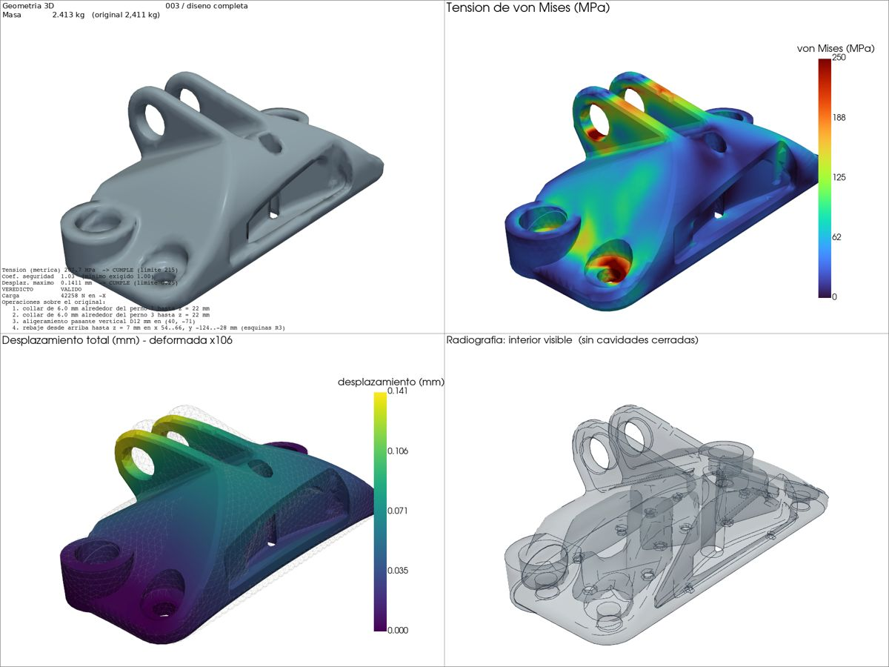
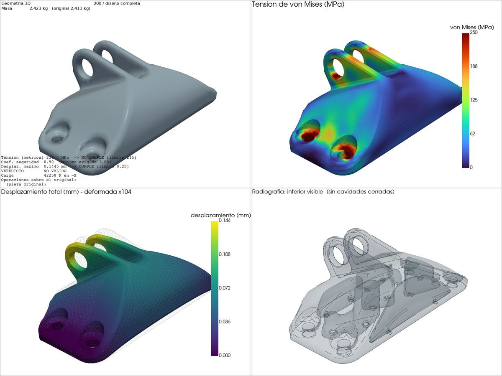

# Registro de iteraciones (changelog de la pieza)

Carga 42258 N | limite 215 MPa (coef. de seguridad >= 1.00) y 0.25 mm | reglas: [DESIGN_RULES.md](../../DESIGN_RULES.md) | la mas reciente arriba

## Iteracion 6 - ACEPTADA: R1 aligeramiento pasante vertical D16 mm en (-20, -26)

*2026-11-23 20:27*

- **Pieza de partida:** 2.3652 kg | 195.3 MPa | CS 1.10 | 0.142 mm
- **Por que (regla R1):** Toda la columna en (-20, -26) hasta 11 mm de radio trabaja como maximo al 24 % del limite (umbral de material ocioso: 25 %): no esta en el camino de la carga. Con Kt ~ 3 el borde del agujero quedaria por debajo del ~72 %; el pico (195 MPa, en alrededor de los pernos traseros) esta a 121 mm. Evidencia: en los 16 disenos publicados VALIDOS, la mitad mas ligera tiene un 25 % de material ocioso (por debajo del 15 % de su pico) frente al 51 % del original; en ese grupo, a mas material ocioso mas masa (Spearman +0.55). Agujeros pasantes: en ese grupo, a mas agujeros pasantes (genus de la malla) menos masa (Spearman -0.11, p = 0.69).
- **Se esperaba:** la tension maxima casi no cambia (prevision rapida: 2.3360 kg | 197.6 MPa | CS 1.09 | 0.143 mm)
- **Resultado (malla completa):** 2.3358 kg | 197.2 MPa | CS 1.09 | 0.143 mm (tension +0.9 %, masa -29 g)
- **Decision:** ACEPTADA - cumple y mejora al mejor (puntuacion 2.3652 -> 2.3358; masa 2.3652 -> 2.3358 kg)
- Descartada en la evaluacion rapida: [R11] sustituir el bloque x -38..58, y -128..-100 (por encima de z = 5) por 2 nervio(s) en la trayectoria de la carga -> la geometria no se puede construir (operacion 6 (rebaje): el rebaje ha fallado (2 solidos, resto 11 mm3))
- Descartada en la evaluacion rapida: [R2] rebaje desde arriba hasta z = 5 mm en x -30..-18, y -40..-20 mm (esquinas R3) -> pasa la evaluacion rapida (2.3651 kg | 194.3 MPa | CS 1.11 | 0.142 mm) pero otra es mas prometedora; se podra proponer de nuevo

## Iteracion 5 - RECHAZADA: R2 rebaje desde arriba hasta z = 5 mm en x -30..-18, y -40..-8 mm (esquinas R3)

*2026-11-23 20:23*

- **Pieza de partida:** 2.3652 kg | 195.3 MPa | CS 1.10 | 0.142 mm
- **Por que (regla R2):** Todo el material por encima de z = 5 mm en esa zona (y 4 mm alrededor) trabaja por debajo del 25 % del limite: ni el momento de vuelco ni el cortante pasan por ahi. El rebaje deja un suelo horizontal (imprimible) y acuerdos redondeados. Evidencia: en los 16 disenos publicados VALIDOS, la mitad mas ligera tiene un 25 % de material ocioso (por debajo del 15 % de su pico) frente al 51 % del original; en ese grupo, a mas material ocioso mas masa (Spearman +0.55).
- **Se esperaba:** mediana de las 2 veces que se ha aplicado: -0.0 % (prevision rapida: 2.3647 kg | 194.4 MPa | CS 1.11 | 0.142 mm)
- **Resultado (malla completa):** 2.3654 kg | 195.4 MPa | CS 1.10 | 0.142 mm (tension +0.0 %, masa +0 g)
- **Decision:** RECHAZADA - cumple pero no mejora al mejor (puntuacion 2.3654 frente a 2.3652)
- Descartada en la evaluacion rapida: [R11] sustituir el bloque x -30..54, y -48..-20 (por encima de z = 5) por 2 nervio(s) en la trayectoria de la carga -> la malla o el calculo han fallado (RuntimeError: todas las estrategias de malla/solucion fallaron: malla alg10 h6.00: Exception: HXT 3D mesh failed | malla)
- Descartada en la evaluacion rapida: [R1] aligeramiento pasante vertical D20 mm en (-23, -26) -> la malla o el calculo han fallado (RuntimeError: todas las estrategias de malla/solucion fallaron: malla alg10 h6.00: Exception: HXT 3D mesh failed | malla)

## Iteracion 4 - ACEPTADA: R2 rebaje desde arriba hasta z = 9 mm en x 42..54, y -100..-52 mm (esquinas R3)

*2026-11-23 20:17*

- **Pieza de partida:** 2.4126 kg | 207.7 MPa | CS 1.03 | 0.141 mm
- **Por que (regla R2):** Todo el material por encima de z = 9 mm en esa zona (y 4 mm alrededor) trabaja por debajo del 25 % del limite: ni el momento de vuelco ni el cortante pasan por ahi. El rebaje deja un suelo horizontal (imprimible) y acuerdos redondeados. Evidencia: en los 16 disenos publicados VALIDOS, la mitad mas ligera tiene un 25 % de material ocioso (por debajo del 15 % de su pico) frente al 51 % del original; en ese grupo, a mas material ocioso mas masa (Spearman +0.55).
- **Se esperaba:** la tension maxima casi no cambia (prevision rapida: 2.3656 kg | 208.6 MPa | CS 1.03 | 0.142 mm)
- **Resultado (malla completa):** 2.3652 kg | 195.3 MPa | CS 1.10 | 0.142 mm (tension -6.0 %, masa -47 g)
- **Decision:** ACEPTADA - cumple y mejora al mejor (puntuacion 2.4126 -> 2.3652; masa 2.4126 -> 2.3652 kg)
- Descartada en la evaluacion rapida: [R11] sustituir el bloque x 22..58, y -128..-24 (por encima de z = 5) por 1 nervio(s) en la trayectoria de la carga -> la malla o el calculo han fallado (RuntimeError: todas las estrategias de malla/solucion fallaron: malla alg10 h6.00: Exception: HXT 3D mesh failed | malla)
- Descartada en la evaluacion rapida: [R1] aligeramiento pasante vertical D20 mm en (52, -56) -> tension prevista 245 MPa: supera el limite (215 MPa)

## Iteracion 3 - ACEPTADA: R2 rebaje desde arriba hasta z = 7 mm en x 54..66, y -124..-28 mm (esquinas R3)

*2026-11-23 20:08*

- **Pieza de partida:** 2.4704 kg | 196.2 MPa | CS 1.10 | 0.140 mm
- **Por que (regla R2):** Todo el material por encima de z = 7 mm en esa zona (y 4 mm alrededor) trabaja por debajo del 25 % del limite: ni el momento de vuelco ni el cortante pasan por ahi. El rebaje deja un suelo horizontal (imprimible) y acuerdos redondeados. Evidencia: en los 16 disenos publicados VALIDOS, la mitad mas ligera tiene un 25 % de material ocioso (por debajo del 15 % de su pico) frente al 51 % del original; en ese grupo, a mas material ocioso mas masa (Spearman +0.55).
- **Se esperaba:** la tension maxima casi no cambia (prevision rapida: 2.4132 kg | 196.1 MPa | CS 1.10 | 0.141 mm)
- **Resultado (malla completa):** 2.4126 kg | 207.7 MPa | CS 1.03 | 0.141 mm (tension +5.9 %, masa -58 g)
- **Decision:** ACEPTADA - cumple y mejora al mejor (puntuacion 2.4704 -> 2.4126; masa 2.4704 -> 2.4126 kg)
- Descartada en la evaluacion rapida: [R11] sustituir el bloque x -42..54, y -48..-20 (por encima de z = 5) por 2 nervio(s) en la trayectoria de la carga -> la malla o el calculo han fallado (RuntimeError: todas las estrategias de malla/solucion fallaron: malla alg10 h6.00: Exception: HXT 3D mesh failed | malla)
- Descartada en la evaluacion rapida: [R1] aligeramiento pasante vertical D20 mm en (52, -56) -> pasa la evaluacion rapida (2.4284 kg | 197.1 MPa | CS 1.09 | 0.140 mm) pero otra es mas prometedora; se podra proponer de nuevo
- Nota: R10: ya no queda material por debajo del 15 % del limite donde quepa un corte -> se pasa al umbral del 25 %

## Iteracion 2 - ACEPTADA: R1 aligeramiento pasante vertical D12 mm en (40, -71)

*2026-11-23 20:01*

- **Pieza de partida:** 2.5044 kg | 201.9 MPa | CS 1.06 | 0.139 mm
- **Por que (regla R1):** Toda la columna en (40, -71) hasta 9 mm de radio trabaja como maximo al 12 % del limite (umbral de material ocioso: 15 %): no esta en el camino de la carga. Con Kt ~ 3 el borde del agujero quedaria por debajo del ~36 %; el pico (202 MPa, en orejetas del bulon) esta a 46 mm. Evidencia: en los 16 disenos publicados VALIDOS, la mitad mas ligera tiene un 25 % de material ocioso (por debajo del 15 % de su pico) frente al 51 % del original; en ese grupo, a mas material ocioso mas masa (Spearman +0.55). Agujeros pasantes: en ese grupo, a mas agujeros pasantes (genus de la malla) menos masa (Spearman -0.11, p = 0.69).
- **Se esperaba:** la tension maxima casi no cambia (prevision rapida: 2.4704 kg | 204.4 MPa | CS 1.05 | 0.140 mm)
- **Resultado (malla completa):** 2.4704 kg | 196.2 MPa | CS 1.10 | 0.140 mm (tension -2.8 %, masa -34 g)
- **Decision:** ACEPTADA - cumple y mejora al mejor (puntuacion 2.5044 -> 2.4704; masa 2.5044 -> 2.4704 kg)
- Descartada en la evaluacion rapida: [R11] sustituir el bloque x 26..66, y -128..-16 (por encima de z = 5) por 1 nervio(s) en la trayectoria de la carga -> la malla o el calculo han fallado (RuntimeError: todas las estrategias de malla/solucion fallaron: malla alg10 h6.00: Exception: HXT 3D mesh failed | malla)
- Descartada en la evaluacion rapida: [R2] rebaje desde arriba hasta z = 9 mm en x 42..62, y -88..-64 mm (esquinas R4) -> pasa la evaluacion rapida (2.4711 kg | 204.5 MPa | CS 1.05 | 0.140 mm) pero otra es mas prometedora; se podra proponer de nuevo

## Iteracion 1 - ACEPTADA: R4 collar de 6 mm en los pernos 1 y 3

*2026-11-23 19:40*

- **Pieza de partida:** 2.4234 kg | 238.0 MPa | CS 0.90 | 0.144 mm
- **Por que (regla R4):** El pico (238 MPa, 111 % del limite) esta junto al alojamiento del perno 1 (concentracion local x2.4). El momento de vuelco de la carga (F x 44,7 mm) llega a los pernos por una seccion pequena alrededor del alojamiento: un collar de 6 mm aumenta esa seccion. El perno 3 es su simetrico respecto al plano medio de las orejetas y trabaja igual. Evidencia: prueba directa en ANSYS sobre el original (bitacora 22/11): collares de 6 mm -> pico de 238 a 203 MPa (-15 %) con +159 g (escalado lineal a 42258 N); en 228 disenos de la familia refuerzo, mas collar delantero -> menos tension (Spearman -0.25, p = 0.00014); material junto a los pernos delanteros: original 25 cm3, mediana del grupo de referencia 37 cm3; en 104 de 297 disenos publicados calculados el pico esta junto a un perno.
- **Se esperaba:** del orden de -15 % (collares anteriores: -15 % con 6 mm) (prevision rapida: 2.5045 kg | 221.9 MPa | CS 0.97 | 0.139 mm)
- **Resultado (malla completa):** 2.5044 kg | 201.9 MPa | CS 1.06 | 0.139 mm (tension -15.2 %, masa +81 g)
- **Decision:** ACEPTADA - primera pieza que CUMPLE
- Descartada en la evaluacion rapida: [R4] collar de 4 mm en los pernos 1 y 3 -> pasa la evaluacion rapida (2.4652 kg | 232.7 MPa | CS 0.92 | 0.142 mm) pero otra es mas prometedora; se podra proponer de nuevo
- Nota: R5 (Alojamiento de la cabeza mas ancho con acuerdo de fondo mayor) desactivada: los datos la contradicen

## Iteracion 0 - INICIO

*2026-11-23 19:40*

- **Resultado (malla completa):** 2.4234 kg | 238.0 MPa | CS 0.90 | 0.144 mm
- **Decision:** INICIO - NO cumple (238 MPa > 215): primero hay que reforzar donde esta el pico

